# Data lineage: flows → SharePoint lists → Power BI models

*Generated by `scripts/build_docs.py`. A flow is **documented** when the Dashboards Master File names it for a table, and **inferred** when the Flow Register's description mentions the list (for example "the Applications list") or the flow is named after it. Inferred links are leads to confirm, not facts.*

- [SharePoint lists](#sharepoint-lists)
- [Lists → models](#lists--models)
- [Flows → lists](#flows--lists)
- [Other sources](#other-sources)
- [Flows](#flows)

## SharePoint lists

| List | Site | List ID | Used by (model: table) | Flows: documented | Flows: inferred |
|---|---|---|---|---|---|
| **Applications** | AuthorisationsandAdvisoryUnit-AuthandAdvisoryUnit | `62881d43-cd6b-4be9-b785-d4cde2bfcfb5` | [Compliance Monitoring Dash](models/Compliance%20Monitoring%20Dash.md#applications): Applications [ELT Frontpage](models/ELT%20Frontpage.md#applications): Applications [PEPA Exec Dash](models/PEPA%20Exec%20Dash.md#applications): Applications [PEPA Management Dash](models/PEPA%20Management%20Dash.md#applications): Applications | [PopulateAAOUIDs](lineage.md#populateaaouids), [PopulateADRUIDs](lineage.md#populateadruids), [PopulateASBUIDs](lineage.md#populateasbuids), [PopulateCCRUIDs](lineage.md#populateccruids), [PopulateCSLUIDs](lineage.md#populatecsluids), [PopulateHSCUIDs](lineage.md#populatehscuids), [PopulateOCDUIDs](lineage.md#populateocduids), [PopulatePCRUIDs](lineage.md#populatepcruids) | [AAOCloseDate](lineage.md#aaoclosedate), [ADRCloseDate](lineage.md#adrclosedate), [ASBCloseDate](lineage.md#asbclosedate), [AuditTransfer](lineage.md#audittransfer), [CCRCloseDate](lineage.md#ccrclosedate), [CloseWithoutNotificationDates](lineage.md#closewithoutnotificationdates), [ExemptionsCloseDate](lineage.md#exemptionsclosedate), [ExemptionsToPEPA](lineage.md#exemptionstopepa), [HSCCloseDate](lineage.md#hscclosedate), [OCDCloseDate](lineage.md#ocdclosedate), [PCRCloseDate](lineage.md#pcrclosedate), [PEPAApplicationsArchive](lineage.md#pepaapplicationsarchive), [RemoveDeleted](lineage.md#removedeleted) |
| **ApplicationsArchive** | AuthorisationsandAdvisoryUnit-AuthandAdvisoryUnit | `201fb453-7d3e-4aa5-9cec-35bddd4a5b59` | [ELT Frontpage](models/ELT%20Frontpage.md#applicationsarchive): ApplicationsArchive [PEPA Exec Dash](models/PEPA%20Exec%20Dash.md#applicationsarchive): ApplicationsArchive [PEPA Management Dash](models/PEPA%20Management%20Dash.md#applicationsarchive): ApplicationsArchive |  | [PEPAApplicationsArchive](lineage.md#pepaapplicationsarchive) |
| **Assignments** | AuthorisationsandAdvisoryUnit-AuthandAdvisoryUnit | `c3b18339-2ff6-4eeb-a854-75671434e0a8` | [Compliance Monitoring Dash](models/Compliance%20Monitoring%20Dash.md#assignments): Assignments [PEPA Management Dash](models/PEPA%20Management%20Dash.md#assignments): Assignments |  |  |
| **Commentary** | AuthorisationsandAdvisoryUnit-AuthandAdvisoryUnit | `458e2e36-d56a-4eec-9ba9-ffdc0b1faaff` | [Compliance Monitoring Dash](models/Compliance%20Monitoring%20Dash.md#commentary): Commentary [ELT Frontpage](models/ELT%20Frontpage.md#commentary): Commentary [ELT Permit Timeliness Report](models/ELT%20Permit%20Timeliness%20Report.md#commentary): Commentary [PEPA Management Dash](models/PEPA%20Management%20Dash.md#commentary): Commentary [Permit SPE Dash](models/Permit%20SPE%20Dash.md#commentary): Commentary | [Commnetary Reminder](lineage.md#commnetary-reminder), [Pending Commentary Reminder](lineage.md#pending-commentary-reminder) |  |
| **Complaints&Audits** | AuthorisationsandAdvisoryUnit-AuthandAdvisoryUnit | `52205575-9958-4af5-a218-240fc26e58a0` | [Compliance Monitoring Dash](models/Compliance%20Monitoring%20Dash.md#complaintsaudits): Complaints&Audits [PEPA Management Dash](models/PEPA%20Management%20Dash.md#complaintsaudits): Complaints&Audits | [AuditTransfer](lineage.md#audittransfer), [ComplaintTransfer](lineage.md#complainttransfer) |  |
| **FeeSchedule** | AuthorisationsandAdvisoryUnit-AuthandAdvisoryUnit | `72470e84-c556-4f6d-9f54-086849abd9cf` | [ELT Frontpage](models/ELT%20Frontpage.md#feeschedule): FeeSchedule [PEPA Exec Dash](models/PEPA%20Exec%20Dash.md#feeschedule): FeeSchedule |  |  |
| **PECPR** | AuthorisationsandAdvisoryUnit-AuthandAdvisoryUnit | `4ff28259-630c-45d4-b93b-caa923d772fd` | [ELT Frontpage](models/ELT%20Frontpage.md#pecpr): PECPR [ELT Permit Timeliness Report](models/ELT%20Permit%20Timeliness%20Report.md#pecpr): PECPR [Permit SPE Dash](models/Permit%20SPE%20Dash.md#pecpr): PECPR |  | [PCRCloseDate](lineage.md#pcrclosedate), [PopulatePCRUIDs](lineage.md#populatepcruids) |
| **PermitForecast** | AuthorisationsandAdvisoryUnit-AuthandAdvisoryUnit | `780f50e3-e8cb-407e-a0e4-082917ed4d76` | [ELT Frontpage](models/ELT%20Frontpage.md#permitforecast): PermitForecast [Permit Forecast](models/Permit%20Forecast.md#permitforecast): PermitForecast | [UpdateActuals](lineage.md#updateactuals), [UpdateForecasts](lineage.md#updateforecasts) |  |
| **RiskAssessments** | AuthorisationsandAdvisoryUnit-AuthandAdvisoryUnit | `47f0b78a-3051-4c7e-a9db-eb2c37d01223` | [ELT Permit Timeliness Report](models/ELT%20Permit%20Timeliness%20Report.md#riskassessments): RiskAssessments |  | [CCRCloseDate](lineage.md#ccrclosedate), [OCDCloseDate](lineage.md#ocdclosedate) |
| **RoleTable** | AuthorisationsandAdvisoryUnit-AuthandAdvisoryUnit | `a15c2d78-e7b4-4bc0-bf62-53053794b466` | [Compliance Monitoring Dash](models/Compliance%20Monitoring%20Dash.md#roletable): RoleTable [ELT Frontpage](models/ELT%20Frontpage.md#roletable): RoleTable [PEPA Exec Dash](models/PEPA%20Exec%20Dash.md#roletable): RoleTable [PEPA Management Dash](models/PEPA%20Management%20Dash.md#roletable): RoleTable | [UpdateFullNames](lineage.md#updatefullnames) |  |
| **TimesheetArchive** | AuthorisationsandAdvisoryUnit-AuthandAdvisoryUnit | `4fcaed04-b6a7-49f1-9622-4fb8c388c4f7` | [Compliance Monitoring Dash](models/Compliance%20Monitoring%20Dash.md#timesheetarchive): TimesheetArchive [ELT Frontpage](models/ELT%20Frontpage.md#timesheetarchive): TimesheetArchive [ELT Permit Timeliness Report](models/ELT%20Permit%20Timeliness%20Report.md#timesheetarchive): TimesheetArchive [PEPA Exec Dash](models/PEPA%20Exec%20Dash.md#timesheetarchive): TimesheetArchive [PEPA Management Dash](models/PEPA%20Management%20Dash.md#timesheetarchive): TimesheetArchive | [Timesheet Archive](lineage.md#timesheet-archive) |  |
| **TimesheetData** | AuthorisationsandAdvisoryUnit-AuthandAdvisoryUnit | `5493e186-37a5-4e3b-b31d-5de07b89f712` | [Compliance Monitoring Dash](models/Compliance%20Monitoring%20Dash.md#timesheetdata): TimesheetData [ELT Frontpage](models/ELT%20Frontpage.md#timesheetdata): TimesheetData [ELT Permit Timeliness Report](models/ELT%20Permit%20Timeliness%20Report.md#timesheetdata): TimesheetData [PEPA Exec Dash](models/PEPA%20Exec%20Dash.md#timesheetdata): TimesheetData [PEPA Management Dash](models/PEPA%20Management%20Dash.md#timesheetdata): TimesheetData |  | [PEPA Reminder Email](lineage.md#pepa-reminder-email), [Timesheet Archive](lineage.md#timesheet-archive) |
| **Junctions** | COLLABEnterprisePlanning | `d516d85e-011b-49d7-ac9b-bd9f5bcb4688` | [Programme Risk](models/Programme%20Risk.md#junctions): Junctions |  |  |
| **RiskRegister** | COLLABEnterprisePlanning | `2ccf25d1-972a-4a32-9f3f-ce5b9eff5d15` | [Programme Risk](models/Programme%20Risk.md#riskregister): RiskRegister |  |  |
| **TreatmentRegister** | COLLABEnterprisePlanning | `3a000d89-0850-417a-aac6-6670c537cac0` | [Programme Risk](models/Programme%20Risk.md#treatmentregister): TreatmentRegister |  |  |
| **Users** | COLLABEnterprisePlanning | `375dd0cc-f2de-48f8-8863-81b41a759523` | [Programme Risk](models/Programme%20Risk.md#users): Users |  |  |
| **Adventure Activities** | Org_Authorisations | `507b9f5d-c8ee-4a2a-be55-86a54b0385e5` | [ELT Frontpage](models/ELT%20Frontpage.md#adventure-activities): Adventure Activities [ELT Permit Timeliness Report](models/ELT%20Permit%20Timeliness%20Report.md#adventure-activities): Adventure Activities [Permit Forecast](models/Permit%20Forecast.md#aao-new): AAO New [Permit SPE Dash](models/Permit%20SPE%20Dash.md#adventure-activities): Adventure Activities |  | [AAOCloseDate](lineage.md#aaoclosedate), [PopulateAAOUIDs](lineage.md#populateaaouids) |
| **Amusement Device Registrations** | Org_Authorisations | `6d4d1af7-0d18-4de2-8ec8-d10bb6f250cf` | [ELT Frontpage](models/ELT%20Frontpage.md#amusement-device-registrations): Amusement Device Registrations [ELT Permit Timeliness Report](models/ELT%20Permit%20Timeliness%20Report.md#amusement-device-registrations): Amusement Device Registrations [Permit SPE Dash](models/Permit%20SPE%20Dash.md#amusement-device-registrations): Amusement Device Registrations |  | [ADRCloseDate](lineage.md#adrclosedate), [PopulateADRUIDs](lineage.md#populateadruids) |
| **Asbestos Applications** | Org_Authorisations | `57f4b395-126f-4912-8cc2-d7f3dbd502f2` | [ELT Frontpage](models/ELT%20Frontpage.md#asbestos-applications): Asbestos Applications [ELT Permit Timeliness Report](models/ELT%20Permit%20Timeliness%20Report.md#asbestos-applications): Asbestos Applications [Permit Forecast](models/Permit%20Forecast.md#asb-new): ASB New [Permit SPE Dash](models/Permit%20SPE%20Dash.md#asbestos-applications): Asbestos Applications |  | [ASBCloseDate](lineage.md#asbclosedate), [CloseWithoutNotificationDates](lineage.md#closewithoutnotificationdates), [PopulateASBUIDs](lineage.md#populateasbuids) |
| **Diving Authorisations** | Org_Authorisations | `f686b5c5-893a-4685-baa2-6c2c1d37b167` | [ELT Frontpage](models/ELT%20Frontpage.md#diving-authorisations): Diving Authorisations [ELT Permit Timeliness Report](models/ELT%20Permit%20Timeliness%20Report.md#diving-authorisations): Diving Authorisations [Permit Forecast](models/Permit%20Forecast.md#diving-forecast): Diving Forecast [Permit SPE Dash](models/Permit%20SPE%20Dash.md#diving-authorisations): Diving Authorisations |  | [OCDCloseDate](lineage.md#ocdclosedate), [PopulateOCDUIDs](lineage.md#populateocduids) |
| **FakeWarehouse** | Org_Authorisations | `60a3406a-a6d6-41fa-88d7-d859711ea1a0` | [ELT Frontpage](models/ELT%20Frontpage.md#fakewarehouse): FakeWarehouse [ELT Permit Timeliness Report](models/ELT%20Permit%20Timeliness%20Report.md#fakewarehouse): FakeWarehouse [Permit SPE Dash](models/Permit%20SPE%20Dash.md#fakewarehouse): FakeWarehouse | [PECPR Warehousing](lineage.md#pecpr-warehousing), [Update Authorisations Warehousing](lineage.md#update-authorisations-warehousing), [Warehouse Old Certifications & Exemptions Apps](lineage.md#warehouse-old-certifications--exemptions-apps) |  |
| **Compliance Certifier Application Tracker** | Org_CertEx | `85ca55f6-57c1-44ab-b2a3-85d228b6cd80` | [ELT Frontpage](models/ELT%20Frontpage.md#compliance-certifier-application-tracker): Compliance Certifier Application Tracker [ELT Permit Timeliness Report](models/ELT%20Permit%20Timeliness%20Report.md#compliance-certifier-application-tracker): Compliance Certifier Application Tracker [Permit SPE Dash](models/Permit%20SPE%20Dash.md#compliance-certifier-application-tracker): Compliance Certifier Application Tracker |  | [CCRCloseDate](lineage.md#ccrclosedate), [PopulateCCRUIDs](lineage.md#populateccruids) |
| **CSL** | Org_CertEx | `1497688c-5f85-40d2-b461-da6c4399e020` | [ELT Frontpage](models/ELT%20Frontpage.md#csl): CSL [ELT Permit Timeliness Report](models/ELT%20Permit%20Timeliness%20Report.md#csl): CSL [Permit Forecast](models/Permit%20Forecast.md#csl): CSL [Permit SPE Dash](models/Permit%20SPE%20Dash.md#csl): CSL |  | [CSLCloseDate](lineage.md#cslclosedate), [CloseWithoutNotificationDates](lineage.md#closewithoutnotificationdates), [PopulateCSLUIDs](lineage.md#populatecsluids) |
| **Exemptions** | Org_CertEx | `306e9ab9-5b7b-4244-b20c-92ae230293e6` | [ELT Permit Timeliness Report](models/ELT%20Permit%20Timeliness%20Report.md#exemptions): Exemptions |  | [ExemptionsCloseDate](lineage.md#exemptionsclosedate), [ExemptionsToPEPA](lineage.md#exemptionstopepa), [Warehouse Old Certifications & Exemptions Apps](lineage.md#warehouse-old-certifications--exemptions-apps) |
| **HS Controls** | Org_CertEx | `5ee6f094-130d-4ede-88bc-d9b94dc8d18a` | [ELT Frontpage](models/ELT%20Frontpage.md#hs-controls): HS Controls [ELT Permit Timeliness Report](models/ELT%20Permit%20Timeliness%20Report.md#hs-controls): HS Controls [Permit SPE Dash](models/Permit%20SPE%20Dash.md#hs-controls): HS Controls |  | [HSCCloseDate](lineage.md#hscclosedate), [PopulateHSCUIDs](lineage.md#populatehscuids) |
| **Audits** | Portal_RAA | `0696da9a-17b0-4987-8347-63ebb56e2d84` | [Compliance Monitoring Dash](models/Compliance%20Monitoring%20Dash.md#audits): Audits [PEPA Management Dash](models/PEPA%20Management%20Dash.md#audits): Audits | [AuditTransfer](lineage.md#audittransfer) |  |
| **Complaints Tracker** | Portal_RAA | `6a5b706a-6f92-4788-a5a3-f4d3770bf54d` | [Compliance Monitoring Dash](models/Compliance%20Monitoring%20Dash.md#complaints-tracker): Complaints Tracker [PEPA Management Dash](models/PEPA%20Management%20Dash.md#complaints-tracker): Complaints Tracker | [ComplaintTransfer](lineage.md#complainttransfer) | [UpdateAuthHolder](lineage.md#updateauthholder) |

## Lists → models

```mermaid
flowchart LR
    subgraph S0["AuthorisationsandAdvisoryUnit-AuthandAdvisoryUnit"]
        L0["Applications"]
        L1["ApplicationsArchive"]
        L2["Assignments"]
        L3["Commentary"]
        L4["Complaints&Audits"]
        L5["FeeSchedule"]
        L6["PECPR"]
        L7["PermitForecast"]
        L8["RiskAssessments"]
        L9["RoleTable"]
        L10["TimesheetArchive"]
        L11["TimesheetData"]
    end
    subgraph S1["COLLABEnterprisePlanning"]
        L12["Junctions"]
        L13["RiskRegister"]
        L14["TreatmentRegister"]
        L15["Users"]
    end
    subgraph S2["Org_Authorisations"]
        L16["Adventure Activities"]
        L17["Amusement Device Registrations"]
        L18["Asbestos Applications"]
        L19["Diving Authorisations"]
        L20["FakeWarehouse"]
    end
    subgraph S3["Org_CertEx"]
        L21["Compliance Certifier Application Tracker"]
        L22["CSL"]
        L23["Exemptions"]
        L24["HS Controls"]
    end
    subgraph S4["Portal_RAA"]
        L25["Audits"]
        L26["Complaints Tracker"]
    end
    M0(["Compliance Monitoring Dash"])
    M1(["ELT Frontpage"])
    M2(["ELT Permit Timeliness Report"])
    M3(["PEPA Exec Dash"])
    M4(["PEPA Management Dash"])
    M5(["Permit Forecast"])
    M6(["Permit SPE Dash"])
    M7(["Programme Risk"])
    M8(["Survey Dash"])
    L0 --> M0
    L0 --> M1
    L0 --> M3
    L0 --> M4
    L1 --> M1
    L1 --> M3
    L1 --> M4
    L2 --> M0
    L2 --> M4
    L3 --> M0
    L3 --> M1
    L3 --> M2
    L3 --> M4
    L3 --> M6
    L4 --> M0
    L4 --> M4
    L5 --> M1
    L5 --> M3
    L6 --> M1
    L6 --> M2
    L6 --> M6
    L7 --> M1
    L7 --> M5
    L8 --> M2
    L9 --> M0
    L9 --> M1
    L9 --> M3
    L9 --> M4
    L10 --> M0
    L10 --> M1
    L10 --> M2
    L10 --> M3
    L10 --> M4
    L11 --> M0
    L11 --> M1
    L11 --> M2
    L11 --> M3
    L11 --> M4
    L12 --> M7
    L13 --> M7
    L14 --> M7
    L15 --> M7
    L16 --> M1
    L16 --> M2
    L16 --> M5
    L16 --> M6
    L17 --> M1
    L17 --> M2
    L17 --> M6
    L18 --> M1
    L18 --> M2
    L18 --> M5
    L18 --> M6
    L19 --> M1
    L19 --> M2
    L19 --> M5
    L19 --> M6
    L20 --> M1
    L20 --> M2
    L20 --> M6
    L21 --> M1
    L21 --> M2
    L21 --> M6
    L22 --> M1
    L22 --> M2
    L22 --> M5
    L22 --> M6
    L23 --> M2
    L24 --> M1
    L24 --> M2
    L24 --> M6
    L25 --> M0
    L25 --> M4
    L26 --> M0
    L26 --> M4
```

## Flows → lists

Solid arrow = documented in the Master File; dotted = inferred.

```mermaid
flowchart LR
    F0["AAOCloseDate"]
    F1["ADRCloseDate"]
    F2["ASBCloseDate"]
    F3["AuditTransfer"]
    F4["CCRCloseDate"]
    F5["CSLCloseDate"]
    F6["CloseWithoutNotificationDates"]
    F7["Commnetary Reminder"]
    F8["ComplaintTransfer"]
    F9["ExemptionsCloseDate"]
    F10["ExemptionsToPEPA"]
    F11["HSCCloseDate"]
    F12["OCDCloseDate"]
    F13["PCRCloseDate"]
    F14["PECPR Warehousing"]
    F15["PEPA Reminder Email"]
    F16["PEPAApplicationsArchive"]
    F17["Pending Commentary Reminder"]
    F18["PopulateAAOUIDs"]
    F19["PopulateADRUIDs"]
    F20["PopulateASBUIDs"]
    F21["PopulateCCRUIDs"]
    F22["PopulateCSLUIDs"]
    F23["PopulateHSCUIDs"]
    F24["PopulateOCDUIDs"]
    F25["PopulatePCRUIDs"]
    F26["RemoveDeleted"]
    F27["Timesheet Archive"]
    F28["Update Authorisations Warehousing"]
    F29["UpdateActuals"]
    F30["UpdateAuthHolder"]
    F31["UpdateForecasts"]
    F32["UpdateFullNames"]
    F33["Warehouse Old Certifications & Exemptions Apps"]
    L0[("Applications")]
    L1[("ApplicationsArchive")]
    L3[("Commentary")]
    L4[("Complaints&Audits")]
    L6[("PECPR")]
    L7[("PermitForecast")]
    L8[("RiskAssessments")]
    L9[("RoleTable")]
    L10[("TimesheetArchive")]
    L11[("TimesheetData")]
    L16[("Adventure Activities")]
    L17[("Amusement Device Registrations")]
    L18[("Asbestos Applications")]
    L19[("Diving Authorisations")]
    L20[("FakeWarehouse")]
    L21[("Compliance Certifier Application Tracker")]
    L22[("CSL")]
    L23[("Exemptions")]
    L24[("HS Controls")]
    L25[("Audits")]
    L26[("Complaints Tracker")]
    F18 --> L0
    F19 --> L0
    F20 --> L0
    F21 --> L0
    F22 --> L0
    F23 --> L0
    F24 --> L0
    F25 --> L0
    F0 -.-> L0
    F1 -.-> L0
    F2 -.-> L0
    F3 -.-> L0
    F4 -.-> L0
    F6 -.-> L0
    F9 -.-> L0
    F10 -.-> L0
    F11 -.-> L0
    F12 -.-> L0
    F13 -.-> L0
    F16 -.-> L0
    F26 -.-> L0
    F16 -.-> L1
    F7 --> L3
    F17 --> L3
    F3 --> L4
    F8 --> L4
    F13 -.-> L6
    F25 -.-> L6
    F29 --> L7
    F31 --> L7
    F4 -.-> L8
    F12 -.-> L8
    F32 --> L9
    F27 --> L10
    F15 -.-> L11
    F27 -.-> L11
    F0 -.-> L16
    F18 -.-> L16
    F1 -.-> L17
    F19 -.-> L17
    F2 -.-> L18
    F6 -.-> L18
    F20 -.-> L18
    F12 -.-> L19
    F24 -.-> L19
    F14 --> L20
    F28 --> L20
    F33 --> L20
    F4 -.-> L21
    F21 -.-> L21
    F5 -.-> L22
    F6 -.-> L22
    F22 -.-> L22
    F9 -.-> L23
    F10 -.-> L23
    F33 -.-> L23
    F11 -.-> L24
    F23 -.-> L24
    F3 --> L25
    F8 --> L26
    F30 -.-> L26
```

## Other sources

| Source | Kind | Used by (model: table) |
|---|---|---|
| AAO (new) Forecast Data For History.xlsm (team_regulatory_intelligence) | Excel file on SharePoint | [Permit Forecast](models/Permit%20Forecast.md#aao-archived-new): AAO Archived New |
| AAO H5.xlsm (team_regulatory_intelligence) | Excel file on SharePoint | [Permit Forecast](models/Permit%20Forecast.md#aao-renewal-archive): AAO Renewal Archive |
| ASB1.1.xlsx (team_regulatory_intelligence) | Excel file on SharePoint | [Permit Forecast](models/Permit%20Forecast.md#asb-archived-new): ASB Archived New |
| Asbestos Assessor Register 7-10-25 10-30-16 AM.xlsx (team_regulatory_intelligence) | Excel file on SharePoint | [Permit Forecast](models/Permit%20Forecast.md#asbestos-assessor-register): Asbestos Assessor Register |
| Asbestos Removalist Register 7-10-25 10-29-45 AM.xlsx (team_regulatory_intelligence) | Excel file on SharePoint | [Permit Forecast](models/Permit%20Forecast.md#asb-renewal-forecast): ASB Renewal Forecast |
| Abbreviations | Manual table (Enter Data) | [PEPA Exec Dash](models/PEPA%20Exec%20Dash.md#abbreviations): Abbreviations |
| AuditStageOrder | Manual table (Enter Data) | [Compliance Monitoring Dash](models/Compliance%20Monitoring%20Dash.md#auditstageorder): AuditStageOrder [PEPA Management Dash](models/PEPA%20Management%20Dash.md#auditstageorder): AuditStageOrder |
| AuditStageOrder (2) | Manual table (Enter Data) | [Compliance Monitoring Dash](models/Compliance%20Monitoring%20Dash.md#auditstageorder-2): AuditStageOrder (2) [PEPA Management Dash](models/PEPA%20Management%20Dash.md#auditstageorder-2): AuditStageOrder (2) |
| ComplaintStageOrder | Manual table (Enter Data) | [Compliance Monitoring Dash](models/Compliance%20Monitoring%20Dash.md#complaintstageorder): ComplaintStageOrder [PEPA Management Dash](models/PEPA%20Management%20Dash.md#complaintstageorder): ComplaintStageOrder |
| ComplaintStageOrder (2) | Manual table (Enter Data) | [Compliance Monitoring Dash](models/Compliance%20Monitoring%20Dash.md#complaintstageorder-2): ComplaintStageOrder (2) [PEPA Management Dash](models/PEPA%20Management%20Dash.md#complaintstageorder-2): ComplaintStageOrder (2) |
| FinanceTable | Manual table (Enter Data) | [ELT Frontpage](models/ELT%20Frontpage.md#financetable): FinanceTable |
| Holidays | Manual table (Enter Data) | [Compliance Monitoring Dash](models/Compliance%20Monitoring%20Dash.md#holidays): Holidays [ELT Frontpage](models/ELT%20Frontpage.md#holidays): Holidays [ELT Permit Timeliness Report](models/ELT%20Permit%20Timeliness%20Report.md#holidays): Holidays [PEPA Exec Dash](models/PEPA%20Exec%20Dash.md#holidays): Holidays [PEPA Management Dash](models/PEPA%20Management%20Dash.md#holidays): Holidays [Permit SPE Dash](models/Permit%20SPE%20Dash.md#holidays): Holidays |
| ProblemTable | Manual table (Enter Data) | [ELT Frontpage](models/ELT%20Frontpage.md#problemtable): ProblemTable [Survey Dash](models/Survey%20Dash.md#problemtable): ProblemTable |
| Regimes | Manual table (Enter Data) | [ELT Frontpage](models/ELT%20Frontpage.md#regimes): Regimes [Survey Dash](models/Survey%20Dash.md#regimes): Regimes |
| Salaries | Manual table (Enter Data) | [Compliance Monitoring Dash](models/Compliance%20Monitoring%20Dash.md#salaries): Salaries [ELT Frontpage](models/ELT%20Frontpage.md#salaries): Salaries [PEPA Exec Dash](models/PEPA%20Exec%20Dash.md#salaries): Salaries [PEPA Management Dash](models/PEPA%20Management%20Dash.md#salaries): Salaries |
| ScoreSort | Manual table (Enter Data) | [Programme Risk](models/Programme%20Risk.md#scoresort): ScoreSort |
| StageOrder | Manual table (Enter Data) | [Compliance Monitoring Dash](models/Compliance%20Monitoring%20Dash.md#stageorder): StageOrder [PEPA Management Dash](models/PEPA%20Management%20Dash.md#stageorder): StageOrder |
| StatusSort | Manual table (Enter Data) | [Programme Risk](models/Programme%20Risk.md#statussort): StatusSort |
| https://api.ubiquity.co.nz/surveys/QAAY9WwGI0CmEAjdYuCWbQ/responses | Web API | [Survey Dash](models/Survey%20Dash.md#retrospective-responses): Retrospective Responses |
| https://api.ubiquity.co.nz/surveys/sZXYBBJxa0GLSgjdYIPv9g/responses | Web API | [Permit SPE Dash](models/Permit%20SPE%20Dash.md#survey): Survey [Survey Dash](models/Survey%20Dash.md#live-responses): Live Responses |

## Flows

### AAOCloseDate

*A&A Apps #1 · Cloud Flow*

This flow monitors a SharePoint list for item or file modifications.  When a change is detected, it retrieves related items from another SharePoint list using the UID field. It then runs a series of checks and updates: For each item, it checks if certain fields (like JobClosed, PassedToDecider, DecisionDate, PartialReceived, CompleteReceived, AppType, and Applicant) have changed compared to the trigger data. If a field has changed, it updates the corresponding field in the SharePoint item. Each update is performed inside a loop, ensuring all relevant items are processed.

- **Inferred lists:** Applications (description mentions "Applications list"); Adventure Activities (description mentions "Adventure Activities list")

### ADRCloseDate

*A&A Apps #2 · Cloud Flow*

This flow monitors a SharePoint list for item or file modifications.  When a change is detected, it retrieves related items from another SharePoint list using the UID field. It then runs a series of checks and updates: For each item, it checks if certain fields (like JobClosed, PassedToDecider, DecisionDate, PartialReceived, CompleteReceived, AppType, and Applicant) have changed compared to the trigger data. If a field has changed, it updates the corresponding field in the SharePoint item. Each update is performed inside a loop, ensuring all relevant items are processed.

- **Inferred lists:** Applications (description mentions "Applications list"); Amusement Device Registrations (description mentions "Amusement Device Registrations list")

### ASBCloseDate

*A&A Apps #3 · Cloud Flow*

This flow monitors a SharePoint list for item or file modifications.  When a change is detected, it retrieves related items from another SharePoint list using the UID field. It then runs a series of checks and updates: For each item, it checks if certain fields (like JobClosed, PassedToDecider, DecisionDate, PartialReceived, CompleteReceived, AppType, and Applicant) have changed compared to the trigger data. If a field has changed, it updates the corresponding field in the SharePoint item. Each update is performed inside a loop, ensuring all relevant items are processed.

- **Inferred lists:** Applications (description mentions "Applications list"); Asbestos Applications (description mentions "Asbestos Applications list")

### AuditTransfer

*A&A Apps #4 · Cloud Flow*

This flow automates data entry across SharePoint lists. When a new item is created in a source SharePoint list, the flow triggers and automatically creates related items in two different SharePoint lists, mapping and populating fields from the original entry.  This helps streamline record-keeping and ensures data consistency across multiple lists.

- **Documented for:** [Compliance Monitoring Dash](models/Compliance%20Monitoring%20Dash.md#audits): Audits, [Compliance Monitoring Dash](models/Compliance%20Monitoring%20Dash.md#complaintsaudits): Complaints&Audits, [PEPA Management Dash](models/PEPA%20Management%20Dash.md#audits): Audits, [PEPA Management Dash](models/PEPA%20Management%20Dash.md#complaintsaudits): Complaints&Audits
- **Inferred lists:** Applications (description mentions "Applications list")

### CCRCloseDate

*A&A Apps #5 · Cloud Flow*

This flow monitors a SharePoint list for item or file modifications every 5 minutes. It retrieves related items from another SharePoint list using the UID field. For each related item, it checks if specific fields (JobClosed, PassedToDecider, DecisionDate, PartialReceived, CompleteReceived, AppType) have changed compared to the trigger data, and updates them if needed. Additionally, if no related risk assessment exists and Scope is present, the flow finds the lowest ScopeRank from a reference list and creates a new risk assessment item with the appropriate scores and renewal status. All updates and assessments are performed sequentially.

- **Inferred lists:** Applications (description mentions "Applications list"); RiskAssessments (description mentions "RiskAssessments list"); Compliance Certifier Application Tracker (description mentions "Compliance Certifier Application Tracker list")

### CheckBlankMinutes

*A&A Apps #6 · Cloud Flow*

The purpose of this flow is to automatically calculate and update the "Minutes" field for SharePoint list items where it is missing, based on the difference between "StartTime" and "EndTime."  This ensures your SharePoint data stays accurate and up to date without manual intervention.

- Not linked to any table in the 9 models.

### CloseWithoutNotificationDates

*A&A Apps #7 · Cloud Flow*

This flow automates SharePoint list management tasks. It: Runs daily (triggered by a recurrence). Retrieves items from multiple SharePoint lists based on specific filters. Updates or closes items in lists depending on their status and related data. Deletes items and related records if certain conditions are met. Assigns items to users or updates fields based on lookup results. Overall, it helps keep SharePoint lists up-to-date by processing, updating, or removing records according to business rules.

- **Inferred lists:** Applications (description mentions "Applications List"); Asbestos Applications (description mentions "Asbestos Applications list"); CSL (description mentions "CSL SharePoint list")

### Commnetary Reminder

*A&A Apps #8 · Cloud Flow*

This flow is designed to run weekly and check SharePoint list items for applications that have been open for 20 or more working days and are not closed.  It then checks for recent ELT commentary.  If commentary is older than two weeks or missing, it sends reminder emails to the last person who added time to the application, prompting them to update or add commentary for ELT dashboard visibility.

- **Documented for:** [Compliance Monitoring Dash](models/Compliance%20Monitoring%20Dash.md#commentary): Commentary, [ELT Frontpage](models/ELT%20Frontpage.md#commentary): Commentary, [ELT Permit Timeliness Report](models/ELT%20Permit%20Timeliness%20Report.md#commentary): Commentary, [PEPA Management Dash](models/PEPA%20Management%20Dash.md#commentary): Commentary, [Permit SPE Dash](models/Permit%20SPE%20Dash.md#commentary): Commentary

### ComplaintTransfer

*A&A Apps #9 · Cloud Flow*

This flow is designed to automate actions when a new item is created in the Complaints Tracker list.  It checks for existing items in  Complaints & Audits lists based on the "Complainant" field.  If no matching item is found in either list, it creates a new item in the respective list.  This helps prevent duplicate entries and ensures that new complaints or records are properly logged in the correct SharePoint location.

- **Documented for:** [Compliance Monitoring Dash](models/Compliance%20Monitoring%20Dash.md#complaints-tracker): Complaints Tracker, [Compliance Monitoring Dash](models/Compliance%20Monitoring%20Dash.md#complaintsaudits): Complaints&Audits, [PEPA Management Dash](models/PEPA%20Management%20Dash.md#complaints-tracker): Complaints Tracker, [PEPA Management Dash](models/PEPA%20Management%20Dash.md#complaintsaudits): Complaints&Audits

### CSLCloseDate

*A&A Apps #10 · Cloud Flow*

This flow monitors a SharePoint list for item or file modifications every 5 minutes. When a change is detected, it retrieves related items from another SharePoint list using the UID field. It then runs a series of checks and updates: For each item, it checks if certain fields (like JobClosed, PassedToDecider, DecisionDate, PartialReceived, CompleteReceived, AppType, and Applicant) have changed compared to the trigger data. If a field has changed, it updates the corresponding field in the SharePoint item. Each update is performed inside a loop, ensuring all relevant items are processed.

- **Inferred lists:** CSL (description mentions "CSL SharePoint list")

### ExemptionsCloseDate

*A&A Apps #11 · Cloud Flow*

The purpose of this flow is to monitor the "Exemptions" SharePoint list for any item or file modifications.  When a change occurs, it retrieves related items from the "Applications" SharePoint list by matching the Title field.  For each related application, it checks if specific fields have changed and updates those fields in the Applications list to ensure data consistency between the Exemptions and Applications lists.  This helps keep both lists synchronized and up to date automatically.

- **Inferred lists:** Applications (description mentions "Applications" SharePoint list"); Exemptions (description mentions "Exemptions" SharePoint list")

### ExemptionsToPEPA

*A&A Apps #12 · Cloud Flow*

The purpose of this flow is to automate the transfer of new exemption records into the applications list.  When a new item is created in the Exemptions list, the flow automatically creates a corresponding entry in the Applications list, ensuring data consistency and reducing manual data entry between the two SharePoint lists.

- **Inferred lists:** Applications (description mentions "applications list"); Exemptions (description mentions "Exemptions list")

### HSCCloseDate

*A&A Apps #13 · Cloud Flow*

This flow monitors a SharePoint list for item or file modifications.  When a change is detected, it retrieves related items from another SharePoint list using the UID field.  For each related item, it checks if specific fields (such as JobClosed, PassedToDecider, DecisionDate, PartialReceived, CompleteReceived, AppType, and Applicant) differ from the trigger data. If a difference is found, it updates the corresponding field in the SharePoint item.  All updates are performed within a loop to ensure every relevant item is processed.

- **Inferred lists:** Applications (description mentions "Applications” SharePoint list"); HS Controls (description mentions "HS Controls” SharePoint list")

### OCDCloseDate

*A&A Apps #14 · Cloud Flow*

This flow monitors a SharePoint list for item or file modifications every 5 minutes.  When a change is detected, it retrieves related items and updates specific fields based on conditions, such as job closure, decision dates, and applicant information. It also processes additional logic to calculate and create new items in another SharePoint list if certain criteria are met.  The flow automates data synchronization and updates across multiple SharePoint lists based on changes and business rules.

- **Inferred lists:** Applications (description mentions "Applications” SharePoint list"); RiskAssessments (description mentions "RiskAssessments” list"); Diving Authorisations (description mentions "Diving Authorisations” SharePoint list")

### Overnight Working Days Authorisations

*A&A Apps #15 · Cloud Flow*

This flow is designed to calculate and update the total working days for various types of applications (AAO, ADR, Asbestos, Diving) in SharePoint lists.  It retrieves application data, calculates working days by excluding weekends and holidays, and updates each application record with the calculated total working days.  The process is automated to run on a daily schedule.

- Not linked to any table in the 9 models.

### Overnight Working Days C&E

*A&A Apps #16 · Cloud Flow*

This flow is designed to calculate and update the total working days for various SharePoint lists related to organizational processes (such as CSL, CCR, HSC, and EXE).  It retrieves items from SharePoint, calculates working days excluding weekends and holidays, and updates each item with the calculated total.  This helps track processing times and monitor workflow efficiency across different business units.

- Not linked to any table in the 9 models.

### PCRCloseDate

*A&A Apps #17 · Cloud Flow*

This flow monitors a SharePoint list for item or file modifications every 5 minutes. When a change is detected, it retrieves related items from the same list and updates specific fields based on conditions, such as job closure, decision dates, and applicant information. The flow automates data synchronization and updates within a single SharePoint list based on changes and business rules.

- **Inferred lists:** Applications (description mentions "Applications” SharePoint list"); PECPR (description mentions "PECPR” SharePoint list")

### PECPR Overnight WorkingDays

*A&A Apps #18 · Cloud Flow*

The flow automates the calculation and tracking of working days for PECPR applications in a SharePoint list, ensuring accurate processing time by excluding weekends and holidays.

- Not linked to any table in the 9 models.

### Pending Commentary Reminder

*A&A Apps #19 · Cloud Flow*

This flow is designed to run daily and automate the process of identifying items in the Commentary SharePoint list that require approval.  It retrieves items pending approval, gathers related data, and sends an email notification to the appropriate manager, including a link for them to review and approve the pending commentary.  The flow ensures timely notifications and streamlines the approval process.

- **Documented for:** [Compliance Monitoring Dash](models/Compliance%20Monitoring%20Dash.md#commentary): Commentary, [ELT Frontpage](models/ELT%20Frontpage.md#commentary): Commentary, [ELT Permit Timeliness Report](models/ELT%20Permit%20Timeliness%20Report.md#commentary): Commentary, [PEPA Management Dash](models/PEPA%20Management%20Dash.md#commentary): Commentary, [Permit SPE Dash](models/Permit%20SPE%20Dash.md#commentary): Commentary

### Pending Risk Reminder

*A&A Apps #20 · Cloud Flow*

The purpose of this flow is to automatically identify applications in the RiskAssessments SharePoint lists that have incomplete risk assessments and send reminder emails to the responsible individuals or groups.  It ensures that pending risk assessments are followed up on, helping to keep the review process on track and applications moving forward.

- Not linked to any table in the 9 models.

### PEPA Reminder Email

*A&A Apps #21 · Cloud Flow*

This flow is designed to monitor the TimesheetData SharePoint list for new items.  When a new item is created, it retrieves user and item details, sends notification emails, and manages a timed process to check if the user is still working on the application.  If no response is received or the user indicates they are done, the flow updates the item and notifies the user that their session has ended.  This helps track and manage application processing times efficiently.

- **Inferred lists:** TimesheetData (description mentions "TimesheetData SharePoint list")

### PEPAApplicationsArchive

*A&A Apps #22 · Cloud Flow*

This flow automates a SharePoint process.  It runs daily, retrieves items from the Applications SharePoint list, checks conditions, and processes each item.  If certain criteria are met, it creates new items, deletes old ones, and manages variables.  The flow is designed to streamline data handling and updates in SharePoint, reducing manual work and ensuring records are kept up to date.

- **Inferred lists:** Applications (description mentions "Applications SharePoint list"); ApplicationsArchive (flow name contains the list name)

### PopulateAAOUIDs

*A&A Apps #23 · Cloud Flow*

This flow is designed to automate the process when a new item is created in the AdventureActivities  SharePoint list.  It checks if a certain field (field_3) is not empty and, based on that, updates the item and creates related items in other SharePoint lists.  The flow helps streamline data management and ensures related records are created and updated automatically.

- **Documented for:** [Compliance Monitoring Dash](models/Compliance%20Monitoring%20Dash.md#applications): Applications, [ELT Frontpage](models/ELT%20Frontpage.md#applications): Applications, [PEPA Exec Dash](models/PEPA%20Exec%20Dash.md#applications): Applications, [PEPA Management Dash](models/PEPA%20Management%20Dash.md#applications): Applications
- **Inferred lists:** Adventure Activities (description mentions "AdventureActivities  SharePoint list")

### PopulateADRUIDs

*A&A Apps #24 · Cloud Flow*

The purpose of this flow is to automate actions when a new item is created in the Amusement Device Registrations SharePoint list. It checks if a field (field_3) is not null and, based on this condition, updates the item and creates related items in other SharePoint lists.  The flow handles both the "if" and "else" scenarios to ensure items are processed and tracked correctly across multiple lists.

- **Documented for:** [Compliance Monitoring Dash](models/Compliance%20Monitoring%20Dash.md#applications): Applications, [ELT Frontpage](models/ELT%20Frontpage.md#applications): Applications, [PEPA Exec Dash](models/PEPA%20Exec%20Dash.md#applications): Applications, [PEPA Management Dash](models/PEPA%20Management%20Dash.md#applications): Applications
- **Inferred lists:** Amusement Device Registrations (description mentions "Amusement Device Registrations SharePoint list")

### PopulateASBUIDs

*A&A Apps #25 · Cloud Flow*

The purpose of this flow is to automate the processing of licensing applications. It: Monitors a SharePoint list for new items. Updates and creates related records in other SharePoint lists. Sets key variables for each application. Handles different application types and statuses. Generates summary records for "New Licence" or "Renew" applications. This ensures efficient, consistent handling of application data and reduces manual work.

- **Documented for:** [Compliance Monitoring Dash](models/Compliance%20Monitoring%20Dash.md#applications): Applications, [ELT Frontpage](models/ELT%20Frontpage.md#applications): Applications, [PEPA Exec Dash](models/PEPA%20Exec%20Dash.md#applications): Applications, [PEPA Management Dash](models/PEPA%20Management%20Dash.md#applications): Applications
- **Inferred lists:** Asbestos Applications (description mentions "Asbestos Applications SharePoint list")

### PopulateCCRUIDs

*A&A Apps #26 · Cloud Flow*

This flow automates a process triggered when a new item is created in a SharePoint list. It: Checks if the FormReceivedDate field is present.  If present, it updates the item, creates a related item in another SharePoint list, processes scope values, and calculates rankings.  If not present, it updates the item differently, creates a related item, and follows a similar ranking and item creation process.  The flow uses variables, loops, and conditions to manage data across multiple SharePoint lists for compliance and tracking purposes.

- **Documented for:** [Compliance Monitoring Dash](models/Compliance%20Monitoring%20Dash.md#applications): Applications, [ELT Frontpage](models/ELT%20Frontpage.md#applications): Applications, [PEPA Exec Dash](models/PEPA%20Exec%20Dash.md#applications): Applications, [PEPA Management Dash](models/PEPA%20Management%20Dash.md#applications): Applications
- **Inferred lists:** Compliance Certifier Application Tracker (description mentions "Compliance Certifier Application Tracker SharePoint list")

### PopulateCSLUIDs

*A&A Apps #27 · Cloud Flow*

This flow is triggered when a new item is created in the CSL specific SharePoint list.  It checks if a certain field (field_9) is not empty.  If it’s not empty, it updates the item and then creates a related item in another SharePoint list.  If field_9 is empty, it updates the item differently and creates a related item with alternate data.  This helps automate data synchronization and record creation across two SharePoint sites based on the item’s status.

- **Documented for:** [PEPA Exec Dash](models/PEPA%20Exec%20Dash.md#applications): Applications
- **Inferred lists:** CSL (description mentions "CSL  SharePoint list")

### PopulateHSCUIDs

*A&A Apps #28 · Cloud Flow*

This flow automates actions when a new item is created in the HS Controls SharePoint list.  It checks if a specific field (field_4) is not null.  If true, it updates the item and then creates a related item in another SharePoint list. If false, it updates the item differently and creates a related item with alternate data. This helps streamline item processing and record creation across two SharePoint sites.

- **Documented for:** [PEPA Exec Dash](models/PEPA%20Exec%20Dash.md#applications): Applications
- **Inferred lists:** HS Controls (description mentions "HS Controls SharePoint list")

### PopulateOCDUIDs

*A&A Apps #29 · Cloud Flow*

This flow automates processing the Diving Authorisations SharePoint list items for authorizations.  When a new item is created, it updates the item, creates related records in another SharePoint site, and calculates scores based on conditions. It handles different application types (like Renew, New, Addition) and manages related data through loops and conditions, ensuring all relevant records are updated and created efficiently.

- **Documented for:** [PEPA Exec Dash](models/PEPA%20Exec%20Dash.md#applications): Applications
- **Inferred lists:** Diving Authorisations (description mentions "Diving Authorisations SharePoint list")

### PopulatePCRUIDs

*A&A Apps #30 · Cloud Flow*

This flow automates actions when a new item is created in the PECPR SharePoint list. It checks if the "ReceivedPartialApplication" field is not null.  If true, it updates the item and creates a related item in another list. If false, it updates the item differently and creates a related item with additional fields.  This helps streamline processing and record-keeping for new SharePoint entries.

- **Documented for:** [PEPA Exec Dash](models/PEPA%20Exec%20Dash.md#applications): Applications
- **Inferred lists:** PECPR (description mentions "PECPR SharePoint list")

### RemoveDeleted

*A&A Apps #31 · Cloud Flow*

This flow is designed to: 1.Run on a daily schedule (triggered by the Recurrence trigger).  2.Retrieve up to 2000 items from the Applications SharePoint list.  3.For each item, check its "Regime/Value" and, based on its value, look up related records in various SharePoint lists.  4.If no related records are found for the item in the corresponding list, the item is deleted from the original SharePoint list. This helps keep your main SharePoint list clean by removing items that no longer have related records in other lists.

- **Inferred lists:** Applications (description mentions "Applications SharePoint list")

### Timesheet Archive

*A&A Apps #32 · Cloud Flow*

This flow automates the management of the TimesheetData SharePoint list items.  It runs daily, retrieves items older than 30 days, processes each item, deletes them, and updates or creates related records in other SharePoint lists.  It also manages variables to track and update minutes and status for each item, ensuring data consistency across multiple lists.

- **Documented for:** [Compliance Monitoring Dash](models/Compliance%20Monitoring%20Dash.md#timesheetarchive): TimesheetArchive, [ELT Frontpage](models/ELT%20Frontpage.md#timesheetarchive): TimesheetArchive, [ELT Permit Timeliness Report](models/ELT%20Permit%20Timeliness%20Report.md#timesheetarchive): TimesheetArchive, [PEPA Exec Dash](models/PEPA%20Exec%20Dash.md#timesheetarchive): TimesheetArchive, [PEPA Management Dash](models/PEPA%20Management%20Dash.md#timesheetarchive): TimesheetArchive
- **Inferred lists:** TimesheetData (description mentions "TimesheetData SharePoint list")

### Update PEPA WorkingDays

*A&A Apps #33 · Cloud Flow*

This flow automates updating SharePoint list items across multiple sites. It retrieves items from various lists, then for each item, finds related records in another list and updates their "TotalWorkingDays" field.  The process repeats for several lists, ensuring data consistency and synchronization between organizational and advisory unit records.

- Not linked to any table in the 9 models.

### UpdateAuthHolder

*A&A Apps #34 · Cloud Flow*

This flow is designed to automate updates in a SharePoint list. When an item is created or modified in the Complaints Tracker SharePoint site, the flow retrieves related items from another SharePoint list. For each item found, it checks if the "Subject" field matches the "AuthorisationHolder" from the trigger.  If not, it updates the item’s "Subject" field to match the "AuthorisationHolder." This helps keep data consistent across lists automatically.

- **Inferred lists:** Complaints Tracker (description mentions "Complaints Tracker SharePoint list")

### UpdateFullNames

*A&A Apps #35 · Cloud Flow*

This flow is designed to automate actions in SharePoint. It triggers when a new item is created in the RoleTable  SharePoint list, waits for 5 seconds, and then updates the item by combining the first name and surname into a "NameInFull" field.  This helps streamline data entry and ensures the item is updated with a full name automatically.

- **Documented for:** [Compliance Monitoring Dash](models/Compliance%20Monitoring%20Dash.md#roletable): RoleTable, [ELT Frontpage](models/ELT%20Frontpage.md#roletable): RoleTable, [PEPA Exec Dash](models/PEPA%20Exec%20Dash.md#roletable): RoleTable, [PEPA Management Dash](models/PEPA%20Management%20Dash.md#roletable): RoleTable

### UpdatePepaStatus

*A&A Apps #36 · Cloud Flow*

This flow is designed to update SharePoint list items based on input received from Power Apps. Depending on the value of the "Regime" field (e.g., Adventure, Amusement, Asb, Diving, Compliance, CSL, HS-C, PEC, Exemptions), the flow: 1.Retrieves a specific item from a SharePoint list using the provided Assignment number.  2.Finds related items in another SharePoint list using the UID.  3.Updates the status and assignment fields for those items with values from Power Apps and the retrieved item. This automates updating records for different regimes in your SharePoint environment.

- Not linked to any table in the 9 models.

### UploadDoc

*A&A Apps #37 · Cloud Flow*

This flow is triggered by Power Apps and processes file uploads and form data. Based on a Yes/No input (boolean), it creates a file in a SharePoint folder and updates file properties in a SharePoint list. The flow uses a condition to determine which set of file properties to update, ensuring the correct metadata is applied depending on the user's input.  This helps automate document handling and metadata management in SharePoint from Power Apps submissions.

- Not linked to any table in the 9 models.

### PECPR Warehousing

*DashboardFlows #1 · Scheduled Flow*

This flow automates the monthly calculation and reporting of working days for PECPR applications, excluding weekends and holidays, and updates SharePoint with the results.

- **Documented for:** [ELT Frontpage](models/ELT%20Frontpage.md#fakewarehouse): FakeWarehouse, [ELT Permit Timeliness Report](models/ELT%20Permit%20Timeliness%20Report.md#fakewarehouse): FakeWarehouse, [Permit SPE Dash](models/Permit%20SPE%20Dash.md#fakewarehouse): FakeWarehouse

### Update Authorisations Warehousing

*DashboardFlows #2 · Scheduled Flow*

This flow automates the calculation of working days for regulatory applications, updates SharePoint records, and logs summary counts for reporting.

- **Documented for:** [ELT Frontpage](models/ELT%20Frontpage.md#fakewarehouse): FakeWarehouse, [ELT Permit Timeliness Report](models/ELT%20Permit%20Timeliness%20Report.md#fakewarehouse): FakeWarehouse, [Permit SPE Dash](models/Permit%20SPE%20Dash.md#fakewarehouse): FakeWarehouse

### UpdateActuals

*DashboardFlows #3 · Instant Flow*

When manually triggered, the flow retrieves items from a SharePoint list for a specific date and regime. It then runs a Power BI query to calculate the number of applications received in the previous month. The result is composed and used to update the "Actuals" field for each relevant SharePoint item, ensuring the list reflects the latest calculated data from Power BI.

- **Documented for:** [ELT Frontpage](models/ELT%20Frontpage.md#permitforecast): PermitForecast, [Permit Forecast](models/Permit%20Forecast.md#permitforecast): PermitForecast

### UpdateForecasts

*DashboardFlows #4 · Instant Flow*

This flow automatically manages monthly records in a SharePoint list by creating new entries if they don’t exist and updating them with forecasted volume data from Power BI. It is triggered manually, generates the next six months, checks for existing records, and ensures each month’s entry is accurate and up-to-date, reducing manual work and improving data reliability.

- **Documented for:** [ELT Frontpage](models/ELT%20Frontpage.md#permitforecast): PermitForecast, [Permit Forecast](models/Permit%20Forecast.md#permitforecast): PermitForecast

### Warehouse Old Certifications & Exemptions Apps

*DashboardFlows #5 · Scheduled Flow*

This flow automates the calculation and tracking of working days for various SharePoint lists related to organizational processes (like CSL, CCR, HSC, EXE). It retrieves items, calculates working days (excluding weekends and holidays), updates records, and creates summary snapshots for reporting. The flow runs monthly and helps monitor processing times and compliance for different regimes.

- **Documented for:** [ELT Frontpage](models/ELT%20Frontpage.md#fakewarehouse): FakeWarehouse, [ELT Permit Timeliness Report](models/ELT%20Permit%20Timeliness%20Report.md#fakewarehouse): FakeWarehouse, [Permit SPE Dash](models/Permit%20SPE%20Dash.md#fakewarehouse): FakeWarehouse
- **Inferred lists:** Exemptions (flow name contains the list name)
