# ELT Frontpage

*Generated by `scripts/build_docs.py` from `pbix/ELT Frontpage.pbix`, the Master File sheet "ELT FrontPage" and the Power Automate Flow Master Register. Regenerate it rather than editing by hand.*

| | |
|---|---|
| Used by | ELT, Kate Morrison, Corey Sinclair |
| Scheduled refresh | Daily |
| Dashboard owner | Chris Thornborough, James Dodwell, Angela Jones |
| SMEs | Adventure Activities - Kay Davies; Asbestos, Diving Authorisations - James Dodwell; HS Controls, CSL - Jon Heard |
| Report | Legacy Layout, 1 pages (0 hidden) |
| Power BI IDs | dataset `117aca4e-2272-4edc-97b9-4debc3102b33` · report `87377fb3-c77d-4565-a014-3bfdab8e08da` |

**Model:** 29 tables · 696 columns · 66 measures · 21 relationships. 273 hidden auto date/time tables (`LocalDateTable_*`) are left out.

- [Relationship diagram](#relationship-diagram)
- [Tables](#tables)
- [Table details](#table-details)
- [Measures](#measures)
- [Report pages](#report-pages)

## Relationship diagram

```mermaid
erDiagram
    Adventure_Activities["Adventure Activities"] {
        string Applicant FK
        datetime Partial_Application_Received FK
        string Regime FK
    }
    AllApplications {
        string Regime FK
    }
    Amusement_Device_Registrations["Amusement Device Registrations"] {
        string Regime FK
    }
    Applications {
        string Regime FK
        string UID PK
    }
    ApplicationsArchive {
        string Regime FK
    }
    Asbestos_Applications["Asbestos Applications"] {
        string Regime FK
    }
    AssessOnDecisionDay {
        double GroupedRows_Index FK
        string GroupedRows_RoleTable_Role FK
    }
    CSL {
        string Regime FK
    }
    Compliance_Certifier_Application_Tracker["Compliance Certifier Application Tracker"] {
        string UID FK
    }
    Diving_Authorisations["Diving Authorisations"] {
        string Applicant PK
        datetime Partial_Application_Received PK
        string Regime FK
    }
    FakeWarehouse {
        string Regime PK, FK
    }
    PECPR {
        string UID FK
    }
    ProblemTable {
        int64 Number FK
    }
    Regimes {
        double Index PK
        int64 Number PK
        string Regime PK
    }
    RoleTable {
        int64 ID PK
        string Role FK
    }
    Salaries {
        string Role PK
    }
    TimesheetData {
        string AppUID FK
        double Person FK
        string RoleTable_Role FK
    }
    Adventure_Activities }o--o{ Diving_Authorisations : "Applicant → Applicant ⇄"
    Adventure_Activities }o..o{ Diving_Authorisations : "Partial Application Received → Partial Application Received (inactive) ⇄"
    AllApplications }o--o{ FakeWarehouse : "Regime → Regime ⇄"
    PECPR ||--|| Applications : "UID → UID ⇄"
    TimesheetData }o--|| Salaries : "RoleTable.Role → Role"
    AssessOnDecisionDay }o--|| Salaries : "GroupedRows.RoleTable.Role → Role"
    Adventure_Activities }o--|| Regimes : "Regime → Regime"
    Amusement_Device_Registrations }o--|| Regimes : "Regime → Regime"
    Asbestos_Applications }o--|| Regimes : "Regime → Regime"
    Diving_Authorisations }o..|| Regimes : "Regime → Regime (inactive)"
    AllApplications }o--|| Regimes : "Regime → Regime"
    FakeWarehouse }o..|| Regimes : "Regime → Regime (inactive)"
    CSL }o--|| Regimes : "Regime → Regime"
    Applications }o..|| Regimes : "Regime → Regime (inactive)"
    ProblemTable ||--|| Regimes : "Number → Number ⇄"
    AssessOnDecisionDay }o--|| Regimes : "GroupedRows.Index → Index"
    RoleTable }o--|| Salaries : "Role → Role ⇄"
    TimesheetData }o..|| RoleTable : "Person → ID (inactive) ⇄"
    TimesheetData }o--|| Applications : "AppUID → UID ⇄"
    ApplicationsArchive }o--|| Regimes : "Regime → Regime"
    Compliance_Certifier_Application_Tracker }o--|| Applications : "UID → UID"
```



`}o--||` many-to-one · `||--||` one-to-one · dotted line = inactive · ⇄ = filters in both directions. Only key columns are shown.

Not related to any other table: `Holidays`, `Query1`, `Commentary`, `HS Controls`, `TimesheetArchive`, `FeeSchedule`, `AssessLastFlagExport`, `PermitForecast`, `FinanceTable`, `DateSlicer`, `DateTable`, `UniqueUIDs`.

| From | To | Cardinality | Cross-filter | Active |
|---|---|---|---|---|
| Adventure Activities[Applicant] | Diving Authorisations[Applicant] | M:M | Both | yes |
| Adventure Activities[Partial Application Received] | Diving Authorisations[Partial Application Received] | M:M | Both | no |
| AllApplications[Regime] | FakeWarehouse[Regime] | M:M | Both | yes |
| PECPR[UID] | Applications[UID] | 1:1 | Both | yes |
| TimesheetData[RoleTable.Role] | Salaries[Role] | M:1 | Single | yes |
| AssessOnDecisionDay[GroupedRows.RoleTable.Role] | Salaries[Role] | M:1 | Single | yes |
| Adventure Activities[Regime] | Regimes[Regime] | M:1 | Single | yes |
| Amusement Device Registrations[Regime] | Regimes[Regime] | M:1 | Single | yes |
| Asbestos Applications[Regime] | Regimes[Regime] | M:1 | Single | yes |
| Diving Authorisations[Regime] | Regimes[Regime] | M:1 | Single | no |
| AllApplications[Regime] | Regimes[Regime] | M:1 | Single | yes |
| FakeWarehouse[Regime] | Regimes[Regime] | M:1 | Single | no |
| CSL[Regime] | Regimes[Regime] | M:1 | Single | yes |
| Applications[Regime] | Regimes[Regime] | M:1 | Single | no |
| ProblemTable[Number] | Regimes[Number] | 1:1 | Both | yes |
| AssessOnDecisionDay[GroupedRows.Index] | Regimes[Index] | M:1 | Single | yes |
| RoleTable[Role] | Salaries[Role] | M:1 | Both | yes |
| TimesheetData[Person] | RoleTable[ID] | M:1 | Both | no |
| TimesheetData[AppUID] | Applications[UID] | M:1 | Both | yes |
| ApplicationsArchive[Regime] | Regimes[Regime] | M:1 | Single | yes |
| Compliance Certifier Application Tracker[UID] | Applications[UID] | M:1 | Single | yes |

## Tables

| Table | Source | Columns | In report | In Master File | Flows |
|---|---|---|---|---|---|
| [Adventure Activities](#adventure-activities) | SharePoint list: `Adventure Activities` on `Org_Authorisations` | 54 | yes | yes | inferred: [AAOCloseDate](../lineage.md#aaoclosedate), [PopulateAAOUIDs](../lineage.md#populateaaouids) |
| [Amusement Device Registrations](#amusement-device-registrations) | SharePoint list: `Amusement Device Registrations` on `Org_Authorisations` | 64 | no | yes | inferred: [ADRCloseDate](../lineage.md#adrclosedate), [PopulateADRUIDs](../lineage.md#populateadruids) |
| [Asbestos Applications](#asbestos-applications) | SharePoint list: `Asbestos Applications` on `Org_Authorisations` | 68 | no | yes | inferred: [ASBCloseDate](../lineage.md#asbclosedate), [CloseWithoutNotificationDates](../lineage.md#closewithoutnotificationdates), [PopulateASBUIDs](../lineage.md#populateasbuids) |
| [Diving Authorisations](#diving-authorisations) | SharePoint list: `Diving Authorisations` on `Org_Authorisations` | 64 | no | yes | inferred: [OCDCloseDate](../lineage.md#ocdclosedate), [PopulateOCDUIDs](../lineage.md#populateocduids) |
| [AllApplications](#allapplications) | Append of other queries | 107 | yes | yes |  |
| [Holidays](#holidays) | Manual table (Enter Data) | 1 | no | yes |  |
| [FakeWarehouse](#fakewarehouse) | SharePoint list: `FakeWarehouse` on `Org_Authorisations` | 4 | no | yes | documented: [PECPR Warehousing](../lineage.md#pecpr-warehousing), [Update Authorisations Warehousing](../lineage.md#update-authorisations-warehousing), [Warehouse Old Certifications & Exemptions Apps](../lineage.md#warehouse-old-certifications--exemptions-apps) |
| [Compliance Certifier Application Tracker](#compliance-certifier-application-tracker) | SharePoint list: `Compliance Certifier Application Tracker` on `Org_CertEx` | 49 | no | yes | inferred: [CCRCloseDate](../lineage.md#ccrclosedate), [PopulateCCRUIDs](../lineage.md#populateccruids) |
| [CSL](#csl) | SharePoint list: `CSL` on `Org_CertEx` | 52 | no | yes | inferred: [CSLCloseDate](../lineage.md#cslclosedate), [CloseWithoutNotificationDates](../lineage.md#closewithoutnotificationdates), [PopulateCSLUIDs](../lineage.md#populatecsluids) |
| [Query1](#query1) | Power Query calculation (refresh timestamp) | 1 | yes | yes |  |
| [Commentary](#commentary) | SharePoint list: `Commentary` on `AuthorisationsandAdvisoryUnit-AuthandAdvisoryUnit` | 7 | no | yes | documented: [Commnetary Reminder](../lineage.md#commnetary-reminder), [Pending Commentary Reminder](../lineage.md#pending-commentary-reminder) |
| [HS Controls](#hs-controls) | SharePoint list: `HS Controls` on `Org_CertEx` | 37 | no | yes | inferred: [HSCCloseDate](../lineage.md#hscclosedate), [PopulateHSCUIDs](../lineage.md#populatehscuids) |
| [PECPR](#pecpr) | SharePoint list: `PECPR` on `AuthorisationsandAdvisoryUnit-AuthandAdvisoryUnit` | 31 | no | yes | inferred: [PCRCloseDate](../lineage.md#pcrclosedate), [PopulatePCRUIDs](../lineage.md#populatepcruids) |
| [TimesheetData](#timesheetdata) | SharePoint list + append: `TimesheetData` on `AuthorisationsandAdvisoryUnit-AuthandAdvisoryUnit` | 17 | yes | yes | inferred: [PEPA Reminder Email](../lineage.md#pepa-reminder-email), [Timesheet Archive](../lineage.md#timesheet-archive) |
| [TimesheetArchive](#timesheetarchive) | SharePoint list: `TimesheetArchive` on `AuthorisationsandAdvisoryUnit-AuthandAdvisoryUnit` | 6 | no | yes | documented: [Timesheet Archive](../lineage.md#timesheet-archive) |
| [FeeSchedule](#feeschedule) | SharePoint list: `FeeSchedule` on `AuthorisationsandAdvisoryUnit-AuthandAdvisoryUnit` | 3 | no | yes |  |
| [Salaries](#salaries) | Manual table (Enter Data) | 3 | no | yes |  |
| [Applications](#applications) | SharePoint list + append: `Applications` on `AuthorisationsandAdvisoryUnit-AuthandAdvisoryUnit` | 19 | yes | yes | documented: [PopulateAAOUIDs](../lineage.md#populateaaouids), [PopulateADRUIDs](../lineage.md#populateadruids), [PopulateASBUIDs](../lineage.md#populateasbuids), [PopulateCCRUIDs](../lineage.md#populateccruids); inferred: [AAOCloseDate](../lineage.md#aaoclosedate), [ADRCloseDate](../lineage.md#adrclosedate), [ASBCloseDate](../lineage.md#asbclosedate), [AuditTransfer](../lineage.md#audittransfer), [CCRCloseDate](../lineage.md#ccrclosedate), [CloseWithoutNotificationDates](../lineage.md#closewithoutnotificationdates), [ExemptionsCloseDate](../lineage.md#exemptionsclosedate), [ExemptionsToPEPA](../lineage.md#exemptionstopepa), [HSCCloseDate](../lineage.md#hscclosedate), [OCDCloseDate](../lineage.md#ocdclosedate), [PCRCloseDate](../lineage.md#pcrclosedate), [PEPAApplicationsArchive](../lineage.md#pepaapplicationsarchive), [RemoveDeleted](../lineage.md#removedeleted) |
| [RoleTable](#roletable) | SharePoint list: `RoleTable` on `AuthorisationsandAdvisoryUnit-AuthandAdvisoryUnit` | 16 | no | yes | documented: [UpdateFullNames](../lineage.md#updatefullnames) |
| [AssessOnDecisionDay](#assessondecisionday) | Derived from other queries | 20 | no | yes |  |
| [AssessLastFlagExport](#assesslastflagexport) | Derived from other queries | 7 | no | yes |  |
| [ProblemTable](#problemtable) | Manual table (Enter Data) | 2 | no | yes |  |
| [Regimes](#regimes) | Manual table (Enter Data) | 4 | yes | yes |  |
| [PermitForecast](#permitforecast) | SharePoint list: `PermitForecast` on `AuthorisationsandAdvisoryUnit-AuthandAdvisoryUnit` | 5 | yes | yes | documented: [UpdateActuals](../lineage.md#updateactuals), [UpdateForecasts](../lineage.md#updateforecasts) |
| [FinanceTable](#financetable) | Manual table (Enter Data) | 7 | yes | yes |  |
| [ApplicationsArchive](#applicationsarchive) | SharePoint list: `ApplicationsArchive` on `AuthorisationsandAdvisoryUnit-AuthandAdvisoryUnit` | 37 | no | yes | inferred: [PEPAApplicationsArchive](../lineage.md#pepaapplicationsarchive) |
| [DateSlicer](#dateslicer) | DAX calculated table | 1 | no | yes |  |
| [DateTable](#datetable) | DAX calculated table | 9 | yes | yes |  |
| [UniqueUIDs](#uniqueuids) | DAX calculated table | 1 | no | yes |  |

## Table details

### Adventure Activities

**Source:** SharePoint list: `Adventure Activities` on `Org_Authorisations` (list id `507b9f5d-c8ee-4a2a-be55-86a54b0385e5`)

**Master File:** Location: Authorisations - Adventure Activities - All Items · Team: Authorisations · Maintained by: Manual update from the team · Contact: Chris Thornborough<br>Rossano Grand · Flow: No · App: No

**Power Automate flows:**

- [AAOCloseDate](../lineage.md#aaoclosedate): inferred (description mentions "Adventure Activities list")
- [PopulateAAOUIDs](../lineage.md#populateaaouids): inferred (description mentions "AdventureActivities  SharePoint list")

| Column | Type | Kind | Hidden | Referenced by |
|---|---|---|---|---|
| AAO# | String | Data |  | — |
| Applicant | String | Data |  | relationship |
| SharePoint Link | String | Data |  | — |
| Expiry/Action date | DateTime | Data |  | — |
| Partial Application Received | DateTime | Data |  | relationship, DAX |
| Received Completed Application | DateTime | Data |  | DAX |
| Paid Date | String | Data |  | — |
| Status | String | Data |  | DAX |
| Assigned to | String | Data |  | — |
| Job Closed | DateTime | Data |  | DAX |
| Comment | String | Data |  | — |
| Auditor | String | Data |  | — |
| Atlas AAO# | String | Data |  | — |
| Application Time | String | Data |  | — |
| Proposal to refuse/grant with conditions | Boolean | Data |  | — |
| Date proposal sent | DateTime | Data |  | DAX |
| Date Proposal Response Received | DateTime | Data |  | DAX |
| Monitoring of AAOs expired/suspended, etc (eg web check) | String | Data |  | — |
| Condition Due | DateTime | Data |  | — |
| Color Tag | String | Data |  | — |
| Compliance Asset Id | String | Data |  | — |
| Extra info Time | String | Data |  | — |
| Proposal request Downtime | String | Data |  | — |
| ID | Int64 | Data |  | DAX |
| Type | String | Data |  | — |
| Partial2Complete | Int64 | Calculated |  | — |
| Complete2Closed | Int64 | Calculated |  | — |
| Regime | String | Data |  | relationship, DAX |
| Review RFI Sent 1 | DateTime | Data |  | DAX |
| Review RFI Rxd 1 | DateTime | Data |  | DAX |
| Review RFI Sent 2 | DateTime | Data |  | DAX |
| Review RFI Rxd 2 | DateTime | Data |  | DAX |
| Review RFI Sent 3 | DateTime | Data |  | DAX |
| Review RFI Rxd 3 | DateTime | Data |  | DAX |
| Acknowledgement Date | DateTime | Data |  | DAX |
| Passed to Decider | DateTime | Data |  | DAX |
| Decision Date | DateTime | Data |  | DAX |
| Notification Date | DateTime | Data |  | DAX |
| Assess RFI Sent 1 | DateTime | Data |  | DAX |
| Assess RFI Rxd 1 | DateTime | Data |  | DAX |
| Assess RFI Sent 2 | DateTime | Data |  | DAX |
| Assess RFI Rxd 2 | DateTime | Data |  | DAX |
| Assess RFI Sent 3 | DateTime | Data |  | DAX |
| Assess RFI Rxd 3 | DateTime | Data |  | DAX |
| Assess RFI Sent 4 | DateTime | Data |  | DAX |
| Assess RFI Rxd 4 | DateTime | Data |  | DAX |
| Assess RFI Sent 5 | DateTime | Data |  | DAX |
| Assess RFI Rxd 5 | DateTime | Data |  | DAX |
| UID | String | Data |  | DAX |
| TotalWorkingDays | Double | Data |  | — |
| WorkingDaysTotal | Double | Data |  | — |
| PEPAStatus | String | Data |  | DAX |
| PEPAAssignment | String | Data |  | — |
| Type   | String | Data |  | — |

<details><summary>Calculated columns (DAX)</summary>

**Partial2Complete**

```dax
if('Adventure Activities'[Partial Application Received]>0,NETWORKDAYS('Adventure Activities'[Partial Application Received],'Adventure Activities'[Received Completed Application],1,Holidays),0)
```

**Complete2Closed**

```dax
NETWORKDAYS('Adventure Activities'[Received Completed Application],'Adventure Activities'[Job Closed],1,Holidays)
```

</details>

<details><summary>Power Query (M), redacted</summary>

```m
let
    Source = SharePoint.Tables("https://worksafenz.sharepoint.com/sites/Org_Authorisations/", [Implementation="2.0", ViewMode="All"]),
    #"507b9f5d-c8ee-4a2a-be55-86a54b0385e5" = Source{[Id="507b9f5d-c8ee-4a2a-be55-86a54b0385e5"]}[Items],
    #"Renamed Columns" = Table.RenameColumns(#"507b9f5d-c8ee-4a2a-be55-86a54b0385e5",{{"Name ", "Applicant"}, {"Partial Application Received ", "Partial Application Received"},{"Application Type","Type  "}}),
    #"Added Custom" = Table.AddColumn(#"Renamed Columns", "Regime", each "Adventure Activities"),
    #"Filtered Rows" = Table.SelectRows(#"Added Custom", each ([#"Type  "] <> "TBC")),
    #"Removed Columns" = Table.RemoveColumns(#"Filtered Rows",{"Type"}),
    #"Added Custom1" = Table.AddColumn(#"Removed Columns", "Type", each [#"Type  "]),
    #"Removed Other Columns" = Table.SelectColumns(#"Added Custom1",{"ID", "AAO#", "Applicant", "Type  ", "SharePoint Link", "Expiry/Action date", "Partial Application Received", "Review RFI Sent 1", "Review RFI Rxd 1", "Review RFI Sent 2", "Review RFI Rxd 2", "Review RFI Sent 3", "Review RFI Rxd 3", "Received Completed Application", "Paid Date", "Status", "Assigned to", "Job Closed", "Comment", "Auditor", "Atlas AAO#", "Application Time", "Proposal to refuse/grant with conditions", "Date proposal sent", "Date Proposal Response Received", "Monitoring of AAOs expired/suspended, etc (eg web check)", "Condition Due", "Acknowledgement Date", "Passed to Decider", "Decision Date", "Notification Date", "Assess RFI Sent 1", "Assess RFI Rxd 1", "Assess RFI Sent 2", "Assess RFI Rxd 2", "Assess RFI Sent 3", "Assess RFI Rxd 3", "Assess RFI Sent 4", "Assess RFI Rxd 4", "Assess RFI Sent 5", "Assess RFI Rxd 5", "UID", "TotalWorkingDays", "WorkingDaysTotal", "PEPAStatus", "PEPAAssignment", "Color Tag", "Compliance Asset Id", "Extra info Time", "Proposal request Downtime", "Regime", "Type"})
in
    #"Removed Other Columns"
```

</details>

### Amusement Device Registrations

**Source:** SharePoint list: `Amusement Device Registrations` on `Org_Authorisations` (list id `6d4d1af7-0d18-4de2-8ec8-d10bb6f250cf`)

**Master File:** Location: Authorisations - Amusement Device Registrations - All Items · Team: Authorisations · Maintained by: Manual update from the team · Contact: Chris Thornborough<br>Gareth Ellis · Flow: No · App: No

**Power Automate flows:**

- [ADRCloseDate](../lineage.md#adrclosedate): inferred (description mentions "Amusement Device Registrations list")
- [PopulateADRUIDs](../lineage.md#populateadruids): inferred (description mentions "Amusement Device Registrations SharePoint list")

| Column | Type | Kind | Hidden | Referenced by |
|---|---|---|---|---|
| Applicant | String | Data |  | — |
| Type | String | Data |  | — |
| Cert Date Received | DateTime | Data |  | — |
| Partial Application Received | DateTime | Data |  | DAX |
| Payment Date | DateTime | Data |  | — |
| Invoice Requested | String | Data |  | — |
| Received Completed Application | DateTime | Data |  | DAX |
| Date sent to external party/engineer | DateTime | Data |  | — |
| Information received from external party/engineer | DateTime | Data |  | — |
| Status | String | Data |  | DAX |
| AO | String | Data |  | — |
| Technical Specialist | String | Data |  | — |
| IoM | String | Data |  | — |
| Issuing AO | String | Data |  | — |
| Outcome | String | Data |  | — |
| Decision Date | DateTime | Data |  | DAX |
| New Certificate Expiry Date | DateTime | Data |  | — |
| Working Days | String | Data |  | — |
| SharePoint Link | String | Data |  | — |
| Proposed to Refuse | Boolean | Data |  | — |
| Date proposal sent | DateTime | Data |  | DAX |
| Date Proposal Response Received | DateTime | Data |  | DAX |
| Modified | DateTime | Data |  | — |
| Invoice Number | String | Data |  | — |
| Certifying Engineer | String | Data |  | — |
| CoR follow-up | DateTime | Data |  | — |
| Extra Info | String | Data |  | — |
| Color Tag | String | Data |  | — |
| Compliance Asset Id | String | Data |  | — |
| 1st reminder sent | DateTime | Data |  | — |
| 2nd reminder sent | DateTime | Data |  | — |
| 3rd reminder sent | DateTime | Data |  | — |
| ID | Int64 | Data |  | DAX |
| Version | String | Data |  | — |
| Edit | String | Data |  | — |
| Regime | String | Data |  | relationship, DAX |
| Acknowledgement Date | DateTime | Data |  | DAX |
| Passed to Decider | DateTime | Data |  | DAX |
| Notification Date | DateTime | Data |  | DAX |
| Review RFI Sent 1 | DateTime | Data |  | DAX |
| Review RFI Rxd 1 | DateTime | Data |  | DAX |
| Review RFI Sent 2 | DateTime | Data |  | DAX |
| Review RFI Rxd 2 | DateTime | Data |  | DAX |
| Review RFI Sent 3 | DateTime | Data |  | DAX |
| Review RFI Rxd 3 | DateTime | Data |  | DAX |
| Assess RFI Sent 1 | DateTime | Data |  | DAX |
| Assess RFI Rxd 1 | DateTime | Data |  | DAX |
| Assess RFI Sent 2 | DateTime | Data |  | DAX |
| Assess RFI Rxd 2 | DateTime | Data |  | DAX |
| Assess RFI Sent 3 | DateTime | Data |  | DAX |
| Assess RFI Rxd 3 | DateTime | Data |  | DAX |
| Assess RFI Sent 4 | DateTime | Data |  | DAX |
| Assess RFI Rxd 4 | DateTime | Data |  | DAX |
| Assess RFI Sent 5 | DateTime | Data |  | DAX |
| Assess RFI Rxd 5 | DateTime | Data |  | DAX |
| UID | String | Data |  | DAX |
| TotalWorkingDays | Double | Data |  | — |
| CoR Condtion Met | DateTime | Data |  | — |
| Contact Name | String | Data |  | — |
| Contact Email | String | Data |  | — |
| WorkingDaysTotal | Double | Data |  | — |
| Send Acknowledgement Email | Boolean | Data |  | — |
| PEPAStatus | String | Data |  | DAX |
| PEPAAssignment | String | Data |  | — |

<details><summary>Power Query (M), redacted</summary>

```m
let
    Source = SharePoint.Tables("https://worksafenz.sharepoint.com/sites/Org_Authorisations/", [Implementation="2.0", ViewMode="All"]),
    #"6d4d1af7-0d18-4de2-8ec8-d10bb6f250cf" = Source{[Id="6d4d1af7-0d18-4de2-8ec8-d10bb6f250cf"]}[Items],
    #"Renamed Columns" = Table.RenameColumns(#"6d4d1af7-0d18-4de2-8ec8-d10bb6f250cf",{{"Device", "Applicant"}, {"Partial Initial Application Received", "Partial Application Received"}}),
    #"Removed Other Columns" = Table.SelectColumns(#"Renamed Columns",{"Applicant", "Application type", "Cert Date Received", "Partial Application Received", "Payment Date", "Invoice Requested", "Received Completed Application", "Date sent to external party/engineer", "Information received from external party/engineer", "Status", "AO", "Technical Specialist", "IoM", "Issuing AO", "Outcome", "Passed to Decider", "Issue date", "Notification Date", "New Certificate Expiry Date", "Working Days", "SharePoint Link", "Proposed to Refuse", "Date proposal sent", "Date Proposal Response Received", "Modified", "Invoice Number", "Certifying Engineer", "CoR follow-up", "CoR Condtion Met", "Extra Info", "Acknowledgement Date", "Review RFI Sent 1", "Review RFI Rxd 1", "Review RFI Sent 2", "Review RFI Rxd 2", "Review RFI Sent 3", "Review RFI Rxd 3", "Assess RFI Sent 1", "Assess RFI Rxd 1", "Assess RFI Sent 2", "Assess RFI Rxd 2", "Assess RFI Sent 3", "Assess RFI Rxd 3", "Assess RFI Sent 4", "Assess RFI Rxd 4", "Assess RFI Sent 5", "Assess RFI Rxd 5", "UJID", "TotalWorkingDays", "Contact Name", "Contact Email", "WorkingDaysTotal", "PEPAStatus", "PEPAAssignment", "Color Tag", "Compliance Asset Id", "1st reminder sent", "2nd reminder sent", "3rd reminder sent", "Send Acknowledgement Email", "ID", "Version", "Edit", "Type"}),
    #"Added Custom" = Table.AddColumn(#"Removed Other Columns", "Regime", each "Amusement Devices"),
    #"Renamed Columns1" = Table.RenameColumns(#"Added Custom",{{"Application type", "Application Type"}}),
    #"Removed Columns" = Table.RemoveColumns(#"Renamed Columns1",{"Type"}),
    #"Renamed Columns2" = Table.RenameColumns(#"Removed Columns",{{"Application Type", "Type"}, {"UJID", "UID"}, {"Issue date", "Decision Date"}})
in
    #"Renamed Columns2"
```

</details>

### Asbestos Applications

**Source:** SharePoint list: `Asbestos Applications` on `Org_Authorisations` (list id `57f4b395-126f-4912-8cc2-d7f3dbd502f2`)

**Master File:** Location: Authorisations - Asbestos Applications - All Items · Team: Authorisations · Maintained by: Manual update from the team · Contact: Chris Thornborough<br>Connor Stairs · Flow: No · App: No

**Power Automate flows:**

- [ASBCloseDate](../lineage.md#asbclosedate): inferred (description mentions "Asbestos Applications list")
- [CloseWithoutNotificationDates](../lineage.md#closewithoutnotificationdates): inferred (description mentions "Asbestos Applications list")
- [PopulateASBUIDs](../lineage.md#populateasbuids): inferred (description mentions "Asbestos Applications SharePoint list")

| Column | Type | Kind | Hidden | Referenced by |
|---|---|---|---|---|
| Partial Application Received | DateTime | Data |  | DAX |
| Received Completed Application | DateTime | Data |  | DAX |
| Closed Date | DateTime | Data |  | — |
| Status | String | Data |  | DAX |
| Applicant | String | Data |  | — |
| Licence Number | String | Data |  | — |
| Licence  Class | String | Data |  | — |
| Type | String | Data |  | — |
| Applicant Names | String | Data |  | — |
| Invoiced | String | Data |  | — |
| Paid | String | Data |  | — |
| Required  | String | Data |  | — |
| Ownership | String | Data |  | — |
| Further Info Requested | String | Data |  | — |
| #Sup  | Double | Data |  | — |
| Proposal to refuse | Boolean | Data |  | — |
| Date proposal sent | DateTime | Data |  | DAX |
| Date Proposal Response Received | DateTime | Data |  | DAX |
| Days Since Complete Application | String | Data |  | — |
| Color Tag | String | Data |  | — |
| Compliance Asset Id | String | Data |  | — |
| Final Completed Date | String | Data |  | — |
| Proposal request Downtime | String | Data |  | — |
| ID | Int64 | Data |  | DAX |
| Content Type | String | Data |  | — |
| Modified | DateTime | Data |  | — |
| Created | DateTime | Data |  | — |
| Created By | String | Data |  | — |
| Modified By | String | Data |  | — |
| Version | String | Data |  | — |
| Attachments | String | Data |  | — |
| Edit | String | Data |  | — |
| Item Child Count | String | Data |  | — |
| Folder Child Count | String | Data |  | — |
| Label setting | String | Data |  | — |
| Retention label | String | Data |  | — |
| Retention label Applied | String | Data |  | — |
| Label applied by | String | Data |  | — |
| Item is a Record | String | Data |  | — |
| App Created By | String | Data |  | — |
| App Modified By | String | Data |  | — |
| Regime | String | Data |  | relationship, DAX |
| Assess RFI Sent 1 | DateTime | Data |  | DAX |
| Assess RFI Rxd 1 | DateTime | Data |  | DAX |
| Acknowledgement Date | DateTime | Data |  | DAX |
| Passed to Decider | DateTime | Data |  | DAX |
| Decision Date | DateTime | Data |  | DAX |
| Notification Date | DateTime | Data |  | DAX |
| Review RFI Sent 1 | DateTime | Data |  | DAX |
| Review RFI Rxd 1 | DateTime | Data |  | DAX |
| Review RFI Sent 2 | DateTime | Data |  | DAX |
| Review RFI Rxd 2 | DateTime | Data |  | DAX |
| Review RFI Sent 3 | DateTime | Data |  | DAX |
| Review RFI Rxd 3 | DateTime | Data |  | DAX |
| Assess RFI Sent 2 | DateTime | Data |  | DAX |
| Assess RFI Rxd 2 | DateTime | Data |  | DAX |
| Assess RFI Sent 3 | DateTime | Data |  | DAX |
| Assess RFI Rxd 3 | DateTime | Data |  | DAX |
| Assess RFI Sent 4 | DateTime | Data |  | DAX |
| Assess RFI Rxd 4 | DateTime | Data |  | DAX |
| Assess RFI Sent 5 | DateTime | Data |  | DAX |
| Assess RFI Rxd 5 | DateTime | Data |  | DAX |
| UID | String | Data |  | DAX |
| TotalWorkingDays | Double | Data |  | — |
| WorkingDaysTotal | Double | Data |  | — |
| PEPAStatus | String | Data |  | DAX |
| PEPAAssignment | String | Data |  | — |
| Licence Posted | String | Data |  | — |

<details><summary>Power Query (M), redacted</summary>

```m
let
    Source = SharePoint.Tables("https://worksafenz.sharepoint.com/sites/Org_Authorisations/", [Implementation="2.0", ViewMode="All"]),
    #"57f4b395-126f-4912-8cc2-d7f3dbd502f2" = Source{[Id="57f4b395-126f-4912-8cc2-d7f3dbd502f2"]}[Items],
    #"Renamed Columns" = Table.RenameColumns(#"57f4b395-126f-4912-8cc2-d7f3dbd502f2",{{"Licence Holder", "Applicant"}}),
    #"Added Custom" = Table.AddColumn(#"Renamed Columns", "Regime", each "Asbestos"),
    #"Removed Columns" = Table.RemoveColumns(#"Added Custom",{"Type"}),
    #"Renamed Columns1" = Table.RenameColumns(#"Removed Columns",{{"Application Type", "Type"}})
in
    #"Renamed Columns1"
```

</details>

### Diving Authorisations

**Source:** SharePoint list: `Diving Authorisations` on `Org_Authorisations` (list id `f686b5c5-893a-4685-baa2-6c2c1d37b167`)

**Master File:** Location: Authorisations - Diving Authorisations - All Items · Team: Authorisations · Maintained by: Manual update from the team · Contact: Chris Thornborough<br>Ashlyn Deo · Flow: No · App: No

**Power Automate flows:**

- [OCDCloseDate](../lineage.md#ocdclosedate): inferred (description mentions "Diving Authorisations” SharePoint list")
- [PopulateOCDUIDs](../lineage.md#populateocduids): inferred (description mentions "Diving Authorisations SharePoint list")

| Column | Type | Kind | Hidden | Referenced by |
|---|---|---|---|---|
| Applicant | String | Data |  | relationship |
| Current CoC status | String | Data |  | — |
| Status | String | Data |  | DAX |
| Partial Application Received | DateTime | Data |  | relationship, DAX |
| Received Completed Application | DateTime | Data |  | DAX |
| Invoice number: | String | Data |  | — |
| Payment Received  | DateTime | Data |  | — |
| Cats applied for | String | Data |  | — |
| Problem with file if any | String | Data |  | — |
| CoC posted | String | Data |  | — |
| Application Time | String | Data |  | — |
| Proposal to refuse | Boolean | Data |  | — |
| Date proposal sent | DateTime | Data |  | DAX |
| Date Proposal Response Received | DateTime | Data |  | DAX |
| ID | Int64 | Data |  | DAX |
| Color Tag | String | Data |  | — |
| Compliance Asset Id | String | Data |  | — |
| Extra info Time | String | Data |  | — |
| Proposal request Downtime | String | Data |  | — |
| Content Type | String | Data |  | — |
| Modified | DateTime | Data |  | — |
| Created | DateTime | Data |  | — |
| Created By | String | Data |  | — |
| Modified By | String | Data |  | — |
| Version | String | Data |  | — |
| Attachments | String | Data |  | — |
| Edit | String | Data |  | — |
| Type | String | Data |  | — |
| Item Child Count | String | Data |  | — |
| Folder Child Count | String | Data |  | — |
| Label setting | String | Data |  | — |
| Retention label | String | Data |  | — |
| Retention label Applied | String | Data |  | — |
| Label applied by | String | Data |  | — |
| Item is a Record | String | Data |  | — |
| App Created By | String | Data |  | — |
| App Modified By | String | Data |  | — |
| Regime | String | Data |  | relationship, DAX |
| Review RFI Sent 1 | DateTime | Data |  | DAX |
| Review RFI Rxd 1 | DateTime | Data |  | DAX |
| Acknowledgement Date | DateTime | Data |  | DAX |
| Passed to Decider | DateTime | Data |  | DAX |
| Decision Date | DateTime | Data |  | DAX |
| Notification Date | DateTime | Data |  | DAX |
| Review RFI Sent 2 | DateTime | Data |  | DAX |
| Review RFI Rxd 2 | DateTime | Data |  | DAX |
| Review RFI Sent 3 | DateTime | Data |  | DAX |
| Review RFI Rxd 3 | DateTime | Data |  | DAX |
| Assess RFI Sent 1 | DateTime | Data |  | DAX |
| Assess RFI Rxd 1 | DateTime | Data |  | DAX |
| Assess RFI Sent 2 | DateTime | Data |  | DAX |
| Assess RFI Rxd 2 | DateTime | Data |  | DAX |
| Assess RFI Sent 3 | DateTime | Data |  | DAX |
| Assess RFI Rxd 3 | DateTime | Data |  | DAX |
| Assess RFI Sent 4 | DateTime | Data |  | DAX |
| Assess RFI Rxd 4 | DateTime | Data |  | DAX |
| Assess RFI Sent 5 | DateTime | Data |  | DAX |
| Assess RFI Rxd 5 | DateTime | Data |  | DAX |
| Date CoC Issued | DateTime | Data |  | — |
| UID | String | Data |  | DAX |
| TotalWorkingDays | Double | Data |  | — |
| WorkingDaysTotal | Double | Data |  | — |
| PEPAStatus | String | Data |  | DAX |
| PEPAAssignment | String | Data |  | — |

<details><summary>Power Query (M), redacted</summary>

```m
let
    Source = SharePoint.Tables("https://worksafenz.sharepoint.com/sites/Org_Authorisations/", [Implementation="2.0", ViewMode="All"]),
    #"f686b5c5-893a-4685-baa2-6c2c1d37b167" = Source{[Id="f686b5c5-893a-4685-baa2-6c2c1d37b167"]}[Items],
    #"Renamed Columns" = Table.RenameColumns(#"f686b5c5-893a-4685-baa2-6c2c1d37b167",{{"Name of Applicant", "Applicant"}, {"Partial Application Received ", "Partial Application Received"}}),
    #"Added Custom" = Table.AddColumn(#"Renamed Columns", "Regime", each "Occupational Diving"),
    #"Removed Columns" = Table.RemoveColumns(#"Added Custom",{"Type"}),
    #"Added Custom1" = Table.AddColumn(#"Removed Columns", "Type", each [Current CoC status]),
    #"Renamed Columns1" = Table.RenameColumns(#"Added Custom1",{{"Date CoC Issued/Notified to Applicant", "Date CoC Issued"}})
in
    #"Renamed Columns1"
```

</details>

### AllApplications

**Source:** Append of other queries

**Reads from:** `Adventure Activities`, `Amusement Device Registrations`, `Asbestos Applications`, `CSL`, `Compliance Certifier Application Tracker`, `Diving Authorisations`, `HS Controls`, `PECPR`

**Master File:** Location: Append query · Team: n/a · Maintained by: n/a · Contact: n/a · Flow: No · App: No

| Column | Type | Kind | Hidden | Referenced by |
|---|---|---|---|---|
| AAO# | String | Data |  | — |
| Applicant | String | Data |  | — |
| Application Time | String | Data |  | — |
| Condition Due | DateTime | Data |  | — |
| Date Proposal Response Received | DateTime | Data |  | DAX |
| Date proposal sent | DateTime | Data |  | DAX |
| Job Closed | DateTime | Data |  | DAX |
| New Certificate Expiry Date | DateTime | Data |  | — |
| Paid Date | String | Data |  | — |
| Partial Application Received | DateTime | Data |  | DAX |
| Payment Date | DateTime | Data |  | — |
| Proposal to refuse/grant with conditions | Boolean | Data |  | — |
| Received Completed Application | DateTime | Data |  | DAX |
| Regime | String | Data |  | report, relationship, DAX |
| Status | String | Data |  | report, DAX |
| Type | String | Data |  | report |
| Type   | String | Data |  | — |
| NetworkCalc | Int64 | Calculated |  | DAX |
| Triage | String | Calculated |  | — |
| DaysSinceReceipt | Int64 | Calculated |  | — |
| OldAtJuly | Int64 | Calculated |  | — |
| OldAtJanuary | Int64 | Calculated |  | — |
| OldAtFebruary | Int64 | Calculated |  | — |
| OldAtMarch | Int64 | Calculated |  | — |
| OldAtApril | Int64 | Calculated |  | — |
| OldAtMay | Int64 | Calculated |  | — |
| OldAtJune | Int64 | Calculated |  | — |
| OldAtAugust | Int64 | Calculated |  | — |
| OldAtSeptember | Int64 | Calculated |  | — |
| OldAtOctober | Int64 | Calculated |  | — |
| OldAtNovember | Int64 | Calculated |  | — |
| OldAtDecember | Int64 | Calculated |  | — |
| EffectiveCloseDate | DateTime | Data |  | DAX |
| Review RFI Sent 1 | DateTime | Data |  | DAX |
| Review RFI Rxd 1 | DateTime | Data |  | DAX |
| Review RFI Sent 2 | DateTime | Data |  | DAX |
| Review RFI Rxd 2 | DateTime | Data |  | DAX |
| Review RFI Sent 3 | DateTime | Data |  | DAX |
| Review RFI Rxd 3 | DateTime | Data |  | DAX |
| Acknowledgement Date | DateTime | Data |  | DAX |
| Passed to Decider | DateTime | Data |  | DAX |
| Decision Date | DateTime | Data |  | DAX |
| Notification Date | DateTime | Data |  | DAX |
| Assess RFI Sent 1 | DateTime | Data |  | DAX |
| Assess RFI Rxd 1 | DateTime | Data |  | DAX |
| Assess RFI Sent 2 | DateTime | Data |  | DAX |
| Assess RFI Rxd 2 | DateTime | Data |  | DAX |
| Assess RFI Sent 3 | DateTime | Data |  | DAX |
| Assess RFI Rxd 3 | DateTime | Data |  | DAX |
| Assess RFI Sent 4 | DateTime | Data |  | DAX |
| Assess RFI Rxd 4 | DateTime | Data |  | DAX |
| Assess RFI Sent 5 | DateTime | Data |  | DAX |
| Assess RFI Rxd 5 | DateTime | Data |  | DAX |
| Review RFI Sent 4 | DateTime | Data |  | DAX |
| Review RFI Rxd 4 | DateTime | Data |  | DAX |
| ReviewDownTime | Int64 | Calculated |  | DAX |
| AssessDownTime | Int64 | Calculated |  | DAX |
| ProposalDownTime | Int64 | Calculated |  | DAX |
| TotalDownTime | Int64 | Calculated |  | DAX |
| ReviewDownTimeAtApr | Int64 | Calculated |  | DAX |
| AssessDownTimeAtApr | Int64 | Calculated |  | DAX |
| ProposalDownTimeAtApr | Int64 | Calculated |  | DAX |
| ReviewDownTimeAtJan | Int64 | Calculated |  | DAX |
| AssessDownTimeAtJan | Int64 | Calculated |  | DAX |
| ProposalDownTimeAtJan | Int64 | Calculated |  | DAX |
| ReviewDownTimeAtFeb | Int64 | Calculated |  | DAX |
| AssessDownTimeAtFeb | Int64 | Calculated |  | DAX |
| ProposalDownTimeAtFeb | Int64 | Calculated |  | DAX |
| ReviewDownTimeAtMar | Int64 | Calculated |  | DAX |
| AssessDownTimeAtMar | Int64 | Calculated |  | DAX |
| ProposalDownTimeAtMar | Int64 | Calculated |  | DAX |
| ReviewDownTimeAtMay | Int64 | Calculated |  | DAX |
| AssessDownTimeAtMay | Int64 | Calculated |  | DAX |
| ProposalDownTimeAtMay | Int64 | Calculated |  | DAX |
| ReviewDownTimeAtJune | Int64 | Calculated |  | DAX |
| AssessDownTimeAtJune | Int64 | Calculated |  | DAX |
| ProposalDownTimeAtJune | Int64 | Calculated |  | DAX |
| ReviewDownTimeAtJuly | Int64 | Calculated |  | DAX |
| AssessDownTimeAtJuly | Int64 | Calculated |  | DAX |
| ProposalDownTimeAtJuly | Int64 | Calculated |  | DAX |
| ReviewDownTimeAtAugust | Int64 | Calculated |  | DAX |
| AssessDownTimeAtAugust | Int64 | Calculated |  | DAX |
| ProposalDownTimeAtAugust | Int64 | Calculated |  | DAX |
| ReviewDownTimeAtSeptember | Int64 | Calculated |  | DAX |
| AssessDownTimeAtSeptember | Int64 | Calculated |  | DAX |
| ProposalDownTimeAtSeptember | Int64 | Calculated |  | DAX |
| ReviewDownTimeAtOctober | Int64 | Calculated |  | DAX |
| AssessDownTimeAtOctober | Int64 | Calculated |  | DAX |
| ProposalDownTimeAtOctober | Int64 | Calculated |  | DAX |
| ReviewDownTimeAtNovember | Int64 | Calculated |  | DAX |
| AssessDownTimeAtNovember | Int64 | Calculated |  | DAX |
| ProposalDownTimeAtNovember | Int64 | Calculated |  | DAX |
| ReviewDownTimeAtDecember | Int64 | Calculated |  | DAX |
| AssessDownTimeAtDecember | Int64 | Calculated |  | DAX |
| ProposalDownTimeAtDecember | Int64 | Calculated |  | DAX |
| OldAtFebruary25 | Int64 | Calculated |  | — |
| ProposalDownTimeAtFeb25 | Int64 | Calculated |  | DAX |
| ReviewDownTimeAtFeb25 | Int64 | Calculated |  | DAX |
| AssessDownTimeAtFeb25 | Int64 | Calculated |  | DAX |
| UID | String | Data |  | DAX |
| NetworkCalc2 | Int64 | Calculated |  | DAX |
| EarliestReceived | DateTime | Calculated |  | — |
| PEPAStatus | String | Data |  | DAX |
| CurrentStatus | String | Calculated |  | — |
| AssessRFICount | Int64 | Calculated |  | DAX |
| ReviewRFICount | Int64 | Calculated |  | DAX |
| Type_Norm | String | Data |  | — |

<details><summary>Calculated columns (DAX)</summary>

**NetworkCalc**

```dax
IF(ISBLANK('AllApplications'[Received Completed Application]),0,NETWORKDAYS('AllApplications'[Received Completed Application],Today(),1,'Holidays')-('AllApplications'[ProposalDownTime]+'AllApplications'[AssessDownTime]))
```

**Triage**

```dax
"WIP"
```

**DaysSinceReceipt**

```dax
IF(
    NOT(ISBLANK(AllApplications[Partial Application Received])),
    DATEDIFF(AllApplications[Partial Application Received], TODAY(), DAY),
    DATEDIFF(AllApplications[Received Completed Application], TODAY(), DAY)
)
```

**OldAtJuly**

```dax
(IF(OR('AllApplications'[Received Completed Application]>DATE(2024,7,31),ISBLANK('AllApplications'[Received Completed Application])),0, NETWORKDAYS('AllApplications'[Received Completed Application],DATE(2024,7,31),1,'Holidays')))-(AllApplications[AssessDownTimeAtJuly]+AllApplications[ProposalDownTimeAtJuly]+AllApplications[ReviewDownTimeAtJuly])
```

**OldAtJanuary**

```dax
(IF(OR('AllApplications'[Received Completed Application]>DATE(2024,1,31),ISBLANK('AllApplications'[Received Completed Application])),0, NETWORKDAYS('AllApplications'[Received Completed Application],DATE(2024,1,31),1,'Holidays')))-(AllApplications[AssessDownTimeAtJan]+AllApplications[ProposalDownTimeAtJan]+AllApplications[ReviewDownTimeAtJan])
```

**OldAtFebruary**

```dax
(IF(OR('AllApplications'[Received Completed Application]>DATE(2024,2,29),ISBLANK('AllApplications'[Received Completed Application])),0, NETWORKDAYS('AllApplications'[Received Completed Application],DATE(2024,2,29),1,'Holidays')))-(AllApplications[AssessDownTimeAtFeb]+AllApplications[ProposalDownTimeAtFeb]+AllApplications[ReviewDownTimeAtFeb])
```

**OldAtMarch**

```dax
(IF(OR('AllApplications'[Received Completed Application]>DATE(2024,3,31),ISBLANK('AllApplications'[Received Completed Application])),0, NETWORKDAYS('AllApplications'[Received Completed Application],DATE(2024,3,31),1,'Holidays')))-(AllApplications[AssessDownTimeAtMar]+AllApplications[ProposalDownTimeAtMar]+AllApplications[ReviewDownTimeAtMar])
```

**OldAtApril**

```dax
(IF(OR('AllApplications'[Received Completed Application]>DATE(2024,4,30),ISBLANK('AllApplications'[Received Completed Application])),0, NETWORKDAYS('AllApplications'[Received Completed Application],DATE(2024,4,30),1,'Holidays'))-(AllApplications[ReviewDownTimeAtApr]+AllApplications[ProposalDownTimeAtApr]+AllApplications[AssessDownTimeAtApr]))
```

**OldAtMay**

```dax
(IF(OR('AllApplications'[Received Completed Application]>DATE(2024,5,31),ISBLANK('AllApplications'[Received Completed Application])),0, NETWORKDAYS('AllApplications'[Received Completed Application],DATE(2024,5,31),1,'Holidays')))-(AllApplications[AssessDownTimeAtMay]+AllApplications[ProposalDownTimeAtMay]+AllApplications[ReviewDownTimeAtMay])
```

**OldAtJune**

```dax
(IF(OR('AllApplications'[Received Completed Application]>DATE(2024,6,30),ISBLANK('AllApplications'[Received Completed Application])),0, NETWORKDAYS('AllApplications'[Received Completed Application],DATE(2024,6,30),1,'Holidays')))-(AllApplications[AssessDownTimeAtJune]+AllApplications[ProposalDownTimeAtJune]+AllApplications[ReviewDownTimeAtJune])
```

**OldAtAugust**

```dax
(IF(OR('AllApplications'[Received Completed Application]>DATE(2024,8,31),ISBLANK('AllApplications'[Received Completed Application])),0, NETWORKDAYS('AllApplications'[Received Completed Application],DATE(2024,8,31),1,'Holidays')))-(AllApplications[AssessDownTimeAtAugust]+AllApplications[ProposalDownTimeAtAugust]+AllApplications[ReviewDownTimeAtAugust])
```

**OldAtSeptember**

```dax
(IF(OR('AllApplications'[Received Completed Application]>DATE(2024,9,30),ISBLANK('AllApplications'[Received Completed Application])),0, NETWORKDAYS('AllApplications'[Received Completed Application],DATE(2024,9,30),1,'Holidays')))-(AllApplications[AssessDownTimeAtSeptember]+AllApplications[ProposalDownTimeAtSeptember]+AllApplications[ReviewDownTimeAtSeptember])
```

**OldAtOctober**

```dax
(IF(OR('AllApplications'[Received Completed Application]>DATE(2024,10,31),ISBLANK('AllApplications'[Received Completed Application])),0, NETWORKDAYS('AllApplications'[Received Completed Application],DATE(2024,10,31),1,'Holidays')))-(AllApplications[AssessDownTimeAtOctober]+AllApplications[ProposalDownTimeAtOctober]+AllApplications[ReviewDownTimeAtOctober])
```

**OldAtNovember**

```dax
(IF(OR('AllApplications'[Received Completed Application]>DATE(2024,11,30),ISBLANK('AllApplications'[Received Completed Application])),0, NETWORKDAYS('AllApplications'[Received Completed Application],DATE(2024,11,30),1,'Holidays')))-(AllApplications[AssessDownTimeAtNovember]+AllApplications[ProposalDownTimeAtNovember]+AllApplications[ReviewDownTimeAtNovember])
```

**OldAtDecember**

```dax
(IF(OR('AllApplications'[Received Completed Application]>DATE(2024,12,31),ISBLANK('AllApplications'[Received Completed Application])),0, NETWORKDAYS('AllApplications'[Received Completed Application],DATE(2024,12,31),1,'Holidays')))-(AllApplications[AssessDownTimeAtDecember]+AllApplications[ProposalDownTimeAtDecember]+AllApplications[ReviewDownTimeAtDecember])
```

**ReviewDownTime**

```dax
VAR RDT1 = If(ISBLANK(AllApplications[Review RFI Sent 1]),0,NETWORKDAYS(
        [Review RFI Sent 1],
        IF(
            ISBLANK([Review RFI Rxd 1]),
            IF(
                NOT ISBLANK([EffectiveCloseDate]),
                [Review RFI Sent 1],  
                TODAY()            
            ),
            [Review RFI Rxd 1]
        ),
        1,
        'Holidays'
    ))
VAR RDT2 = If(ISBLANK(AllApplications[Review RFI Sent 2]),0,NETWORKDAYS(
        [Review RFI Sent 2],
        IF(
            ISBLANK([Review RFI Rxd 2]),
            IF(
                NOT ISBLANK([EffectiveCloseDate]),
                [Review RFI Sent 2],  
                TODAY()            
            ),
            [Review RFI Rxd 2]
        ),
        1,
        'Holidays'
    ))
VAR RDT3 = If(ISBLANK(AllApplications[Review RFI Sent 3]),0,NETWORKDAYS(
        [Review RFI Sent 3],
        IF(
            ISBLANK([Review RFI Rxd 3]),
            IF(
                NOT ISBLANK([EffectiveCloseDate]),
                [Review RFI Sent 3],  
                TODAY()            
            ),
            [Review RFI Rxd 3]
        ),
        1,
        'Holidays'
    ))
VAR RDT4 = If(ISBLANK(AllApplications[Review RFI Sent 4]),0,NETWORKDAYS(
        [Review RFI Sent 4],
        IF(
            ISBLANK([Review RFI Rxd 4]),
            IF(
                NOT ISBLANK([EffectiveCloseDate]),
                [Review RFI Sent 4],  
                TODAY()            
            ),
            [Review RFI Rxd 4]
        ),
        1,
        'Holidays'
    ))

RETURN
RDT1+RDT2+RDT3+RDT4
```

**AssessDownTime**

```dax
VAR ADT1 = If(ISBLANK(AllApplications[Assess RFI Sent 1]),0,NETWORKDAYS(
        [Assess RFI Sent 1],
        IF(
            ISBLANK([Assess RFI Rxd 1]),
            IF(
                NOT ISBLANK([EffectiveCloseDate]),
                [Assess RFI Sent 1],  
                TODAY()            
            ),
            [Assess RFI Rxd 1]
        ),
        1,
        'Holidays'
    ))
VAR ADT2 = If(ISBLANK(AllApplications[Assess RFI Sent 2]),0,NETWORKDAYS(
        [Assess RFI Sent 2],
        IF(
            ISBLANK([Assess RFI Rxd 2]),
            IF(
                NOT ISBLANK([EffectiveCloseDate]),
                [Assess RFI Sent 2],  
                TODAY()            
            ),
            [Assess RFI Rxd 2]
        ),
        1,
        'Holidays'
    ))
VAR ADT3 = If(ISBLANK(AllApplications[Assess RFI Sent 3]),0,NETWORKDAYS(
        [Assess RFI Sent 3],
        IF(
            ISBLANK([Assess RFI Rxd 3]),
            IF(
                NOT ISBLANK([EffectiveCloseDate]),
                [Assess RFI Sent 3],  
                TODAY()            
            ),
            [Assess RFI Rxd 3]
        ),
        1,
        'Holidays'
    ))
VAR ADT4 = If(ISBLANK(AllApplications[Assess RFI Sent 4]),0,NETWORKDAYS(
        [Assess RFI Sent 4],
        IF(
            ISBLANK([Assess RFI Rxd 4]),
            IF(
                NOT ISBLANK([EffectiveCloseDate]),
                [Assess RFI Sent 4],  
                TODAY()            
            ),
            [Assess RFI Rxd 4]
        ),
        1,
        'Holidays'
    ))
VAR ADT5 = If(ISBLANK(AllApplications[Assess RFI Sent 5]),0,NETWORKDAYS(
        [Assess RFI Sent 5],
        IF(
            ISBLANK([Assess RFI Rxd 5]),
            IF(
                NOT ISBLANK([EffectiveCloseDate]),
                [Assess RFI Sent 5],  // same day if closed
                TODAY()            // else it's ongoing
            ),
            [Assess RFI Rxd 5]
        ),
        1,
        'Holidays'
    ))
RETURN
ADT1+ADT2+ADT3+ADT4+ADT5
```

**ProposalDownTime**

```dax
IF(
    ISBLANK([Date proposal sent]),
    0,
    NETWORKDAYS(
        [Date proposal sent],
        IF(
            ISBLANK([Date Proposal Response Received]),
            IF(
                NOT ISBLANK([EffectiveCloseDate]),
                [EffectiveCloseDate],   
                TODAY()                 
            ),
            [Date Proposal Response Received] 
        ),
        1,          
        'Holidays'  
    )
)
```

**TotalDownTime**

```dax
'AllApplications'[ProposalDownTime]+'AllApplications'[AssessDownTime]+'AllApplications'[ReviewDownTime]
```

**ReviewDownTimeAtApr**

```dax
VAR StartDate = [Review RFI Sent 1]
RETURN
IF(
    ISBLANK(StartDate),
    0,
    VAR EndDate =
        IF(
            ISBLANK([Review RFI Rxd 1]),

            IF(
                NOT ISBLANK([EffectiveCloseDate]),
                StartDate,          
                TODAY()             
            ),
            [Review RFI Rxd 1]
        )
    VAR AprEnd = DATE(2024, 4, 30)
    VAR TruncatedEnd =
        IF(
            EndDate > AprEnd,
            AprEnd, 
            EndDate
        )
    RETURN
        IF(
            StartDate <= AprEnd,
            NETWORKDAYS(
                StartDate,
                TruncatedEnd,
                1,          
                'Holidays'  
            ),
            0
        )
)
```

**AssessDownTimeAtApr**

```dax
VAR StartDate = [Assess RFI Sent 1]
RETURN
IF(
    ISBLANK(StartDate),
    0,
    VAR EndDate =
        IF(
            ISBLANK([Assess RFI Rxd 1]),
            IF(
                NOT ISBLANK([EffectiveCloseDate]),
                StartDate,
                TODAY()
            ),
            [Assess RFI Rxd 1]
        )
    VAR AprEnd = DATE(2024,4,30)
    VAR TruncatedEnd =
        IF(
            EndDate > AprEnd,
            AprEnd,
            EndDate
        )
    RETURN
        IF(
            StartDate <= AprEnd,
            NETWORKDAYS(
                StartDate,
                TruncatedEnd,
                1,
                'Holidays'
            ),
            0
        )
)
```

**ProposalDownTimeAtApr**

```dax
VAR StartDate = [Date proposal sent]
RETURN
IF(
    ISBLANK(StartDate),
    0,
    VAR EndDate =
        IF(
            ISBLANK([Date Proposal Response Received]),
            IF(
                NOT ISBLANK([EffectiveCloseDate]),
                StartDate,
                TODAY()
            ),
            [Date Proposal Response Received]
        )
    VAR AprEnd = DATE(2024,4,30)
    VAR TruncatedEnd =
        IF(
            EndDate > AprEnd,
            AprEnd,
            EndDate
        )
    RETURN
        IF(
            StartDate <= AprEnd,
            NETWORKDAYS(
                StartDate,
                TruncatedEnd,
                1,          
                'Holidays'  
            ),
            0
        )
)
```

**ReviewDownTimeAtJan**

```dax
VAR StartDate = [Review RFI Sent 1]
RETURN
IF(
    ISBLANK(StartDate),
    0,
    VAR EndDate =
        IF(
            ISBLANK([Review RFI Rxd 1]),

            IF(
                NOT ISBLANK([EffectiveCloseDate]),
                StartDate,          
                TODAY()             
            ),
            [Review RFI Rxd 1]
        )
    VAR JanEnd = DATE(2024, 1, 31)
    VAR TruncatedEnd =
        IF(
            EndDate > JanEnd,
            JanEnd, 
            EndDate
        )
    RETURN
        IF(
            StartDate <= JanEnd,
            NETWORKDAYS(
                StartDate,
                TruncatedEnd,
                1,          
                'Holidays'  
            ),
            0
        )
)
```

**AssessDownTimeAtJan**

```dax
VAR StartDate = [Assess RFI Sent 1]
RETURN
IF(
    ISBLANK(StartDate),
    0,
    VAR EndDate =
        IF(
            ISBLANK([Assess RFI Rxd 1]),
            IF(
                NOT ISBLANK([EffectiveCloseDate]),
                StartDate,
                TODAY()
            ),
            [Assess RFI Rxd 1]
        )
    VAR JanEnd = DATE(2024,1,31)
    VAR TruncatedEnd =
        IF(
            EndDate > JanEnd,
            JanEnd,
            EndDate
        )
    RETURN
        IF(
            StartDate <=JanEnd,
            NETWORKDAYS(
                StartDate,
                TruncatedEnd,
                1,
                'Holidays'
            ),
            0
        )
)
```

**ProposalDownTimeAtJan**

```dax
VAR StartDate = [Date proposal sent]
RETURN
IF(
    ISBLANK(StartDate),
    0,
    VAR EndDate =
        IF(
            ISBLANK([Date Proposal Response Received]),
            IF(
                NOT ISBLANK([EffectiveCloseDate]),
                StartDate,
                TODAY()
            ),
            [Date Proposal Response Received]
        )
    VAR JanEnd = DATE(2024,1,31)
    VAR TruncatedEnd =
        IF(
            EndDate > JanEnd,
            JanEnd,
            EndDate
        )
    RETURN
        IF(
            StartDate <= JanEnd,
            NETWORKDAYS(
                StartDate,
                TruncatedEnd,
                1,          
                'Holidays'  
            ),
            0
        )
)
```

**ReviewDownTimeAtFeb**

```dax
VAR StartDate = [Review RFI Sent 1]
RETURN
IF(
    ISBLANK(StartDate),
    0,
    VAR EndDate =
        IF(
            ISBLANK([Review RFI Rxd 1]),

            IF(
                NOT ISBLANK([EffectiveCloseDate]),
                StartDate,          
                TODAY()             
            ),
            [Review RFI Rxd 1]
        )
    VAR FebEnd = DATE(2024, 2, 29)
    VAR TruncatedEnd =
        IF(
            EndDate > FebEnd,
            FebEnd, 
            EndDate
        )
    RETURN
        IF(
            StartDate <= FebEnd,
            NETWORKDAYS(
                StartDate,
                TruncatedEnd,
                1,          
                'Holidays'  
            ),
            0
        )
)
```

**AssessDownTimeAtFeb**

```dax
VAR StartDate = [Assess RFI Sent 1]
RETURN
IF(
    ISBLANK(StartDate),
    0,
    VAR EndDate =
        IF(
            ISBLANK([Assess RFI Rxd 1]),
            IF(
                NOT ISBLANK([EffectiveCloseDate]),
                StartDate,
                TODAY()
            ),
            [Assess RFI Rxd 1]
        )
    VAR FebEnd = DATE(2024,2,29)
    VAR TruncatedEnd =
        IF(
            EndDate > FebEnd,
            FebEnd,
            EndDate
        )
    RETURN
        IF(
            StartDate <=FebEnd,
            NETWORKDAYS(
                StartDate,
                TruncatedEnd,
                1,
                'Holidays'
            ),
            0
        )
)
```

**ProposalDownTimeAtFeb**

```dax
VAR StartDate = [Date proposal sent]
RETURN
IF(
    ISBLANK(StartDate),
    0,
    VAR EndDate =
        IF(
            ISBLANK([Date Proposal Response Received]),
            IF(
                NOT ISBLANK([EffectiveCloseDate]),
                StartDate,
                TODAY()
            ),
            [Date Proposal Response Received]
        )
    VAR FebEnd = DATE(2024,2,29)
    VAR TruncatedEnd =
        IF(
            EndDate > FebEnd,
            FebEnd,
            EndDate
        )
    RETURN
        IF(
            StartDate <= FebEnd,
            NETWORKDAYS(
                StartDate,
                TruncatedEnd,
                1,          
                'Holidays'  
            ),
            0
        )
)
```

**ReviewDownTimeAtMar**

```dax
VAR StartDate = [Review RFI Sent 1]
RETURN
IF(
    ISBLANK(StartDate),
    0,
    VAR EndDate =
        IF(
            ISBLANK([Review RFI Rxd 1]),

            IF(
                NOT ISBLANK([EffectiveCloseDate]),
                StartDate,          
                TODAY()             
            ),
            [Review RFI Rxd 1]
        )
    VAR MarEnd = DATE(2024, 3, 31)
    VAR TruncatedEnd =
        IF(
            EndDate > MarEnd,
            MarEnd, 
            EndDate
        )
    RETURN
        IF(
            StartDate <= MarEnd,
            NETWORKDAYS(
                StartDate,
                TruncatedEnd,
                1,          
                'Holidays'  
            ),
            0
        )
)
```

**AssessDownTimeAtMar**

```dax
VAR StartDate = [Assess RFI Sent 1]
RETURN
IF(
    ISBLANK(StartDate),
    0,
    VAR EndDate =
        IF(
            ISBLANK([Assess RFI Rxd 1]),
            IF(
                NOT ISBLANK([EffectiveCloseDate]),
                StartDate,
                TODAY()
            ),
            [Assess RFI Rxd 1]
        )
    VAR MarEnd = DATE(2024,3,31)
    VAR TruncatedEnd =
        IF(
            EndDate > MarEnd,
            MarEnd,
            EndDate
        )
    RETURN
        IF(
            StartDate <=MarEnd,
            NETWORKDAYS(
                StartDate,
                TruncatedEnd,
                1,
                'Holidays'
            ),
            0
        )
)
```

**ProposalDownTimeAtMar**

```dax
VAR StartDate = [Date proposal sent]
RETURN
IF(
    ISBLANK(StartDate),
    0,
    VAR EndDate =
        IF(
            ISBLANK([Date Proposal Response Received]),
            IF(
                NOT ISBLANK([EffectiveCloseDate]),
                StartDate,
                TODAY()
            ),
            [Date Proposal Response Received]
        )
    VAR MarEnd = DATE(2024,3,31)
    VAR TruncatedEnd =
        IF(
            EndDate > MarEnd,
            MarEnd,
            EndDate
        )
    RETURN
        IF(
            StartDate <= MarEnd,
            NETWORKDAYS(
                StartDate,
                TruncatedEnd,
                1,          
                'Holidays'  
            ),
            0
        )
)
```

**ReviewDownTimeAtMay**

```dax
VAR StartDate = [Review RFI Sent 1]
RETURN
IF(
    ISBLANK(StartDate),
    0,
    VAR EndDate =
        IF(
            ISBLANK([Review RFI Rxd 1]),

            IF(
                NOT ISBLANK([EffectiveCloseDate]),
                StartDate,          
                TODAY()             
            ),
            [Review RFI Rxd 1]
        )
    VAR MayEnd = DATE(2024, 5, 31)
    VAR TruncatedEnd =
        IF(
            EndDate > MayEnd,
            MayEnd, 
            EndDate
        )
    RETURN
        IF(
            StartDate <= MayEnd,
            NETWORKDAYS(
                StartDate,
                TruncatedEnd,
                1,          
                'Holidays'  
            ),
            0
        )
)
```

**AssessDownTimeAtMay**

```dax
VAR StartDate = [Assess RFI Sent 1]
RETURN
IF(
    ISBLANK(StartDate),
    0,
    VAR EndDate =
        IF(
            ISBLANK([Assess RFI Rxd 1]),
            IF(
                NOT ISBLANK([EffectiveCloseDate]),
                StartDate,
                TODAY()
            ),
            [Assess RFI Rxd 1]
        )
    VAR MayEnd = DATE(2024,5,31)
    VAR TruncatedEnd =
        IF(
            EndDate > MayEnd,
            MayEnd,
            EndDate
        )
    RETURN
        IF(
            StartDate <=MayEnd,
            NETWORKDAYS(
                StartDate,
                TruncatedEnd,
                1,
                'Holidays'
            ),
            0
        )
)
```

**ProposalDownTimeAtMay**

```dax
VAR StartDate = [Date proposal sent]
RETURN
IF(
    ISBLANK(StartDate),
    0,
    VAR EndDate =
        IF(
            ISBLANK([Date Proposal Response Received]),
            IF(
                NOT ISBLANK([EffectiveCloseDate]),
                StartDate,
                TODAY()
            ),
            [Date Proposal Response Received]
        )
    VAR MayEnd = DATE(2024,5,31)
    VAR TruncatedEnd =
        IF(
            EndDate > MayEnd,
            MayEnd,
            EndDate
        )
    RETURN
        IF(
            StartDate <= MayEnd,
            NETWORKDAYS(
                StartDate,
                TruncatedEnd,
                1,          
                'Holidays'  
            ),
            0
        )
)
```

**ReviewDownTimeAtJune**

```dax
VAR StartDate = [Review RFI Sent 1]
RETURN
IF(
    ISBLANK(StartDate),
    0,
    VAR EndDate =
        IF(
            ISBLANK([Review RFI Rxd 1]),

            IF(
                NOT ISBLANK([EffectiveCloseDate]),
                StartDate,          
                TODAY()             
            ),
            [Review RFI Rxd 1]
        )
    VAR JuneEnd = DATE(2024, 6, 30)
    VAR TruncatedEnd =
        IF(
            EndDate > JuneEnd,
            JuneEnd, 
            EndDate
        )
    RETURN
        IF(
            StartDate <= JuneEnd,
            NETWORKDAYS(
                StartDate,
                TruncatedEnd,
                1,          
                'Holidays'  
            ),
            0
        )
)
```

**AssessDownTimeAtJune**

```dax
VAR StartDate = [Assess RFI Sent 1]
RETURN
IF(
    ISBLANK(StartDate),
    0,
    VAR EndDate =
        IF(
            ISBLANK([Assess RFI Rxd 1]),
            IF(
                NOT ISBLANK([EffectiveCloseDate]),
                StartDate,
                TODAY()
            ),
            [Assess RFI Rxd 1]
        )
    VAR JuneEnd = DATE(2024,6,30)
    VAR TruncatedEnd =
        IF(
            EndDate > JuneEnd,
            JuneEnd,
            EndDate
        )
    RETURN
        IF(
            StartDate <=JuneEnd,
            NETWORKDAYS(
                StartDate,
                TruncatedEnd,
                1,
                'Holidays'
            ),
            0
        )
)
```

**ProposalDownTimeAtJune**

```dax
VAR StartDate = [Date proposal sent]
RETURN
IF(
    ISBLANK(StartDate),
    0,
    VAR EndDate =
        IF(
            ISBLANK([Date Proposal Response Received]),
            IF(
                NOT ISBLANK([EffectiveCloseDate]),
                StartDate,
                TODAY()
            ),
            [Date Proposal Response Received]
        )
    VAR JuneEnd = DATE(2024,6,30)
    VAR TruncatedEnd =
        IF(
            EndDate > JuneEnd,
            JuneEnd,
            EndDate
        )
    RETURN
        IF(
            StartDate <= JuneEnd,
            NETWORKDAYS(
                StartDate,
                TruncatedEnd,
                1,          
                'Holidays'  
            ),
            0
        )
)
```

**ReviewDownTimeAtJuly**

```dax
VAR StartDate = [Review RFI Sent 1]
RETURN
IF(
    ISBLANK(StartDate),
    0,
    VAR EndDate =
        IF(
            ISBLANK([Review RFI Rxd 1]),

            IF(
                NOT ISBLANK([EffectiveCloseDate]),
                StartDate,          
                TODAY()             
            ),
            [Review RFI Rxd 1]
        )
    VAR JulyEnd = DATE(2024, 7, 31)
    VAR TruncatedEnd =
        IF(
            EndDate > JulyEnd,
            JulyEnd, 
            EndDate
        )
    RETURN
        IF(
            StartDate <= JulyEnd,
            NETWORKDAYS(
                StartDate,
                TruncatedEnd,
                1,          
                'Holidays'  
            ),
            0
        )
)
```

**AssessDownTimeAtJuly**

```dax
VAR StartDate = [Assess RFI Sent 1]
RETURN
IF(
    ISBLANK(StartDate),
    0,
    VAR EndDate =
        IF(
            ISBLANK([Assess RFI Rxd 1]),
            IF(
                NOT ISBLANK([EffectiveCloseDate]),
                StartDate,
                TODAY()
            ),
            [Assess RFI Rxd 1]
        )
    VAR JulyEnd = DATE(2024,7,31)
    VAR TruncatedEnd =
        IF(
            EndDate > JulyEnd,
            JulyEnd,
            EndDate
        )
    RETURN
        IF(
            StartDate <=JulyEnd,
            NETWORKDAYS(
                StartDate,
                TruncatedEnd,
                1,
                'Holidays'
            ),
            0
        )
)
```

**ProposalDownTimeAtJuly**

```dax
VAR StartDate = [Date proposal sent]
RETURN
IF(
    ISBLANK(StartDate),
    0,
    VAR EndDate =
        IF(
            ISBLANK([Date Proposal Response Received]),
            IF(
                NOT ISBLANK([EffectiveCloseDate]),
                StartDate,
                TODAY()
            ),
            [Date Proposal Response Received]
        )
    VAR JulyEnd = DATE(2024,7,31)
    VAR TruncatedEnd =
        IF(
            EndDate > JulyEnd,
            JulyEnd,
            EndDate
        )
    RETURN
        IF(
            StartDate <= JulyEnd,
            NETWORKDAYS(
                StartDate,
                TruncatedEnd,
                1,          
                'Holidays'  
            ),
            0
        )
)
```

**ReviewDownTimeAtAugust**

```dax
VAR StartDate = [Review RFI Sent 1]
RETURN
IF(
    ISBLANK(StartDate),
    0,
    VAR EndDate =
        IF(
            ISBLANK([Review RFI Rxd 1]),

            IF(
                NOT ISBLANK([EffectiveCloseDate]),
                StartDate,          
                TODAY()             
            ),
            [Review RFI Rxd 1]
        )
    VAR AugEnd = DATE(2024, 8, 31)
    VAR TruncatedEnd =
        IF(
            EndDate > AugEnd,
            AugEnd, 
            EndDate
        )
    RETURN
        IF(
            StartDate <= AugEnd,
            NETWORKDAYS(
                StartDate,
                TruncatedEnd,
                1,          
                'Holidays'  
            ),
            0
        )
)
```

**AssessDownTimeAtAugust**

```dax
VAR StartDate = [Assess RFI Sent 1]
RETURN
IF(
    ISBLANK(StartDate),
    0,
    VAR EndDate =
        IF(
            ISBLANK([Assess RFI Rxd 1]),
            IF(
                NOT ISBLANK([EffectiveCloseDate]),
                StartDate,
                TODAY()
            ),
            [Assess RFI Rxd 1]
        )
    VAR AugEnd = DATE(2024,8,31)
    VAR TruncatedEnd =
        IF(
            EndDate > AugEnd,
            AugEnd,
            EndDate
        )
    RETURN
        IF(
            StartDate <=AugEnd,
            NETWORKDAYS(
                StartDate,
                TruncatedEnd,
                1,
                'Holidays'
            ),
            0
        )
)
```

**ProposalDownTimeAtAugust**

```dax
VAR StartDate = [Date proposal sent]
RETURN
IF(
    ISBLANK(StartDate),
    0,
    VAR EndDate =
        IF(
            ISBLANK([Date Proposal Response Received]),
            IF(
                NOT ISBLANK([EffectiveCloseDate]),
                StartDate,
                TODAY()
            ),
            [Date Proposal Response Received]
        )
    VAR AugEnd = DATE(2024,8,31)
    VAR TruncatedEnd =
        IF(
            EndDate > AugEnd,
            AugEnd,
            EndDate
        )
    RETURN
        IF(
            StartDate <= AugEnd,
            NETWORKDAYS(
                StartDate,
                TruncatedEnd,
                1,          
                'Holidays'  
            ),
            0
        )
)
```

**ReviewDownTimeAtSeptember**

```dax
VAR StartDate = [Review RFI Sent 1]
RETURN
IF(
    ISBLANK(StartDate),
    0,
    VAR EndDate =
        IF(
            ISBLANK([Review RFI Rxd 1]),

            IF(
                NOT ISBLANK([EffectiveCloseDate]),
                StartDate,          
                TODAY()             
            ),
            [Review RFI Rxd 1]
        )
    VAR SepEnd = DATE(2024, 9, 30)
    VAR TruncatedEnd =
        IF(
            EndDate > SepEnd,
            SepEnd, 
            EndDate
        )
    RETURN
        IF(
            StartDate <= SepEnd,
            NETWORKDAYS(
                StartDate,
                TruncatedEnd,
                1,          
                'Holidays'  
            ),
            0
        )
)
```

**AssessDownTimeAtSeptember**

```dax
VAR StartDate = [Assess RFI Sent 1]
RETURN
IF(
    ISBLANK(StartDate),
    0,
    VAR EndDate =
        IF(
            ISBLANK([Assess RFI Rxd 1]),
            IF(
                NOT ISBLANK([EffectiveCloseDate]),
                StartDate,
                TODAY()
            ),
            [Assess RFI Rxd 1]
        )
    VAR SepEnd = DATE(2024,9,30)
    VAR TruncatedEnd =
        IF(
            EndDate > SepEnd,
            SepEnd,
            EndDate
        )
    RETURN
        IF(
            StartDate <=SepEnd,
            NETWORKDAYS(
                StartDate,
                TruncatedEnd,
                1,
                'Holidays'
            ),
            0
        )
)
```

**ProposalDownTimeAtSeptember**

```dax
VAR StartDate = [Date proposal sent]
RETURN
IF(
    ISBLANK(StartDate),
    0,
    VAR EndDate =
        IF(
            ISBLANK([Date Proposal Response Received]),
            IF(
                NOT ISBLANK([EffectiveCloseDate]),
                StartDate,
                TODAY()
            ),
            [Date Proposal Response Received]
        )
    VAR SepEnd = DATE(2024,9,30)
    VAR TruncatedEnd =
        IF(
            EndDate > SepEnd,
            SepEnd,
            EndDate
        )
    RETURN
        IF(
            StartDate <= SepEnd,
            NETWORKDAYS(
                StartDate,
                TruncatedEnd,
                1,          
                'Holidays'  
            ),
            0
        )
)
```

**ReviewDownTimeAtOctober**

```dax
VAR StartDate = [Review RFI Sent 1]
RETURN
IF(
    ISBLANK(StartDate),
    0,
    VAR EndDate =
        IF(
            ISBLANK([Review RFI Rxd 1]),

            IF(
                NOT ISBLANK([EffectiveCloseDate]),
                StartDate,          
                TODAY()             
            ),
            [Review RFI Rxd 1]
        )
    VAR OctEnd = DATE(2024, 10, 31)
    VAR TruncatedEnd =
        IF(
            EndDate > OctEnd,
            OctEnd, 
            EndDate
        )
    RETURN
        IF(
            StartDate <= OctEnd,
            NETWORKDAYS(
                StartDate,
                TruncatedEnd,
                1,          
                'Holidays'  
            ),
            0
        )
)
```

**AssessDownTimeAtOctober**

```dax
VAR StartDate = [Assess RFI Sent 1]
RETURN
IF(
    ISBLANK(StartDate),
    0,
    VAR EndDate =
        IF(
            ISBLANK([Assess RFI Rxd 1]),
            IF(
                NOT ISBLANK([EffectiveCloseDate]),
                StartDate,
                TODAY()
            ),
            [Assess RFI Rxd 1]
        )
    VAR OctEnd = DATE(2024,10,31)
    VAR TruncatedEnd =
        IF(
            EndDate > OctEnd,
            OctEnd,
            EndDate
        )
    RETURN
        IF(
            StartDate <=OctEnd,
            NETWORKDAYS(
                StartDate,
                TruncatedEnd,
                1,
                'Holidays'
            ),
            0
        )
)
```

**ProposalDownTimeAtOctober**

```dax
VAR StartDate = [Date proposal sent]
RETURN
IF(
    ISBLANK(StartDate),
    0,
    VAR EndDate =
        IF(
            ISBLANK([Date Proposal Response Received]),
            IF(
                NOT ISBLANK([EffectiveCloseDate]),
                StartDate,
                TODAY()
            ),
            [Date Proposal Response Received]
        )
    VAR OctEnd = DATE(2024,10,31)
    VAR TruncatedEnd =
        IF(
            EndDate > OctEnd,
            OctEnd,
            EndDate
        )
    RETURN
        IF(
            StartDate <= OctEnd,
            NETWORKDAYS(
                StartDate,
                TruncatedEnd,
                1,          
                'Holidays'  
            ),
            0
        )
)
```

**ReviewDownTimeAtNovember**

```dax
VAR StartDate = [Review RFI Sent 1]
RETURN
IF(
    ISBLANK(StartDate),
    0,
    VAR EndDate =
        IF(
            ISBLANK([Review RFI Rxd 1]),

            IF(
                NOT ISBLANK([EffectiveCloseDate]),
                StartDate,          
                TODAY()             
            ),
            [Review RFI Rxd 1]
        )
    VAR NovEnd = DATE(2024, 11, 30)
    VAR TruncatedEnd =
        IF(
            EndDate > NovEnd,
            NovEnd, 
            EndDate
        )
    RETURN
        IF(
            StartDate <= NovEnd,
            NETWORKDAYS(
                StartDate,
                TruncatedEnd,
                1,          
                'Holidays'  
            ),
            0
        )
)
```

**AssessDownTimeAtNovember**

```dax
VAR StartDate = [Assess RFI Sent 1]
RETURN
IF(
    ISBLANK(StartDate),
    0,
    VAR EndDate =
        IF(
            ISBLANK([Assess RFI Rxd 1]),
            IF(
                NOT ISBLANK([EffectiveCloseDate]),
                StartDate,
                TODAY()
            ),
            [Assess RFI Rxd 1]
        )
    VAR NovEnd = DATE(2024,11,30)
    VAR TruncatedEnd =
        IF(
            EndDate > NovEnd,
            NovEnd,
            EndDate
        )
    RETURN
        IF(
            StartDate <=NovEnd,
            NETWORKDAYS(
                StartDate,
                TruncatedEnd,
                1,
                'Holidays'
            ),
            0
        )
)
```

**ProposalDownTimeAtNovember**

```dax
VAR StartDate = [Date proposal sent]
RETURN
IF(
    ISBLANK(StartDate),
    0,
    VAR EndDate =
        IF(
            ISBLANK([Date Proposal Response Received]),
            IF(
                NOT ISBLANK([EffectiveCloseDate]),
                StartDate,
                TODAY()
            ),
            [Date Proposal Response Received]
        )
    VAR NovEnd = DATE(2024,11,30)
    VAR TruncatedEnd =
        IF(
            EndDate > NovEnd,
            NovEnd,
            EndDate
        )
    RETURN
        IF(
            StartDate <= NovEnd,
            NETWORKDAYS(
                StartDate,
                TruncatedEnd,
                1,          
                'Holidays'  
            ),
            0
        )
)
```

**ReviewDownTimeAtDecember**

```dax
VAR StartDate = [Review RFI Sent 1]
RETURN
IF(
    ISBLANK(StartDate),
    0,
    VAR EndDate =
        IF(
            ISBLANK([Review RFI Rxd 1]),

            IF(
                NOT ISBLANK([EffectiveCloseDate]),
                StartDate,          
                TODAY()             
            ),
            [Review RFI Rxd 1]
        )
    VAR DecEnd = DATE(2024, 12, 31)
    VAR TruncatedEnd =
        IF(
            EndDate > DecEnd,
            DecEnd, 
            EndDate
        )
    RETURN
        IF(
            StartDate <= DecEnd,
            NETWORKDAYS(
                StartDate,
                TruncatedEnd,
                1,          
                'Holidays'  
            ),
            0
        )
)
```

**AssessDownTimeAtDecember**

```dax
VAR StartDate = [Assess RFI Sent 1]
RETURN
IF(
    ISBLANK(StartDate),
    0,
    VAR EndDate =
        IF(
            ISBLANK([Assess RFI Rxd 1]),
            IF(
                NOT ISBLANK([EffectiveCloseDate]),
                StartDate,
                TODAY()
            ),
            [Assess RFI Rxd 1]
        )
    VAR DecEnd = DATE(2024,12,31)
    VAR TruncatedEnd =
        IF(
            EndDate > DecEnd,
            DecEnd,
            EndDate
        )
    RETURN
        IF(
            StartDate <=DecEnd,
            NETWORKDAYS(
                StartDate,
                TruncatedEnd,
                1,
                'Holidays'
            ),
            0
        )
)
```

**ProposalDownTimeAtDecember**

```dax
VAR StartDate = [Date proposal sent]
RETURN
IF(
    ISBLANK(StartDate),
    0,
    VAR EndDate =
        IF(
            ISBLANK([Date Proposal Response Received]),
            IF(
                NOT ISBLANK([EffectiveCloseDate]),
                StartDate,
                TODAY()
            ),
            [Date Proposal Response Received]
        )
    VAR DecEnd = DATE(2024,12,31)
    VAR TruncatedEnd =
        IF(
            EndDate > DecEnd,
            DecEnd,
            EndDate
        )
    RETURN
        IF(
            StartDate <= DecEnd,
            NETWORKDAYS(
                StartDate,
                TruncatedEnd,
                1,          
                'Holidays'  
            ),
            0
        )
)
```

**OldAtFebruary25**

```dax
(IF(OR('AllApplications'[Received Completed Application]>DATE(2025,2,28),ISBLANK('AllApplications'[Received Completed Application])),0, NETWORKDAYS('AllApplications'[Received Completed Application],DATE(2025,2,28),1,'Holidays')))-(AllApplications[AssessDownTimeAtFeb25]+AllApplications[ProposalDownTimeAtFeb25]+AllApplications[ReviewDownTimeAtFeb25])
```

**ProposalDownTimeAtFeb25**

```dax
VAR StartDate = [Date proposal sent]
RETURN
IF(
    ISBLANK(StartDate),
    0,
    VAR EndDate =
        IF(
            ISBLANK([Date Proposal Response Received]),
            IF(
                NOT ISBLANK([EffectiveCloseDate]),
                StartDate,
                TODAY()
            ),
            [Date Proposal Response Received]
        )
    VAR FebEnd = DATE(2025,2,28)
    VAR TruncatedEnd =
        IF(
            EndDate > FebEnd,
            FebEnd,
            EndDate
        )
    RETURN
        IF(
            StartDate <= FebEnd,
            NETWORKDAYS(
                StartDate,
                TruncatedEnd,
                1,          
                'Holidays'  
            ),
            0
        )
)
```

**ReviewDownTimeAtFeb25**

```dax
VAR StartDate = [Review RFI Sent 1]
RETURN
IF(
    ISBLANK(StartDate),
    0,
    VAR EndDate =
        IF(
            ISBLANK([Review RFI Rxd 1]),

            IF(
                NOT ISBLANK([EffectiveCloseDate]),
                StartDate,          
                TODAY()             
            ),
            [Review RFI Rxd 1]
        )
    VAR FebEnd = DATE(2025, 2, 28)
    VAR TruncatedEnd =
        IF(
            EndDate > FebEnd,
            FebEnd, 
            EndDate
        )
    RETURN
        IF(
            StartDate <= FebEnd,
            NETWORKDAYS(
                StartDate,
                TruncatedEnd,
                1,          
                'Holidays'  
            ),
            0
        )
)
```

**AssessDownTimeAtFeb25**

```dax
VAR StartDate = [Assess RFI Sent 1]
RETURN
IF(
    ISBLANK(StartDate),
    0,
    VAR EndDate =
        IF(
            ISBLANK([Assess RFI Rxd 1]),
            IF(
                NOT ISBLANK([EffectiveCloseDate]),
                StartDate,
                TODAY()
            ),
            [Assess RFI Rxd 1]
        )
    VAR FebEnd = DATE(2025,2,28)
    VAR TruncatedEnd =
        IF(
            EndDate > FebEnd,
            FebEnd,
            EndDate
        )
    RETURN
        IF(
            StartDate <=FebEnd,
            NETWORKDAYS(
                StartDate,
                TruncatedEnd,
                1,
                'Holidays'
            ),
            0
        )
)
```

**NetworkCalc2**

```dax
IF(ISBLANK('AllApplications'[Received Completed Application]),0,NETWORKDAYS('AllApplications'[Received Completed Application],'AllApplications'[EffectiveCloseDate],1,'Holidays')-('AllApplications'[ProposalDownTime]+'AllApplications'[AssessDownTime]))
```

**EarliestReceived**

```dax
VAR p = [Partial Application Received]
VAR c = [Received Completed Application]
RETURN
IF(
    ISBLANK(p) && ISBLANK(c),
    BLANK(),
    IF(
        NOT ISBLANK(p) && NOT ISBLANK(c),
        MIN(p, c),
        COALESCE(p, c)
    )
)
```

**CurrentStatus**

```dax
VAR list = [Status]
VAR pepa = [PEPAStatus]
RETURN
IF(
    ISBLANK(pepa) || pepa="In Progress" || pepa = "",
    list,pepa)
```

**AssessRFICount**

```dax
IF(COUNTAX({'AllApplications'[Assess RFI Sent 1],'AllApplications'[Assess RFI Sent 2],'AllApplications'[Assess RFI Sent 3],'AllApplications'[Assess RFI Sent 4],'AllApplications'[Assess RFI Sent 5]},[Value])>0,COUNTAX({'AllApplications'[Assess RFI Sent 1],'AllApplications'[Assess RFI Sent 2],'AllApplications'[Assess RFI Sent 3],'AllApplications'[Assess RFI Sent 4],'AllApplications'[Assess RFI Sent 5]},[Value]),0)
```

**ReviewRFICount**

```dax
If(Countax({'AllApplications'[Review RFI Sent 1],'AllApplications'[Review RFI Sent 2],'AllApplications'[Review RFI Sent 3],'AllApplications'[Review RFI Sent 4]},[Value])>0,Countax({'AllApplications'[Review RFI Sent 1],'AllApplications'[Review RFI Sent 2],'AllApplications'[Review RFI Sent 3],'AllApplications'[Review RFI Sent 4]},[Value]),0)
```

</details>

<details><summary>Power Query (M), redacted</summary>

```m
let
    Source = Table.Combine({#"Adventure Activities", #"Amusement Device Registrations", #"Asbestos Applications", #"Diving Authorisations",#"CSL",#"Compliance Certifier Application Tracker",#"HS Controls",#"PECPR"}),
    #"Removed Columns" = Table.RemoveColumns(Source,{"Created By", "App Modified By"}),
    #"Added Custom" = Table.AddColumn(#"Removed Columns", "EffectiveCloseDate", each if [Job Closed] <> null then [Job Closed]
else if [Closed Date] <> null then [Closed Date]
else if [Date CoC Issued] <> null then [Date CoC Issued] else if [Notification Date] <> null then [Notification Date]
else null),
    #"Removed Columns1" = Table.RemoveColumns(#"Added Custom",{"Monitoring of AAOs expired/suspended, etc (eg web check)"}),
    #"Changed Type" = Table.TransformColumnTypes(#"Removed Columns1",{{"Received Completed Application", type date}, {"Payment Received ", type date}}),
    #"Removed Columns2" = Table.RemoveColumns(#"Changed Type",{"Current CoC status"}),
    #"Removed Other Columns" = Table.SelectColumns(#"Removed Columns2",{"AAO#", "Applicant", "Type  ", "Partial Application Received", "Review RFI Sent 1", "Review RFI Rxd 1", "Review RFI Sent 2", "Review RFI Rxd 2", "Review RFI Sent 3", "Review RFI Rxd 3", "Received Completed Application", "Paid Date", "Status", "Job Closed", "Application Time", "Proposal to refuse/grant with conditions", "Date proposal sent", "Date Proposal Response Received", "Condition Due", "Acknowledgement Date", "Passed to Decider", "Decision Date", "Notification Date", "Assess RFI Sent 1", "Assess RFI Rxd 1", "Assess RFI Sent 2", "Assess RFI Rxd 2", "Assess RFI Sent 3", "Assess RFI Rxd 3", "Assess RFI Sent 4", "Assess RFI Rxd 4", "Assess RFI Sent 5", "Assess RFI Rxd 5", "Regime", "Type", "Payment Date", "New Certificate Expiry Date", "Review RFI Sent 4", "Review RFI Rxd 4","EffectiveCloseDate", "UID","PEPAStatus"}),
    Custom1 = Table.AddColumn(
    #"Removed Other Columns",
    "Type_Norm",
    each
      let
        t0 = Text.From([Type]?),
        t1 = Text.Replace(t0, Character.FromNumber(160), " "),
        t2 = Text.Replace(t1, Character.FromNumber(9),  " "),
        t3 = Text.Replace(t2, Character.FromNumber(10), " "),
        t4 = Text.Replace(t3, Character.FromNumber(13), " "),
        t5 = Text.Trim(Text.Clean(t4))
      in if t5 = "" then null else t5,
    type text
  ),
    #"Changed Type1" = Table.TransformColumnTypes(Custom1,{{"Partial Application Received", type date}, {"Review RFI Sent 1", type date}, {"Review RFI Rxd 1", type date}, {"Review RFI Sent 2", type date}, {"Review RFI Rxd 2", type date}, {"Review RFI Sent 3", type date}, {"Review RFI Rxd 3", type date}, {"Received Completed Application", type date}, {"Paid Date", type text}, {"Job Closed", type date}, {"Passed to Decider", type date}, {"Notification Date", type date}, {"Assess RFI Sent 1", type date}, {"Assess RFI Rxd 1", type date}, {"Assess RFI Sent 2", type date}, {"Assess RFI Rxd 2", type date}, {"Assess RFI Sent 3", type date}, {"Assess RFI Rxd 3", type date}, {"Assess RFI Sent 4", type date}, {"Assess RFI Rxd 4", type date}, {"Assess RFI Sent 5", type date}, {"Assess RFI Rxd 5", type date}, {"EffectiveCloseDate", type date}})
in
    #"Changed Type1"
```

</details>

### Holidays

**Source:** Manual table (Enter Data)

**Master File:** Location: Manual Table

**Master File:** Location: Authorisations - PublicHolidayDates - All Items · Team: Authorisations · Maintained by: Lliam Munro · Contact: Lliam Munro · Flow: No · App: No

| Column | Type | Kind | Hidden | Referenced by |
|---|---|---|---|---|
| ObservedHoliday | DateTime | Data |  | — |

<details><summary>Power Query (M), redacted</summary>

```m
let
    Source = Table.FromRows(Json.Document(Binary.Decompress(Binary.FromText("<embedded data redacted>", BinaryEncoding.Base64), Compression.Deflate)), let _t = ((type nullable text) meta [Serialized.Text = true]) in type table [ObservedHoliday = _t]),
    #"Changed Type" = Table.TransformColumnTypes(Source,{{"ObservedHoliday", type date}})
in
    #"Changed Type"
```

</details>

### FakeWarehouse

**Source:** SharePoint list: `FakeWarehouse` on `Org_Authorisations` (list id `60a3406a-a6d6-41fa-88d7-d859711ea1a0`)

**Master File:** Location: Authorisations - FakeWarehouse - All Items · Team: Authorisations · Maintained by: Authorisations and Advisory Team · Flow: Yes -Warehouse Old Certifications & Exemptions Apps, Update Authorisations Warehousing, PECPR Warehousing · App: No

**Power Automate flows:**

- [PECPR Warehousing](../lineage.md#pecpr-warehousing): documented (named in Master File)
- [Update Authorisations Warehousing](../lineage.md#update-authorisations-warehousing): documented (named in Master File)
- [Warehouse Old Certifications & Exemptions Apps](../lineage.md#warehouse-old-certifications--exemptions-apps): documented (named in Master File)

| Column | Type | Kind | Hidden | Referenced by |
|---|---|---|---|---|
| Id | String | Data |  | — |
| Regime | String | Data |  | relationship, DAX |
| SnapshotDate | DateTime | Data |  | — |
| Count | Int64 | Data |  | — |

<details><summary>Power Query (M), redacted</summary>

```m
let
    Source = SharePoint.Tables("https://worksafenz.sharepoint.com/sites/Org_Authorisations", [ApiVersion = 15]),
    #"60a3406a-a6d6-41fa-88d7-d859711ea1a0" = Source{[Id="60a3406a-a6d6-41fa-88d7-d859711ea1a0"]}[Items],
    #"Renamed Columns" = Table.RenameColumns(#"60a3406a-a6d6-41fa-88d7-d859711ea1a0",{{"ID", "ID.1"}}),
    #"Removed Other Columns" = Table.SelectColumns(#"Renamed Columns",{"Id", "Regime", "SnapshotDate", "Count"})
in
    #"Removed Other Columns"
```

</details>

### Compliance Certifier Application Tracker

**Source:** SharePoint list: `Compliance Certifier Application Tracker` on `Org_CertEx` (list id `85ca55f6-57c1-44ab-b2a3-85d228b6cd80`)

**Master File:** Location: Certifications and Exemptions - Compliance Certifier Application Tracker - Application on-hand · Team: Certifications and Exemptions · Maintained by: Manual update from the team · Contact: Angela Jones · Flow: Yes, flow creating UID and write it in the application list · App: No

**Power Automate flows:**

- [CCRCloseDate](../lineage.md#ccrclosedate): inferred (description mentions "Compliance Certifier Application Tracker list")
- [PopulateCCRUIDs](../lineage.md#populateccruids): inferred (description mentions "Compliance Certifier Application Tracker SharePoint list")

| Column | Type | Kind | Hidden | Referenced by |
|---|---|---|---|---|
| Title | String | Data |  | — |
| Applicant | String | Data |  | — |
| Emailaddress | String | Data |  | — |
| Type | String | Data |  | — |
| APPStatus | String | Data |  | — |
| DetailedStatus | String | Data |  | — |
| LegalInvolvement | String | Data |  | — |
| Person | String | Data |  | DAX |
| Partial Application Received | DateTime | Data |  | DAX |
| Sendacknowledgement0 | String | Data |  | — |
| Dateofacknowledgement | DateTime | Data |  | — |
| RequestInvoice | String | Data |  | — |
| RequestInvoiceDate | DateTime | Data |  | — |
| Accountno./Finance | String | Data |  | — |
| PaymentDate | DateTime | Data |  | — |
| Fitandproperformcomplete | String | Data |  | — |
| Datepolicecheckrequested | DateTime | Data |  | — |
| Datepolicecheckreceived | DateTime | Data |  | — |
| NZPoliceOutcome | String | Data |  | — |
| HSWAquestionnairecompleted | String | Data |  | — |
| Closed Date | DateTime | Data |  | — |
| ApprovalNumber | String | Data |  | — |
| Approvalexpirydate | String | Data |  | — |
| Informationtracking | String | Data |  | — |
| Passed to Decider | String | Data |  | DAX |
| Regime | String | Data |  | DAX |
| Status | String | Data |  | DAX |
| Notification Date | String | Data |  | DAX |
| Review RFI Sent 1 | String | Data |  | DAX |
| Review RFI Rxd 1 | String | Data |  | DAX |
| Review RFI Sent 2 | String | Data |  | DAX |
| Review RFI Rxd 2 | String | Data |  | DAX |
| Review RFI Sent 3 | String | Data |  | DAX |
| Review RFI Rxd 3 | String | Data |  | DAX |
| Assess RFI Sent 1 | String | Data |  | DAX |
| Assess RFI Rxd 1 | String | Data |  | DAX |
| Assess RFI Sent 2 | String | Data |  | DAX |
| Assess RFI Rxd 2 | String | Data |  | DAX |
| Assess RFI Rxd 3 | String | Data |  | DAX |
| Assess RFI Sent 4 | String | Data |  | DAX |
| Assess RFI Rxd 4 | String | Data |  | DAX |
| UID | String | Data |  | relationship, DAX |
| PEPAStatus | String | Data |  | DAX |
| Assess RFI Sent 3 | String | Data |  | DAX |
| Assess RFI Sent_x0023 | String | Data |  | — |
| Assess RFI Rxd_x00203 | String | Data |  | — |
| Received Completed Application | DateTime | Data |  | DAX |
| Assess RFI Sent 5 | DateTime | Data |  | DAX |
| Assess RFI Rxd 5 | DateTime | Data |  | DAX |

<details><summary>Power Query (M), redacted</summary>

```m
let
    Source = SharePoint.Tables("https://worksafenz.sharepoint.com/sites/Org_CertEx", [Implementation=null, ApiVersion=15]),
    #"85ca55f6-57c1-44ab-b2a3-85d228b6cd80" = Source{[Id="85ca55f6-57c1-44ab-b2a3-85d228b6cd80"]}[Items],
    #"Removed Other Columns" = Table.SelectColumns(#"85ca55f6-57c1-44ab-b2a3-85d228b6cd80",{"Title", "ApplicantName", "Emailaddress", "Applicationtype", "APPStatus", "Status", "LegalInvolvement", "Person", "FormReceivedDate", "Sendacknowledgement0", "Dateofacknowledgement", "RequestInvoice", "RequestInvoiceDate", "Accountno./Finance", "PaymentDate", "Fitandproperformcomplete", "Datepolicecheckrequested", "Datepolicecheckreceived", "NZPoliceOutcome", "HSWAquestionnairecompleted", "DateDecisiondocumentApproved_x00", "ApprovalNumber", "Approvalexpirydate", "Informationtracking", "Submittedforadecisiondate", "Status0", "Notification Date", "Review RFI Sent_x002", "Review RFI Rxd_x0020", "Review RFI Sent_x0020", "Review RFI Rxd_x00200", "Review RFI Sent_x0021", "Review RFI Rxd_x00201", "Assess RFI Sent_x002", "Assess RFI Rxd_x0020", "Assess RFI Sent_x0020", "Assess RFI Rxd_x00200", "Assess RFI Rxd_x00201", "Assess RFI Sent_x0021", "Assess RFI Rxd_x00202", "UID", "PEPAStatus", "Assess RFI Sent_x0022", "Assess RFI Sent_x0023", "Assess RFI Rxd_x00203", "App Rec Complete", "AssessRFISent5", "AssessRFIRxd5"}),
    #"Renamed Columns" = Table.RenameColumns(#"Removed Other Columns",{{"Applicationtype", "Type"}}),
    #"Changed Type" = Table.TransformColumnTypes(#"Renamed Columns",{{"FormReceivedDate", type date}, {"PaymentDate", type date}, {"RequestInvoiceDate", type date}, {"Dateofacknowledgement", type date}, {"Datepolicecheckrequested", type date}, {"Datepolicecheckreceived", type date}}),
    #"Added Custom1" = Table.AddColumn(#"Changed Type", "Regime", each "Compliance Certifiers"),
    #"Renamed Columns1" = Table.RenameColumns(#"Added Custom1",{{"FormReceivedDate", "Partial Application Received"}, {"DateDecisiondocumentApproved_x00", "Closed Date"}}),
    #"Renamed Columns2" = Table.RenameColumns(#"Renamed Columns1",{{"ApplicantName", "Applicant"}, {"Status", "DetailedStatus"}, {"Status0", "Status"},{"App Rec Complete","Received Completed Application"}}),
    #"Changed Type1" = Table.TransformColumnTypes(#"Renamed Columns2",{{"Closed Date", type date}, {"AssessRFISent5", type date}, {"AssessRFIRxd5", type date}, {"Received Completed Application", type date}}),
    Custom1 = Table.RenameColumns(#"Changed Type1",{{"Submittedforadecisiondate", "Passed to Decider"}, {"Review RFI Sent_x002", "Review RFI Sent 1"}, {"Review RFI Rxd_x0020", "Review RFI Rxd 1"}, {"Review RFI Sent_x0020", "Review RFI Sent 2"}, {"Review RFI Rxd_x00200", "Review RFI Rxd 2"}, {"Review RFI Sent_x0021", "Review RFI Sent 3"}, {"Review RFI Rxd_x00201", "Review RFI Rxd 3"}, {"Assess RFI Sent_x002", "Assess RFI Sent 1"}, {"Assess RFI Rxd_x0020", "Assess RFI Rxd 1"}, {"Assess RFI Sent_x0020", "Assess RFI Sent 2"}, {"Assess RFI Rxd_x00200", "Assess RFI Rxd 2"}, {"Assess RFI Rxd_x00201", "Assess RFI Rxd 3"}, {"Assess RFI Sent_x0022", "Assess RFI Sent 3"}, {"Assess RFI Rxd_x00202", "Assess RFI Rxd 4"}, {"Assess RFI Sent_x0021", "Assess RFI Sent 4"}, {"AssessRFISent5", "Assess RFI Sent 5"}, {"AssessRFIRxd5", "Assess RFI Rxd 5"}})
in
    Custom1
```

</details>

### CSL

**Source:** SharePoint list: `CSL` on `Org_CertEx` (list id `1497688c-5f85-40d2-b461-da6c4399e020`)

**Master File:** Location: Certifications and Exemptions - CSL - All Items · Team: Certifications and Exemptions · Maintained by: Manual update from the team · Contact: Angela Jones · Flow: Yes, flow creating UID and write it in the application list · App: No

**Power Automate flows:**

- [CSLCloseDate](../lineage.md#cslclosedate): inferred (description mentions "CSL SharePoint list")
- [CloseWithoutNotificationDates](../lineage.md#closewithoutnotificationdates): inferred (description mentions "CSL SharePoint list")
- [PopulateCSLUIDs](../lineage.md#populatecsluids): inferred (description mentions "CSL  SharePoint list")

| Column | Type | Kind | Hidden | Referenced by |
|---|---|---|---|---|
| Category | String | Data |  | — |
| Type | String | Data |  | — |
| App No. | String | Data |  | — |
| CSL No. | String | Data |  | — |
| Advisor | String | Data |  | — |
| First name | String | Data |  | — |
| Middle name | String | Data |  | — |
| Last name | String | Data |  | — |
| DoB | DateTime | Data |  | — |
| Partial Application Received | DateTime | Data |  | DAX |
| Received Completed Application | DateTime | Data |  | DAX |
| Status | String | Data |  | DAX |
| invoice requested | String | Data |  | — |
| Paid | String | Data |  | — |
| PC returned | String | Data |  | — |
| Police response | String | Data |  | — |
| Request PC on | DateTime | Data |  | — |
| Return PC on | DateTime | Data |  | — |
| Comments | String | Data |  | — |
| Closed Date | DateTime | Data |  | — |
| Days since App received | String | Data |  | — |
| Days since Complete app Received | String | Data |  | — |
| Active | String | Data |  | — |
| ID | Int64 | Data |  | DAX |
| Regime | String | Data |  | relationship, DAX |
| Applicant | String | Data |  | — |
| Acknowledgement Date | DateTime | Data |  | DAX |
| Passed to Decider | DateTime | Data |  | DAX |
| Decision Date | DateTime | Data |  | DAX |
| Notification Date | DateTime | Data |  | DAX |
| Review RFI Sent 1 | DateTime | Data |  | DAX |
| Review RFI Rxd 1 | DateTime | Data |  | DAX |
| Review RFI Sent 2 | DateTime | Data |  | DAX |
| Review RFI Rxd 2 | DateTime | Data |  | DAX |
| Review RFI Sent 3 | DateTime | Data |  | DAX |
| Review RFI Rxd 3 | DateTime | Data |  | DAX |
| Review RFI Sent 4 | DateTime | Data |  | DAX |
| Review RFI Rxd 4 | DateTime | Data |  | DAX |
| Review RFI Rxd 5 | DateTime | Data |  | — |
| Assess RFI Sent 2 | DateTime | Data |  | DAX |
| Assess RFI Rxd 2 | DateTime | Data |  | DAX |
| Assess RFI Sent 3 | DateTime | Data |  | DAX |
| Assess RFI Rxd 3 | DateTime | Data |  | DAX |
| Assess RFI Sent 4 | DateTime | Data |  | DAX |
| Assess RFI Rxd 4 | DateTime | Data |  | DAX |
| Assess RFI Sent 5 | DateTime | Data |  | DAX |
| Assess RFI Rxd 5 | DateTime | Data |  | DAX |
| WorkingDaysTotal | Double | Data |  | — |
| UID | String | Data |  | DAX |
| PEPAStatus | String | Data |  | DAX |
| PEPAAssignment | String | Data |  | — |
| Review RFI Sent 5  | DateTime | Data |  | — |

<details><summary>Power Query (M), redacted</summary>

```m
let
    Source = SharePoint.Tables("https://worksafenz.sharepoint.com/sites/Org_CertEx", [Implementation="2.0", ViewMode="Default"]),
    #"1497688c-5f85-40d2-b461-da6c4399e020" = Source{[Id="1497688c-5f85-40d2-b461-da6c4399e020"]}[Items],
    #"Renamed Columns" = Table.RenameColumns(#"1497688c-5f85-40d2-b461-da6c4399e020",{{"App Received", "Partial Application Received"}, {"App Rec Complete", "Received Completed Application"}, {"Processed on", "Closed Date"}}),
    #"Added Custom" = Table.AddColumn(#"Renamed Columns", "Regime", each "CSL"),
    #"Renamed Columns1" = Table.RenameColumns(#"Added Custom",{{"App Type", "Type"}}),
    #"Added Custom1" = Table.AddColumn(#"Renamed Columns1", "Applicant", each [First name] & " " & [Last name])
in
    #"Added Custom1"
```

</details>

### Query1

**Source:** Power Query calculation (refresh timestamp)

**Master File:** Location: Power Query · Team: n/a · Maintained by: n/a · Contact: n/a · Flow: n/a · App: n/a

| Column | Type | Kind | Hidden | Referenced by |
|---|---|---|---|---|
| Query1 | DateTime | Data |  | report |

<details><summary>Power Query (M), redacted</summary>

```m
let
    // Get current UTC time
    nowUtc = DateTimeZone.FixedUtcNow(),
    
    // Get a candidate local time assuming standard NZ time (UTC+12)
    localCandidate = DateTimeZone.SwitchZone(nowUtc, 12),
    localDate = DateTime.Date(localCandidate),
    currentYear = Date.Year(localDate),
    currentMonth = Date.Month(localDate),
    
    // Determine if DST is in effect.
    // New Zealand DST is in effect from the last Sunday in September until the first Sunday in April.
    // For dates in April or September, we check the specific boundary date.
    isDST =
        if currentMonth = 4 then
            // For April, calculate the first Sunday of April.
            let
                april1 = #date(currentYear, 4, 1),
                firstSundayApril = if Date.DayOfWeek(april1, Day.Sunday) = 0 
                     then april1 
                     else Date.AddDays(april1, 7 - Date.DayOfWeek(april1, Day.Sunday))
            in
                // If today is before the first Sunday, it's still DST.
                localDate < firstSundayApril
        else if currentMonth = 9 then
            // For September, calculate the last Sunday of September.
            let
                sept30 = #date(currentYear, 9, 30),
                lastSundaySept = Date.AddDays(sept30, -Date.DayOfWeek(sept30, Day.Sunday))
            in
                // If today is on or after the last Sunday, DST is active.
                localDate >= lastSundaySept
        else if currentMonth < 4 then
            // January to March are in DST.
            true
        else if currentMonth > 9 then
            // October to December are in DST.
            true
        else
            // May, June, July, August are standard time.
            false,
    
    // Choose the correct offset
    offset = if isDST then 13 else 12,
    
    // Convert UTC to Wellington local time using the calculated offset.
    localTime = DateTimeZone.SwitchZone(nowUtc, offset)
in
    localTime
```

</details>

### Commentary

**Source:** SharePoint list: `Commentary` on `AuthorisationsandAdvisoryUnit-AuthandAdvisoryUnit` (list id `458e2e36-d56a-4eec-9ba9-ffdc0b1faaff`)

**Master File:** Location: Authorisations and Advisory Unit-Auth and Advisory Unit - Commentary - All Items · Team: Authorisations and Advisory Unit · Maintained by: Authorisations and Advisory Team · Flow: Yes - Commentary Reminder, Pending Commentary Reminder , flows to send email · App: Yes -list populated by SAGE ad again read by SAGE

**Power Automate flows:**

- [Commnetary Reminder](../lineage.md#commnetary-reminder): documented (similar name in Master File: "Commentary Reminder")
- [Pending Commentary Reminder](../lineage.md#pending-commentary-reminder): documented (named in Master File)

| Column | Type | Kind | Hidden | Referenced by |
|---|---|---|---|---|
| Commentary | String | Data |  | — |
| AppUID | String | Data |  | DAX |
| CommentDate | DateTime | Data |  | — |
| ELT | Boolean | Data |  | — |
| Posted | Boolean | Data |  | — |
| Approved | Boolean | Data |  | — |
| TextPlain | String | Data |  | — |

<details><summary>Power Query (M), redacted</summary>

```m
let
    Source = SharePoint.Tables("https://worksafenz.sharepoint.com/sites/AuthorisationsandAdvisoryUnit-AuthandAdvisoryUnit/", [ApiVersion = 15]),
    #"458e2e36-d56a-4eec-9ba9-ffdc0b1faaff" = Source{[Id="458e2e36-d56a-4eec-9ba9-ffdc0b1faaff"]}[Items],
    #"Renamed Columns" = Table.RenameColumns(#"458e2e36-d56a-4eec-9ba9-ffdc0b1faaff",{{"ID", "ID.1"}}),
    #"Removed Other Columns" = Table.SelectColumns(#"Renamed Columns",{"Commentary", "AppUID", "CommentDate", "ELT", "Posted", "Approved", "TextPlain"})
in
    #"Removed Other Columns"
```

</details>

### HS Controls

**Source:** SharePoint list: `HS Controls` on `Org_CertEx` (list id `5ee6f094-130d-4ede-88bc-d9b94dc8d18a`)

**Master File:** Location: Certifications and Exemptions - HS Controls - Active · Team: Certifications and Exemptions · Maintained by: Manual update from the team · Contact: Angela Jones · Flow: Yes, flow creating UID and write it in the application list · App: No

**Power Automate flows:**

- [HSCCloseDate](../lineage.md#hscclosedate): inferred (description mentions "HS Controls” SharePoint list")
- [PopulateHSCUIDs](../lineage.md#populatehscuids): inferred (description mentions "HS Controls SharePoint list")

| Column | Type | Kind | Hidden | Referenced by |
|---|---|---|---|---|
| Title | String | Data |  | — |
| Advisor | String | Data |  | — |
| Applicant | String | Data |  | — |
| Partial Application Received | DateTime | Data |  | DAX |
| Status | String | Data |  | DAX |
| Permit Process Stage | String | Data |  | — |
| Invoice Requested | String | Data |  | — |
| Invoice Sent to Applicant Date | DateTime | Data |  | — |
| Invoice Paid Date  | DateTime | Data |  | — |
| Sent to Peer Review | DateTime | Data |  | — |
| Passed to Decider | DateTime | Data |  | DAX |
| Decision Date | DateTime | Data |  | DAX |
| Assess RFI Sent 1 | DateTime | Data |  | DAX |
| Assess RFI Rxd 1 | DateTime | Data |  | DAX |
| Assess RFI Sent 2 | DateTime | Data |  | DAX |
| Assess RFI Rxd 2 | DateTime | Data |  | DAX |
| Assess RFI Sent 3 | DateTime | Data |  | DAX |
| Assess RFI Rxd 3 | DateTime | Data |  | DAX |
| Assess RFI Sent 4 | DateTime | Data |  | DAX |
| Assess RFI Rxd 4 | DateTime | Data |  | DAX |
| Assess RFI Sent 5 | DateTime | Data |  | DAX |
| Assess RFI Rxd 5 | DateTime | Data |  | DAX |
| Acknowledgement Date | DateTime | Data |  | DAX |
| Notification Date | DateTime | Data |  | DAX |
| Review RFI Sent 1 | DateTime | Data |  | DAX |
| Review RFI Rxd 1 | DateTime | Data |  | DAX |
| Review RFI Sent 2 | DateTime | Data |  | DAX |
| Review RFI Sent 3 | DateTime | Data |  | DAX |
| Review RFI Rxd 2 | DateTime | Data |  | DAX |
| Review RFI Rxd 3 | DateTime | Data |  | DAX |
| UID | String | Data |  | DAX |
| WorkingDaysTotal | Double | Data |  | — |
| ID | Int64 | Data |  | DAX |
| Regime | String | Data |  | DAX |
| Paid | String | Data |  | — |
| JobClosed | DateTime | Data |  | — |
| Received Completed Application | DateTime | Data |  | DAX |

<details><summary>Power Query (M), redacted</summary>

```m
let
    Source = SharePoint.Tables("https://worksafenz.sharepoint.com/sites/Org_CertEx", [Implementation="2.0", ViewMode="Default"]),
    #"5ee6f094-130d-4ede-88bc-d9b94dc8d18a" = Source{[Id="5ee6f094-130d-4ede-88bc-d9b94dc8d18a"]}[Items],
    #"Removed Other Columns" = Table.SelectColumns(#"5ee6f094-130d-4ede-88bc-d9b94dc8d18a",{"Title", "Advisor", "Legal Name", "Date Received", "AcknowledgementDate", "App Rec Complete", "Status", "Permit Process Stage", "Invoice Requested", "Invoice Sent to Applicant Date", "Paid", "ReviewRFISent1", "ReviewRFIRxd1", "ReviewRFISent2", "ReviewRFISent3", "ReviewRFIRxd2", "ReviewRFIRxd3", "Invoice Paid Date ", "AssessRFISent1", "AssessRFIRxd1", "AssessRFISent2", "AssessRFIRxd2", "AssessRFISent3", "AssessRFIRxd3", "AssessRFISent4", "AssessRFIRxd4", "AssessRFISent5", "AssessRFIRxd5", "Sent to Peer Review", "Sent to Decision Maker", "Decision Date", "NotificationDate", "UID", "WorkingDaysTotal", "JobClosed", "ID"}),
    #"Renamed Columns" = Table.RenameColumns(#"Removed Other Columns",{{"Legal Name", "Applicant"}, {"Date Received", "Partial Application Received"}, {"App Rec Complete", "Received Completed Application"}, {"Sent to Decision Maker", "Passed to Decider"}, {"AssessRFISent1", "Assess RFI Sent 1"}, {"AssessRFIRxd1", "Assess RFI Rxd 1"}, {"AssessRFISent2", "Assess RFI Sent 2"}, {"AssessRFIRxd2", "Assess RFI Rxd 2"}, {"AssessRFISent3", "Assess RFI Sent 3"}, {"AssessRFIRxd3", "Assess RFI Rxd 3"}, {"AssessRFISent4", "Assess RFI Sent 4"}, {"AssessRFIRxd4", "Assess RFI Rxd 4"}, {"AssessRFISent5", "Assess RFI Sent 5"}, {"AssessRFIRxd5", "Assess RFI Rxd 5"}, {"AcknowledgementDate", "Acknowledgement Date"}, {"NotificationDate", "Notification Date"}, {"ReviewRFISent1", "Review RFI Sent 1"}, {"ReviewRFIRxd1", "Review RFI Rxd 1"}, {"ReviewRFISent2", "Review RFI Sent 2"}, {"ReviewRFISent3", "Review RFI Sent 3"}, {"ReviewRFIRxd2", "Review RFI Rxd 2"}, {"ReviewRFIRxd3", "Review RFI Rxd 3"}}),
    #"Added Custom" = Table.AddColumn(#"Renamed Columns", "Regime", each "HS Controls")
in
    #"Added Custom"
```

</details>

### PECPR

**Source:** SharePoint list: `PECPR` on `AuthorisationsandAdvisoryUnit-AuthandAdvisoryUnit` (list id `4ff28259-630c-45d4-b93b-caa923d772fd`)

**Master File:** Location: Authorisations and Advisory Unit-Auth and Advisory Unit - PECPR - All Items · Team: Authorisations and Advisory Unit · Maintained by: Manual update from the team · Contact: Angela Jones · Flow: Yes, flow creating UID and write it in the application list · App: No

**Power Automate flows:**

- [PCRCloseDate](../lineage.md#pcrclosedate): inferred (description mentions "PECPR” SharePoint list")
- [PopulatePCRUIDs](../lineage.md#populatepcruids): inferred (description mentions "PECPR SharePoint list")

| Column | Type | Kind | Hidden | Referenced by |
|---|---|---|---|---|
| UID | String | Data |  | relationship, DAX |
| Applicant | String | Data |  | — |
| Type | String | Data |  | — |
| Requirement Letter | DateTime | Data |  | — |
| Letter from applicant | DateTime | Data |  | — |
| Partial Application Received | DateTime | Data |  | DAX |
| AcknowledgementDate | DateTime | Data |  | — |
| Received Completed Application | DateTime | Data |  | DAX |
| Passed to Decider | DateTime | Data |  | DAX |
| Peer Review complete | DateTime | Data |  | — |
| Decided Date | DateTime | Data |  | — |
| Notification Date | DateTime | Data |  | DAX |
| Job Closed | DateTime | Data |  | DAX |
| ReviewRFISent1 | DateTime | Data |  | — |
| AssessRFIRxd1 | DateTime | Data |  | — |
| ReviewRFIRxd1 | DateTime | Data |  | — |
| ReviewRFISent2 | DateTime | Data |  | — |
| ReviewRFIRxd2 | DateTime | Data |  | — |
| ReviewRFISent3 | DateTime | Data |  | — |
| ReviewRFIRxd3 | DateTime | Data |  | — |
| AssessRFISent1 | DateTime | Data |  | — |
| AssessRFISent2 | DateTime | Data |  | — |
| AssessRFIRxd2 | DateTime | Data |  | — |
| AssessRFISent3 | DateTime | Data |  | — |
| AssessRFIRxd3 | DateTime | Data |  | — |
| AssessRFISent4 | DateTime | Data |  | — |
| AssessRFIRxd4 | DateTime | Data |  | — |
| AssessRFISent5 | DateTime | Data |  | — |
| AssessRFIRxd5 | DateTime | Data |  | — |
| Regime | String | Data |  | DAX |
| Status | String | Data |  | DAX |

<details><summary>Power Query (M), redacted</summary>

```m
let
    Source = SharePoint.Tables("https://worksafenz.sharepoint.com/sites/AuthorisationsandAdvisoryUnit-AuthandAdvisoryUnit", [Implementation="2.0", ViewMode="All"]),
    #"4ff28259-630c-45d4-b93b-caa923d772fd" = Source{[Id="4ff28259-630c-45d4-b93b-caa923d772fd"]}[Items],
    #"Removed Other Columns" = Table.SelectColumns(#"4ff28259-630c-45d4-b93b-caa923d772fd",{"UID", "Applicant Name", "Application Type", "Requirement Letter", "Letter from applicant", "Received Partial Application", "AcknowledgementDate", "Received Complete Application", "Recommendation Date", "Peer Review complete", "Decision made", "Letter sent", "Work complete", "ReviewRFISent1", "AssessRFIRxd1", "ReviewRFIRxd1", "ReviewRFISent2", "ReviewRFIRxd2", "ReviewRFISent3", "ReviewRFIRxd3", "AssessRFISent1", "AssessRFISent2", "AssessRFIRxd2", "AssessRFISent3", "AssessRFIRxd3", "AssessRFISent4", "AssessRFIRxd4", "AssessRFISent5", "AssessRFIRxd5", "Status"}),
    #"Renamed Columns" = Table.RenameColumns(#"Removed Other Columns",{{"Decision made", "Decided Date"}, {"Letter sent", "Notification Date"}, {"Recommendation Date", "Passed to Decider"}}),
    #"Added Custom" = Table.AddColumn(#"Renamed Columns", "Regime", each "PECPR"),
    #"Renamed Columns1" = Table.RenameColumns(#"Added Custom",{{"Received Partial Application", "Partial Application Received"}, {"Received Complete Application", "Received Completed Application"}, {"Work complete", "Job Closed"}, {"Application Type", "Type"}, {"Applicant Name", "Applicant"}})
in
    #"Renamed Columns1"
```

</details>

### TimesheetData

**Source:** SharePoint list + append: `TimesheetData` on `AuthorisationsandAdvisoryUnit-AuthandAdvisoryUnit` (list id `5493e186-37a5-4e3b-b31d-5de07b89f712`)

**Reads from:** `Applications`, `RoleTable`, `Salaries`, `TimesheetArchive`

**Master File:** Location: Authorisations and Advisory Unit-Auth and Advisory Unit - TimesheetData - All Items · Team: Authorisations and Advisory Unit · Maintained by: Authorisations and Advisory Team · Flow: Yes · App: Yes - populated by PEPA and ACME

**Power Automate flows:**

- [PEPA Reminder Email](../lineage.md#pepa-reminder-email): inferred (description mentions "TimesheetData SharePoint list")
- [Timesheet Archive](../lineage.md#timesheet-archive): inferred (description mentions "TimesheetData SharePoint list")

| Column | Type | Kind | Hidden | Referenced by |
|---|---|---|---|---|
| Person | Double | Data |  | relationship, DAX |
| Minutes | Double | Data |  | DAX |
| AppUID | String | Data |  | relationship, DAX |
| StartTime | DateTime | Data |  | DAX |
| EndTime | DateTime | Data |  | — |
| WorkType | String | Data |  | report |
| Status | String | Data |  | DAX |
| Applications.CompleteReceived | DateTime | Data |  | DAX |
| Applications.PassedToDecider | DateTime | Data |  | — |
| Applications.DecisionDate | DateTime | Data |  | — |
| RoleTable.Role | String | Data |  | relationship |
| WorkDate | DateTime | Data |  | DAX |
| CalcStage | String | Calculated |  | report |
| IsDeciderPresent | Boolean | Calculated |  | DAX |
| IsLastAssess | Boolean | Calculated |  | DAX |
| PrimaryFunction | String | Calculated |  | DAX |
| StartDate | DateTime | Data |  | DAX |

<details><summary>Calculated columns (DAX)</summary>

**CalcStage**

```dax
VAR StartTime = TimesheetData[StartTime]
VAR WorkDate = DATEVALUE(StartTime)
VAR Role = TimesheetData[PrimaryFunction]
VAR IsLastAssess = TimesheetData[IsLastAssess]
VAR IsDeciderPresent = TimesheetData[IsDeciderPresent]

VAR ReceivedApp = TimesheetData[Applications.CompleteReceived]

VAR PassedDecider =
    LOOKUPVALUE(Applications[PassedToDecider], Applications[UID], TimesheetData[AppUID])

VAR DecidedDate =
    LOOKUPVALUE(Applications[DecisionDate], Applications[UID], TimesheetData[AppUID])

RETURN
SWITCH(
    TRUE(),

// Reviewers before or on received date
Role = "Review" &&
(ISBLANK(ReceivedApp) || WorkDate <= DATEVALUE(ReceivedApp)),
    "1. Review",

    // Reviewers between received and passed
    Role = "Review" &&
    (ISBLANK(PassedDecider) || StartTime < PassedDecider),
        "2. Assess",

    // Reviewers between passed and decided
    Role = "Review" &&
    (ISBLANK(DecidedDate) || StartTime < DecidedDate),
        "3. Decide",

    // Reviewers after decision
    Role = "Review",
        "4. Notify",

    // Assessors before receieved complete
    Role = "Assess" &&
    (ISBLANK(ReceivedApp) ||
    WorkDate < DATEVALUE(ReceivedApp)),
        "1. Review",
        
    // Assessors on decision day – last one, no decider
    Role = "Assess" &&
    NOT ISBLANK(DecidedDate) &&
    WorkDate = DATEVALUE(DecidedDate) &&
    IsLastAssess &&
    NOT IsDeciderPresent,
        "3. Decide",

    // Assessors on decision day – not last or decider present
    Role = "Assess" &&
    NOT ISBLANK(DecidedDate) &&
    WorkDate = DATEVALUE(DecidedDate),
        "2. Assess",

    // Assessors before passed
    Role = "Assess" &&
    (ISBLANK(PassedDecider) || StartTime < PassedDecider),
        "2. Assess",

    // Assessors between passed and decided
    Role = "Assess" &&
    (ISBLANK(DecidedDate) || StartTime < DecidedDate),
        "2. Assess",

    // Deciders after passed
    Role = "Decide" &&
    NOT ISBLANK(PassedDecider) &&
    StartTime >= PassedDecider,
        "3. Decide",

    // Deciders before passed (jumped the gun)
    Role = "Decide",
        "2. Assess",
    Role="Monitor", "5. Monitor",
    // Catch-all
    "4. Notify"
)
```

**IsDeciderPresent**

```dax
VAR ThisAppUID = [AppUID]
VAR ThisWorkDate = [WorkDate]
RETURN
CALCULATE(
    MAXX(
        FILTER(
            AssessLastFlagExport,
            AssessLastFlagExport[AppUID] = ThisAppUID
            && AssessLastFlagExport[WorkDate.1] = ThisWorkDate
        ),
        INT(AssessLastFlagExport[IsDeciderPresent])
    )
) = 1
```

**IsLastAssess**

```dax
VAR ThisAppUID = [AppUID]
VAR ThisPerson = [Person]
VAR ThisWorkDate = [WorkDate]
RETURN
CALCULATE(
    MAXX(
        FILTER(
            AssessLastFlagExport,
            AssessLastFlagExport[AppUID] = ThisAppUID
            && AssessLastFlagExport[Person] = ThisPerson
            && AssessLastFlagExport[WorkDate.1] = ThisWorkDate
        ),
        INT(AssessLastFlagExport[IsLastAssess])
    )
) = 1
```

**PrimaryFunction**

```dax
LOOKUPVALUE(
    Salaries[PrimaryFunction],
    Salaries[Role],
        LOOKUPVALUE(
            RoleTable[Role],
            RoleTable[ID], TimesheetData[Person]
        )
)
```

</details>

<details><summary>Power Query (M), redacted</summary>

```m
let
    Source = SharePoint.Tables("https://worksafenz.sharepoint.com/sites/AuthorisationsandAdvisoryUnit-AuthandAdvisoryUnit", [Implementation="2.0", ViewMode="All"]),
    #"5493e186-37a5-4e3b-b31d-5de07b89f712" = Source{[Id="5493e186-37a5-4e3b-b31d-5de07b89f712"]}[Items],
    #"Removed Other Columns" = Table.SelectColumns(#"5493e186-37a5-4e3b-b31d-5de07b89f712",{"Person", "Minutes", "AppUID", "StartTime", "EndTime", "WorkType", "Status"}),
    #"Appended Query" = Table.Combine({#"Removed Other Columns", TimesheetArchive}),
    #"Merged Queries" = Table.NestedJoin(#"Appended Query", {"AppUID"}, Applications, {"UID"}, "Applications", JoinKind.LeftOuter),
    #"Merged Queries1" = Table.NestedJoin(#"Merged Queries", {"Person"}, RoleTable, {"ID"}, "RoleTable", JoinKind.LeftOuter),
    #"Expanded RoleTable" = Table.ExpandTableColumn(#"Merged Queries1", "RoleTable", {"Role"}, {"RoleTable.Role"}),
    #"Expanded Applications" = Table.ExpandTableColumn(#"Expanded RoleTable", "Applications", {"CompleteReceived", "PassedToDecider", "DecisionDate"}, {"Applications.CompleteReceived", "Applications.PassedToDecider", "Applications.DecisionDate"}),
    #"Merged Queries2" = Table.NestedJoin(#"Expanded Applications", {"RoleTable.Role"}, Salaries, {"Role"}, "Salaries", JoinKind.LeftOuter),
    Custom1 = Table.AddColumn(#"Merged Queries2", "WorkDate", each Date.From([StartTime]), type date),
    #"Added Custom" = Table.AddColumn(Custom1, "StartDate", each [StartTime]),
    #"Changed Type" = Table.TransformColumnTypes(#"Added Custom",{{"StartDate", type date}})
in
    #"Changed Type"
```

</details>

### TimesheetArchive

**Source:** SharePoint list: `TimesheetArchive` on `AuthorisationsandAdvisoryUnit-AuthandAdvisoryUnit` (list id `4fcaed04-b6a7-49f1-9622-4fb8c388c4f7`)

**Master File:** Location: Authorisations and Advisory Unit-Auth and Advisory Unit - TimesheetArchive - All Items · Team: Authorisations and Advisory Unit · Maintained by: Authorisations and Advisory Team · Flow: Yes - Scheduled flow · App: Yes - Flow from PEPA · Notes: Runs every night.<br>Copies timesheet entries older than 30 days from the Timesheet List to the TimesheetArchive list.<br>Deletes the copied entries from the Timesheet List.

**Power Automate flows:**

- [Timesheet Archive](../lineage.md#timesheet-archive): documented (named in Master File)

| Column | Type | Kind | Hidden | Referenced by |
|---|---|---|---|---|
| Person | Double | Data |  | DAX |
| Minutes | Double | Data |  | DAX |
| AppUID | String | Data |  | DAX |
| StartTime | DateTime | Data |  | DAX |
| EndTime | DateTime | Data |  | — |
| Status | String | Data |  | DAX |

<details><summary>Power Query (M), redacted</summary>

```m
let
    Source = SharePoint.Tables("https://worksafenz.sharepoint.com/sites/AuthorisationsandAdvisoryUnit-AuthandAdvisoryUnit/", [Implementation="2.0", ViewMode="All"]),
    #"4fcaed04-b6a7-49f1-9622-4fb8c388c4f7" = Source{[Id="4fcaed04-b6a7-49f1-9622-4fb8c388c4f7"]}[Items],
    #"Removed Other Columns" = Table.SelectColumns(#"4fcaed04-b6a7-49f1-9622-4fb8c388c4f7",{"Person", "Minutes", "AppUID", "StartTime", "EndTime", "Status"})
in
    #"Removed Other Columns"
```

</details>

### FeeSchedule

**Source:** SharePoint list: `FeeSchedule` on `AuthorisationsandAdvisoryUnit-AuthandAdvisoryUnit` (list id `72470e84-c556-4f6d-9f54-086849abd9cf`)

**Master File:** Location: Authorisations and Advisory Unit-Auth and Advisory Unit - FeeSchedule - All Items · Team: Authorisations and Advisory Unit · Maintained by: BI Team · Contact: BI Team - move to BI Sharepoint · Notes: No changes are required unless WorkSafe fees change

| Column | Type | Kind | Hidden | Referenced by |
|---|---|---|---|---|
| Regime | String | Data |  | DAX |
| AppType | String | Data |  | DAX |
| Fee | Decimal | Data |  | DAX |

<details><summary>Power Query (M), redacted</summary>

```m
let
    Source = SharePoint.Tables("https://worksafenz.sharepoint.com/sites/AuthorisationsandAdvisoryUnit-AuthandAdvisoryUnit", [Implementation="2.0", ViewMode="All"]),
    #"72470e84-c556-4f6d-9f54-086849abd9cf" = Source{[Id="72470e84-c556-4f6d-9f54-086849abd9cf"]}[Items],
    #"Removed Other Columns" = Table.SelectColumns(#"72470e84-c556-4f6d-9f54-086849abd9cf",{"Regime", "AppType", "Fee"})
in
    #"Removed Other Columns"
```

</details>

### Salaries

**Source:** Manual table (Enter Data)

**Master File:** Location: Manual Table · Team: BI Team · Maintained by: BI Team · Contact: HR · Notes: Every year, contact HR to obtain the updated banding data.<br>Update the report with the latest band information once it is received.

| Column | Type | Kind | Hidden | Referenced by |
|---|---|---|---|---|
| Role | String | Data |  | relationship, DAX |
| Salary | Decimal | Data |  | DAX |
| PrimaryFunction | String | Data |  | DAX |

<details><summary>Power Query (M), redacted</summary>

```m
let
    Source = Table.FromRows(Json.Document(Binary.Decompress(Binary.FromText("<embedded data redacted>", BinaryEncoding.Base64), Compression.Deflate)), let _t = ((type nullable text) meta [Serialized.Text = true]) in type table [Role = _t, Salary = _t, PrimaryFunction = _t, Column1 = _t]),
    #"Changed Type" = Table.TransformColumnTypes(Source,{{"Role", type text}, {"Salary", Currency.Type}}),
    #"Removed Columns" = Table.RemoveColumns(#"Changed Type",{"Column1"})
in
    #"Removed Columns"
```

</details>

### Applications

**Source:** SharePoint list + append: `Applications` on `AuthorisationsandAdvisoryUnit-AuthandAdvisoryUnit` (list id `62881d43-cd6b-4be9-b785-d4cde2bfcfb5`)

**Reads from:** `ApplicationsArchive`

**Master File:** Location: Authorisations and Advisory Unit-Auth and Advisory Unit - Applications - All Items · Team: Authorisations and Advisory Unit · Maintained by: Updated by power automate - PopulateAAOUIDs, PopulateADRUIDs, PopulateASBUIDs, PopulateCCRUIDs · Contact: Askdigital? · Flow: Yes - in the solution · App: PEPA, SAGE and ACME use this information

**Power Automate flows:**

- [PopulateAAOUIDs](../lineage.md#populateaaouids): documented (named in Master File)
- [PopulateADRUIDs](../lineage.md#populateadruids): documented (named in Master File)
- [PopulateASBUIDs](../lineage.md#populateasbuids): documented (named in Master File)
- [PopulateCCRUIDs](../lineage.md#populateccruids): documented (named in Master File)
- [AAOCloseDate](../lineage.md#aaoclosedate): inferred (description mentions "Applications list")
- [ADRCloseDate](../lineage.md#adrclosedate): inferred (description mentions "Applications list")
- [ASBCloseDate](../lineage.md#asbclosedate): inferred (description mentions "Applications list")
- [AuditTransfer](../lineage.md#audittransfer): inferred (description mentions "Applications list")
- [CCRCloseDate](../lineage.md#ccrclosedate): inferred (description mentions "Applications list")
- [CloseWithoutNotificationDates](../lineage.md#closewithoutnotificationdates): inferred (description mentions "Applications List")
- [ExemptionsCloseDate](../lineage.md#exemptionsclosedate): inferred (description mentions "Applications" SharePoint list")
- [ExemptionsToPEPA](../lineage.md#exemptionstopepa): inferred (description mentions "applications list")
- [HSCCloseDate](../lineage.md#hscclosedate): inferred (description mentions "Applications” SharePoint list")
- [OCDCloseDate](../lineage.md#ocdclosedate): inferred (description mentions "Applications” SharePoint list")
- [PCRCloseDate](../lineage.md#pcrclosedate): inferred (description mentions "Applications” SharePoint list")
- [PEPAApplicationsArchive](../lineage.md#pepaapplicationsarchive): inferred (description mentions "Applications SharePoint list")
- [RemoveDeleted](../lineage.md#removedeleted): inferred (description mentions "Applications SharePoint list")

| Column | Type | Kind | Hidden | Referenced by |
|---|---|---|---|---|
| UID | String | Data |  | relationship, DAX |
| Regime | String | Data |  | relationship, DAX |
| Applicant | String | Data |  | — |
| PartialReceived | DateTime | Data |  | DAX |
| CompleteReceived | DateTime | Data |  | DAX |
| AssignedTo | Double | Data |  | — |
| TotalWorkingDays | Double | Data |  | — |
| JobClosed | DateTime | Data |  | — |
| AppType | String | Data |  | DAX |
| Status | String | Data |  | DAX |
| PassedToDecider | DateTime | Data |  | DAX |
| Acknowledged | DateTime | Data |  | — |
| DecisionDate | DateTime | Data |  | DAX |
| Class | String | Data |  | DAX |
| NomSups | String | Data |  | DAX |
| LatestReceived | DateTime | Calculated |  | DAX |
| Fee | decimal.Decimal | Calculated |  | DAX |
| Abbr | String | Calculated |  | DAX |
| SupCount | Int64 | Calculated |  | DAX |

<details><summary>Calculated columns (DAX)</summary>

**LatestReceived**

```dax
VAR Partial = Applications[PartialReceived]
VAR Complete = Applications[CompleteReceived]
RETURN
IF(
    NOT ISBLANK(Complete),
    Complete,
    Partial
)
```

**Fee**

```dax
SWITCH(
    TRUE(),

    -- ASB
    Applications[Abbr] = "ASB",
    VAR AppType = Applications[AppType]
    VAR Class = Applications[Class]
    VAR SupCount = Applications[SupCount]

    VAR BaseFee =
        CALCULATE(
            MAX(FeeSchedule[Fee]),
            FeeSchedule[Regime] = "ASB",
            FeeSchedule[AppType] = AppType
        )

    VAR SupAppType = "Sup (" & Class & ")"

    VAR SupFeePer =
        CALCULATE(
            MAX(FeeSchedule[Fee]),
            FeeSchedule[Regime] = "ASB",
            FeeSchedule[AppType] = SupAppType
        )

    VAR SupFee =
        IF(
            AppType IN { "New Licence (A)", "New Licence (B)", "Renew (A)", "Renew (B)" },
            COALESCE(SupFeePer, 0) * SupCount,
            0
        )

    RETURN COALESCE(BaseFee, 0) + SupFee,

--  CCR
Applications[Abbr] = "CCR",
VAR CCR_AppType = Applications[AppType]
RETURN
COALESCE(
    CALCULATE(
        MAX(FeeSchedule[Fee]),
        FeeSchedule[Regime] = "CCR",
        FeeSchedule[AppType] = CCR_AppType
    ),
    0
),

--  OCD
Applications[Abbr] = "OCD",
VAR OCD_AppType = Applications[AppType]
RETURN
COALESCE(
    CALCULATE(
        MAX(FeeSchedule[Fee]),
        FeeSchedule[Regime] = "OCD",
        FeeSchedule[AppType] = OCD_AppType
    ),
    0
),

Applications[Abbr] = "CSL",
VAR CSLType = Applications[AppType]
RETURN
IF(
    CSLType IN { "New", "Renewal" },
    COALESCE(
        CALCULATE(
            MAX(FeeSchedule[Fee]),
            FeeSchedule[Regime] = "CSL"
        ),
        0
    ),
    0
),
Applications[Abbr] = "HSC",
COALESCE(
    CALCULATE(
        MAX(FeeSchedule[Fee]),
        FeeSchedule[Regime] = "HSC"
    ),
    0
),
Applications[Abbr] = "ADR",
VAR ADR_AppType = Applications[AppType]
RETURN
COALESCE(
    CALCULATE(
        MAX(FeeSchedule[Fee]),
        FeeSchedule[Regime] = "ADR",
        FeeSchedule[AppType] = ADR_AppType
    ),
    0
),
Applications[Abbr] = "AAO",
VAR AAO_AppType = Applications[AppType]
RETURN
COALESCE(
    CALCULATE(
        MAX(FeeSchedule[Fee]),
        FeeSchedule[Regime] = "AAO",
        FeeSchedule[AppType] = AAO_AppType
    ),
    0
),
Applications[Abbr] = "EXE",
VAR EXE_AppType = Applications[AppType]
RETURN
COALESCE(
    CALCULATE(
        MAX(FeeSchedule[Fee]),
        FeeSchedule[Regime] = "EXE",
        FeeSchedule[AppType] = EXE_AppType
    ),
    0
),   
    BLANK()
)
```

**Abbr**

```dax
If([Regime]="Adventure Activities","AAO",If([Regime]="Amusement Devices","ADR",If([Regime]="Asbestos","ASB",If([Regime]="Compliance Certifiers","CCR",If([Regime]="CSL","CSL",If([Regime]="HS Controls","HSC",If([Regime]="Occupational Diving","OCD",If([Regime]="PECPR","PCR",If([Regime]="Exemptions","EXE")))))))))
```

**SupCount**

```dax
VAR CleanText = SUBSTITUTE('Applications'[NomSups],",", "|") 
VAR CountSups = LEN(CleanText) - LEN(SUBSTITUTE(CleanText,"|","")) 
RETURN
IF(TRIM('Applications'[NomSups]) = "",0,CountSups +1 )
```

</details>

<details><summary>Power Query (M), redacted</summary>

```m
let
    Source = SharePoint.Tables("https://worksafenz.sharepoint.com/sites/AuthorisationsandAdvisoryUnit-AuthandAdvisoryUnit", [Implementation="2.0", ViewMode="All"]),
    #"62881d43-cd6b-4be9-b785-d4cde2bfcfb5" = Source{[Id="62881d43-cd6b-4be9-b785-d4cde2bfcfb5"]}[Items],
    #"Appended Query" = Table.Combine({#"62881d43-cd6b-4be9-b785-d4cde2bfcfb5", ApplicationsArchive}),
    #"Removed Other Columns" = Table.SelectColumns(#"Appended Query",{"UID", "Regime", "Applicant", "PartialReceived", "CompleteReceived", "AssignedTo", "TotalWorkingDays", "JobClosed", "AppType", "Status", "PassedToDecider", "Acknowledged", "DecisionDate", "SupNames","Class"}),
    #"Filtered Rows" = Table.SelectRows(#"Removed Other Columns", each [UID] <> null and [UID] <> ""),
    #"Added Custom" = Table.AddColumn(#"Filtered Rows", "NomSups", each if [SupNames] = null or Text.Trim([SupNames]) = "" then null else try Html.Table([SupNames], {{"Col",":root"}}){0}[Col] otherwise null),
    #"Removed Columns" = Table.RemoveColumns(#"Added Custom",{"SupNames"}),
    #"Filtered Rows1" = Table.SelectRows(#"Removed Columns", each ([Regime] <> "FAKE"))
in
    #"Filtered Rows1"
```

</details>

### RoleTable

**Source:** SharePoint list: `RoleTable` on `AuthorisationsandAdvisoryUnit-AuthandAdvisoryUnit` (list id `a15c2d78-e7b4-4bc0-bf62-53053794b466`)

**Master File:** Location: Authorisations and Advisory Unit-Auth and Advisory Unit - RoleTable - All Items · Team: Authorisations and Advisory Unit · Maintained by: Authorisations Team · Contact: Chris Thornborough · Flow: Yes - Update to Names [ UpdateFullNames] · App: No

**Power Automate flows:**

- [UpdateFullNames](../lineage.md#updatefullnames): documented (named in Master File)

| Column | Type | Kind | Hidden | Referenced by |
|---|---|---|---|---|
| ID | Int64 | Data |  | relationship, DAX |
| FirstName | String | Data |  | — |
| Surname | String | Data |  | — |
| NameInFull | String | Data |  | — |
| Email | String | Data |  | — |
| Role | String | Data |  | relationship, DAX |
| AAO | Boolean | Data |  | — |
| ADR | Boolean | Data |  | — |
| ASB | Boolean | Data |  | — |
| OCD | Boolean | Data |  | — |
| CSL | Boolean | Data |  | — |
| CCR | Boolean | Data |  | — |
| HSC | Boolean | Data |  | — |
| PCR | Boolean | Data |  | — |
| Approver | Boolean | Data |  | — |
| Team | String | Data |  | — |

<details><summary>Power Query (M), redacted</summary>

```m
let
    Source = SharePoint.Tables("https://worksafenz.sharepoint.com/sites/AuthorisationsandAdvisoryUnit-AuthandAdvisoryUnit", [Implementation="2.0", ViewMode="All"]),
    #"a15c2d78-e7b4-4bc0-bf62-53053794b466" = Source{[Id="a15c2d78-e7b4-4bc0-bf62-53053794b466"]}[Items],
    #"Removed Other Columns" = Table.SelectColumns(#"a15c2d78-e7b4-4bc0-bf62-53053794b466",{"ID", "FirstName", "Surname", "NameInFull", "Email", "Role", "AAO", "ADR", "ASB", "OCD", "CSL", "CCR", "HSC", "PCR", "Approver", "Team"})
in
    #"Removed Other Columns"
```

</details>

### AssessOnDecisionDay

**Source:** Derived from other queries

**Reads from:** `TimesheetData`

**Master File:** Location: TimesheetData

| Column | Type | Kind | Hidden | Referenced by |
|---|---|---|---|---|
| AppUID | String | Data |  | DAX |
| WorkDate | DateTime | Data |  | DAX |
| GroupedRows.AppUID | String | Data |  | — |
| GroupedRows.WorkDate | DateTime | Data |  | — |
| GroupedRows.Person | Double | Data |  | — |
| GroupedRows.Minutes | Double | Data |  | — |
| GroupedRows.AppUID.1 | String | Data |  | — |
| GroupedRows.StartTime | DateTime | Data |  | — |
| GroupedRows.EndTime | DateTime | Data |  | — |
| GroupedRows.WorkType | String | Data |  | — |
| GroupedRows.Status | String | Data |  | — |
| GroupedRows.Applications.CompleteReceived | DateTime | Data |  | — |
| GroupedRows.Applications.PassedToDecider | DateTime | Data |  | — |
| GroupedRows.Applications.DecisionDate | DateTime | Data |  | — |
| GroupedRows.RoleTable.Role | String | Data |  | relationship |
| GroupedRows.WorkDate.1 | DateTime | Data |  | — |
| GroupedRows.Index | Double | Data |  | relationship |
| GroupedRows.IsLastAssess | Boolean | Data |  | — |
| GroupedRows.CalcStage | String | Data |  | — |
| IsDeciderPresent | String | Data |  | DAX |

<details><summary>Power Query (M), redacted</summary>

```m
let
    Source = TimesheetData,
    #"Expanded Salaries" = Table.ExpandTableColumn(Source, "Salaries", {"PrimaryFunction"}, {"Salaries.PrimaryFunction"}),
    #"Filtered Rows" = Table.SelectRows(#"Expanded Salaries", each 
    [Salaries.PrimaryFunction] = "Assess" 
    or [Salaries.PrimaryFunction] = "Decide"
),
    #"Filtered Rows1" = Table.SelectRows(#"Filtered Rows", each [AppUID] <> null and [AppUID] <> ""),
    Custom1 = Table.SelectRows(#"Filtered Rows1", each [StartTime] <> null and [Applications.DecisionDate] <> null),
    #"Grouped Rows" = Table.Group(Custom1, {"AppUID", "WorkDate"}, {{"GroupedRows", each _, type table [Person=nullable number, Minutes=nullable number, AppUID=nullable text, StartTime=nullable datetime, EndTime=nullable datetime, WorkType=nullable text, Status=nullable text, Applications.CompleteReceived=nullable datetime, Applications.PassedToDecider=nullable datetime, Applications.DecisionDate=nullable datetime, RoleTable.Role=nullable text, Salaries.PrimaryFunction=nullable text, WorkDate=date]}}),
    Custom3 = Table.AddColumn(#"Grouped Rows", "Processed", each 
    let
        GroupedTable = [GroupedRows],
        SortedTable = Table.Sort(GroupedTable, {{"StartTime", Order.Ascending}}),
        WithIndex = Table.AddIndexColumn(SortedTable, "Index", 1, 1, Int64.Type),
        RowCount = Table.RowCount(SortedTable),
        WithIsLast = Table.AddColumn(WithIndex, "IsLastAssess", each [Index] = RowCount, type logical)
    in
        WithIsLast
),
    #"Expanded Processed" = Table.ExpandTableColumn(Custom3, "Processed", {"Person", "Minutes", "AppUID", "StartTime", "EndTime", "WorkType", "Status", "Applications.CompleteReceived", "Applications.PassedToDecider", "Applications.DecisionDate", "RoleTable.Role", "Salaries.PrimaryFunction", "WorkDate", "Index", "IsLastAssess"}, {"Person", "Minutes", "AppUID.1", "StartTime", "EndTime", "WorkType", "Status", "Applications.CompleteReceived", "Applications.PassedToDecider", "Applications.DecisionDate", "RoleTable.Role", "Salaries.PrimaryFunction", "WorkDate.1", "Index", "IsLastAssess"}),
    Custom4 = Table.AddColumn(#"Expanded Processed", "AssessorsWithIndex", each 
    Table.AddIndexColumn(
        Table.Sort(
            Table.SelectRows([GroupedRows], each [Salaries.PrimaryFunction] = "Assess"),
            {{"StartTime", Order.Ascending}}
        ),
        "Index", 1, 1, Int64.Type
    )
),
    Custom5 = Table.AddColumn(#"Custom4", "MaxIndex", each 
    List.Max(Table.Column([AssessorsWithIndex], "Index"))
),
    Custom6 = Table.AddColumn(#"Custom5", "AssessorsWithLastFlag", each 
    let
        maxIdx = [MaxIndex],
        tableWithFlag = Table.AddColumn(
            [AssessorsWithIndex],
            "IsLastAssess",
            each [Index] = maxIdx,
            type logical
        )
    in
        tableWithFlag
),
    #"Expanded AssessorsWithLastFlag" = Table.ExpandTableColumn(Custom6, "AssessorsWithLastFlag", {"Person", "StartTime", "IsLastAssess"}, {"AssessorsWithLastFlag.Person", "AssessorsWithLastFlag.StartTime", "AssessorsWithLastFlag.IsLastAssess"}),
    #"Filtered Rows2" = Table.SelectRows(#"Expanded AssessorsWithLastFlag", each true),
    #"Changed Type" = Table.TransformColumnTypes(#"Filtered Rows2",{{"AssessorsWithLastFlag.IsLastAssess", type logical}}),
    #"Removed Columns" = Table.RemoveColumns(#"Changed Type",{"GroupedRows"}),
    #"Added Custom" = Table.AddColumn(#"Removed Columns", "CalcStage", each let
    role = [Salaries.PrimaryFunction],
    start = [StartTime],
    received = [Applications.CompleteReceived],
    passed = [Applications.PassedToDecider],
    decided = [Applications.DecisionDate],
    isLast = [IsLastAssess]
in
    if role = "Review" or (received <> null and start < received) then
        "1. Review"
    else if role = "Assess" and (decided <> null and Date.From(start) = Date.From(decided)) then
        if isLast then "3. Decide" else "2. Assess"
    else if role = "Assess" and (passed <> null and start >= passed) then
        "3. Decide"
    else if role = "Assess" then
        "2. Assess"
    else if role = "Decide" then
        "3. Decide"
    else if passed <> null and start < passed then
        "2. Assess"
    else if decided <> null and start < decided then
        "3. Decide"
    else
        "4. Notify"),
    #"Grouped Rows1" = Table.Group(#"Added Custom", {"AppUID", "WorkDate"}, {{"GroupedRows", each _, type table [AppUID=nullable text, WorkDate=date, Person=number, Minutes=number, AppUID.1=text, StartTime=datetime, EndTime=datetime, WorkType=text, Status=text, Applications.CompleteReceived=nullable datetime, Applications.PassedToDecider=datetime, Applications.DecisionDate=datetime, RoleTable.Role=text, Salaries.PrimaryFunction=text, WorkDate.1=date, Index=number, IsLastAssess=logical, CalcStage=text]}}),
    Custom2 = Table.AddColumn(#"Grouped Rows1", "IsDeciderPresent", each List.ContainsAny(
    Table.Column([GroupedRows], "Salaries.PrimaryFunction"),
    {"Decide"}
)),
    #"Expanded GroupedRows" = Table.ExpandTableColumn(Custom2, "GroupedRows", {"AppUID", "WorkDate", "Person", "Minutes", "AppUID.1", "StartTime", "EndTime", "WorkType", "Status", "Applications.CompleteReceived", "Applications.PassedToDecider", "Applications.DecisionDate", "RoleTable.Role", "WorkDate.1", "Index", "IsLastAssess", "CalcStage"}, {"GroupedRows.AppUID", "GroupedRows.WorkDate", "GroupedRows.Person", "GroupedRows.Minutes", "GroupedRows.AppUID.1", "GroupedRows.StartTime", "GroupedRows.EndTime", "GroupedRows.WorkType", "GroupedRows.Status", "GroupedRows.Applications.CompleteReceived", "GroupedRows.Applications.PassedToDecider", "GroupedRows.Applications.DecisionDate", "GroupedRows.RoleTable.Role", "GroupedRows.WorkDate.1", "GroupedRows.Index", "GroupedRows.IsLastAssess", "GroupedRows.CalcStage"})
in
    #"Expanded GroupedRows"
```

</details>

### AssessLastFlagExport

**Source:** Derived from other queries

**Reads from:** `AssessOnDecisionDay`

**Master File:** Location: AssessOnDecisionDay

| Column | Type | Kind | Hidden | Referenced by |
|---|---|---|---|---|
| AppUID | String | Data |  | DAX |
| Person | Int64 | Data |  | DAX |
| WorkDate.1 | DateTime | Data |  | DAX |
| IsLastAssess | Boolean | Data |  | DAX |
| IsDeciderPresent | Boolean | Data |  | DAX |
| IsLastAssessFinal | Boolean | Data |  | — |
| IsLastAssessInt | Int64 | Data |  | — |

<details><summary>Power Query (M), redacted</summary>

```m
let
    Source = AssessOnDecisionDay,
    #"Removed Other Columns" = Table.SelectColumns(Source,{"AppUID", "GroupedRows.Person", "GroupedRows.WorkDate.1", "GroupedRows.IsLastAssess", "IsDeciderPresent"}),
    #"Added Custom" = Table.AddColumn(#"Removed Other Columns", "IsLastAssessFinal", each if [GroupedRows.IsLastAssess] = true and [IsDeciderPresent] = false then true else false),
    #"Renamed Columns" = Table.RenameColumns(#"Added Custom",{{"GroupedRows.IsLastAssess", "IsLastAssess"}, {"GroupedRows.WorkDate.1", "WorkDate.1"}, {"GroupedRows.Person", "Person"}}),
    #"Added Custom1" = Table.AddColumn(#"Renamed Columns", "IsLastAssessInt", each if [IsLastAssess] then 1 else 0),
    #"Changed Type" = Table.TransformColumnTypes(#"Added Custom1",{{"Person", Int64.Type}, {"IsDeciderPresent", type logical}, {"IsLastAssessFinal", type logical}, {"IsLastAssessInt", Int64.Type}}),
    #"Filtered Rows" = Table.SelectRows(#"Changed Type", each true)
in
    #"Filtered Rows"
```

</details>

### ProblemTable

**Source:** Manual table (Enter Data)

**Master File:** Location: Manual Table

| Column | Type | Kind | Hidden | Referenced by |
|---|---|---|---|---|
| Response | String | Data |  | — |
| Number | Int64 | Data |  | relationship |

<details><summary>Power Query (M), redacted</summary>

```m
let
    Source = Table.FromRows(Json.Document(Binary.Decompress(Binary.FromText("<embedded data redacted>", BinaryEncoding.Base64), Compression.Deflate)), let _t = ((type nullable text) meta [Serialized.Text = true]) in type table [Response = _t, Number = _t]),
    #"Changed Type" = Table.TransformColumnTypes(Source,{{"Response", type text}, {"Number", Int64.Type}})
in
    #"Changed Type"
```

</details>

### Regimes

**Source:** Manual table (Enter Data)

**Master File:** Location: Manual Table

| Column | Type | Kind | Hidden | Referenced by |
|---|---|---|---|---|
| Number | Int64 | Data |  | relationship |
| Regime | String | Data |  | relationship, DAX |
| Abbr | String | Data |  | report, DAX |
| Index | Double | Data |  | relationship |

<details><summary>Power Query (M), redacted</summary>

```m
let
    Source = Table.FromRows(Json.Document(Binary.Decompress(Binary.FromText("<embedded data redacted>", BinaryEncoding.Base64), Compression.Deflate)), let _t = ((type nullable text) meta [Serialized.Text = true]) in type table [Number = _t, Regime = _t, Abbr = _t]),
    #"Changed Type" = Table.TransformColumnTypes(Source,{{"Number", Int64.Type}, {"Regime", type text}, {"Abbr", type text}}),
    #"Added Index" = Table.AddIndexColumn(#"Changed Type", "Index", 0, 1, Int64.Type),
    #"Replaced Value" = Table.ReplaceValue(#"Added Index",3,5,Replacer.ReplaceValue,{"Index"}),
    #"Replaced Value1" = Table.ReplaceValue(#"Replaced Value",4,3,Replacer.ReplaceValue,{"Index"}),
    #"Replaced Value2" = Table.ReplaceValue(#"Replaced Value1",5,4,Replacer.ReplaceValue,{"Index"})
in
    #"Replaced Value2"
```

</details>

### PermitForecast

**Source:** SharePoint list: `PermitForecast` on `AuthorisationsandAdvisoryUnit-AuthandAdvisoryUnit` (list id `780f50e3-e8cb-407e-a0e4-082917ed4d76`)

**Master File:** Location: Authorisations and Advisory Unit-Auth and Advisory Unit - PermitForecast - All Items · Team: Authorisations and Advisory Unit · Maintained by: Authorisations and Advisory Team · Flow: Yes - UpdateActuals and UpdateForecast · App: No

**Power Automate flows:**

- [UpdateActuals](../lineage.md#updateactuals): documented (named in Master File)
- [UpdateForecasts](../lineage.md#updateforecasts): documented (similar name in Master File: "UpdateForecast")

| Column | Type | Kind | Hidden | Referenced by |
|---|---|---|---|---|
| Date | DateTime | Data |  | DAX |
| Regime | String | Data |  | DAX |
| Category | String | Data |  | — |
| Volume | Double | Data |  | DAX |
| DateKey | DateTime | Calculated |  | DAX |

<details><summary>Calculated columns (DAX)</summary>

**DateKey**

```dax
DATE ( YEAR ( PermitForecast[Date] ), MONTH ( PermitForecast[Date] ), 1 )
```

</details>

<details><summary>Power Query (M), redacted</summary>

```m
let
    Source = SharePoint.Tables("https://worksafenz.sharepoint.com/sites/AuthorisationsandAdvisoryUnit-AuthandAdvisoryUnit", [Implementation="2.0", ViewMode="All"]),
    #"780f50e3-e8cb-407e-a0e4-082917ed4d76" = Source{[Id="780f50e3-e8cb-407e-a0e4-082917ed4d76"]}[Items],
    #"Removed Other Columns" = Table.SelectColumns(#"780f50e3-e8cb-407e-a0e4-082917ed4d76",{"Date", "Regime", "Category", "Volume"})
in
    #"Removed Other Columns"
```

</details>

### FinanceTable

**Source:** Manual table (Enter Data)

**Master File:** Location: Manual Table · Team: BI Team · Maintained by: BI Team · Contact: Wai Li Do · Notes: Ask Finance monthly for Authorisation and Advisory Team changes and update the list manually each month

| Column | Type | Kind | Hidden | Referenced by |
|---|---|---|---|---|
| Category | String | Data |  | — |
| Full-Year Forecast | Int64 | Data |  | — |
| Variance | Int64 | Calculated |  | DAX |
| Variance% | Double | Calculated |  | — |
| 25/26 YTD Actual | Int64 | Data |  | DAX |
| 25/26 YTD Budget | Int64 | Data |  | DAX |
| Full-Year Budget | String | Data |  | — |

<details><summary>Calculated columns (DAX)</summary>

**Variance**

```dax
'FinanceTable'[25/26 YTD Actual]-'FinanceTable'[25/26 YTD Budget]
```

**Variance%**

```dax
('FinanceTable'[Variance]/'FinanceTable'[25/26 YTD Budget])
```

</details>

<details><summary>Power Query (M), redacted</summary>

```m
let
    Source = Table.FromRows(Json.Document(Binary.Decompress(Binary.FromText("<embedded data redacted>", BinaryEncoding.Base64), Compression.Deflate)), let _t = ((type nullable text) meta [Serialized.Text = true]) in type table [Category = _t, #"25/26 YTD Actual" = _t, #"25/26 YTD Budget" = _t, #"Full-Year Forecast" = _t, #"Full-Year Budget" = _t]),
    #"Changed Type" = Table.TransformColumnTypes(Source,{{"Category", type text}, {"25/26 YTD Actual", Int64.Type}, {"25/26 YTD Budget", Int64.Type}, {"Full-Year Forecast", Int64.Type}})
in
    #"Changed Type"
```

</details>

### ApplicationsArchive

**Source:** SharePoint list: `ApplicationsArchive` on `AuthorisationsandAdvisoryUnit-AuthandAdvisoryUnit` (list id `201fb453-7d3e-4aa5-9cec-35bddd4a5b59`)

**Master File:** Location: Authorisations and Advisory Unit-Auth and Advisory Unit - ApplicationsArchive - All Items · Team: Authorisations and Advisory Unit · Maintained by: Authorisations and Advisory Team · Notes: Runs every night.<br>Identifies closed application records older than 30 days that have not been updated.<br>Copies those records from the Application List to the ApplicationsArchive list.<br>Deletes the copied records from the Application List.

**Power Automate flows:**

- [PEPAApplicationsArchive](../lineage.md#pepaapplicationsarchive): inferred (flow name contains the list name)

| Column | Type | Kind | Hidden | Referenced by |
|---|---|---|---|---|
| Regime | String | Data |  | relationship, DAX |
| Applicant | String | Data |  | — |
| PartialReceived | DateTime | Data |  | DAX |
| CompleteReceived | DateTime | Data |  | DAX |
| AssignedTo | Double | Data |  | — |
| TotalWorkingDays | Double | Data |  | — |
| JobClosed | DateTime | Data |  | — |
| AppType | String | Data |  | DAX |
| Status | String | Data |  | DAX |
| Created | DateTime | Data |  | — |
| Modified By | String | Data |  | — |
| Modified | DateTime | Data |  | — |
| PassedToDecider | DateTime | Data |  | DAX |
| Acknowledged | DateTime | Data |  | — |
| DecisionDate | DateTime | Data |  | DAX |
| SupNames | String | Data |  | — |
| Class | String | Data |  | DAX |
| VartiationType | String | Data |  | — |
| Color Tag | String | Data |  | — |
| Compliance Asset Id | String | Data |  | — |
| ID | Int64 | Data |  | DAX |
| Content Type | String | Data |  | — |
| Created By | String | Data |  | — |
| Version | String | Data |  | — |
| Attachments | String | Data |  | — |
| Edit | String | Data |  | — |
| Type | String | Data |  | — |
| Item Child Count | String | Data |  | — |
| Folder Child Count | String | Data |  | — |
| Label setting | String | Data |  | — |
| Retention label | String | Data |  | — |
| Retention label Applied | String | Data |  | — |
| Label applied by | String | Data |  | — |
| Item is a Record | String | Data |  | — |
| App Created By | String | Data |  | — |
| App Modified By | String | Data |  | — |
| UID | String | Data |  | DAX |

<details><summary>Power Query (M), redacted</summary>

```m
let
    Source = SharePoint.Tables("https://worksafenz.sharepoint.com/sites/AuthorisationsandAdvisoryUnit-AuthandAdvisoryUnit", [Implementation="2.0", ViewMode="All"]),
    #"201fb453-7d3e-4aa5-9cec-35bddd4a5b59" = Source{[Id="201fb453-7d3e-4aa5-9cec-35bddd4a5b59"]}[Items]
in
    #"201fb453-7d3e-4aa5-9cec-35bddd4a5b59"
```

</details>

### DateSlicer

**Source:** DAX calculated table

**Master File:** Location: New calculated table with only one column: Date. · Team: n/a · Maintained by: n/a · Contact: n/a · Flow: n/a · App: n/a

| Column | Type | Kind | Hidden | Referenced by |
|---|---|---|---|---|
| Date | DateTime | CalculatedTableColumn |  | DAX |

<details><summary>Table expression (DAX)</summary>

```dax
SELECTCOLUMNS(DateTable, "Date", DateTable[Date])
```

</details>

### DateTable

**Source:** DAX calculated table

**Master File:** Location: Date (Calendar) table · Team: n/a · Maintained by: n/a · Contact: n/a · Flow: n/a · App: n/a

| Column | Type | Kind | Hidden | Referenced by |
|---|---|---|---|---|
| Date | DateTime | CalculatedTableColumn |  | DAX |
| Year | Int64 | CalculatedTableColumn |  | — |
| Month Number | Int64 | CalculatedTableColumn |  | — |
| Month Name | String | CalculatedTableColumn |  | — |
| Day | Int64 | CalculatedTableColumn |  | — |
| Weekday | String | CalculatedTableColumn |  | — |
| IsWeekend | Boolean | CalculatedTableColumn |  | — |
| Month-Year | String | CalculatedTableColumn |  | report |
| MonthSort | Int64 | CalculatedTableColumn |  | — |

<details><summary>Table expression (DAX)</summary>

```dax
ADDCOLUMNS (
    CALENDAR ( DATE ( 2020, 1, 1 ), DATE ( 2030, 12, 31 ) ),
    "Year",          YEAR ( [Date] ),
    "Month Number",  MONTH ( [Date] ),
    "Month Name",    FORMAT ( [Date], "MMMM" ),
    "Month-Year",    FORMAT ( [Date], "mmm yyyy" ),      -- <- new
    "MonthSort",     YEAR ( [Date] ) * 12 + MONTH ( [Date] ),
    "Day",           DAY ( [Date] ),
    "Weekday",       FORMAT ( [Date], "dddd" ),
    "IsWeekend",     WEEKDAY ( [Date], 2 ) > 5
)
```

</details>

### UniqueUIDs

**Source:** DAX calculated table

**Master File:** Location: DAX calculated table -  to create one master list of unique application IDs (UIDs) from two different tables. · Team: n/a · Maintained by: n/a · Contact: n/a · Flow: n/a · App: n/a

| Column | Type | Kind | Hidden | Referenced by |
|---|---|---|---|---|
| UID | String | CalculatedTableColumn |  | DAX |

<details><summary>Table expression (DAX)</summary>

```dax
DISTINCT(
    UNION(
        SELECTCOLUMNS(
            FILTER(AllApplications, NOT(ISBLANK(AllApplications[UID]))),
            "UID", AllApplications[UID]
        ),
        SELECTCOLUMNS(
            FILTER(Commentary, NOT(ISBLANK(Commentary[AppUID]))),
            "UID", Commentary[AppUID]
        )
    )
)
```

</details>

## Measures

| Measure | Home table | In report | Display folder | Description |
|---|---|---|---|---|
| AssessedThisMonth | Adventure Activities | no |  |  |
| CurrentMonth | Adventure Activities | yes |  |  |
| DebugNetworkDaysTable | Adventure Activities | no |  |  |
| DecidedThisMonth | Adventure Activities | no |  |  |
| PctClosedBelow30 | Adventure Activities | no |  |  |
| PercentMeetTarget | Adventure Activities | no |  |  |
| Placeholder | Adventure Activities | no |  |  |
| ReviewedThisMonth | Adventure Activities | no |  |  |
| calcdays | Adventure Activities | no |  |  |
| 1MonthsAgo | AllApplications | no |  |  |
| 2MonthsAgo | AllApplications | no |  |  |
| AckInefficient | AllApplications | no |  |  |
| AckPctEfficient | AllApplications | no |  |  |
| Actual Vol | AllApplications | yes |  |  |
| AdvMeetTarget | AllApplications | no |  |  |
| AdvPercentMeetTarget | AllApplications | no |  |  |
| AppCount | AllApplications | no |  |  |
| ApplicationAge | AllApplications | no |  |  |
| AsbPercentMeetTarget | AllApplications | no |  |  |
| AssessInefficient | AllApplications | no |  |  |
| AssessInefficientB | AllApplications | no |  |  |
| AssessPctEfficient | AllApplications | no |  |  |
| AvgAssessRFI | AllApplications | yes |  |  |
| AvgReviewRFI | AllApplications | yes |  |  |
| ClosedInefficient | AllApplications | no |  |  |
| ClosedPctEfficient3Months | AllApplications | yes |  |  |
| Count120Plus | AllApplications | yes |  |  |
| Count30Plus | AllApplications | yes |  |  |
| Count60Plus | AllApplications | yes |  |  |
| Count90Plus | AllApplications | yes |  |  |
| DecideInefficient | AllApplications | no |  |  |
| DecidePctEfficient | AllApplications | no |  |  |
| FakeMeasure | AllApplications | yes |  |  |
| Last13MonthsDecidedMeasure | AllApplications | no |  |  |
| Last13MonthsPartialMeasure | AllApplications | no |  |  |
| Last18FullMonthsMeasure | AllApplications | no |  |  |
| Last3FullMonthsMeasure | AllApplications | no |  |  |
| Last60FullMonthsMeasure | AllApplications | no |  |  |
| Last6FullMonthsMeasure | AllApplications | no |  |  |
| Measure | AllApplications | no |  |  |
| MonthToDate | AllApplications | no |  |  |
| NotifyInefficient | AllApplications | no |  |  |
| NotifyPctEfficient | AllApplications | no |  |  |
| ReceiveInefficient | AllApplications | no |  |  |
| ReceivePctEfficient | AllApplications | no |  |  |
| Total30Plus | AllApplications | no |  |  |
| FeesActuals | Applications | yes |  |  |
| FeesByMonth | Applications | no |  |  |
| FeesTest | Applications | no |  |  |
| MaxAxisValue | Applications | no |  |  |
| PepaActuals | Applications | no |  |  |
| PepaCount | Applications | no |  |  |
| TotalVariance | FinanceTable | yes |  |  |
| TotalVariance% | FinanceTable | yes |  |  |
| Forecast Vol | PermitForecast | yes |  |  |
| CountArchive | TimesheetArchive | no |  |  |
| ActualsCost | TimesheetData | yes |  |  |
| CostTest | TimesheetData | no |  |  |
| DebugMinutes | TimesheetData | no |  |  |
| Delta | TimesheetData | yes |  |  |
| ExtraCost | TimesheetData | no |  |  |
| Hours | TimesheetData | no |  |  |
| Hours2 | TimesheetData | no |  |  |
| Hours3 | TimesheetData | no |  |  |
| TotalCost | TimesheetData | no |  |  |
| UnfilteredHours | TimesheetData | yes |  |  |

<details><summary>Measure expressions (DAX)</summary>

**Adventure Activities[AssessedThisMonth]**

```dax
CALCULATE(COUNTROWS('AllApplications'),FILTER('AllApplications','AllApplications'[EffectiveCloseDate]>=EOMONTH(TODAY(),-1)+1&&'AllApplications'[EffectiveCloseDate]<=EOMONTH(TODAY(),0)))
```

**Adventure Activities[CurrentMonth]**

```dax
Format(TODAY(),"MMMM yyyy")
```

**Adventure Activities[DebugNetworkDaysTable]**

```dax
NETWORKDAYS(
        MAX('Adventure Activities'[Received Completed Application]),
        MAX('Adventure Activities'[Job Closed]),
        1,             
        'Holidays'      

)
```

**Adventure Activities[DecidedThisMonth]**

```dax
CALCULATE(COUNTROWS('AllApplications'),FILTER('AllApplications','AllApplications'[Decision Date]>=EOMONTH(TODAY(),-1)+1&&'AllApplications'[Decision Date]<=EOMONTH(TODAY(),0)))
```

**Adventure Activities[PctClosedBelow30]**

```dax
VAR TotalClosed =
    CALCULATE(
        COUNTROWS(AllApplications),
        NOT(ISBLANK(AllApplications[EffectiveCloseDate]))
    )
VAR ClosedBelow30 =
    CALCULATE(
        COUNTROWS(AllApplications),
        NOT(ISBLANK(AllApplications[EffectiveCloseDate])),
        AllApplications[NetworkCalc2] < 30
    )
RETURN
DIVIDE(ClosedBelow30, TotalClosed)
```

**Adventure Activities[PercentMeetTarget]**

```dax
DIVIDE(
    CALCULATE(
        COUNTROWS('Adventure Activities'),
        FILTER(
            'Adventure Activities',
            NETWORKDAYS(
                'Adventure Activities'[Received Completed Application],
                'Adventure Activities'[Job Closed],1,
                'Holidays'
            ) < 30
        )
    ),
    COUNTROWS('Adventure Activities')
)
```

**Adventure Activities[Placeholder]**

```dax
"WIP"
```

**Adventure Activities[ReviewedThisMonth]**

```dax
CALCULATE(COUNTROWS('AllApplications'),FILTER('AllApplications','AllApplications'[Received Completed Application]>=EOMONTH(TODAY(),-1)+1&&'AllApplications'[Received Completed Application]<=EOMONTH(TODAY(),0)))
```

**Adventure Activities[calcdays]**

```dax
SUMX(
    'Adventure Activities',
    VAR StartDate = COALESCE('Adventure Activities'[Partial Application Received], 'Adventure Activities'[Received Completed Application])
    RETURN
        IF(
            ISBLANK(StartDate) || StartDate > TODAY(),
            0,
            DATEDIFF(StartDate, TODAY(), DAY)
        )
)
```

**AllApplications[1MonthsAgo]**

```dax
CALCULATE(
    COUNTROWS('AllApplications'),
    KEEPFILTERS(
        'AllApplications'[Received Completed Application] >= EOMONTH(TODAY(), -2) + 1 &&
        'AllApplications'[Received Completed Application] <= EOMONTH(TODAY(), -1)
    )
)
```

**AllApplications[2MonthsAgo]**

```dax
CALCULATE(
    COUNTROWS('AllApplications'),
    KEEPFILTERS(
        'AllApplications'[Received Completed Application] >= EOMONTH(TODAY(), -3) + 1 &&
        'AllApplications'[Received Completed Application] <= EOMONTH(TODAY(), -2)
    )
)
```

**AllApplications[AckInefficient]**

```dax
IF(NOT(ISBLANK(MAX('AllApplications'[Partial Application Received]))),IF(
    ISBLANK(MAX('AllApplications'[Acknowledgement Date])),

    IF(
        NETWORKDAYS(
            MAX('AllApplications'[Partial Application Received]),
            TODAY(),1,
            'Holidays'
        ) > 1,
        1,
        0
    ),

    IF(
        NETWORKDAYS(
            MAX('AllApplications'[Partial Application Received]),
            MAX('AllApplications'[Acknowledgement Date]),1,
            'Holidays'
        ) > 1,
        1,
        0
    )
),0)
```

**AllApplications[AckPctEfficient]**

```dax
1-DIVIDE(
    SUMX(
        ALLSELECTED('AllApplications'),
        [AckInefficient]
    ),
    COUNTROWS(
        ALLSELECTED('AllApplications')
    )
)
```

**AllApplications[Actual Vol]**

```dax
VAR TodayDate      = TODAY()


VAR ContextDate    = MAX ( 'DateTable'[Date] )


VAR MonthStart     = DATE ( YEAR ( ContextDate ), MONTH ( ContextDate ), 1 )


VAR MonthEnd       = EOMONTH ( MonthStart, 0 )


VAR WindowStart    = DATE ( YEAR ( EOMONTH ( TodayDate, -3 ) ),
                            MONTH( EOMONTH ( TodayDate, -3 ) ), 1 )


VAR IsCurrentMonth =
        YEAR ( ContextDate ) = YEAR ( TodayDate )
    &&  MONTH( ContextDate ) = MONTH( TodayDate )

RETURN
    SWITCH ( TRUE(),

        MonthEnd < WindowStart, BLANK(),


        MonthStart > TodayDate, BLANK(),


        IsCurrentMonth,
            CALCULATE (
                COUNTROWS ( AllApplications ),
                USERELATIONSHIP ( 'DateTable'[Date],
                                  AllApplications[Received Completed Application] ),
                AllApplications[Received Completed Application] <= TodayDate
            ),


        CALCULATE (
            COUNTROWS ( AllApplications ),
            USERELATIONSHIP ( 'DateTable'[Date],
                              AllApplications[Received Completed Application] )
        )
    )
```

**AllApplications[AdvMeetTarget]**

```dax
IF(
    (
        NETWORKDAYS(
            MAX('AllApplications'[Received Completed Application]),
            MAX('AllApplications'[EffectiveCloseDate]),
            1,
            'Holidays'
        )
        - MAX('AllApplications'[TotalDownTime])
    ) < 30,
    1,
    0
)
```

**AllApplications[AdvPercentMeetTarget]**

```dax
DIVIDE(
    CALCULATE(
        COUNTROWS('AllApplications'),
        FILTER(
            'AllApplications',
            (NETWORKDAYS(
                'AllApplications'[Received Completed Application],
                'AllApplications'[EffectiveCloseDate],1,
                'Holidays'
            )-'AllApplications'[TotalDownTime]) < 30
        )
    ),
    COUNTROWS('AllApplications')
)
```

**AllApplications[AppCount]**

```dax
IF(ISBLANK(COUNTROWS('AllApplications')),0,COUNTROWS('AllApplications'))
```

**AllApplications[ApplicationAge]**

```dax
VAR SelectedDate = MAX(DateTable[Date])
RETURN
    SUMX(
        AllApplications,
        IF(
            NOT(ISBLANK(AllApplications[Partial Application Received])),
            DATEDIFF(AllApplications[Partial Application Received], SelectedDate, DAY),
            IF(
                NOT(ISBLANK(AllApplications[Received Completed Application])),
                DATEDIFF(AllApplications[Received Completed Application], SelectedDate, DAY),
                BLANK() // or another default value like 0
            )
        )
    )
```

**AllApplications[AsbPercentMeetTarget]**

```dax
DIVIDE(
    CALCULATE(
        COUNTROWS('AllApplications'),
        FILTER(
            'AllApplications',
            (DATEDIFF(
                'AllApplications'[Received Completed Application],
                'AllApplications'[EffectiveCloseDate],DAY
            )-'AllApplications'[TotalDownTime]) < 120   
        )
    ),
    COUNTROWS('AllApplications')
)
```

**AllApplications[AssessInefficient]**

```dax
IF(MAX('AllApplications'[NetworkCalc])-MAX('AllApplications'[AssessDownTime])>22,1,0)
```

**AllApplications[AssessInefficientB]**

```dax
IF(MAX('AllApplications'[NetworkCalc])>26,1,0)
```

**AllApplications[AssessPctEfficient]**

```dax
CALCULATE(
    1 - DIVIDE(
        SUMX(
            ALLSELECTED('AllApplications'),
            [AssessInefficient]
        ),
        COUNTROWS(
            ALLSELECTED('AllApplications')
        )
    ),
    KEEPFILTERS(
        OR(
            ISBLANK('AllApplications'[EffectiveCloseDate]),
            AND(
                'AllApplications'[EffectiveCloseDate] >= EOMONTH(TODAY(), -1) + 1,
                'AllApplications'[EffectiveCloseDate] <= EOMONTH(TODAY(), 0)
            )
        )
    )
)
```

**AllApplications[AvgAssessRFI]**

```dax
VAR TodayDate   = TODAY()
VAR WindowStart = DATE( YEAR( EOMONTH(TodayDate, -3) ),
                        MONTH(EOMONTH(TodayDate, -3)), 1 )
RETURN
CALCULATE(
    AVERAGE( AllApplications[AssessRFICount] ),
    USERELATIONSHIP( 'DateTable'[Date], AllApplications[Partial Application Received] ),
    REMOVEFILTERS( 'DateTable' ),
    DATESBETWEEN( 'DateTable'[Date], WindowStart, TodayDate )
)
```

**AllApplications[AvgReviewRFI]**

```dax
VAR TodayDate   = TODAY()
VAR WindowStart = DATE( YEAR( EOMONTH(TodayDate, -3) ),
                        MONTH(EOMONTH(TodayDate, -3)), 1 )
RETURN
CALCULATE(
    AVERAGE( AllApplications[ReviewRFICount] ),
    USERELATIONSHIP( 'DateTable'[Date], AllApplications[Partial Application Received] ),
    REMOVEFILTERS( 'DateTable' ),
    DATESBETWEEN( 'DateTable'[Date], WindowStart, TodayDate )
)
```

**AllApplications[ClosedInefficient]**

```dax
CALCULATE (
    COUNTROWS ( 'AllApplications' ),
    FILTER (
        'AllApplications',
        NOT ISBLANK ( 'AllApplications'[Notification Date] )
            && NETWORKDAYS (
                    'AllApplications'[Received Completed Application],
                    TODAY (),
                    1,                     
                    'Holidays'             
               ) > 30
    )
)
```

**AllApplications[ClosedPctEfficient3Months]**

```dax
VAR TodayDate = Today()
VAR WindowStart = EOMONTH (TodayDate,-4)+1
VAR Inefficient = 

    COUNTROWS(
        Filter(
            'AllApplications',
            'AllApplications'[NetworkCalc2] >30 &&
'AllApplications'[EffectiveCloseDate] >= WindowStart &&
'AllApplications'[EffectiveCloseDate] <= TodayDate))

VAR TotalClosed = 
CALCULATE(
    COUNTROWS('AllApplications'),
    'AllApplications'[EffectiveCloseDate] >= WindowStart,
    'AllApplications'[EffectiveCloseDate] <= TodayDate
)

RETURN
1 - DIVIDE(Inefficient,TotalClosed)
```

**AllApplications[Count120Plus]**

```dax
CALCULATE(
    COUNTROWS('AllApplications'),
    FILTER(
        'AllApplications',
        'AllApplications'[NetworkCalc] >= 120
        && ISBLANK('AllApplications'[EffectiveCloseDate])
    )
)
```

**AllApplications[Count30Plus]**

```dax
CALCULATE(
    COUNTROWS('AllApplications'),
    FILTER(
        'AllApplications',
        'AllApplications'[NetworkCalc] >= 30 && 'AllApplications'[NetworkCalc] <60
        && ISBLANK('AllApplications'[EffectiveCloseDate])
    )
)
```

**AllApplications[Count60Plus]**

```dax
CALCULATE(
    COUNTROWS('AllApplications'),
    FILTER(
        'AllApplications',
        'AllApplications'[NetworkCalc] >= 60 && 'AllApplications'[NetworkCalc] < 90
        && ISBLANK('AllApplications'[EffectiveCloseDate])
    )
)
```

**AllApplications[Count90Plus]**

```dax
CALCULATE(
    COUNTROWS('AllApplications'),
    FILTER(
        'AllApplications',
        'AllApplications'[NetworkCalc] >= 90 && 'AllApplications'[NetworkCalc] < 120
        && ISBLANK('AllApplications'[EffectiveCloseDate])
    )
)
```

**AllApplications[DecideInefficient]**

```dax
IF(NOT(ISBLANK(MAX('AllApplications'[Passed to Decider]))),IF(
    ISBLANK(MAX('AllApplications'[Decision Date])),

    IF(
        NETWORKDAYS(
            MAX('AllApplications'[Passed to Decider]),
            TODAY(),1,
            'Holidays'
        ) > 3,
        1,
        0
    ),

    IF(
        NETWORKDAYS(
            MAX('AllApplications'[Passed to Decider]),
            MAX('AllApplications'[Decision Date]),1,
            'Holidays'
        ) > 3,
        1,
        0
    )
),0)
```

**AllApplications[DecidePctEfficient]**

```dax
1-DIVIDE(
    SUMX(
        ALLSELECTED('AllApplications'),
        [DecideInefficient]
    ),
    COUNTROWS(
        ALLSELECTED('AllApplications')
    )
)
```

**AllApplications[FakeMeasure]**

```dax
0.00
```

**AllApplications[Last13MonthsDecidedMeasure]**

```dax
CALCULATE(
    COUNTROWS('AllApplications'),
    KEEPFILTERS(
        'AllApplications'[EffectiveCloseDate] >= EOMONTH(TODAY(), -14) + 1 &&
        'AllApplications'[EffectiveCloseDate] <= EOMONTH(TODAY(), 0)
    )
)
```

**AllApplications[Last13MonthsPartialMeasure]**

```dax
CALCULATE(
    COUNTROWS('AllApplications'),
    KEEPFILTERS(
        'AllApplications'[Partial Application Received] >= EOMONTH(TODAY(), -14) + 1 &&
        'AllApplications'[Partial Application Received] <= EOMONTH(TODAY(), 0)
    )
)
```

**AllApplications[Last18FullMonthsMeasure]**

```dax
CALCULATE(
    COUNTROWS('AllApplications'),
    KEEPFILTERS(
        'AllApplications'[Received Completed Application] >= EOMONTH(TODAY(), -18) + 1 &&
        'AllApplications'[Received Completed Application] <= EOMONTH(TODAY(), 0)
    )
)
```

**AllApplications[Last3FullMonthsMeasure]**

```dax
CALCULATE(
    COUNTROWS('AllApplications'),
    KEEPFILTERS(
        'AllApplications'[Received Completed Application] >= EOMONTH(TODAY(), -3) +1  &&
        'AllApplications'[Received Completed Application] <= EOMONTH(TODAY(), 0)
    )
)
```

**AllApplications[Last60FullMonthsMeasure]**

```dax
VAR ThisMonth   = EOMONTH ( TODAY(), 0 )               -- end of the current month
VAR ContextDate = MAX ( 'DateTable'[Date] )                 -- month on the X-axis
VAR BaseCount   =
    CALCULATE (
        COUNTROWS ( 'AllApplications' ),
        KEEPFILTERS (
            'AllApplications'[Received Completed Application] 
                >= EOMONTH ( TODAY(), -48 ) + 1
                && 'AllApplications'[Received Completed Application] 
                <= EOMONTH ( TODAY(), +3 )
        )
    )
RETURN
    IF ( ContextDate > ThisMonth, 0, BaseCount )
```

**AllApplications[Last6FullMonthsMeasure]**

```dax
CALCULATE(
    COUNTROWS('AllApplications'),
    KEEPFILTERS(
        'AllApplications'[Received Completed Application] >= EOMONTH(TODAY(), -6) + 1 &&
        'AllApplications'[Received Completed Application] <= EOMONTH(TODAY(), 0)
    )
)
```

**AllApplications[Measure]**

```dax

```

**AllApplications[MonthToDate]**

```dax
CALCULATE(
    COUNTROWS('AllApplications'),
    KEEPFILTERS(
        'AllApplications'[Received Completed Application] >= EOMONTH(TODAY(), -1) + 1 &&
        'AllApplications'[Received Completed Application] <= EOMONTH(TODAY(), 0)
    )
)
```

**AllApplications[NotifyInefficient]**

```dax
IF(NOT(ISBLANK(MAX('AllApplications'[Decision Date]))),IF(
    ISBLANK(MAX('AllApplications'[Notification Date])),

    IF(
        NETWORKDAYS(
            MAX('AllApplications'[Decision Date]),
            TODAY(),1,
            'Holidays'
        ) > 1,
        1,
        0
    ),

    IF(
        NETWORKDAYS(
            MAX('AllApplications'[Decision Date]),
            MAX('AllApplications'[Notification Date]),1,
            'Holidays'
        ) > 1,
        1,
        0
    )
),0)
```

**AllApplications[NotifyPctEfficient]**

```dax
1-DIVIDE(
    SUMX(
        ALLSELECTED('AllApplications'),
        [NotifyInefficient]
    ),
    COUNTROWS(
        ALLSELECTED('AllApplications')
    )
)
```

**AllApplications[ReceiveInefficient]**

```dax
IF(NOT(ISBLANK(MAX('AllApplications'[Partial Application Received]))),IF(
    ISBLANK(MAX('AllApplications'[Received Completed Application])),

    IF(
        NETWORKDAYS(
            MAX('AllApplications'[Partial Application Received]),
            TODAY(),1,
            'Holidays'
        )-Max(AllApplications[ReviewDownTime]) > 4,
        1,
        0
    ),

    IF(
        NETWORKDAYS(
            MAX('AllApplications'[Partial Application Received]),
            MAX('AllApplications'[Received Completed Application]),1,
            'Holidays'
        ) -Max(AllApplications[ReviewDownTime])> 4,
        1,
        0
    )
),0)
```

**AllApplications[ReceivePctEfficient]**

```dax
1-DIVIDE(
    SUMX(
        ALLSELECTED('AllApplications'),
        [ReceiveInefficient]
    ),
    COUNTROWS(
        ALLSELECTED('AllApplications')
    )
)
```

**AllApplications[Total30Plus]**

```dax
CALCULATE(
    COUNTROWS('AllApplications'),
    FILTER(
        'AllApplications',
        'AllApplications'[NetworkCalc] > 30 
        && ISBLANK('AllApplications'[EffectiveCloseDate])
    )
)
```

**Applications[FeesActuals]**

```dax
VAR TodayDate   = TODAY ()

VAR RollingStart =
    DATE ( YEAR ( EOMONTH ( TodayDate, -3 ) ),
           MONTH( EOMONTH ( TodayDate, -3 ) ), 1 )

VAR WindowStart = MAX ( RollingStart, DATE ( 2025, 4, 1 ) )

RETURN
CALCULATE (
    SUM ( Applications[Fee] ),
    REMOVEFILTERS (),
    USERELATIONSHIP ( 'DateTable'[Date], Applications[LatestReceived] ),
    'DateTable'[Date] >= WindowStart,
    'DateTable'[Date] <= TodayDate
)
```

**Applications[FeesByMonth]**

```dax
COALESCE(
    CALCULATE(
        SUMX(Applications, [Fee]),
        FILTER(
            Applications,
            Applications[LatestReceived] >= MIN('DateSlicer'[Date]) &&
            Applications[LatestReceived] <= MAX('DateSlicer'[Date])
        )
    ),
    0
)
```

**Applications[FeesTest]**

```dax
CALCULATE (
    SUM ( Applications[Fee] ),
    REMOVEFILTERS (),
    INT ( Applications[LatestReceived] )        >= DATE ( 2025, 4, 1 ),
    INT ( Applications[LatestReceived] )        <= DATE ( 2025, 6, 17 )
)
```

**Applications[MaxAxisValue]**

```dax
MAXX(
    VALUES(Applications[Regime]), 
    MAX(
        CALCULATE([FeesByMonth]),
        CALCULATE([TotalCost])
    )
)
```

**Applications[PepaActuals]**

```dax
VAR TodayDate   = TODAY ()
VAR WindowStart = DATE ( YEAR ( EOMONTH ( TodayDate, -3 ) ),
                         MONTH( EOMONTH ( TodayDate, -3 ) ), 1 )
RETURN
CALCULATE (
    COUNTROWS ( Applications ), REMOVEFILTERS(),
    USERELATIONSHIP ( 'DateTable'[Date], Applications[LatestReceived] ),
    'DateTable'[Date] >= WindowStart,
    'DateTable'[Date] <= TodayDate
)
```

**Applications[PepaCount]**

```dax
COUNTROWS(All(Applications))
```

**FinanceTable[TotalVariance]**

```dax
sum('FinanceTable'[Variance])*1000
```

**FinanceTable[TotalVariance%]**

```dax
([TotalVariance]/1000)/sum('FinanceTable'[25/26 YTD Budget])
```

**PermitForecast[Forecast Vol]**

```dax
VAR SelDate     = MAX ( DateTable[Date] )
VAR TodayDate   = TODAY()
VAR WindowEnd   = EOMONTH ( TodayDate, 3 )
VAR WindowStart = DATE ( YEAR ( EOMONTH ( TodayDate, -3 ) ),
                         MONTH( EOMONTH ( TodayDate, -3 ) ), 1 )
RETURN
    IF (
        SelDate < WindowStart || SelDate > WindowEnd,
        BLANK(),                                         -- drop it
        CALCULATE (
            SUM ( PermitForecast[Volume] ),
            USERELATIONSHIP ( DateTable[Date], PermitForecast[DateKey] )
        )
    )
```

**TimesheetArchive[CountArchive]**

```dax
CALCULATE(COUNTROWS(TimesheetArchive),REMOVEFILTERS())
```

**TimesheetData[ActualsCost]**

```dax
VAR TodayDate   = TODAY ()
VAR RollingStart =
    DATE (
        YEAR  ( EOMONTH ( TodayDate, -3 ) ),
        MONTH ( EOMONTH ( TodayDate, -3 ) ),
        1
    )

VAR WindowStart = MAX(RollingStart,Date(2025,4,1))
RETURN
CALCULATE (
    SUMX (
        TimesheetData,
        (TimesheetData[Minutes]/60) *
        DIVIDE ( RELATED ( Salaries[Salary] ), 1816, 0 ) *
        1.65
    ),
    REMOVEFILTERS (),
    USERELATIONSHIP ( RoleTable[ID],        TimesheetData[Person]   ),
    USERELATIONSHIP(DateTable[Date],TimesheetData[WorkDate]),
    DATESBETWEEN ( 'DateTable'[Date],
                   WindowStart,
                   TodayDate )
) + 0
```

**TimesheetData[CostTest]**

```dax
CALCULATE(
    SUMX(
        TimesheetData,
        TimesheetData[Minutes] *
            DIVIDE(                            
                RELATED( Salaries[Salary] ),     
                1816,
                0
            ) * 1.65    /60                       
    ), Removefilters(),
    USERELATIONSHIP( TimesheetData[Person], RoleTable[ID] )  , TimesheetData[WorkDate]>= DATE(2025,5,1),TimesheetData[WorkDate]<=DATE(2025,5,31)
) + 0
```

**TimesheetData[DebugMinutes]**

```dax
CALCULATE(COUNTROWS(TimesheetData),REMOVEFILTERS(TimesheetData))
```

**TimesheetData[Delta]**

```dax
If(([ActualsCost]-[FeesActuals])<=0,0,[ActualsCost]-[FeesActuals])
```

**TimesheetData[ExtraCost]**

```dax
CALCULATE (
    SUMX (
        TimesheetData,
        (TimesheetData[Minutes]/60) *
        DIVIDE ( RELATED ( Salaries[Salary] ), 1816, 0 ) *
        1.65
    ),
    NOT TimesheetData[StartTime] >= DATE(2025, 4, 1)
)
```

**TimesheetData[Hours]**

```dax
CALCULATE(SUM(TimesheetData[Minutes]),Filter(TimesheetData,TimesheetData[StartTime] >= MIN('DateSlicer'[Date]) && TimesheetData[StartTime] <= MAX('DateSlicer'[Date]))) / 60
```

**TimesheetData[Hours2]**

```dax
COALESCE(
    DIVIDE(
        CALCULATE(
            SUM(TimesheetData[Minutes]),
            FILTER(
                TimesheetData,
                TimesheetData[StartTime] >= MIN('DateSlicer'[Date]) &&
                TimesheetData[StartTime] <= MAX('DateSlicer'[Date])
            )
        ),
        60
    ),
    0
)
```

**TimesheetData[Hours3]**

```dax
sum(TimesheetData[Minutes])/60
```

**TimesheetData[TotalCost]**

```dax
CALCULATE(
    SUMX(
        TimesheetData,
        TimesheetData[Hours3] *
            DIVIDE(                            
                RELATED( Salaries[Salary] ),     
                1816,
                0
            ) * 1.65                           
    ),
    Removefilters(),USERELATIONSHIP( TimesheetData[Person], RoleTable[ID] )  , TimesheetData[WorkDate]>= DATE(2025,5,1),TimesheetData[WorkDate]<=DATE(2025,5,31)
) + 0
```

**TimesheetData[UnfilteredHours]**

```dax
CALCULATE(
    SUM ( TimesheetData[Minutes] ) ,USERELATIONSHIP('TimesheetData'[StartDate],'DateTable'[Date]),
    TimesheetData[StartTime] >= DATE ( 2025, 4, 1 )
) / 60
```

</details>

## Report pages

| Page | Hidden | Visuals |
|---|---|---|
| Main |  | 107 |
