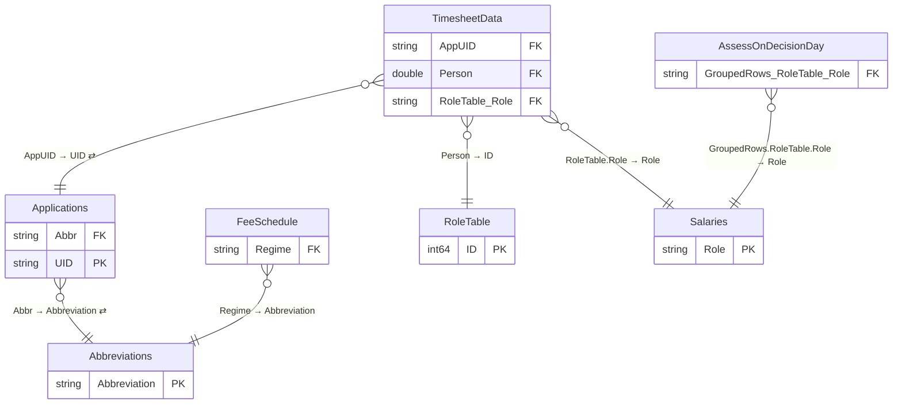

# PEPA Exec Dash

*Generated by `scripts/build_docs.py` from `pbix/PEPA Exec Dash.pbix`, the Master File sheet "PEPA Exec Dash" and the Power Automate Flow Master Register. Regenerate it rather than editing by hand.*

| | |
|---|---|
| Used by | ELT Members: Cori, Kate Morrison |
| Scheduled refresh | Automated - several times a day |
| Dashboard owner | Chris Thornborough, James Dodwell, Jeneve Beer , Angela Jones |
| SMEs | Adventure Activities - Kay Davies; Asbestos, Diving Authorisations - James Dodwell; HS Controls, CSL - Jon Heard |
| Report | PBIR, 3 pages (2 hidden) |
| Power BI IDs | dataset `7ba3d0a7-0b4e-4fbd-92e9-fab52448ae6f` · report `fc0db50f-1161-47bb-a5cd-b96b7a0b23d8` |

**Model:** 14 tables · 139 columns · 11 measures · 6 relationships. 35 hidden auto date/time tables (`LocalDateTable_*`) are left out.

- [Relationship diagram](#relationship-diagram)
- [Tables](#tables)
- [Table details](#table-details)
- [Measures](#measures)
- [Report pages](#report-pages)

## Relationship diagram



`}o--||` many-to-one · `||--||` one-to-one · dotted line = inactive · ⇄ = filters in both directions. Only key columns are shown.

Not related to any other table: `Holidays`, `Query1`, `AssessLastFlagExport`, `TimesheetArchive`, `ApplicationsArchive`, `DateSlicer`, `DateTable`.

| From | To | Cardinality | Cross-filter | Active |
|---|---|---|---|---|
| TimesheetData[Person] | RoleTable[ID] | M:1 | Single | yes |
| TimesheetData[AppUID] | Applications[UID] | M:1 | Both | yes |
| TimesheetData[RoleTable.Role] | Salaries[Role] | M:1 | Single | yes |
| AssessOnDecisionDay[GroupedRows.RoleTable.Role] | Salaries[Role] | M:1 | Single | yes |
| Applications[Abbr] | Abbreviations[Abbreviation] | M:1 | Both | yes |
| FeeSchedule[Regime] | Abbreviations[Abbreviation] | M:1 | Single | yes |

## Tables

| Table | Source | Columns | In report | In Master File | Flows |
|---|---|---|---|---|---|
| [Holidays](#holidays) | Manual table (Enter Data) | 1 | no | yes |  |
| [Query1](#query1) | Power Query calculation (refresh timestamp) | 1 | yes | yes |  |
| [Applications](#applications) | SharePoint list + append: `Applications` on `AuthorisationsandAdvisoryUnit-AuthandAdvisoryUnit` | 19 | yes | yes | documented: [PopulateAAOUIDs](../lineage.md#populateaaouids), [PopulateADRUIDs](../lineage.md#populateadruids), [PopulateASBUIDs](../lineage.md#populateasbuids), [PopulateCCRUIDs](../lineage.md#populateccruids), [PopulateCSLUIDs](../lineage.md#populatecsluids), [PopulateHSCUIDs](../lineage.md#populatehscuids), [PopulateOCDUIDs](../lineage.md#populateocduids), [PopulatePCRUIDs](../lineage.md#populatepcruids); inferred: [AAOCloseDate](../lineage.md#aaoclosedate), [ADRCloseDate](../lineage.md#adrclosedate), [ASBCloseDate](../lineage.md#asbclosedate), [AuditTransfer](../lineage.md#audittransfer), [CCRCloseDate](../lineage.md#ccrclosedate), [CloseWithoutNotificationDates](../lineage.md#closewithoutnotificationdates), [ExemptionsCloseDate](../lineage.md#exemptionsclosedate), [ExemptionsToPEPA](../lineage.md#exemptionstopepa), [HSCCloseDate](../lineage.md#hscclosedate), [OCDCloseDate](../lineage.md#ocdclosedate), [PCRCloseDate](../lineage.md#pcrclosedate), [PEPAApplicationsArchive](../lineage.md#pepaapplicationsarchive), [RemoveDeleted](../lineage.md#removedeleted) |
| [RoleTable](#roletable) | SharePoint list: `RoleTable` on `AuthorisationsandAdvisoryUnit-AuthandAdvisoryUnit` | 16 | yes | yes | documented: [UpdateFullNames](../lineage.md#updatefullnames) |
| [TimesheetData](#timesheetdata) | SharePoint list + append: `TimesheetData` on `AuthorisationsandAdvisoryUnit-AuthandAdvisoryUnit` | 17 | yes | yes | inferred: [PEPA Reminder Email](../lineage.md#pepa-reminder-email), [Timesheet Archive](../lineage.md#timesheet-archive) |
| [Salaries](#salaries) | Manual table (Enter Data) | 3 | no | yes |  |
| [AssessOnDecisionDay](#assessondecisionday) | Derived from other queries | 20 | no | yes |  |
| [AssessLastFlagExport](#assesslastflagexport) | Derived from other queries | 7 | no | yes |  |
| [FeeSchedule](#feeschedule) | SharePoint list: `FeeSchedule` on `AuthorisationsandAdvisoryUnit-AuthandAdvisoryUnit` | 3 | no | yes |  |
| [Abbreviations](#abbreviations) | Manual table (Enter Data) | 1 | yes | yes |  |
| [TimesheetArchive](#timesheetarchive) | SharePoint list: `TimesheetArchive` on `AuthorisationsandAdvisoryUnit-AuthandAdvisoryUnit` | 6 | no | yes | documented: [Timesheet Archive](../lineage.md#timesheet-archive) |
| [ApplicationsArchive](#applicationsarchive) | SharePoint list: `ApplicationsArchive` on `AuthorisationsandAdvisoryUnit-AuthandAdvisoryUnit` | 37 | no | yes | inferred: [PEPAApplicationsArchive](../lineage.md#pepaapplicationsarchive) |
| [DateSlicer](#dateslicer) | DAX calculated table | 1 | yes | yes |  |
| [DateTable](#datetable) | DAX calculated table | 7 | no | yes |  |

## Table details

### Holidays

**Source:** Manual table (Enter Data)

**Master File:** Location: Manual Table

| Column | Type | Kind | Hidden | Referenced by |
|---|---|---|---|---|
| ObservedHoliday | DateTime | Data |  | — |

<details><summary>Power Query (M), redacted</summary>

```m
let
    Source = Table.FromRows(Json.Document(Binary.Decompress(Binary.FromText("<embedded data redacted>", BinaryEncoding.Base64), Compression.Deflate)), let _t = ((type nullable text) meta [Serialized.Text = true]) in type table [ObservedHoliday = _t]),
    #"Changed Type" = Table.TransformColumnTypes(Source,{{"ObservedHoliday", type date}})
in
    #"Changed Type"
```

</details>

### Query1

**Source:** Power Query calculation (refresh timestamp)

**Master File:** Location: Power Query · Team: n/a · Maintained by: n/a · Contact: n/a · Flow: n/a · App: n/a

| Column | Type | Kind | Hidden | Referenced by |
|---|---|---|---|---|
| Query1 | DateTime | Data |  | report |

<details><summary>Power Query (M), redacted</summary>

```m
let
    // Get current UTC time
    nowUtc = DateTimeZone.FixedUtcNow(),
    
    // Get a candidate local time assuming standard NZ time (UTC+12)
    localCandidate = DateTimeZone.SwitchZone(nowUtc, 12),
    localDate = DateTime.Date(localCandidate),
    currentYear = Date.Year(localDate),
    currentMonth = Date.Month(localDate),
    
    // Determine if DST is in effect.
    // New Zealand DST is in effect from the last Sunday in September until the first Sunday in April.
    // For dates in April or September, we check the specific boundary date.
    isDST =
        if currentMonth = 4 then
            // For April, calculate the first Sunday of April.
            let
                april1 = #date(currentYear, 4, 1),
                firstSundayApril = if Date.DayOfWeek(april1, Day.Sunday) = 0 
                     then april1 
                     else Date.AddDays(april1, 7 - Date.DayOfWeek(april1, Day.Sunday))
            in
                // If today is before the first Sunday, it's still DST.
                localDate < firstSundayApril
        else if currentMonth = 9 then
            // For September, calculate the last Sunday of September.
            let
                sept30 = #date(currentYear, 9, 30),
                lastSundaySept = Date.AddDays(sept30, -Date.DayOfWeek(sept30, Day.Sunday))
            in
                // If today is on or after the last Sunday, DST is active.
                localDate >= lastSundaySept
        else if currentMonth < 4 then
            // January to March are in DST.
            true
        else if currentMonth > 9 then
            // October to December are in DST.
            true
        else
            // May, June, July, August are standard time.
            false,
    
    // Choose the correct offset
    offset = if isDST then 13 else 12,
    
    // Convert UTC to Wellington local time using the calculated offset.
    localTime = DateTimeZone.SwitchZone(nowUtc, offset)
in
    localTime
```

</details>

### Applications

**Source:** SharePoint list + append: `Applications` on `AuthorisationsandAdvisoryUnit-AuthandAdvisoryUnit` (list id `62881d43-cd6b-4be9-b785-d4cde2bfcfb5`)

**Reads from:** `ApplicationsArchive`

**Master File:** Location: Authorisations and Advisory Unit-Auth and Advisory Unit - Applications - All Items · Team: Authorisations and Advisory Unit · Maintained by: Updated by power automate - PopulateAAOUIDs, PopulateADRUIDs, PopulateASBUIDs, PopulateCCRUIDs, PopulateCSLUIDs, PopulatePCRUIDs, PopulateOCDUIDs, PopulateHSCUIDs · Contact: Authorisations and Advisory Team · Flow: Yes - in the solution · App: PEPA, SAGE and ACME use this information · Notes: This SharePoint list is automatically populated and updated by the following Power Automate flows: PopulateAAOUIDs, PopulateADRUIDs, PopulateASBUIDs, PopulateCCRUIDs, PopulateCSLUIDs, PopulatePCRUIDs, PopulateOCDUIDs and PopulateHSCUIDs. The data is used by the PEPA, SAGE and ACME applications.

**Power Automate flows:**

- [PopulateAAOUIDs](../lineage.md#populateaaouids): documented (named in Master File)
- [PopulateADRUIDs](../lineage.md#populateadruids): documented (named in Master File)
- [PopulateASBUIDs](../lineage.md#populateasbuids): documented (named in Master File)
- [PopulateCCRUIDs](../lineage.md#populateccruids): documented (named in Master File)
- [PopulateCSLUIDs](../lineage.md#populatecsluids): documented (named in Master File)
- [PopulateHSCUIDs](../lineage.md#populatehscuids): documented (named in Master File)
- [PopulateOCDUIDs](../lineage.md#populateocduids): documented (named in Master File)
- [PopulatePCRUIDs](../lineage.md#populatepcruids): documented (named in Master File)
- [AAOCloseDate](../lineage.md#aaoclosedate): inferred (description mentions "Applications list")
- [ADRCloseDate](../lineage.md#adrclosedate): inferred (description mentions "Applications list")
- [ASBCloseDate](../lineage.md#asbclosedate): inferred (description mentions "Applications list")
- [AuditTransfer](../lineage.md#audittransfer): inferred (description mentions "Applications list")
- [CCRCloseDate](../lineage.md#ccrclosedate): inferred (description mentions "Applications list")
- [CloseWithoutNotificationDates](../lineage.md#closewithoutnotificationdates): inferred (description mentions "Applications List")
- [ExemptionsCloseDate](../lineage.md#exemptionsclosedate): inferred (description mentions "Applications" SharePoint list")
- [ExemptionsToPEPA](../lineage.md#exemptionstopepa): inferred (description mentions "applications list")
- [HSCCloseDate](../lineage.md#hscclosedate): inferred (description mentions "Applications” SharePoint list")
- [OCDCloseDate](../lineage.md#ocdclosedate): inferred (description mentions "Applications” SharePoint list")
- [PCRCloseDate](../lineage.md#pcrclosedate): inferred (description mentions "Applications” SharePoint list")
- [PEPAApplicationsArchive](../lineage.md#pepaapplicationsarchive): inferred (description mentions "Applications SharePoint list")
- [RemoveDeleted](../lineage.md#removedeleted): inferred (description mentions "Applications SharePoint list")

| Column | Type | Kind | Hidden | Referenced by |
|---|---|---|---|---|
| UID | String | Data |  | relationship, DAX |
| Regime | String | Data |  | report, DAX |
| Applicant | String | Data |  | — |
| PartialReceived | DateTime | Data |  | DAX |
| CompleteReceived | DateTime | Data |  | DAX |
| AssignedTo | Double | Data |  | — |
| TotalWorkingDays | Double | Data |  | — |
| JobClosed | DateTime | Data |  | — |
| AppType | String | Data |  | DAX |
| Status | String | Data |  | — |
| PassedToDecider | DateTime | Data |  | DAX |
| Acknowledged | DateTime | Data |  | — |
| DecisionDate | DateTime | Data |  | report, DAX |
| Abbr | String | Calculated |  | report, relationship, DAX |
| NomSups | String | Data |  | DAX |
| SupCount | Int64 | Calculated |  | report, DAX |
| Class | String | Data |  | DAX |
| Fee | decimal.Decimal | Calculated |  | DAX |
| LatestReceived | DateTime | Calculated |  | DAX |

<details><summary>Calculated columns (DAX)</summary>

**Abbr**

```dax
If([Regime]="Adventure Activities","AAO",If([Regime]="Amusement Devices","ADR",If([Regime]="Asbestos","ASB",If([Regime]="Compliance Certifiers","CCR",If([Regime]="CSL","CSL",If([Regime]="HS Controls","HSC",If([Regime]="Occupational Diving","OCD",If([Regime]="PECPR","PCR",If([Regime]="Exemptions","EXE")))))))))
```

**SupCount**

```dax
VAR CleanText = SUBSTITUTE('Applications'[NomSups],",", "|") 
VAR CountSups = LEN(CleanText) - LEN(SUBSTITUTE(CleanText,"|","")) 
RETURN
IF(TRIM('Applications'[NomSups]) = "",0,CountSups +1 )
```

**Fee**

```dax
SWITCH(
    TRUE(),

    -- ASB
    Applications[Abbr] = "ASB",
    VAR AppType = Applications[AppType]
    VAR Class = Applications[Class]
    VAR SupCount = Applications[SupCount]

    VAR BaseFee =
        CALCULATE(
            MAX(FeeSchedule[Fee]),
            FeeSchedule[Regime] = "ASB",
            FeeSchedule[AppType] = AppType
        )

    VAR SupAppType = "Sup (" & Class & ")"

    VAR SupFeePer =
        CALCULATE(
            MAX(FeeSchedule[Fee]),
            FeeSchedule[Regime] = "ASB",
            FeeSchedule[AppType] = SupAppType
        )

    VAR SupFee =
        IF(
            AppType IN { "New Licence (A)", "New Licence (B)", "Renew (A)", "Renew (B)" },
            COALESCE(SupFeePer, 0) * SupCount,
            0
        )

    RETURN COALESCE(BaseFee, 0) + SupFee,

--  CCR
Applications[Abbr] = "CCR",
VAR CCR_AppType = Applications[AppType]
RETURN
COALESCE(
    CALCULATE(
        MAX(FeeSchedule[Fee]),
        FeeSchedule[Regime] = "CCR",
        FeeSchedule[AppType] = CCR_AppType
    ),
    0
),

--  OCD
Applications[Abbr] = "OCD",
VAR OCD_AppType = Applications[AppType]
RETURN
COALESCE(
    CALCULATE(
        MAX(FeeSchedule[Fee]),
        FeeSchedule[Regime] = "OCD",
        FeeSchedule[AppType] = OCD_AppType
    ),
    0
),

Applications[Abbr] = "CSL",
VAR CSLType = Applications[AppType]
RETURN
IF(
    CSLType IN { "New", "Renewal" },
    COALESCE(
        CALCULATE(
            MAX(FeeSchedule[Fee]),
            FeeSchedule[Regime] = "CSL"
        ),
        0
    ),
    0
),
Applications[Abbr] = "HSC",
COALESCE(
    CALCULATE(
        MAX(FeeSchedule[Fee]),
        FeeSchedule[Regime] = "HSC"
    ),
    0
),
Applications[Abbr] = "ADR",
VAR ADR_AppType = Applications[AppType]
RETURN
COALESCE(
    CALCULATE(
        MAX(FeeSchedule[Fee]),
        FeeSchedule[Regime] = "ADR",
        FeeSchedule[AppType] = ADR_AppType
    ),
    0
),
Applications[Abbr] = "AAO",
VAR AAO_AppType = Applications[AppType]
RETURN
COALESCE(
    CALCULATE(
        MAX(FeeSchedule[Fee]),
        FeeSchedule[Regime] = "AAO",
        FeeSchedule[AppType] = AAO_AppType
    ),
    0
),
Applications[Abbr] = "EXE",
VAR EXE_AppType = Applications[AppType]
RETURN
COALESCE(
    CALCULATE(
        MAX(FeeSchedule[Fee]),
        FeeSchedule[Regime] = "EXE",
        FeeSchedule[AppType] = EXE_AppType
    ),
    0
),   
    BLANK()
)
```

**LatestReceived**

```dax
VAR Partial = Applications[PartialReceived]
VAR Complete = Applications[CompleteReceived]
RETURN
IF(
    NOT ISBLANK(Complete),
    Complete,
    Partial
)
```

</details>

<details><summary>Power Query (M), redacted</summary>

```m
let
    Source = SharePoint.Tables("https://worksafenz.sharepoint.com/sites/AuthorisationsandAdvisoryUnit-AuthandAdvisoryUnit", [Implementation="2.0", ViewMode="All"]),
    #"62881d43-cd6b-4be9-b785-d4cde2bfcfb5" = Source{[Id="62881d43-cd6b-4be9-b785-d4cde2bfcfb5"]}[Items],
    #"Appended Query" = Table.Combine({#"62881d43-cd6b-4be9-b785-d4cde2bfcfb5", ApplicationsArchive}),
    #"Removed Other Columns" = Table.SelectColumns(#"Appended Query",{"UID", "Regime", "Applicant", "PartialReceived", "CompleteReceived", "AssignedTo", "TotalWorkingDays", "JobClosed", "AppType", "Status", "PassedToDecider", "Acknowledged", "DecisionDate", "SupNames","Class"}),
    #"Filtered Rows" = Table.SelectRows(#"Removed Other Columns", each [UID] <> null and [UID] <> ""),
    #"Added Custom" = Table.AddColumn(#"Filtered Rows", "NomSups", each if [SupNames] = null or Text.Trim([SupNames]) = "" then null else try Html.Table([SupNames], {{"Col",":root"}}){0}[Col] otherwise null),
    #"Removed Columns" = Table.RemoveColumns(#"Added Custom",{"SupNames"}),
    #"Filtered Rows1" = Table.SelectRows(#"Removed Columns", each ([Regime] <> "FAKE"))
in
    #"Filtered Rows1"
```

</details>

### RoleTable

**Source:** SharePoint list: `RoleTable` on `AuthorisationsandAdvisoryUnit-AuthandAdvisoryUnit` (list id `a15c2d78-e7b4-4bc0-bf62-53053794b466`)

**Master File:** Location: Authorisations and Advisory Unit-Auth and Advisory Unit - RoleTable - All Items · Team: Authorisations and Advisory Unit · Maintained by: Authorisations and Advisory Team · Contact: Chris Thornborough · Flow: Yes - Update to Names [ UpdateFullNames] · App: No

**Power Automate flows:**

- [UpdateFullNames](../lineage.md#updatefullnames): documented (named in Master File)

| Column | Type | Kind | Hidden | Referenced by |
|---|---|---|---|---|
| ID | Int64 | Data |  | relationship, DAX |
| FirstName | String | Data |  | — |
| Surname | String | Data |  | — |
| NameInFull | String | Data |  | — |
| Email | String | Data |  | — |
| Role | String | Data |  | DAX |
| AAO | Boolean | Data |  | — |
| ADR | Boolean | Data |  | — |
| ASB | Boolean | Data |  | — |
| OCD | Boolean | Data |  | — |
| CSL | Boolean | Data |  | — |
| CCR | Boolean | Data |  | — |
| HSC | Boolean | Data |  | — |
| PCR | Boolean | Data |  | — |
| Approver | Boolean | Data |  | — |
| Team | String | Data |  | report |

<details><summary>Power Query (M), redacted</summary>

```m
let
    Source = SharePoint.Tables("https://worksafenz.sharepoint.com/sites/AuthorisationsandAdvisoryUnit-AuthandAdvisoryUnit", [Implementation="2.0", ViewMode="All"]),
    #"a15c2d78-e7b4-4bc0-bf62-53053794b466" = Source{[Id="a15c2d78-e7b4-4bc0-bf62-53053794b466"]}[Items],
    #"Removed Other Columns" = Table.SelectColumns(#"a15c2d78-e7b4-4bc0-bf62-53053794b466",{"ID", "FirstName", "Surname", "NameInFull", "Email", "Role", "AAO", "ADR", "ASB", "OCD", "CSL", "CCR", "HSC", "PCR", "Approver", "Team"})
in
    #"Removed Other Columns"
```

</details>

### TimesheetData

**Source:** SharePoint list + append: `TimesheetData` on `AuthorisationsandAdvisoryUnit-AuthandAdvisoryUnit` (list id `5493e186-37a5-4e3b-b31d-5de07b89f712`)

**Reads from:** `Applications`, `RoleTable`, `Salaries`, `TimesheetArchive`

**Master File:** Location: Authorisations and Advisory Unit-Auth and Advisory Unit - TimesheetData - All Items · Team: Authorisations and Advisory Unit · Maintained by: Authorisations and Advisory Team · Flow: Yes · App: Yes - populated by PEPA and ACME

**Power Automate flows:**

- [PEPA Reminder Email](../lineage.md#pepa-reminder-email): inferred (description mentions "TimesheetData SharePoint list")
- [Timesheet Archive](../lineage.md#timesheet-archive): inferred (description mentions "TimesheetData SharePoint list")

| Column | Type | Kind | Hidden | Referenced by |
|---|---|---|---|---|
| Person | Double | Data |  | relationship, DAX |
| Minutes | Double | Data |  | DAX |
| AppUID | String | Data |  | relationship, DAX |
| StartTime | DateTime | Data |  | DAX |
| EndTime | DateTime | Data |  | report |
| WorkType | String | Data |  | report |
| Status | String | Data |  | — |
| Applications.CompleteReceived | DateTime | Data |  | DAX |
| Applications.PassedToDecider | DateTime | Data |  | — |
| Applications.DecisionDate | DateTime | Data |  | — |
| RoleTable.Role | String | Data |  | relationship |
| WorkDate | DateTime | Data |  | DAX |
| CalcStage | String | Calculated |  | report |
| PrimaryFunction | String | Calculated |  | DAX |
| IsLastAssess | Boolean | Calculated |  | DAX |
| IsDeciderPresent | Boolean | Calculated |  | DAX |
| Hours | Double | Calculated |  | DAX |

<details><summary>Calculated columns (DAX)</summary>

**CalcStage**

```dax
VAR StartTime = TimesheetData[StartTime]
VAR WorkDate = DATEVALUE(StartTime)
VAR Role = TimesheetData[PrimaryFunction]
VAR IsLastAssess = TimesheetData[IsLastAssess]
VAR IsDeciderPresent = TimesheetData[IsDeciderPresent]

VAR ReceivedApp = TimesheetData[Applications.CompleteReceived]

VAR PassedDecider =
    LOOKUPVALUE(Applications[PassedToDecider], Applications[UID], TimesheetData[AppUID])

VAR DecidedDate =
    LOOKUPVALUE(Applications[DecisionDate], Applications[UID], TimesheetData[AppUID])

RETURN
SWITCH(
    TRUE(),

// Reviewers before or on received date
Role = "Review" &&
(ISBLANK(ReceivedApp) || WorkDate <= DATEVALUE(ReceivedApp)),
    "1. Review",

    // Reviewers between received and passed
    Role = "Review" &&
    (ISBLANK(PassedDecider) || StartTime < PassedDecider),
        "2. Assess",

    // Reviewers between passed and decided
    Role = "Review" &&
    (ISBLANK(DecidedDate) || StartTime < DecidedDate),
        "3. Decide",

    // Reviewers after decision
    Role = "Review",
        "4. Notify",

    // Assessors before receieved complete
    Role = "Assess" &&
    (ISBLANK(ReceivedApp) ||
    WorkDate < DATEVALUE(ReceivedApp)),
        "1. Review",
        
    // Assessors on decision day – last one, no decider
    Role = "Assess" &&
    NOT ISBLANK(DecidedDate) &&
    WorkDate = DATEVALUE(DecidedDate) &&
    IsLastAssess &&
    NOT IsDeciderPresent,
        "3. Decide",

    // Assessors on decision day – not last or decider present
    Role = "Assess" &&
    NOT ISBLANK(DecidedDate) &&
    WorkDate = DATEVALUE(DecidedDate),
        "2. Assess",

    // Assessors before passed
    Role = "Assess" &&
    (ISBLANK(PassedDecider) || StartTime < PassedDecider),
        "2. Assess",

    // Assessors between passed and decided
    Role = "Assess" &&
    (ISBLANK(DecidedDate) || StartTime < DecidedDate),
        "2. Assess",

    // Deciders after passed
    Role = "Decide" &&
    NOT ISBLANK(PassedDecider) &&
    StartTime >= PassedDecider,
        "3. Decide",

    // Deciders before passed (jumped the gun)
    Role = "Decide",
        "2. Assess",
    Role="Monitor", "5. Monitor",
    // Catch-all
    "4. Notify"
)
```

**PrimaryFunction**

```dax
LOOKUPVALUE(
    Salaries[PrimaryFunction],
    Salaries[Role],
        LOOKUPVALUE(
            RoleTable[Role],
            RoleTable[ID], TimesheetData[Person]
        )
)
```

**IsLastAssess**

```dax
VAR ThisAppUID = [AppUID]
VAR ThisPerson = [Person]
VAR ThisWorkDate = [WorkDate]
RETURN
CALCULATE(
    MAXX(
        FILTER(
            AssessLastFlagExport,
            AssessLastFlagExport[AppUID] = ThisAppUID
            && AssessLastFlagExport[Person] = ThisPerson
            && AssessLastFlagExport[WorkDate.1] = ThisWorkDate
        ),
        INT(AssessLastFlagExport[IsLastAssess])
    )
) = 1
```

**IsDeciderPresent**

```dax
VAR ThisAppUID = [AppUID]
VAR ThisWorkDate = [WorkDate]
RETURN
CALCULATE(
    MAXX(
        FILTER(
            AssessLastFlagExport,
            AssessLastFlagExport[AppUID] = ThisAppUID
            && AssessLastFlagExport[WorkDate.1] = ThisWorkDate
        ),
        INT(AssessLastFlagExport[IsDeciderPresent])
    )
) = 1
```

**Hours**

```dax
TimesheetData[Minutes]/60
```

</details>

<details><summary>Power Query (M), redacted</summary>

```m
let
    Source = SharePoint.Tables("https://worksafenz.sharepoint.com/sites/AuthorisationsandAdvisoryUnit-AuthandAdvisoryUnit", [Implementation="2.0", ViewMode="All"]),
    #"5493e186-37a5-4e3b-b31d-5de07b89f712" = Source{[Id="5493e186-37a5-4e3b-b31d-5de07b89f712"]}[Items],
    #"Removed Other Columns" = Table.SelectColumns(#"5493e186-37a5-4e3b-b31d-5de07b89f712",{"Person", "Minutes", "AppUID", "StartTime", "EndTime", "WorkType", "Status"}),
    #"Appended Query" = Table.Combine({#"Removed Other Columns", TimesheetArchive}),
    #"Merged Queries" = Table.NestedJoin(#"Appended Query", {"AppUID"}, Applications, {"UID"}, "Applications", JoinKind.LeftOuter),
    #"Merged Queries1" = Table.NestedJoin(#"Merged Queries", {"Person"}, RoleTable, {"ID"}, "RoleTable", JoinKind.LeftOuter),
    #"Expanded RoleTable" = Table.ExpandTableColumn(#"Merged Queries1", "RoleTable", {"Role"}, {"RoleTable.Role"}),
    #"Expanded Applications" = Table.ExpandTableColumn(#"Expanded RoleTable", "Applications", {"CompleteReceived", "PassedToDecider", "DecisionDate"}, {"Applications.CompleteReceived", "Applications.PassedToDecider", "Applications.DecisionDate"}),
    #"Merged Queries2" = Table.NestedJoin(#"Expanded Applications", {"RoleTable.Role"}, Salaries, {"Role"}, "Salaries", JoinKind.LeftOuter),
    Custom1 = Table.AddColumn(#"Merged Queries2", "WorkDate", each Date.From([StartTime]), type date),
    #"Filtered Rows" = Table.SelectRows(Custom1, each ([AppUID] <> "CA2316"))
in
    #"Filtered Rows"
```

</details>

### Salaries

**Source:** Manual table (Enter Data)

**Master File:** Location: Manual Table · Team: BI Team · Maintained by: BI Team · Contact: Belinda Watt, Rosh · Notes: Every year, contact HR to obtain the updated banding data.<br>Update the report with the latest band information once it is received.

| Column | Type | Kind | Hidden | Referenced by |
|---|---|---|---|---|
| Role | String | Data |  | relationship, DAX |
| Salary | Decimal | Data |  | DAX |
| PrimaryFunction | String | Data |  | DAX |

<details><summary>Power Query (M), redacted</summary>

```m
let
    Source = Table.FromRows(Json.Document(Binary.Decompress(Binary.FromText("<embedded data redacted>", BinaryEncoding.Base64), Compression.Deflate)), let _t = ((type nullable text) meta [Serialized.Text = true]) in type table [Role = _t, Salary = _t, PrimaryFunction = _t, Column1 = _t]),
    #"Changed Type" = Table.TransformColumnTypes(Source,{{"Role", type text}, {"Salary", Currency.Type}}),
    #"Removed Columns" = Table.RemoveColumns(#"Changed Type",{"Column1"})
in
    #"Removed Columns"
```

</details>

### AssessOnDecisionDay

**Source:** Derived from other queries

**Reads from:** `TimesheetData`

**Master File:** Location: TimesheetData

| Column | Type | Kind | Hidden | Referenced by |
|---|---|---|---|---|
| AppUID | String | Data |  | DAX |
| WorkDate | DateTime | Data |  | DAX |
| GroupedRows.AppUID | String | Data |  | — |
| GroupedRows.WorkDate | DateTime | Data |  | — |
| GroupedRows.Person | Double | Data |  | — |
| GroupedRows.Minutes | Double | Data |  | — |
| GroupedRows.AppUID.1 | String | Data |  | — |
| GroupedRows.StartTime | DateTime | Data |  | — |
| GroupedRows.EndTime | DateTime | Data |  | — |
| GroupedRows.WorkType | String | Data |  | — |
| GroupedRows.Status | String | Data |  | — |
| GroupedRows.Applications.CompleteReceived | DateTime | Data |  | — |
| GroupedRows.Applications.PassedToDecider | DateTime | Data |  | — |
| GroupedRows.Applications.DecisionDate | DateTime | Data |  | — |
| GroupedRows.RoleTable.Role | String | Data |  | relationship |
| GroupedRows.WorkDate.1 | DateTime | Data |  | — |
| GroupedRows.Index | Double | Data |  | — |
| GroupedRows.IsLastAssess | Boolean | Data |  | — |
| GroupedRows.CalcStage | String | Data |  | — |
| IsDeciderPresent | String | Data |  | DAX |

<details><summary>Power Query (M), redacted</summary>

```m
let
    Source = TimesheetData,
    #"Expanded Salaries" = Table.ExpandTableColumn(Source, "Salaries", {"PrimaryFunction"}, {"Salaries.PrimaryFunction"}),
    #"Filtered Rows" = Table.SelectRows(#"Expanded Salaries", each 
    [Salaries.PrimaryFunction] = "Assess" 
    or [Salaries.PrimaryFunction] = "Decide"
),
    #"Filtered Rows1" = Table.SelectRows(#"Filtered Rows", each [AppUID] <> null and [AppUID] <> ""),
    Custom1 = Table.SelectRows(#"Filtered Rows1", each [StartTime] <> null and [Applications.DecisionDate] <> null),
    #"Grouped Rows" = Table.Group(Custom1, {"AppUID", "WorkDate"}, {{"GroupedRows", each _, type table [Person=nullable number, Minutes=nullable number, AppUID=nullable text, StartTime=nullable datetime, EndTime=nullable datetime, WorkType=nullable text, Status=nullable text, Applications.CompleteReceived=nullable datetime, Applications.PassedToDecider=nullable datetime, Applications.DecisionDate=nullable datetime, RoleTable.Role=nullable text, Salaries.PrimaryFunction=nullable text, WorkDate=date]}}),
    Custom3 = Table.AddColumn(#"Grouped Rows", "Processed", each 
    let
        GroupedTable = [GroupedRows],
        SortedTable = Table.Sort(GroupedTable, {{"StartTime", Order.Ascending}}),
        WithIndex = Table.AddIndexColumn(SortedTable, "Index", 1, 1, Int64.Type),
        RowCount = Table.RowCount(SortedTable),
        WithIsLast = Table.AddColumn(WithIndex, "IsLastAssess", each [Index] = RowCount, type logical)
    in
        WithIsLast
),
    #"Expanded Processed" = Table.ExpandTableColumn(Custom3, "Processed", {"Person", "Minutes", "AppUID", "StartTime", "EndTime", "WorkType", "Status", "Applications.CompleteReceived", "Applications.PassedToDecider", "Applications.DecisionDate", "RoleTable.Role", "Salaries.PrimaryFunction", "WorkDate", "Index", "IsLastAssess"}, {"Person", "Minutes", "AppUID.1", "StartTime", "EndTime", "WorkType", "Status", "Applications.CompleteReceived", "Applications.PassedToDecider", "Applications.DecisionDate", "RoleTable.Role", "Salaries.PrimaryFunction", "WorkDate.1", "Index", "IsLastAssess"}),
    Custom4 = Table.AddColumn(#"Expanded Processed", "AssessorsWithIndex", each 
    Table.AddIndexColumn(
        Table.Sort(
            Table.SelectRows([GroupedRows], each [Salaries.PrimaryFunction] = "Assess"),
            {{"StartTime", Order.Ascending}}
        ),
        "Index", 1, 1, Int64.Type
    )
),
    Custom5 = Table.AddColumn(#"Custom4", "MaxIndex", each 
    List.Max(Table.Column([AssessorsWithIndex], "Index"))
),
    Custom6 = Table.AddColumn(#"Custom5", "AssessorsWithLastFlag", each 
    let
        maxIdx = [MaxIndex],
        tableWithFlag = Table.AddColumn(
            [AssessorsWithIndex],
            "IsLastAssess",
            each [Index] = maxIdx,
            type logical
        )
    in
        tableWithFlag
),
    #"Expanded AssessorsWithLastFlag" = Table.ExpandTableColumn(Custom6, "AssessorsWithLastFlag", {"Person", "StartTime", "IsLastAssess"}, {"AssessorsWithLastFlag.Person", "AssessorsWithLastFlag.StartTime", "AssessorsWithLastFlag.IsLastAssess"}),
    #"Filtered Rows2" = Table.SelectRows(#"Expanded AssessorsWithLastFlag", each true),
    #"Changed Type" = Table.TransformColumnTypes(#"Filtered Rows2",{{"AssessorsWithLastFlag.IsLastAssess", type logical}}),
    #"Removed Columns" = Table.RemoveColumns(#"Changed Type",{"GroupedRows"}),
    #"Added Custom" = Table.AddColumn(#"Removed Columns", "CalcStage", each let
    role = [Salaries.PrimaryFunction],
    start = [StartTime],
    received = [Applications.CompleteReceived],
    passed = [Applications.PassedToDecider],
    decided = [Applications.DecisionDate],
    isLast = [IsLastAssess]
in
    if role = "Review" or (received <> null and start < received) then
        "1. Review"
    else if role = "Assess" and (decided <> null and Date.From(start) = Date.From(decided)) then
        if isLast then "3. Decide" else "2. Assess"
    else if role = "Assess" and (passed <> null and start >= passed) then
        "3. Decide"
    else if role = "Assess" then
        "2. Assess"
    else if role = "Decide" then
        "3. Decide"
    else if passed <> null and start < passed then
        "2. Assess"
    else if decided <> null and start < decided then
        "3. Decide"
    else
        "4. Notify"),
    #"Grouped Rows1" = Table.Group(#"Added Custom", {"AppUID", "WorkDate"}, {{"GroupedRows", each _, type table [AppUID=nullable text, WorkDate=date, Person=number, Minutes=number, AppUID.1=text, StartTime=datetime, EndTime=datetime, WorkType=text, Status=text, Applications.CompleteReceived=nullable datetime, Applications.PassedToDecider=datetime, Applications.DecisionDate=datetime, RoleTable.Role=text, Salaries.PrimaryFunction=text, WorkDate.1=date, Index=number, IsLastAssess=logical, CalcStage=text]}}),
    Custom2 = Table.AddColumn(#"Grouped Rows1", "IsDeciderPresent", each List.ContainsAny(
    Table.Column([GroupedRows], "Salaries.PrimaryFunction"),
    {"Decide"}
)),
    #"Expanded GroupedRows" = Table.ExpandTableColumn(Custom2, "GroupedRows", {"AppUID", "WorkDate", "Person", "Minutes", "AppUID.1", "StartTime", "EndTime", "WorkType", "Status", "Applications.CompleteReceived", "Applications.PassedToDecider", "Applications.DecisionDate", "RoleTable.Role", "WorkDate.1", "Index", "IsLastAssess", "CalcStage"}, {"GroupedRows.AppUID", "GroupedRows.WorkDate", "GroupedRows.Person", "GroupedRows.Minutes", "GroupedRows.AppUID.1", "GroupedRows.StartTime", "GroupedRows.EndTime", "GroupedRows.WorkType", "GroupedRows.Status", "GroupedRows.Applications.CompleteReceived", "GroupedRows.Applications.PassedToDecider", "GroupedRows.Applications.DecisionDate", "GroupedRows.RoleTable.Role", "GroupedRows.WorkDate.1", "GroupedRows.Index", "GroupedRows.IsLastAssess", "GroupedRows.CalcStage"})
in
    #"Expanded GroupedRows"
```

</details>

### AssessLastFlagExport

**Source:** Derived from other queries

**Reads from:** `AssessOnDecisionDay`

**Master File:** Location: AssessOnDecisionDay

| Column | Type | Kind | Hidden | Referenced by |
|---|---|---|---|---|
| AppUID | String | Data |  | DAX |
| Person | Int64 | Data |  | DAX |
| WorkDate.1 | DateTime | Data |  | DAX |
| IsLastAssess | Boolean | Data |  | DAX |
| IsDeciderPresent | Boolean | Data |  | DAX |
| IsLastAssessFinal | Boolean | Data |  | — |
| IsLastAssessInt | Int64 | Data |  | — |

<details><summary>Power Query (M), redacted</summary>

```m
let
    Source = AssessOnDecisionDay,
    #"Removed Other Columns" = Table.SelectColumns(Source,{"AppUID", "GroupedRows.Person", "GroupedRows.WorkDate.1", "GroupedRows.IsLastAssess", "IsDeciderPresent"}),
    #"Added Custom" = Table.AddColumn(#"Removed Other Columns", "IsLastAssessFinal", each if [GroupedRows.IsLastAssess] = true and [IsDeciderPresent] = false then true else false),
    #"Renamed Columns" = Table.RenameColumns(#"Added Custom",{{"GroupedRows.IsLastAssess", "IsLastAssess"}, {"GroupedRows.WorkDate.1", "WorkDate.1"}, {"GroupedRows.Person", "Person"}}),
    #"Added Custom1" = Table.AddColumn(#"Renamed Columns", "IsLastAssessInt", each if [IsLastAssess] then 1 else 0),
    #"Changed Type" = Table.TransformColumnTypes(#"Added Custom1",{{"Person", Int64.Type}, {"IsDeciderPresent", type logical}, {"IsLastAssessFinal", type logical}, {"IsLastAssessInt", Int64.Type}}),
    #"Filtered Rows" = Table.SelectRows(#"Changed Type", each true)
in
    #"Filtered Rows"
```

</details>

### FeeSchedule

**Source:** SharePoint list: `FeeSchedule` on `AuthorisationsandAdvisoryUnit-AuthandAdvisoryUnit` (list id `72470e84-c556-4f6d-9f54-086849abd9cf`)

**Master File:** Location: Authorisations and Advisory Unit-Auth and Advisory Unit - FeeSchedule - All Items · Team: Authorisations and Advisory Unit · Maintained by: BI Team · Contact: BI Team - move to BI Sharepoint · Notes: No changes are required unless WorkSafe fees change

| Column | Type | Kind | Hidden | Referenced by |
|---|---|---|---|---|
| Regime | String | Data |  | relationship, DAX |
| AppType | String | Data |  | DAX |
| Fee | Decimal | Data |  | DAX |

<details><summary>Power Query (M), redacted</summary>

```m
let
    Source = SharePoint.Tables("https://worksafenz.sharepoint.com/sites/AuthorisationsandAdvisoryUnit-AuthandAdvisoryUnit", [Implementation="2.0", ViewMode="All"]),
    #"72470e84-c556-4f6d-9f54-086849abd9cf" = Source{[Id="72470e84-c556-4f6d-9f54-086849abd9cf"]}[Items],
    #"Removed Other Columns" = Table.SelectColumns(#"72470e84-c556-4f6d-9f54-086849abd9cf",{"Regime", "AppType", "Fee"})
in
    #"Removed Other Columns"
```

</details>

### Abbreviations

**Source:** Manual table (Enter Data)

**Master File:** Location: Manual Table · Contact: Chris Thornborough,<br>Graeme Shum · Notes: Used within Power BI.<br>No updates are required unless the regime changes.<br>Update the scaffolding once it becomes available.

| Column | Type | Kind | Hidden | Referenced by |
|---|---|---|---|---|
| Abbreviation | String | Data |  | report, relationship |

<details><summary>Power Query (M), redacted</summary>

```m
let
    Source = Table.FromRows(Json.Document(Binary.Decompress(Binary.FromText("<embedded data redacted>", BinaryEncoding.Base64), Compression.Deflate)), let _t = ((type nullable text) meta [Serialized.Text = true]) in type table [Column1 = _t]),
    #"Changed Type" = Table.TransformColumnTypes(Source,{{"Column1", type text}}),
    #"Renamed Columns" = Table.RenameColumns(#"Changed Type",{{"Column1", "Abbreviation"}})
in
    #"Renamed Columns"
```

</details>

### TimesheetArchive

**Source:** SharePoint list: `TimesheetArchive` on `AuthorisationsandAdvisoryUnit-AuthandAdvisoryUnit` (list id `4fcaed04-b6a7-49f1-9622-4fb8c388c4f7`)

**Master File:** Location: Authorisations and Advisory Unit-Auth and Advisory Unit - TimesheetArchive - All Items · Team: Authorisations and Advisory Unit · Maintained by: Authorisations and Advisory Team · Flow: Yes - Scheduled flow · App: Yes - Flow from PEPA · Notes: Runs every night.<br>Copies timesheet entries older than 30 days from the Timesheet List to the TimesheetArchive list.<br>Deletes the copied entries from the Timesheet List.

**Power Automate flows:**

- [Timesheet Archive](../lineage.md#timesheet-archive): documented (named in Master File)

| Column | Type | Kind | Hidden | Referenced by |
|---|---|---|---|---|
| Person | Double | Data |  | DAX |
| Minutes | Double | Data |  | DAX |
| AppUID | String | Data |  | DAX |
| StartTime | DateTime | Data |  | DAX |
| EndTime | DateTime | Data |  | — |
| Status | String | Data |  | — |

<details><summary>Power Query (M), redacted</summary>

```m
let
    Source = SharePoint.Tables("https://worksafenz.sharepoint.com/sites/AuthorisationsandAdvisoryUnit-AuthandAdvisoryUnit", [Implementation="2.0", ViewMode="All"]),
    Custom1 = Source{[Id="4fcaed04-b6a7-49f1-9622-4fb8c388c4f7"]}[Items],
    #"Removed Other Columns" = Table.SelectColumns(Custom1,{"Person", "Minutes", "AppUID", "StartTime", "EndTime", "Status"})
in
    #"Removed Other Columns"
```

</details>

### ApplicationsArchive

**Source:** SharePoint list: `ApplicationsArchive` on `AuthorisationsandAdvisoryUnit-AuthandAdvisoryUnit` (list id `201fb453-7d3e-4aa5-9cec-35bddd4a5b59`)

**Master File:** Location: Authorisations and Advisory Unit-Auth and Advisory Unit - ApplicationsArchive - All Items · Team: Authorisations and Advisory Unit · Maintained by: Authorisations and Advisory Team · Notes: Runs every night.<br>Identifies closed application records older than 30 days that have not been updated.<br>Copies those records from the Application List to the ApplicationsArchive list.<br>Deletes the copied records from the Application List.

**Power Automate flows:**

- [PEPAApplicationsArchive](../lineage.md#pepaapplicationsarchive): inferred (flow name contains the list name)

| Column | Type | Kind | Hidden | Referenced by |
|---|---|---|---|---|
| Regime | String | Data |  | DAX |
| Applicant | String | Data |  | — |
| PartialReceived | DateTime | Data |  | DAX |
| CompleteReceived | DateTime | Data |  | DAX |
| AssignedTo | Double | Data |  | — |
| TotalWorkingDays | Double | Data |  | — |
| JobClosed | DateTime | Data |  | — |
| AppType | String | Data |  | DAX |
| Status | String | Data |  | — |
| Created | DateTime | Data |  | — |
| Modified By | String | Data |  | — |
| Modified | DateTime | Data |  | — |
| PassedToDecider | DateTime | Data |  | DAX |
| Acknowledged | DateTime | Data |  | — |
| DecisionDate | DateTime | Data |  | DAX |
| SupNames | String | Data |  | — |
| Class | String | Data |  | DAX |
| VartiationType | String | Data |  | — |
| Color Tag | String | Data |  | — |
| Compliance Asset Id | String | Data |  | — |
| ID | Int64 | Data |  | DAX |
| Content Type | String | Data |  | — |
| Created By | String | Data |  | — |
| Version | String | Data |  | — |
| Attachments | String | Data |  | — |
| Edit | String | Data |  | — |
| Type | String | Data |  | — |
| Item Child Count | String | Data |  | — |
| Folder Child Count | String | Data |  | — |
| Label setting | String | Data |  | — |
| Retention label | String | Data |  | — |
| Retention label Applied | String | Data |  | — |
| Label applied by | String | Data |  | — |
| Item is a Record | String | Data |  | — |
| App Created By | String | Data |  | — |
| App Modified By | String | Data |  | — |
| UID | String | Data |  | DAX |

<details><summary>Power Query (M), redacted</summary>

```m
let
    Source = SharePoint.Tables("https://worksafenz.sharepoint.com/sites/AuthorisationsandAdvisoryUnit-AuthandAdvisoryUnit", [Implementation="2.0", ViewMode="All"]),
    #"201fb453-7d3e-4aa5-9cec-35bddd4a5b59" = Source{[Id="201fb453-7d3e-4aa5-9cec-35bddd4a5b59"]}[Items]
in
    #"201fb453-7d3e-4aa5-9cec-35bddd4a5b59"
```

</details>

### DateSlicer

**Source:** DAX calculated table

**Master File:** Location: New calculated table with only one column: Date. · Team: n/a · Maintained by: n/a · Contact: n/a · Flow: n/a · App: n/a

| Column | Type | Kind | Hidden | Referenced by |
|---|---|---|---|---|
| Date | DateTime | CalculatedTableColumn |  | report, DAX |

<details><summary>Table expression (DAX)</summary>

```dax
SELECTCOLUMNS(DateTable, "Date", DateTable[Date])
```

</details>

### DateTable

**Source:** DAX calculated table

**Master File:** Location: Date (Calendar) table · Team: n/a · Maintained by: n/a · Contact: n/a · Flow: n/a · App: n/a

| Column | Type | Kind | Hidden | Referenced by |
|---|---|---|---|---|
| Date | DateTime | CalculatedTableColumn |  | DAX |
| Year | Int64 | CalculatedTableColumn |  | — |
| Month Number | Int64 | CalculatedTableColumn |  | — |
| Month Name | String | CalculatedTableColumn |  | — |
| Day | Int64 | CalculatedTableColumn |  | — |
| Weekday | String | CalculatedTableColumn |  | — |
| IsWeekend | Boolean | CalculatedTableColumn |  | — |

<details><summary>Table expression (DAX)</summary>

```dax
ADDCOLUMNS(
    CALENDAR(DATE(2020, 1, 1), DATE(2030, 12, 31)),
    "Year", YEAR([Date]),
    "Month Number", MONTH([Date]),
    "Month Name", FORMAT([Date], "MMMM"),
    "Day", DAY([Date]),
    "Weekday", FORMAT([Date], "dddd"),
    "IsWeekend", IF(WEEKDAY([Date], 2) > 5, TRUE(), FALSE())
)
```

</details>

## Measures

| Measure | Home table | In report | Display folder | Description |
|---|---|---|---|---|
| FeesActuals | Applications | no |  |  |
| FeesByMonth | Applications | yes |  |  |
| FeesTest | Applications | no |  |  |
| MaxAxisValue | Applications | yes |  |  |
| PepaActuals | Applications | yes |  |  |
| CostTest | TimesheetData | yes |  |  |
| Delta | TimesheetData | yes |  |  |
| Hours1 | TimesheetData | yes |  |  |
| Hours2 | TimesheetData | yes |  |  |
| TotalCost | TimesheetData | yes |  |  |
| TotalCost2 | TimesheetData | yes |  |  |

<details><summary>Measure expressions (DAX)</summary>

**Applications[FeesActuals]**

```dax
VAR TodayDate   = TODAY ()
VAR WindowStart = DATE ( YEAR ( EOMONTH ( TodayDate, -3 ) ),
                         MONTH( EOMONTH ( TodayDate, -3 ) ), 1 )
RETURN
CALCULATE (SUM('Applications'[Fee]),
    USERELATIONSHIP ( 'DateTable'[Date], Applications[LatestReceived] ),
    'DateTable'[Date] >= WindowStart,
    'DateTable'[Date] <= TodayDate
)
```

**Applications[FeesByMonth]**

```dax
COALESCE(
    CALCULATE(
        SUMX(Applications, [Fee]),
        FILTER(
            Applications,
            Applications[LatestReceived] >= MIN('DateSlicer'[Date]) &&
            Applications[LatestReceived] <= MAX('DateSlicer'[Date])
        )
    ),
    0
)
```

**Applications[FeesTest]**

```dax
CALCULATE (
    SUM ( Applications[Fee] ),
    REMOVEFILTERS (),
     Applications[LatestReceived]       >= DATE ( 2025, 3, 1 ),
     Applications[LatestReceived]         <= DATE ( 2025, 6, 17 )
)
```

**Applications[MaxAxisValue]**

```dax
MAXX(
    VALUES(Applications[Regime]), 
    MAX(
        CALCULATE([FeesByMonth]),
        CALCULATE([TotalCost])
    )
)
```

**Applications[PepaActuals]**

```dax
VAR TodayDate   = TODAY ()
VAR WindowStart = DATE ( YEAR ( EOMONTH ( TodayDate, -3 ) ),
                         MONTH( EOMONTH ( TodayDate, -3 ) ), 1 )
RETURN
CALCULATE (
    COUNTROWS ( Applications ), REMOVEFILTERS(),
    USERELATIONSHIP ( 'DateTable'[Date], Applications[LatestReceived] ),
    'DateTable'[Date] >= WindowStart,
    'DateTable'[Date] <= TodayDate
)
```

**TimesheetData[CostTest]**

```dax
CALCULATE(
    SUMX(
        TimesheetData,
        TimesheetData[Minutes] *
            DIVIDE(                            
                RELATED( Salaries[Salary] ),     
                1816,
                0
            ) * 1.65    /60                       
    ), Removefilters(),
    USERELATIONSHIP( TimesheetData[Person], RoleTable[ID] )  , TimesheetData[WorkDate]>= DATE(2025,4,1),TimesheetData[WorkDate]<=DATE(2025,6,17)
) + 0
```

**TimesheetData[Delta]**

```dax
If(([TotalCost]-[FeesByMonth])<=0,0,[TotalCost2]-[FeesByMonth])
```

**TimesheetData[Hours1]**

```dax
CALCULATE(SUM(TimesheetData[Minutes]),Filter(TimesheetData,TimesheetData[StartTime] >= MIN('DateSlicer'[Date]) && TimesheetData[StartTime] <= MAX('DateSlicer'[Date]))) / 60
```

**TimesheetData[Hours2]**

```dax
COALESCE(
    DIVIDE(
        CALCULATE(
            SUM(TimesheetData[Minutes]),
            FILTER(
                TimesheetData,
                TimesheetData[StartTime] >= MIN('DateSlicer'[Date]) &&
                TimesheetData[StartTime] <= MAX('DateSlicer'[Date])
            )
        ),
        60
    ),
    0
)
```

**TimesheetData[TotalCost]**

```dax
VAR Cost =
    SUMX(
        TimesheetData,
        [Hours2] *
            (
                LOOKUPVALUE(
                    Salaries[Salary],
                    Salaries[Role], RELATED(RoleTable[Role])
                ) / 1816
            )*1.65
    )
RETURN
    COALESCE(Cost, 0)
```

**TimesheetData[TotalCost2]**

```dax
VAR StartDate = Min(DateSlicer[Date])

VAR EndDate = Max(DateSlicer[Date])

RETURN(CALCULATE(
    Sumx(TimesheetData,TimesheetData[Hours] * 
    DIVIDE(RELATED(Salaries[Salary]),1816,0)*1.65), 
    REMOVEFILTERS(),
    USERELATIONSHIP(RoleTable[ID],TimesheetData[Person]), Int(TimesheetData[StartTime])>= StartDate,
    Int(TimesheetArchive[StartTime])<= EndDate) + 0)
```

</details>

## Report pages

| Page | Hidden | Visuals |
|---|---|---|
| Main |  | 82 |
| Supervisor Count | yes | 3 |
| Page 1 | yes | 2 |
