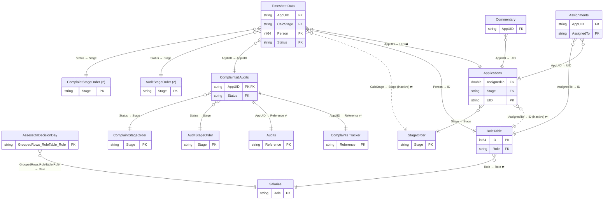

# PEPA Management Dash

*Generated by `scripts/build_docs.py` from `pbix/PEPA Management Dash.pbix`, the Master File sheet "PEPA Management Dash" and the Power Automate Flow Master Register. Regenerate it rather than editing by hand.*

| | |
|---|---|
| Used by | A&A Management team, Kate Morrison |
| Scheduled refresh | Every 2 hours |
| Dashboard owner | Chris Thornborough, James Dodwell, Jeneve Beer, Angela Jones |
| SMEs | Adventure Activities - Kay Davies; Asbestos, Diving Authorisations - James Dodwell; HS Controls, CSL - Jon Heard |
| Report | PBIR, 10 pages (5 hidden) |
| Power BI IDs | dataset `1b2ad4a9-674d-4e08-b99b-768fd3b61996` · report `3a22bf7f-c2a4-4de9-a1d1-e0cbf4bf0853` |

**Model:** 23 tables · 172 columns · 9 measures · 17 relationships. 37 hidden auto date/time tables (`LocalDateTable_*`) are left out.

- [Business purpose](#business-purpose)
- [Relationship diagram](#relationship-diagram)
- [Tables](#tables)
- [Table details](#table-details)
- [Measures](#measures)
- [Report pages](#report-pages)

## Business purpose

*Hand-written: edit `docs/models/_purpose/PEPA Management Dash.md`, not this section.*

PEPA Management Dash gives the Authorisations and Advisory (A&A) management team a view, refreshed every two hours, of how much work the unit has on hand and where its staff time and cost go. It covers authorisation applications in nine regimes: Adventure Activities, Amusement Devices, Asbestos, Compliance Certifiers, CSL, HS Controls, Occupational Diving, PECPR and Exemptions. It also covers the complaints and audits passed over from the Compliance Monitoring Team. For the work itself, it tracks each application through Review, Assess, Decide and Notify, with how long it has been open, its status and who has it. For effort, it takes the time staff log in PEPA and splits it by person, team, regime, application and stage. It turns those hours into a salary-based cost and compares them with each person's expected working hours to give utilisation. The business outcome is better resourcing decisions. Managers can see who is overloaded or underused, where applications are queuing or getting old, which stages and regimes take the most effort, and what each application, regime, complaint or audit costs to process.

*This purpose is inferred from the model and the report's five visible pages. The Master File records only who uses the report and how often it refreshes.*

| Input | Where it comes from | What it adds to the outcome | Where it shows |
|---|---|---|---|
| **Applications**: `UID`, `Regime`, `Applicant`, `AppType`, `Status` | SharePoint `Applications` list, written by PEPA, SAGE and ACME and kept in step with the regime lists by the `Populate*UIDs` flows | The unit of work: what is on hand, for which regime and applicant. `UID` is what staff book time against | Application Status, Application Time, and the Regime slicer on every page |
| **Application dates**: `PartialReceived`, `CompleteReceived`, `PassedToDecider`, `DecisionDate`, `JobClosed` | Same list, updated by the `*CloseDate` flows when a regime list changes | Sets each application's current `Stage` for the on-hand count by stage. `Elapsed` (days since received) shows how old each one is. Also decides which stage each timesheet entry belongs to | Application Status (On Hand Volume by Stage, Hours by Application) |
| `TotalWorkingDays` | Applications list. Going by its description, the Update PEPA WorkingDays flow copies it in daily, but [lineage.md](../lineage.md) doesn't link that flow to this list yet | Processing time in working days (weekends and holidays excluded), the measure for statutory timeframes | Application Status and Application Time tables |
| `AssignedTo`, plus **Assignments** `AssignDate` | Applications list, and the Assignments list PEPA writes to on each reassignment | Who owns each application and since when, so work can be rebalanced | Application Status table (Assigned Person, AssignDate) |
| **TimesheetData**: `Person`, `Minutes`, `AppUID`, `StartTime`, `Status`, plus **TimesheetArchive** | Logged by staff in PEPA and ACME. The Timesheet Archive flow moves entries older than 30 days to the archive each night, and the model adds them back | The effort behind every hours figure, and through it cost and utilisation. Without the archive, the Period slicer could only reach back 30 days | Team, Application Time, Complaint & Audit Time |
| **RoleTable**: `ID`, `NameInFull`, `Team`, `Role` | SharePoint list kept by the A&A team. The UpdateFullNames flow fills in `NameInFull` | Who did the work: names on charts, the Team slicer, and each person's salary band and main function. It also sets the headcount behind expected hours | Team (Hours by User), the name charts, the Team slicer |
| **Salaries**: `Role`, `Salary`, `PrimaryFunction` | Manual table. The BI team updates it each year from HR banding | Turns hours into cost: hours × salary ÷ 1,816 annual hours × 1.65 loading. `PrimaryFunction` (Review, Assess, Decide or Monitor) sets the stage a person's time normally counts towards | Team page cost cards for each stage |
| **AssessOnDecisionDay → AssessLastFlagExport** | Built in Power Query from TimesheetData | Marks the last assessor on an application's decision day, and whether a decider logged time that day. If no decider did, that assessor's time counts as Decide, so effort and cost are split across stages more fairly | Indirect, through `CalcStage` on every stage chart |
| **Holidays**, **DateTable**, **DateSlicer** | Holidays is a manual table. The date tables are DAX, covering 2020–2030 | The Period slicer for all hours. Expected hours are 8 per weekday per person, minus public holidays. That figure is what `Utilisation` divides by | Period slicer, Team (Utilisation) |
| **Complaints&Audits**: `AppUID`, `Subject`, `Nature` | SharePoint list, copied from the Compliance Monitoring Team's lists by the AuditTransfer and ComplaintTransfer flows | Puts complaints and audits in the same workload view, keeping time spent on them separate from application work | Complaint & Audit Time, Audit & Complaint Status |
| **Complaints Tracker** and **Audits**: `Status`, `Allocated to` | Compliance Monitoring Team's lists on Portal_RAA, used by ACME | The current status and owner of each complaint or audit, for on-hand counts by status and by owner | Audit & Complaint Status |
| **Stage-order tables**: StageOrder, AuditStageOrder, ComplaintStageOrder and their "(2)" copies | Manual tables kept by the BI team (Master File: "never change") | Put the stages in process order so each chart reads left to right | Every by-stage chart |
| **Commentary**: `TextPlain`, `ELT` | SharePoint list written by SAGE. Reminder flows chase approval | Progress comments on applications, flagged for the ELT. It's only on a hidden page, so users don't see it today | Commentary page (hidden) |
| **Query1** | Power Query: the refresh time in NZ time | Tells readers how up to date the figures are | Last refresh card on every page |

Until the fixes in the [independent review evaluation](../independent-review-evaluation.md) are applied, the effort, cost and utilisation figures can't be fully trusted:

- **Hours:** the date filter in the hours measures (DX-01, DX-02).
- **Cost:** DX-04 and PQ-08.
- **Expected hours:** DX-05, and PQ-07 for the missing holiday years.

## Relationship diagram



`}o--||` many-to-one · `||--||` one-to-one · dotted line = inactive · ⇄ = filters in both directions. Only key columns are shown.

Not related to any other table: `Holidays`, `Query1`, `AssessLastFlagExport`, `TimesheetArchive`, `ApplicationsArchive`, `DatePerson`, `DateSlicer`, `DateTable`.

| From | To | Cardinality | Cross-filter | Active |
|---|---|---|---|---|
| Assignments[AppUID] | Applications[UID] | M:1 | Single | yes |
| Commentary[AppUID] | Applications[UID] | M:1 | Single | yes |
| TimesheetData[AppUID] | Applications[UID] | M:1 | Both | yes |
| Assignments[AssignedTo] | RoleTable[ID] | M:1 | Single | yes |
| TimesheetData[Person] | RoleTable[ID] | M:1 | Single | yes |
| TimesheetData[CalcStage] | StageOrder[Stage] | M:1 | Both | no |
| Applications[AssignedTo] | RoleTable[ID] | M:1 | Both | no |
| Applications[Stage] | StageOrder[Stage] | M:1 | Single | yes |
| RoleTable[Role] | Salaries[Role] | M:1 | Both | yes |
| AssessOnDecisionDay[GroupedRows.RoleTable.Role] | Salaries[Role] | M:1 | Single | yes |
| TimesheetData[AppUID] | Complaints&Audits[AppUID] | M:1 | Single | yes |
| Complaints&Audits[AppUID] | Complaints Tracker[Reference] | 1:1 | Both | yes |
| Complaints&Audits[AppUID] | Audits[Reference] | 1:1 | Both | yes |
| Complaints&Audits[Status] | AuditStageOrder[Stage] | M:1 | Single | yes |
| Complaints&Audits[Status] | ComplaintStageOrder[Stage] | M:1 | Single | yes |
| TimesheetData[Status] | AuditStageOrder (2)[Stage] | M:1 | Single | yes |
| TimesheetData[Status] | ComplaintStageOrder (2)[Stage] | M:1 | Single | yes |

## Tables

| Table | Source | Columns | In report | In Master File | Flows |
|---|---|---|---|---|---|
| [Holidays](#holidays) | Manual table (Enter Data) | 1 | no | yes |  |
| [Query1](#query1) | Power Query calculation (refresh timestamp) | 1 | yes | yes |  |
| [Commentary](#commentary) | SharePoint list: `Commentary` on `AuthorisationsandAdvisoryUnit-AuthandAdvisoryUnit` | 8 | yes | yes | documented: [Commnetary Reminder](../lineage.md#commnetary-reminder), [Pending Commentary Reminder](../lineage.md#pending-commentary-reminder) |
| [Applications](#applications) | SharePoint list + append: `Applications` on `AuthorisationsandAdvisoryUnit-AuthandAdvisoryUnit` | 15 | yes | yes | documented: [PopulateAAOUIDs](../lineage.md#populateaaouids), [PopulateADRUIDs](../lineage.md#populateadruids), [PopulateASBUIDs](../lineage.md#populateasbuids), [PopulateCCRUIDs](../lineage.md#populateccruids); inferred: [AAOCloseDate](../lineage.md#aaoclosedate), [ADRCloseDate](../lineage.md#adrclosedate), [ASBCloseDate](../lineage.md#asbclosedate), [AuditTransfer](../lineage.md#audittransfer), [CCRCloseDate](../lineage.md#ccrclosedate), [CloseWithoutNotificationDates](../lineage.md#closewithoutnotificationdates), [ExemptionsCloseDate](../lineage.md#exemptionsclosedate), [ExemptionsToPEPA](../lineage.md#exemptionstopepa), [HSCCloseDate](../lineage.md#hscclosedate), [OCDCloseDate](../lineage.md#ocdclosedate), [PCRCloseDate](../lineage.md#pcrclosedate), [PEPAApplicationsArchive](../lineage.md#pepaapplicationsarchive), [RemoveDeleted](../lineage.md#removedeleted) |
| [Assignments](#assignments) | SharePoint list: `Assignments` on `AuthorisationsandAdvisoryUnit-AuthandAdvisoryUnit` | 4 | yes | yes |  |
| [RoleTable](#roletable) | SharePoint list: `RoleTable` on `AuthorisationsandAdvisoryUnit-AuthandAdvisoryUnit` | 18 | yes | yes | documented: [UpdateFullNames](../lineage.md#updatefullnames) |
| [TimesheetData](#timesheetdata) | SharePoint list + append: `TimesheetData` on `AuthorisationsandAdvisoryUnit-AuthandAdvisoryUnit` | 16 | yes | yes | inferred: [PEPA Reminder Email](../lineage.md#pepa-reminder-email), [Timesheet Archive](../lineage.md#timesheet-archive) |
| [StageOrder](#stageorder) | Manual table (Enter Data) | 2 | yes | yes |  |
| [Salaries](#salaries) | Manual table (Enter Data) | 3 | no | yes |  |
| [AssessOnDecisionDay](#assessondecisionday) | Derived from other queries | 20 | no | yes |  |
| [AssessLastFlagExport](#assesslastflagexport) | Derived from other queries | 7 | yes | yes |  |
| [TimesheetArchive](#timesheetarchive) | SharePoint list: `TimesheetArchive` on `AuthorisationsandAdvisoryUnit-AuthandAdvisoryUnit` | 6 | no | yes | documented: [Timesheet Archive](../lineage.md#timesheet-archive) |
| [Complaints&Audits](#complaintsaudits) | SharePoint list: `Complaints&Audits` on `AuthorisationsandAdvisoryUnit-AuthandAdvisoryUnit` | 5 | yes | yes | documented: [AuditTransfer](../lineage.md#audittransfer), [ComplaintTransfer](../lineage.md#complainttransfer) |
| [Complaints Tracker](#complaints-tracker) | SharePoint list: `Complaints Tracker` on `Portal_RAA` | 6 | no | yes | documented: [ComplaintTransfer](../lineage.md#complainttransfer); inferred: [UpdateAuthHolder](../lineage.md#updateauthholder) |
| [Audits](#audits) | SharePoint list: `Audits` on `Portal_RAA` | 5 | no | yes | documented: [AuditTransfer](../lineage.md#audittransfer) |
| [AuditStageOrder](#auditstageorder) | Manual table (Enter Data) | 2 | yes | yes |  |
| [ComplaintStageOrder](#complaintstageorder) | Manual table (Enter Data) | 2 | no | yes |  |
| [AuditStageOrder (2)](#auditstageorder-2) | Manual table (Enter Data) | 2 | yes | yes |  |
| [ComplaintStageOrder (2)](#complaintstageorder-2) | Manual table (Enter Data) | 2 | yes | yes |  |
| [ApplicationsArchive](#applicationsarchive) | SharePoint list: `ApplicationsArchive` on `AuthorisationsandAdvisoryUnit-AuthandAdvisoryUnit` | 37 | no | yes | inferred: [PEPAApplicationsArchive](../lineage.md#pepaapplicationsarchive) |
| [DatePerson](#dateperson) | DAX calculated table | 2 | no | **no** |  |
| [DateSlicer](#dateslicer) | DAX calculated table | 1 | yes | **no** |  |
| [DateTable](#datetable) | DAX calculated table | 7 | no | **no** |  |

## Table details

### Holidays

**Source:** Manual table (Enter Data)

**Master File:** Location: Manual Table

| Column | Type | Kind | Hidden | Referenced by |
|---|---|---|---|---|
| ObservedHoliday | DateTime | Data |  | DAX |

<details><summary>Power Query (M), redacted</summary>

```m
let
    Source = Table.FromRows(Json.Document(Binary.Decompress(Binary.FromText("<embedded data redacted>", BinaryEncoding.Base64), Compression.Deflate)), let _t = ((type nullable text) meta [Serialized.Text = true]) in type table [ObservedHoliday = _t]),
    #"Changed Type" = Table.TransformColumnTypes(Source,{{"ObservedHoliday", type date}})
in
    #"Changed Type"
```

</details>

### Query1

**Source:** Power Query calculation (refresh timestamp)

**Master File:** Location: Power Query · Team: n/a · Maintained by: n/a · Contact: n/a · Flow: n/a · App: n/a

| Column | Type | Kind | Hidden | Referenced by |
|---|---|---|---|---|
| Query1 | DateTime | Data |  | report |

<details><summary>Power Query (M), redacted</summary>

```m
let
    // Get current UTC time
    nowUtc = DateTimeZone.FixedUtcNow(),
    
    // Get a candidate local time assuming standard NZ time (UTC+12)
    localCandidate = DateTimeZone.SwitchZone(nowUtc, 12),
    localDate = DateTime.Date(localCandidate),
    currentYear = Date.Year(localDate),
    currentMonth = Date.Month(localDate),
    
    // Determine if DST is in effect.
    // New Zealand DST is in effect from the last Sunday in September until the first Sunday in April.
    // For dates in April or September, we check the specific boundary date.
    isDST =
        if currentMonth = 4 then
            // For April, calculate the first Sunday of April.
            let
                april1 = #date(currentYear, 4, 1),
                firstSundayApril = if Date.DayOfWeek(april1, Day.Sunday) = 0 
                     then april1 
                     else Date.AddDays(april1, 7 - Date.DayOfWeek(april1, Day.Sunday))
            in
                // If today is before the first Sunday, it's still DST.
                localDate < firstSundayApril
        else if currentMonth = 9 then
            // For September, calculate the last Sunday of September.
            let
                sept30 = #date(currentYear, 9, 30),
                lastSundaySept = Date.AddDays(sept30, -Date.DayOfWeek(sept30, Day.Sunday))
            in
                // If today is on or after the last Sunday, DST is active.
                localDate >= lastSundaySept
        else if currentMonth < 4 then
            // January to March are in DST.
            true
        else if currentMonth > 9 then
            // October to December are in DST.
            true
        else
            // May, June, July, August are standard time.
            false,
    
    // Choose the correct offset
    offset = if isDST then 13 else 12,
    
    // Convert UTC to Wellington local time using the calculated offset.
    localTime = DateTimeZone.SwitchZone(nowUtc, offset)
in
    localTime
```

</details>

### Commentary

**Source:** SharePoint list: `Commentary` on `AuthorisationsandAdvisoryUnit-AuthandAdvisoryUnit` (list id `458e2e36-d56a-4eec-9ba9-ffdc0b1faaff`)

**Master File:** Location: Authorisations and Advisory Unit-Auth and Advisory Unit - Commentary - All Items · Team: Authorisations and Advisory Unit · Maintained by: Authorisations and Advisory Team · Flow: Yes - Commentary Reminder, Pending Commentary Reminder , flows to send email · App: Yes -list populated by SAGE ad again read by SAGE

**Power Automate flows:**

- [Commnetary Reminder](../lineage.md#commnetary-reminder): documented (similar name in Master File: "Commentary Reminder")
- [Pending Commentary Reminder](../lineage.md#pending-commentary-reminder): documented (named in Master File)

| Column | Type | Kind | Hidden | Referenced by |
|---|---|---|---|---|
| Commentary | String | Data |  | — |
| AppUID | String | Data |  | relationship, DAX |
| CommentDate | DateTime | Data |  | — |
| ELT | Boolean | Data |  | report |
| Posted | String | Data |  | — |
| Approved | Boolean | Data |  | — |
| TextPlain | String | Data |  | report |
| AddedBy | String | Data |  | — |

<details><summary>Power Query (M), redacted</summary>

```m
let
    Source = SharePoint.Tables("https://worksafenz.sharepoint.com/sites/AuthorisationsandAdvisoryUnit-AuthandAdvisoryUnit/", [ApiVersion = 15]),
    #"458e2e36-d56a-4eec-9ba9-ffdc0b1faaff" = Source{[Id="458e2e36-d56a-4eec-9ba9-ffdc0b1faaff"]}[Items],
    #"Renamed Columns" = Table.RenameColumns(#"458e2e36-d56a-4eec-9ba9-ffdc0b1faaff",{{"ID", "ID.1"}}),
    #"Removed Other Columns" = Table.SelectColumns(#"Renamed Columns",{"Commentary", "AppUID", "CommentDate", "AddedBy", "ELT", "Posted", "Approved", "TextPlain"})
in
    #"Removed Other Columns"
```

</details>

### Applications

**Source:** SharePoint list + append: `Applications` on `AuthorisationsandAdvisoryUnit-AuthandAdvisoryUnit` (list id `62881d43-cd6b-4be9-b785-d4cde2bfcfb5`)

**Reads from:** `ApplicationsArchive`

**Master File:** Location: Authorisations and Advisory Unit-Auth and Advisory Unit - Applications - All Items · Team: Authorisations and Advisory Unit · Maintained by: Updated by power automate - PopulateAAOUIDs, PopulateADRUIDs, PopulateASBUIDs, PopulateCCRUIDs · Contact: Askdigital? · Flow: Yes - in the solution · App: PEPA, SAGE and ACME use this information

**Power Automate flows:**

- [PopulateAAOUIDs](../lineage.md#populateaaouids): documented (named in Master File)
- [PopulateADRUIDs](../lineage.md#populateadruids): documented (named in Master File)
- [PopulateASBUIDs](../lineage.md#populateasbuids): documented (named in Master File)
- [PopulateCCRUIDs](../lineage.md#populateccruids): documented (named in Master File)
- [AAOCloseDate](../lineage.md#aaoclosedate): inferred (description mentions "Applications list")
- [ADRCloseDate](../lineage.md#adrclosedate): inferred (description mentions "Applications list")
- [ASBCloseDate](../lineage.md#asbclosedate): inferred (description mentions "Applications list")
- [AuditTransfer](../lineage.md#audittransfer): inferred (description mentions "Applications list")
- [CCRCloseDate](../lineage.md#ccrclosedate): inferred (description mentions "Applications list")
- [CloseWithoutNotificationDates](../lineage.md#closewithoutnotificationdates): inferred (description mentions "Applications List")
- [ExemptionsCloseDate](../lineage.md#exemptionsclosedate): inferred (description mentions "Applications" SharePoint list")
- [ExemptionsToPEPA](../lineage.md#exemptionstopepa): inferred (description mentions "applications list")
- [HSCCloseDate](../lineage.md#hscclosedate): inferred (description mentions "Applications” SharePoint list")
- [OCDCloseDate](../lineage.md#ocdclosedate): inferred (description mentions "Applications” SharePoint list")
- [PCRCloseDate](../lineage.md#pcrclosedate): inferred (description mentions "Applications” SharePoint list")
- [PEPAApplicationsArchive](../lineage.md#pepaapplicationsarchive): inferred (description mentions "Applications SharePoint list")
- [RemoveDeleted](../lineage.md#removedeleted): inferred (description mentions "Applications SharePoint list")

| Column | Type | Kind | Hidden | Referenced by |
|---|---|---|---|---|
| UID | String | Data |  | report, relationship, DAX |
| Regime | String | Data |  | report, DAX |
| Applicant | String | Data |  | report |
| PartialReceived | DateTime | Data |  | report, DAX |
| CompleteReceived | DateTime | Data |  | DAX |
| AssignedTo | Double | Data |  | relationship, DAX |
| TotalWorkingDays | Double | Data |  | report |
| JobClosed | DateTime | Data |  | report, DAX |
| AppType | String | Data |  | report |
| Status | String | Data |  | report, DAX |
| PassedToDecider | DateTime | Data |  | DAX |
| Acknowledged | DateTime | Data |  | — |
| DecisionDate | DateTime | Data |  | DAX |
| Abbr | String | Calculated |  | report |
| Stage | String | Calculated |  | report, relationship |

<details><summary>Calculated columns (DAX)</summary>

**Abbr**

```dax
If([Regime]="Adventure Activities","AAO",If([Regime]="Amusement Devices","ADR",If([Regime]="Asbestos","ASB",If([Regime]="Compliance Certifiers","CCR",If([Regime]="CSL","CSL",If([Regime]="HS Controls","HSC",If([Regime]="Occupational Diving","OCD",If([Regime]="PECPR","PCR",If([Regime]="Exemptions","EXE")))))))))
```

**Stage**

```dax
IF(ISBLANK('Applications'[CompleteReceived]),"Review",IF(ISBLANK('Applications'[PassedToDecider]),"Assess",IF(ISBLANK('Applications'[DecisionDate]),"Decide",IF(ISBLANK('Applications'[JobClosed]),"Notify"))))
```

</details>

<details><summary>Power Query (M), redacted</summary>

```m
let
    Source = SharePoint.Tables("https://worksafenz.sharepoint.com/sites/AuthorisationsandAdvisoryUnit-AuthandAdvisoryUnit", [Implementation="2.0", ViewMode="All"]),
    #"62881d43-cd6b-4be9-b785-d4cde2bfcfb5" = Source{[Id="62881d43-cd6b-4be9-b785-d4cde2bfcfb5"]}[Items],
    #"Appended Query" = Table.Combine({#"62881d43-cd6b-4be9-b785-d4cde2bfcfb5", ApplicationsArchive}),
    #"Removed Other Columns" = Table.SelectColumns(#"Appended Query",{"UID", "Regime", "Applicant", "PartialReceived", "CompleteReceived", "AssignedTo", "TotalWorkingDays", "JobClosed", "AppType", "Status", "PassedToDecider", "Acknowledged", "DecisionDate"}),
    #"Filtered Rows" = Table.SelectRows(#"Removed Other Columns", each [UID] <> null and [UID] <> ""),
    #"Sorted Rows" = Table.Sort(#"Filtered Rows",{{"UID", Order.Ascending}})
in
    #"Sorted Rows"
```

</details>

### Assignments

**Source:** SharePoint list: `Assignments` on `AuthorisationsandAdvisoryUnit-AuthandAdvisoryUnit` (list id `c3b18339-2ff6-4eeb-a854-75671434e0a8`)

**Master File:** Location: Authorisations and Advisory Unit-Auth and Advisory Unit - Assignments - All Items · Team: Authorisations and Advisory Unit · Flow: No · App: Yes · Notes: Populated by PEPA, when assignment changes among users in PEPA it creates a record of the change. Not used

| Column | Type | Kind | Hidden | Referenced by |
|---|---|---|---|---|
| AppUID | String | Data |  | relationship, DAX |
| AssignedTo | String | Data |  | relationship, DAX |
| AssignDate | DateTime | Data |  | report |
| ReassignDate | DateTime | Data |  | — |

<details><summary>Power Query (M), redacted</summary>

```m
let
    Source = SharePoint.Tables("https://worksafenz.sharepoint.com/sites/AuthorisationsandAdvisoryUnit-AuthandAdvisoryUnit", [Implementation="2.0", ViewMode="All"]),
    #"c3b18339-2ff6-4eeb-a854-75671434e0a8" = Source{[Id="c3b18339-2ff6-4eeb-a854-75671434e0a8"]}[Items],
    #"Removed Other Columns" = Table.SelectColumns(#"c3b18339-2ff6-4eeb-a854-75671434e0a8",{"AppUID", "AssignedTo", "AssignDate", "ReassignDate"})
in
    #"Removed Other Columns"
```

</details>

### RoleTable

**Source:** SharePoint list: `RoleTable` on `AuthorisationsandAdvisoryUnit-AuthandAdvisoryUnit` (list id `a15c2d78-e7b4-4bc0-bf62-53053794b466`)

**Master File:** Location: Authorisations and Advisory Unit-Auth and Advisory Unit - RoleTable - All Items · Team: Authorisations and Advisory Unit · Maintained by: Authorisations and Advisory Team · Contact: Chris Thornborough · Flow: Yes - Update to Names [ UpdateFullNames] · App: No

**Power Automate flows:**

- [UpdateFullNames](../lineage.md#updatefullnames): documented (named in Master File)

| Column | Type | Kind | Hidden | Referenced by |
|---|---|---|---|---|
| ID | Int64 | Data |  | relationship, DAX |
| FirstName | String | Data |  | — |
| Surname | String | Data |  | — |
| NameInFull | String | Data |  | report, DAX |
| Email | String | Data |  | — |
| Role | String | Data |  | relationship, DAX |
| AAO | Boolean | Data |  | — |
| ADR | Boolean | Data |  | — |
| ASB | Boolean | Data |  | — |
| OCD | Boolean | Data |  | — |
| CSL | Boolean | Data |  | — |
| CCR | Boolean | Data |  | — |
| HSC | Boolean | Data |  | — |
| PCR | Boolean | Data |  | — |
| Approver | Boolean | Data |  | — |
| Team | String | Data |  | report |
| Minutes | Double | Calculated |  | DAX |
| Hours | Double | Calculated |  | DAX |

<details><summary>Calculated columns (DAX)</summary>

**Minutes**

```dax
COALESCE(
    SUMX(
        FILTER(TimesheetData, TimesheetData[Person] = RoleTable[ID]),
        TimesheetData[Minutes]
    ),
    0
)
```

**Hours**

```dax
[Minutes]/60
```

</details>

<details><summary>Power Query (M), redacted</summary>

```m
let
    Source = SharePoint.Tables("https://worksafenz.sharepoint.com/sites/AuthorisationsandAdvisoryUnit-AuthandAdvisoryUnit", [Implementation="2.0", ViewMode="All"]),
    #"a15c2d78-e7b4-4bc0-bf62-53053794b466" = Source{[Id="a15c2d78-e7b4-4bc0-bf62-53053794b466"]}[Items],
    #"Removed Other Columns" = Table.SelectColumns(#"a15c2d78-e7b4-4bc0-bf62-53053794b466",{"ID", "FirstName", "Surname", "NameInFull", "Email", "Role", "AAO", "ADR", "ASB", "OCD", "CSL", "CCR", "HSC", "PCR", "Approver", "Team"})
in
    #"Removed Other Columns"
```

</details>

### TimesheetData

**Source:** SharePoint list + append: `TimesheetData` on `AuthorisationsandAdvisoryUnit-AuthandAdvisoryUnit` (list id `5493e186-37a5-4e3b-b31d-5de07b89f712`)

**Reads from:** `Applications`, `RoleTable`, `Salaries`, `TimesheetArchive`

**Master File:** Location: Authorisations and Advisory Unit-Auth and Advisory Unit - TimesheetData - All Items · Team: Authorisations and Advisory Unit · Maintained by: Authorisations and Advisory Team · Flow: Yes · App: Yes - populated by PEPA and ACME

**Power Automate flows:**

- [PEPA Reminder Email](../lineage.md#pepa-reminder-email): inferred (description mentions "TimesheetData SharePoint list")
- [Timesheet Archive](../lineage.md#timesheet-archive): inferred (description mentions "TimesheetData SharePoint list")

| Column | Type | Kind | Hidden | Referenced by |
|---|---|---|---|---|
| Person | Int64 | Data |  | relationship, DAX |
| Minutes | Double | Data |  | DAX |
| AppUID | String | Data |  | report, relationship, DAX |
| StartTime | DateTime | Data |  | report, DAX |
| EndTime | DateTime | Data |  | report |
| Status | String | Data |  | report, relationship, DAX |
| CalcStage | String | Calculated |  | report, relationship |
| Applications.CompleteReceived | DateTime | Data |  | DAX |
| Applications.PassedToDecider | DateTime | Data |  | — |
| Applications.DecisionDate | DateTime | Data |  | — |
| RoleTable.Role | String | Data |  | — |
| WorkDate | DateTime | Data |  | DAX |
| IsLastAssess | Boolean | Calculated |  | DAX |
| PrimaryFunction | String | Calculated |  | DAX |
| IsDeciderPresent | Boolean | Calculated |  | DAX |
| CreatedNZ | DateTime | Calculated |  | — |

<details><summary>Calculated columns (DAX)</summary>

**CalcStage**

```dax
VAR StartTime = TimesheetData[StartTime]
VAR WorkDate = DATEVALUE(StartTime)
VAR Role = TimesheetData[PrimaryFunction]
VAR IsLastAssess = TimesheetData[IsLastAssess]
VAR IsDeciderPresent = TimesheetData[IsDeciderPresent]

VAR ReceivedApp = TimesheetData[Applications.CompleteReceived]

VAR PassedDecider =
    LOOKUPVALUE(Applications[PassedToDecider], Applications[UID], TimesheetData[AppUID])

VAR DecidedDate =
    LOOKUPVALUE(Applications[DecisionDate], Applications[UID], TimesheetData[AppUID])

RETURN
SWITCH(
    TRUE(),

// Reviewers before or on received date
Role = "Review" &&
(ISBLANK(ReceivedApp) || WorkDate <= DATEVALUE(ReceivedApp)),
    "1. Review",

    // Reviewers between received and passed
    Role = "Review" &&
    (ISBLANK(PassedDecider) || StartTime < PassedDecider),
        "2. Assess",

    // Reviewers between passed and decided
    Role = "Review" &&
    (ISBLANK(DecidedDate) || StartTime < DecidedDate),
        "3. Decide",

    // Reviewers after decision
    Role = "Review",
        "4. Notify",

    // Assessors before receieved complete
    Role = "Assess" &&
    (ISBLANK(ReceivedApp) ||
    WorkDate < DATEVALUE(ReceivedApp)),
        "1. Review",
        
    // Assessors on decision day – last one, no decider
    Role = "Assess" &&
    NOT ISBLANK(DecidedDate) &&
    WorkDate = DATEVALUE(DecidedDate) &&
    IsLastAssess &&
    NOT IsDeciderPresent,
        "3. Decide",

    // Assessors on decision day – not last or decider present
    Role = "Assess" &&
    NOT ISBLANK(DecidedDate) &&
    WorkDate = DATEVALUE(DecidedDate),
        "2. Assess",

    // Assessors before passed
    Role = "Assess" &&
    (ISBLANK(PassedDecider) || StartTime < PassedDecider),
        "2. Assess",

    // Assessors between passed and decided
    Role = "Assess" &&
    (ISBLANK(DecidedDate) || StartTime < DecidedDate),
        "2. Assess",

    // Deciders after passed
    Role = "Decide" &&
    NOT ISBLANK(PassedDecider) &&
    StartTime >= PassedDecider,
        "3. Decide",

    // Deciders before passed (jumped the gun)
    Role = "Decide",
        "2. Assess",
    Role="Monitor", "5. Monitor",
    // Catch-all
    "4. Notify"
)
```

**IsLastAssess**

```dax
VAR ThisAppUID = [AppUID]
VAR ThisPerson = [Person]
VAR ThisWorkDate = [WorkDate]
RETURN
CALCULATE(
    MAXX(
        FILTER(
            AssessLastFlagExport,
            AssessLastFlagExport[AppUID] = ThisAppUID
            && AssessLastFlagExport[Person] = ThisPerson
            && AssessLastFlagExport[WorkDate.1] = ThisWorkDate
        ),
        INT(AssessLastFlagExport[IsLastAssess])
    )
) = 1
```

**PrimaryFunction**

```dax
LOOKUPVALUE(
    Salaries[PrimaryFunction],
    Salaries[Role],
        LOOKUPVALUE(
            RoleTable[Role],
            RoleTable[ID], TimesheetData[Person]
        )
)
```

**IsDeciderPresent**

```dax
VAR ThisAppUID = [AppUID]
VAR ThisWorkDate = [WorkDate]
RETURN
CALCULATE(
    MAXX(
        FILTER(
            AssessLastFlagExport,
            AssessLastFlagExport[AppUID] = ThisAppUID
            && AssessLastFlagExport[WorkDate.1] = ThisWorkDate
        ),
        INT(AssessLastFlagExport[IsDeciderPresent])
    )
) = 1
```

**CreatedNZ**

```dax
VAR RawDate = [StartTime]
VAR Year = YEAR(RawDate)

// Get the first Sunday in April
VAR April1 = DATE(Year, 4, 1)
VAR AprilOffset = WEEKDAY(April1, 2)  // Monday=1, Sunday=7
VAR FirstSundayInApril = 
    IF(AprilOffset = 7, April1, April1 + (7 - AprilOffset))

// Get the last Sunday in September
VAR Sept30 = DATE(Year, 9, 30)
VAR SeptOffset = WEEKDAY(Sept30, 2)  // Monday=1, Sunday=7
VAR LastSundayInSept = Sept30 - SeptOffset + 1

// Determine if it's daylight saving
VAR IsNZDT = RawDate >= LastSundayInSept && RawDate < FirstSundayInApril

RETURN
    RawDate + IF(IsNZDT, TIME(13,0,0), TIME(12,0,0))
```

</details>

<details><summary>Power Query (M), redacted</summary>

```m
let
    Source = SharePoint.Tables("https://worksafenz.sharepoint.com/sites/AuthorisationsandAdvisoryUnit-AuthandAdvisoryUnit", [Implementation="2.0", ViewMode="All"]),
    #"5493e186-37a5-4e3b-b31d-5de07b89f712" = Source{[Id="5493e186-37a5-4e3b-b31d-5de07b89f712"]}[Items],
    #"Removed Other Columns" = Table.SelectColumns(#"5493e186-37a5-4e3b-b31d-5de07b89f712",{"Person", "Minutes", "AppUID", "StartTime", "EndTime", "Status"}),
    #"Appended Query" = Table.Combine({#"Removed Other Columns", TimesheetArchive}),
    #"Merged Queries" = Table.NestedJoin(#"Appended Query", {"AppUID"}, Applications, {"UID"}, "Applications", JoinKind.LeftOuter),
    #"Merged Queries1" = Table.NestedJoin(#"Merged Queries", {"Person"}, RoleTable, {"ID"}, "RoleTable", JoinKind.LeftOuter),
    #"Expanded RoleTable" = Table.ExpandTableColumn(#"Merged Queries1", "RoleTable", {"Role"}, {"RoleTable.Role"}),
    #"Expanded Applications" = Table.ExpandTableColumn(#"Expanded RoleTable", "Applications", {"CompleteReceived", "PassedToDecider", "DecisionDate"}, {"Applications.CompleteReceived", "Applications.PassedToDecider", "Applications.DecisionDate"}),
    #"Merged Queries2" = Table.NestedJoin(#"Expanded Applications", {"RoleTable.Role"}, Salaries, {"Role"}, "Salaries", JoinKind.LeftOuter),
    Custom1 = Table.AddColumn(#"Merged Queries2", "WorkDate", each Date.From([StartTime]), type date)
in
    Custom1
```

</details>

### StageOrder

**Source:** Manual table (Enter Data)

**Master File:** Location: Manual Table · Team: BI Team · Maintained by: BI Team · Contact: BI Team · Flow: No · App: No · Notes: Wont change

| Column | Type | Kind | Hidden | Referenced by |
|---|---|---|---|---|
| Stage | String | Data |  | report, relationship |
| Number | Int64 | Data |  | — |

<details><summary>Power Query (M), redacted</summary>

```m
let
    Source = Table.FromRows(Json.Document(Binary.Decompress(Binary.FromText("<embedded data redacted>", BinaryEncoding.Base64), Compression.Deflate)), let _t = ((type nullable text) meta [Serialized.Text = true]) in type table [Stage = _t, Number = _t]),
    #"Changed Type" = Table.TransformColumnTypes(Source,{{"Stage", type text}, {"Number", Int64.Type}})
in
    #"Changed Type"
```

</details>

### Salaries

**Source:** Manual table (Enter Data)

**Master File:** Location: Manual Table · Team: BI Team · Maintained by: BI Team · Contact: Rosh Ratnayake, Belinda Watt · Notes: Every year, contact HR to obtain the updated banding data.<br>Update the report with the latest band information once it is received.

| Column | Type | Kind | Hidden | Referenced by |
|---|---|---|---|---|
| Role | String | Data |  | relationship, DAX |
| Salary | Decimal | Data |  | DAX |
| PrimaryFunction | String | Data |  | DAX |

<details><summary>Power Query (M), redacted</summary>

```m
let
    Source = Table.FromRows(Json.Document(Binary.Decompress(Binary.FromText("<embedded data redacted>", BinaryEncoding.Base64), Compression.Deflate)), let _t = ((type nullable text) meta [Serialized.Text = true]) in type table [Role = _t, Salary = _t, PrimaryFunction = _t, Column1 = _t]),
    #"Changed Type" = Table.TransformColumnTypes(Source,{{"Role", type text}, {"Salary", Currency.Type}}),
    #"Removed Columns" = Table.RemoveColumns(#"Changed Type",{"Column1"})
in
    #"Removed Columns"
```

</details>

### AssessOnDecisionDay

**Source:** Derived from other queries

**Reads from:** `TimesheetData`

**Master File:** Location: TimesheetData

| Column | Type | Kind | Hidden | Referenced by |
|---|---|---|---|---|
| AppUID | String | Data |  | DAX |
| WorkDate | DateTime | Data |  | DAX |
| GroupedRows.AppUID | String | Data |  | — |
| GroupedRows.WorkDate | DateTime | Data |  | — |
| GroupedRows.Person | Double | Data |  | — |
| GroupedRows.Minutes | Double | Data |  | — |
| GroupedRows.AppUID.1 | String | Data |  | — |
| GroupedRows.StartTime | DateTime | Data |  | — |
| GroupedRows.EndTime | DateTime | Data |  | — |
| GroupedRows.WorkType | String | Data |  | — |
| GroupedRows.Status | String | Data |  | — |
| GroupedRows.Applications.CompleteReceived | DateTime | Data |  | — |
| GroupedRows.Applications.PassedToDecider | DateTime | Data |  | — |
| GroupedRows.Applications.DecisionDate | DateTime | Data |  | — |
| GroupedRows.RoleTable.Role | String | Data |  | relationship |
| GroupedRows.WorkDate.1 | DateTime | Data |  | — |
| GroupedRows.Index | Double | Data |  | — |
| GroupedRows.IsLastAssess | Boolean | Data |  | — |
| GroupedRows.CalcStage | String | Data |  | — |
| IsDeciderPresent | String | Data |  | DAX |

<details><summary>Power Query (M), redacted</summary>

```m
let
    Source = TimesheetData,
    #"Expanded Salaries" = Table.ExpandTableColumn(Source, "Salaries", {"PrimaryFunction"}, {"Salaries.PrimaryFunction"}),
    #"Filtered Rows" = Table.SelectRows(#"Expanded Salaries", each 
    [Salaries.PrimaryFunction] = "Assess" 
    or [Salaries.PrimaryFunction] = "Decide"
),
    #"Filtered Rows1" = Table.SelectRows(#"Filtered Rows", each [AppUID] <> null and [AppUID] <> ""),
    Custom1 = Table.SelectRows(#"Filtered Rows1", each [StartTime] <> null and [Applications.DecisionDate] <> null),
    #"Grouped Rows" = Table.Group(Custom1, {"AppUID", "WorkDate"}, {{"GroupedRows", each _, type table [Person=nullable number, Minutes=nullable number, AppUID=nullable text, StartTime=nullable datetime, EndTime=nullable datetime, WorkType=nullable text, Status=nullable text, Applications.CompleteReceived=nullable datetime, Applications.PassedToDecider=nullable datetime, Applications.DecisionDate=nullable datetime, RoleTable.Role=nullable text, Salaries.PrimaryFunction=nullable text, WorkDate=date]}}),
    Custom3 = Table.AddColumn(#"Grouped Rows", "Processed", each 
    let
        GroupedTable = [GroupedRows],
        SortedTable = Table.Sort(GroupedTable, {{"StartTime", Order.Ascending}}),
        WithIndex = Table.AddIndexColumn(SortedTable, "Index", 1, 1, Int64.Type),
        RowCount = Table.RowCount(SortedTable),
        WithIsLast = Table.AddColumn(WithIndex, "IsLastAssess", each [Index] = RowCount, type logical)
    in
        WithIsLast
),
    #"Expanded Processed" = Table.ExpandTableColumn(Custom3, "Processed", {"Person", "Minutes", "AppUID", "StartTime", "EndTime", "WorkType", "Status", "Applications.CompleteReceived", "Applications.PassedToDecider", "Applications.DecisionDate", "RoleTable.Role", "Salaries.PrimaryFunction", "WorkDate", "Index", "IsLastAssess"}, {"Person", "Minutes", "AppUID.1", "StartTime", "EndTime", "WorkType", "Status", "Applications.CompleteReceived", "Applications.PassedToDecider", "Applications.DecisionDate", "RoleTable.Role", "Salaries.PrimaryFunction", "WorkDate.1", "Index", "IsLastAssess"}),
    Custom4 = Table.AddColumn(#"Expanded Processed", "AssessorsWithIndex", each 
    Table.AddIndexColumn(
        Table.Sort(
            Table.SelectRows([GroupedRows], each [Salaries.PrimaryFunction] = "Assess"),
            {{"StartTime", Order.Ascending}}
        ),
        "Index", 1, 1, Int64.Type
    )
),
    Custom5 = Table.AddColumn(#"Custom4", "MaxIndex", each 
    List.Max(Table.Column([AssessorsWithIndex], "Index"))
),
    Custom6 = Table.AddColumn(#"Custom5", "AssessorsWithLastFlag", each 
    let
        maxIdx = [MaxIndex],
        tableWithFlag = Table.AddColumn(
            [AssessorsWithIndex],
            "IsLastAssess",
            each [Index] = maxIdx,
            type logical
        )
    in
        tableWithFlag
),
    #"Expanded AssessorsWithLastFlag" = Table.ExpandTableColumn(Custom6, "AssessorsWithLastFlag", {"Person", "StartTime", "IsLastAssess"}, {"AssessorsWithLastFlag.Person", "AssessorsWithLastFlag.StartTime", "AssessorsWithLastFlag.IsLastAssess"}),
    #"Filtered Rows2" = Table.SelectRows(#"Expanded AssessorsWithLastFlag", each true),
    #"Changed Type" = Table.TransformColumnTypes(#"Filtered Rows2",{{"AssessorsWithLastFlag.IsLastAssess", type logical}}),
    #"Removed Columns" = Table.RemoveColumns(#"Changed Type",{"GroupedRows"}),
    #"Added Custom" = Table.AddColumn(#"Removed Columns", "CalcStage", each let
    role = [Salaries.PrimaryFunction],
    start = [StartTime],
    received = [Applications.CompleteReceived],
    passed = [Applications.PassedToDecider],
    decided = [Applications.DecisionDate],
    isLast = [IsLastAssess]
in
    if role = "Review" or (received <> null and start < received) then
        "1. Review"
    else if role = "Assess" and (decided <> null and Date.From(start) = Date.From(decided)) then
        if isLast then "3. Decide" else "2. Assess"
    else if role = "Assess" and (passed <> null and start >= passed) then
        "3. Decide"
    else if role = "Assess" then
        "2. Assess"
    else if role = "Decide" then
        "3. Decide"
    else if passed <> null and start < passed then
        "2. Assess"
    else if decided <> null and start < decided then
        "3. Decide"
    else
        "4. Notify"),
    #"Grouped Rows1" = Table.Group(#"Added Custom", {"AppUID", "WorkDate"}, {{"GroupedRows", each _, type table [AppUID=nullable text, WorkDate=date, Person=number, Minutes=number, AppUID.1=text, StartTime=datetime, EndTime=datetime, WorkType=text, Status=text, Applications.CompleteReceived=nullable datetime, Applications.PassedToDecider=datetime, Applications.DecisionDate=datetime, RoleTable.Role=text, Salaries.PrimaryFunction=text, WorkDate.1=date, Index=number, IsLastAssess=logical, CalcStage=text]}}),
    Custom2 = Table.AddColumn(#"Grouped Rows1", "IsDeciderPresent", each List.ContainsAny(
    Table.Column([GroupedRows], "Salaries.PrimaryFunction"),
    {"Decide"}
)),
    #"Expanded GroupedRows" = Table.ExpandTableColumn(Custom2, "GroupedRows", {"AppUID", "WorkDate", "Person", "Minutes", "AppUID.1", "StartTime", "EndTime", "WorkType", "Status", "Applications.CompleteReceived", "Applications.PassedToDecider", "Applications.DecisionDate", "RoleTable.Role", "WorkDate.1", "Index", "IsLastAssess", "CalcStage"}, {"GroupedRows.AppUID", "GroupedRows.WorkDate", "GroupedRows.Person", "GroupedRows.Minutes", "GroupedRows.AppUID.1", "GroupedRows.StartTime", "GroupedRows.EndTime", "GroupedRows.WorkType", "GroupedRows.Status", "GroupedRows.Applications.CompleteReceived", "GroupedRows.Applications.PassedToDecider", "GroupedRows.Applications.DecisionDate", "GroupedRows.RoleTable.Role", "GroupedRows.WorkDate.1", "GroupedRows.Index", "GroupedRows.IsLastAssess", "GroupedRows.CalcStage"})
in
    #"Expanded GroupedRows"
```

</details>

### AssessLastFlagExport

**Source:** Derived from other queries

**Reads from:** `AssessOnDecisionDay`

**Master File:** Location: AssessOnDecisionDay

| Column | Type | Kind | Hidden | Referenced by |
|---|---|---|---|---|
| AppUID | String | Data |  | DAX |
| Person | Int64 | Data |  | DAX |
| WorkDate.1 | DateTime | Data |  | DAX |
| IsLastAssess | Boolean | Data |  | report, DAX |
| IsDeciderPresent | Boolean | Data |  | report, DAX |
| IsLastAssessFinal | Boolean | Data |  | — |
| IsLastAssessInt | Int64 | Data |  | — |

<details><summary>Power Query (M), redacted</summary>

```m
let
    Source = AssessOnDecisionDay,
    #"Removed Other Columns" = Table.SelectColumns(Source,{"AppUID", "GroupedRows.Person", "GroupedRows.WorkDate.1", "GroupedRows.IsLastAssess", "IsDeciderPresent"}),
    #"Added Custom" = Table.AddColumn(#"Removed Other Columns", "IsLastAssessFinal", each if [GroupedRows.IsLastAssess] = true and [IsDeciderPresent] = false then true else false),
    #"Renamed Columns" = Table.RenameColumns(#"Added Custom",{{"GroupedRows.IsLastAssess", "IsLastAssess"}, {"GroupedRows.WorkDate.1", "WorkDate.1"}, {"GroupedRows.Person", "Person"}}),
    #"Added Custom1" = Table.AddColumn(#"Renamed Columns", "IsLastAssessInt", each if [IsLastAssess] then 1 else 0),
    #"Changed Type" = Table.TransformColumnTypes(#"Added Custom1",{{"Person", Int64.Type}, {"IsDeciderPresent", type logical}, {"IsLastAssessFinal", type logical}, {"IsLastAssessInt", Int64.Type}}),
    #"Filtered Rows" = Table.SelectRows(#"Changed Type", each true)
in
    #"Filtered Rows"
```

</details>

### TimesheetArchive

**Source:** SharePoint list: `TimesheetArchive` on `AuthorisationsandAdvisoryUnit-AuthandAdvisoryUnit` (list id `4fcaed04-b6a7-49f1-9622-4fb8c388c4f7`)

**Master File:** Location: Authorisations and Advisory Unit-Auth and Advisory Unit - TimesheetArchive - All Items · Team: Authorisations and Advisory Unit · Maintained by: Authorisations and Advisory Team · Flow: Yes - Scheduled flow · App: Yes - Flow from PEPA · Notes: Runs every night.<br>Copies timesheet entries older than 30 days from the Timesheet List to the TimesheetArchive list.<br>Deletes the copied entries from the Timesheet List.

**Power Automate flows:**

- [Timesheet Archive](../lineage.md#timesheet-archive): documented (named in Master File)

| Column | Type | Kind | Hidden | Referenced by |
|---|---|---|---|---|
| Person | Double | Data |  | DAX |
| Minutes | Double | Data |  | DAX |
| AppUID | String | Data |  | DAX |
| StartTime | DateTime | Data |  | DAX |
| EndTime | DateTime | Data |  | — |
| Status | String | Data |  | DAX |

<details><summary>Power Query (M), redacted</summary>

```m
let
    Source = SharePoint.Tables("https://worksafenz.sharepoint.com/sites/AuthorisationsandAdvisoryUnit-AuthandAdvisoryUnit", [Implementation="2.0", ViewMode="All"]),
    #"4fcaed04-b6a7-49f1-9622-4fb8c388c4f7" = Source{[Id="4fcaed04-b6a7-49f1-9622-4fb8c388c4f7"]}[Items],
    Custom1 = Table.SelectColumns(#"4fcaed04-b6a7-49f1-9622-4fb8c388c4f7",{"Person", "Minutes", "AppUID", "StartTime", "EndTime", "Status"})
in
    Custom1
```

</details>

### Complaints&Audits

**Source:** SharePoint list: `Complaints&Audits` on `AuthorisationsandAdvisoryUnit-AuthandAdvisoryUnit` (list id `52205575-9958-4af5-a218-240fc26e58a0`)

**Master File:** Location: Authorisations and Advisory Unit-Auth and Advisory Unit - Complaints&Audits - All Items · Team: Authorisations and Advisory Unit · Maintained by: Authorisations and Advisory Team · Flow: Yes- AuditTransfer, ComplaintTransfer · Notes: Copies the list to Complaints and Audits from Complaints Tracker and Audits tracker list

**Power Automate flows:**

- [AuditTransfer](../lineage.md#audittransfer): documented (named in Master File)
- [ComplaintTransfer](../lineage.md#complainttransfer): documented (named in Master File)

| Column | Type | Kind | Hidden | Referenced by |
|---|---|---|---|---|
| AppUID | String | Data |  | report, relationship, DAX |
| Subject | String | Data |  | report |
| Nature | String | Data |  | report, DAX |
| Status | String | Calculated |  | report, relationship, DAX |
| AllocatedTo | String | Calculated |  | report |

<details><summary>Calculated columns (DAX)</summary>

**Status**

```dax
If('Complaints&Audits'[Nature]="Complaint",LOOKUPVALUE('Complaints Tracker'[Status],'Complaints Tracker'[Reference],'Complaints&Audits'[AppUID],""),LOOKUPVALUE('Audits'[Status],'Audits'[Reference],'Complaints&Audits'[AppUID],""))
```

**AllocatedTo**

```dax
If('Complaints&Audits'[Nature]="Audit",LOOKUPVALUE(Audits[Allocated to],Audits[Reference],'Complaints&Audits'[AppUID]),LOOKUPVALUE('Complaints Tracker'[Allocated to],'Complaints Tracker'[Reference],'Complaints&Audits'[AppUID]))
```

</details>

<details><summary>Power Query (M), redacted</summary>

```m
let
    Source = SharePoint.Tables("https://worksafenz.sharepoint.com/sites/AuthorisationsandAdvisoryUnit-AuthandAdvisoryUnit/", [Implementation="2.0", ViewMode="All"]),
    #"52205575-9958-4af5-a218-240fc26e58a0" = Source{[Id="52205575-9958-4af5-a218-240fc26e58a0"]}[Items],
    #"Removed Other Columns" = Table.SelectColumns(#"52205575-9958-4af5-a218-240fc26e58a0",{"Title", "Subject", "Nature"}),
    #"Renamed Columns" = Table.RenameColumns(#"Removed Other Columns",{{"Title", "AppUID"}})
in
    #"Renamed Columns"
```

</details>

### Complaints Tracker

**Source:** SharePoint list: `Complaints Tracker` on `Portal_RAA` (list id `6a5b706a-6f92-4788-a5a3-f4d3770bf54d`)

**Master File:** Location: Compliance Monitoring Team - Complaints Tracker - All Items · Team: Compliance Monitoring Team · Maintained by: Shaz Harvey · Contact: Shaz Harvey & Andy Smith · Flow: Yes, Compliance Transfer flow · App: Yes - ACME

**Power Automate flows:**

- [ComplaintTransfer](../lineage.md#complainttransfer): documented (similar name in Master File: "Compliance Transfer")
- [UpdateAuthHolder](../lineage.md#updateauthholder): inferred (description mentions "Complaints Tracker SharePoint list")

| Column | Type | Kind | Hidden | Referenced by |
|---|---|---|---|---|
| Reference | String | Data |  | relationship, DAX |
| Complainant | String | Data |  | — |
| Category | String | Data |  | — |
| Sub Category | String | Data |  | — |
| Status | String | Data |  | DAX |
| Allocated to | String | Data |  | DAX |

<details><summary>Power Query (M), redacted</summary>

```m
let
    Source = SharePoint.Tables("https://worksafenz.sharepoint.com/sites/Portal_RAA", [Implementation="2.0", ViewMode="All"]),
    #"6a5b706a-6f92-4788-a5a3-f4d3770bf54d" = Source{[Id="6a5b706a-6f92-4788-a5a3-f4d3770bf54d"]}[Items],
    #"Removed Other Columns" = Table.SelectColumns(#"6a5b706a-6f92-4788-a5a3-f4d3770bf54d",{"Reference", "Complainant", "Category", "Sub Category", "Allocated to", "Status"})
in
    #"Removed Other Columns"
```

</details>

### Audits

**Source:** SharePoint list: `Audits` on `Portal_RAA` (list id `0696da9a-17b0-4987-8347-63ebb56e2d84`)

**Master File:** Location: Compliance Monitoring Team - Audits - All Items · Team: Compliance Monitoring Team · Maintained by: Shaz Harvey · Contact: Shaz Harvey & Andy Smith · Flow: Yes, AuditTransfer flow · App: Yes - ACME

**Power Automate flows:**

- [AuditTransfer](../lineage.md#audittransfer): documented (named in Master File)

| Column | Type | Kind | Hidden | Referenced by |
|---|---|---|---|---|
| Reference | String | Data |  | relationship, DAX |
| Authorisation Holder | String | Data |  | — |
| Status | String | Data |  | DAX |
| Allocated to | String | Data |  | DAX |
| Allocated to_ | String | Data |  | — |

<details><summary>Power Query (M), redacted</summary>

```m
let
    Source = SharePoint.Tables("https://worksafenz.sharepoint.com/sites/Portal_RAA", [Implementation="2.0", ViewMode="All"]),
    #"0696da9a-17b0-4987-8347-63ebb56e2d84" = Source{[Id="0696da9a-17b0-4987-8347-63ebb56e2d84"]}[Items],
    Custom1 = Table.RenameColumns(#"0696da9a-17b0-4987-8347-63ebb56e2d84",{{"Assigned to","Allocated to_"}}),
    #"Removed Other Columns" = Table.SelectColumns(Custom1,{"Reference", "Authorisation Holder", "Allocated to", "Allocated to_", "Status"})
in
    #"Removed Other Columns"
```

</details>

### AuditStageOrder

**Source:** Manual table (Enter Data)

**Master File:** Location: Manual Table · Team: BI Team · Maintained by: BI Team · Contact: BI Team · Flow: No · App: No · Notes: Never change

| Column | Type | Kind | Hidden | Referenced by |
|---|---|---|---|---|
| Stage | String | Data |  | report, relationship |
| Order | Int64 | Data |  | — |

<details><summary>Power Query (M), redacted</summary>

```m
let
    Source = Table.FromRows(Json.Document(Binary.Decompress(Binary.FromText("<embedded data redacted>", BinaryEncoding.Base64), Compression.Deflate)), let _t = ((type nullable text) meta [Serialized.Text = true]) in type table [Stage = _t, Order = _t]),
    #"Changed Type" = Table.TransformColumnTypes(Source,{{"Stage", type text}, {"Order", Int64.Type}})
in
    #"Changed Type"
```

</details>

### ComplaintStageOrder

**Source:** Manual table (Enter Data)

**Master File:** Location: Manual Table · Team: BI Team · Maintained by: BI Team · Contact: BI Team · Flow: No · App: No · Notes: Never change

| Column | Type | Kind | Hidden | Referenced by |
|---|---|---|---|---|
| Stage | String | Data |  | relationship |
| Order | Int64 | Data |  | — |

<details><summary>Power Query (M), redacted</summary>

```m
let
    Source = Table.FromRows(Json.Document(Binary.Decompress(Binary.FromText("<embedded data redacted>", BinaryEncoding.Base64), Compression.Deflate)), let _t = ((type nullable text) meta [Serialized.Text = true]) in type table [Stage = _t, Order = _t]),
    #"Changed Type" = Table.TransformColumnTypes(Source,{{"Stage", type text}, {"Order", Int64.Type}})
in
    #"Changed Type"
```

</details>

### AuditStageOrder (2)

**Source:** Manual table (Enter Data)

**Master File:** Location: Manual Table · Team: BI Team · Maintained by: BI Team · Contact: BI Team · Flow: No · App: No · Notes: Never change

| Column | Type | Kind | Hidden | Referenced by |
|---|---|---|---|---|
| Stage | String | Data |  | report, relationship |
| Order | Int64 | Data |  | — |

<details><summary>Power Query (M), redacted</summary>

```m
let
    Source = Table.FromRows(Json.Document(Binary.Decompress(Binary.FromText("<embedded data redacted>", BinaryEncoding.Base64), Compression.Deflate)), let _t = ((type nullable text) meta [Serialized.Text = true]) in type table [Stage = _t, Order = _t]),
    #"Changed Type" = Table.TransformColumnTypes(Source,{{"Stage", type text}, {"Order", Int64.Type}})
in
    #"Changed Type"
```

</details>

### ComplaintStageOrder (2)

**Source:** Manual table (Enter Data)

**Master File:** Location: Manual Table · Team: BI Team · Maintained by: BI Team · Contact: BI Team · Flow: No · App: No · Notes: Never change

| Column | Type | Kind | Hidden | Referenced by |
|---|---|---|---|---|
| Stage | String | Data |  | report, relationship |
| Order | Int64 | Data |  | — |

<details><summary>Power Query (M), redacted</summary>

```m
let
    Source = Table.FromRows(Json.Document(Binary.Decompress(Binary.FromText("<embedded data redacted>", BinaryEncoding.Base64), Compression.Deflate)), let _t = ((type nullable text) meta [Serialized.Text = true]) in type table [Stage = _t, Order = _t]),
    #"Changed Type" = Table.TransformColumnTypes(Source,{{"Stage", type text}, {"Order", Int64.Type}})
in
    #"Changed Type"
```

</details>

### ApplicationsArchive

**Source:** SharePoint list: `ApplicationsArchive` on `AuthorisationsandAdvisoryUnit-AuthandAdvisoryUnit` (list id `201fb453-7d3e-4aa5-9cec-35bddd4a5b59`)

**Master File:** Location: Authorisations and Advisory Unit-Auth and Advisory Unit - ApplicationsArchive - All Items · Team: Authorisations and Advisory Unit · Maintained by: Authorisations and Advisory Team · Notes: Runs every night.<br>Identifies closed application records older than 30 days that have not been updated.<br>Copies those records from the Application List to the ApplicationsArchive list.<br>Deletes the copied records from the Application List.

**Power Automate flows:**

- [PEPAApplicationsArchive](../lineage.md#pepaapplicationsarchive): inferred (flow name contains the list name)

| Column | Type | Kind | Hidden | Referenced by |
|---|---|---|---|---|
| Regime | String | Data |  | DAX |
| Applicant | String | Data |  | — |
| PartialReceived | DateTime | Data |  | DAX |
| CompleteReceived | DateTime | Data |  | DAX |
| AssignedTo | Double | Data |  | DAX |
| TotalWorkingDays | Double | Data |  | — |
| JobClosed | DateTime | Data |  | DAX |
| AppType | String | Data |  | — |
| Status | String | Data |  | DAX |
| Created | DateTime | Data |  | — |
| Modified By | String | Data |  | — |
| Modified | DateTime | Data |  | — |
| PassedToDecider | DateTime | Data |  | DAX |
| Acknowledged | DateTime | Data |  | — |
| DecisionDate | DateTime | Data |  | DAX |
| SupNames | String | Data |  | — |
| Class | String | Data |  | — |
| VartiationType | String | Data |  | — |
| Color Tag | String | Data |  | — |
| Compliance Asset Id | String | Data |  | — |
| ID | Int64 | Data |  | DAX |
| Content Type | String | Data |  | — |
| Created By | String | Data |  | — |
| Version | String | Data |  | — |
| Attachments | String | Data |  | — |
| Edit | String | Data |  | — |
| Type | String | Data |  | — |
| Item Child Count | String | Data |  | — |
| Folder Child Count | String | Data |  | — |
| Label setting | String | Data |  | — |
| Retention label | String | Data |  | — |
| Retention label Applied | String | Data |  | — |
| Label applied by | String | Data |  | — |
| Item is a Record | String | Data |  | — |
| App Created By | String | Data |  | — |
| App Modified By | String | Data |  | — |
| UID | String | Data |  | DAX |

<details><summary>Power Query (M), redacted</summary>

```m
let
    Source = SharePoint.Tables("https://worksafenz.sharepoint.com/sites/AuthorisationsandAdvisoryUnit-AuthandAdvisoryUnit/", [Implementation="2.0", ViewMode="All"]),
    #"201fb453-7d3e-4aa5-9cec-35bddd4a5b59" = Source{[Id="201fb453-7d3e-4aa5-9cec-35bddd4a5b59"]}[Items]
in
    #"201fb453-7d3e-4aa5-9cec-35bddd4a5b59"
```

</details>

### DatePerson

**Source:** DAX calculated table

**Master File:** not documented.

| Column | Type | Kind | Hidden | Referenced by |
|---|---|---|---|---|
| ID | Int64 | CalculatedTableColumn |  | DAX |
| Date | DateTime | CalculatedTableColumn |  | DAX |

<details><summary>Table expression (DAX)</summary>

```dax
CROSSJOIN(
    VALUES(RoleTable[ID]),         
    VALUES(DateSlicer[Date])
)
```

</details>

### DateSlicer

**Source:** DAX calculated table

**Master File:** not documented.

| Column | Type | Kind | Hidden | Referenced by |
|---|---|---|---|---|
| Date | DateTime | CalculatedTableColumn |  | report, DAX |

<details><summary>Table expression (DAX)</summary>

```dax
SELECTCOLUMNS(DateTable, "Date", DateTable[Date])
```

</details>

### DateTable

**Source:** DAX calculated table

**Master File:** not documented.

| Column | Type | Kind | Hidden | Referenced by |
|---|---|---|---|---|
| Date | DateTime | CalculatedTableColumn |  | DAX |
| Year | Int64 | CalculatedTableColumn |  | — |
| Month Number | Int64 | CalculatedTableColumn |  | — |
| Month Name | String | CalculatedTableColumn |  | — |
| Day | Int64 | CalculatedTableColumn |  | — |
| Weekday | String | CalculatedTableColumn |  | — |
| IsWeekend | Boolean | CalculatedTableColumn |  | — |

<details><summary>Table expression (DAX)</summary>

```dax
ADDCOLUMNS(
    CALENDAR(DATE(2020, 1, 1), DATE(2030, 12, 31)),
    "Year", YEAR([Date]),
    "Month Number", MONTH([Date]),
    "Month Name", FORMAT([Date], "MMMM"),
    "Day", DAY([Date]),
    "Weekday", FORMAT([Date], "dddd"),
    "IsWeekend", IF(WEEKDAY([Date], 2) > 5, TRUE(), FALSE())
)
```

</details>

## Measures

| Measure | Home table | In report | Display folder | Description |
|---|---|---|---|---|
| Assigned Person | Applications | yes |  |  |
| Elapsed | Applications | yes |  |  |
| ExpectedHours | RoleTable | no |  |  |
| Utilisation | RoleTable | yes |  |  |
| CountofApps | TimesheetData | no |  |  |
| Hours | TimesheetData | yes |  |  |
| Hours2 | TimesheetData | yes |  |  |
| Hours3 | TimesheetData | yes |  |  |
| TotalCost | TimesheetData | yes |  |  |

<details><summary>Measure expressions (DAX)</summary>

**Applications[Assigned Person]**

```dax
CALCULATE(
    SELECTEDVALUE(RoleTable[NameInFull]),
    USERELATIONSHIP(Applications[AssignedTo], RoleTable[ID])
)
```

**Applications[Elapsed]**

```dax
DATEDIFF(
    COALESCE(
        MAX(Applications[PartialReceived]),
        MAX(Applications[CompleteReceived])
    ),
    TODAY(),
    DAY
)
```

**RoleTable[ExpectedHours]**

```dax
CALCULATE(
    COUNTROWS(
        FILTER(
            CROSSJOIN(VALUES(RoleTable[ID]), VALUES(DateSlicer[Date])),
            WEEKDAY(DateSlicer[Date], 2) <= 5
                && NOT DateSlicer[Date] IN VALUES(Holidays[ObservedHoliday])
        )
    ) * 8
)
```

**RoleTable[Utilisation]**

```dax
If(ISBLANK([Hours]/[ExpectedHours]),0,[Hours]/[ExpectedHours])
```

**TimesheetData[CountofApps]**

```dax
DISTINCTCOUNT(TimesheetArchive[AppUID])
```

**TimesheetData[Hours]**

```dax
CALCULATE(SUM(TimesheetData[Minutes]),Filter(TimesheetData,TimesheetData[StartTime] >= MIN('DateSlicer'[Date]) && TimesheetData[StartTime] <= MAX('DateSlicer'[Date]))) / 60
```

**TimesheetData[Hours2]**

```dax
COALESCE(
    DIVIDE(
        CALCULATE(
            SUM(TimesheetData[Minutes]),
            FILTER(
                TimesheetData,
                TimesheetData[StartTime] >= MIN('DateSlicer'[Date]) &&
                TimesheetData[StartTime] <= MAX('DateSlicer'[Date])
            )
        ),
        60
    ),
    0
)
```

**TimesheetData[Hours3]**

```dax
If(ISBLANK(SUM(TimesheetData[Minutes])),0,
    DIVIDE(

            SUM(TimesheetData[Minutes]),

            
       
        60
    )
)
```

**TimesheetData[TotalCost]**

```dax
VAR Cost =
    SUMX(
        TimesheetData,
        [Hours] *
            (
                LOOKUPVALUE(
                    Salaries[Salary],
                    Salaries[Role], RELATED(RoleTable[Role])
                ) / 1816
            )*1.65
    )
RETURN
    COALESCE(Cost, 0)
```

</details>

## Report pages

| Page | Hidden | Visuals |
|---|---|---|
| Page 1 | yes | 2 |
| Application Status |  | 10 |
| Application Time |  | 12 |
| Timesheet | yes | 6 |
| Complaint & Audit Time |  | 11 |
| Team |  | 52 |
| Audit & Complaint Status |  | 8 |
| Commentary | yes | 6 |
| Effort on Application | yes | 6 |
| Duplicate of Timesheet | yes | 6 |
