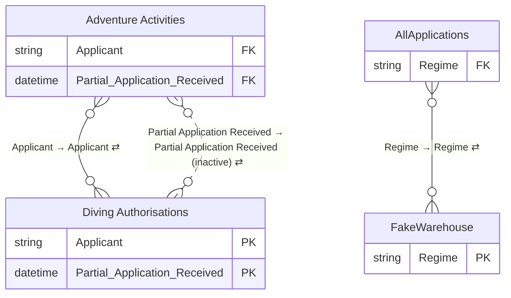

# Permit SPE Dash

*Generated by `scripts/build_docs.py` from `pbix/Permit SPE Dash.pbix`, the Master File sheet "Permit SPE Dash" and the Power Automate Flow Master Register. Regenerate it rather than editing by hand.*

| | |
|---|---|
| Used by | Belinda watt, Principal Advisor |
| Scheduled refresh | Refreshes everyday |
| Dashboard owner | Belinda watt, Chris Thornborough, James Dodwell, Angela Jones |
| SMEs | Adventure Activities - Kay Davies; Asbestos, Diving Authorisations - James Dodwell; HS Controls, CSL - Jon Heard |
| Report | PBIR, 7 pages (5 hidden) |
| Power BI IDs | dataset `4ef3cb10-877a-40c6-a7e6-a35c8adc884f` · report `f344f880-ddc8-458f-8547-5a95946ce158` |

**Model:** 17 tables · 592 columns · 59 measures · 3 relationships. 242 hidden auto date/time tables (`LocalDateTable_*`) are left out.

- [Relationship diagram](#relationship-diagram)
- [Tables](#tables)
- [Table details](#table-details)
- [Measures](#measures)
- [Report pages](#report-pages)

## Relationship diagram



`}o--||` many-to-one · `||--||` one-to-one · dotted line = inactive · ⇄ = filters in both directions. Only key columns are shown.

Not related to any other table: `Amusement Device Registrations`, `Asbestos Applications`, `Holidays`, `Compliance Certifier Application Tracker`, `CSL`, `Query1`, `Commentary`, `HS Controls`, `PECPR`, `Survey`, `DateTable`, `DateTable2`, `UniqueUIDs`.

| From | To | Cardinality | Cross-filter | Active |
|---|---|---|---|---|
| Adventure Activities[Applicant] | Diving Authorisations[Applicant] | M:M | Both | yes |
| Adventure Activities[Partial Application Received] | Diving Authorisations[Partial Application Received] | M:M | Both | no |
| AllApplications[Regime] | FakeWarehouse[Regime] | M:M | Both | yes |

## Tables

| Table | Source | Columns | In report | In Master File | Flows |
|---|---|---|---|---|---|
| [Adventure Activities](#adventure-activities) | SharePoint list: `Adventure Activities` on `Org_Authorisations` | 54 | yes | yes | inferred: [AAOCloseDate](../lineage.md#aaoclosedate), [PopulateAAOUIDs](../lineage.md#populateaaouids) |
| [Amusement Device Registrations](#amusement-device-registrations) | SharePoint list: `Amusement Device Registrations` on `Org_Authorisations` | 64 | no | yes | inferred: [ADRCloseDate](../lineage.md#adrclosedate), [PopulateADRUIDs](../lineage.md#populateadruids) |
| [Asbestos Applications](#asbestos-applications) | SharePoint list: `Asbestos Applications` on `Org_Authorisations` | 68 | no | yes | inferred: [ASBCloseDate](../lineage.md#asbclosedate), [CloseWithoutNotificationDates](../lineage.md#closewithoutnotificationdates), [PopulateASBUIDs](../lineage.md#populateasbuids) |
| [Diving Authorisations](#diving-authorisations) | SharePoint list: `Diving Authorisations` on `Org_Authorisations` | 64 | no | yes | inferred: [OCDCloseDate](../lineage.md#ocdclosedate), [PopulateOCDUIDs](../lineage.md#populateocduids) |
| [AllApplications](#allapplications) | Append of other queries | 125 | yes | yes |  |
| [Holidays](#holidays) | Manual table (Enter Data) | 1 | no | yes |  |
| [FakeWarehouse](#fakewarehouse) | SharePoint list: `FakeWarehouse` on `Org_Authorisations` | 4 | no | yes | documented: [PECPR Warehousing](../lineage.md#pecpr-warehousing), [Update Authorisations Warehousing](../lineage.md#update-authorisations-warehousing), [Warehouse Old Certifications & Exemptions Apps](../lineage.md#warehouse-old-certifications--exemptions-apps) |
| [Compliance Certifier Application Tracker](#compliance-certifier-application-tracker) | SharePoint list: `Compliance Certifier Application Tracker` on `Org_CertEx` | 41 | no | yes | inferred: [CCRCloseDate](../lineage.md#ccrclosedate), [PopulateCCRUIDs](../lineage.md#populateccruids) |
| [CSL](#csl) | SharePoint list: `CSL` on `Org_CertEx` | 52 | no | yes | inferred: [CSLCloseDate](../lineage.md#cslclosedate), [CloseWithoutNotificationDates](../lineage.md#closewithoutnotificationdates), [PopulateCSLUIDs](../lineage.md#populatecsluids) |
| [Query1](#query1) | Power Query calculation (refresh timestamp) | 1 | yes | yes |  |
| [Commentary](#commentary) | SharePoint list: `Commentary` on `AuthorisationsandAdvisoryUnit-AuthandAdvisoryUnit` | 7 | no | yes | documented: [Commnetary Reminder](../lineage.md#commnetary-reminder), [Pending Commentary Reminder](../lineage.md#pending-commentary-reminder) |
| [HS Controls](#hs-controls) | SharePoint list: `HS Controls` on `Org_CertEx` | 37 | no | yes | inferred: [HSCCloseDate](../lineage.md#hscclosedate), [PopulateHSCUIDs](../lineage.md#populatehscuids) |
| [PECPR](#pecpr) | SharePoint list: `PECPR` on `AuthorisationsandAdvisoryUnit-AuthandAdvisoryUnit` | 31 | no | yes | inferred: [PCRCloseDate](../lineage.md#pcrclosedate), [PopulatePCRUIDs](../lineage.md#populatepcruids) |
| [Survey](#survey) | Web API: `https://api.ubiquity.co.nz/surveys/sZXYBBJxa0GLSgjdYIPv9g/responses` | 24 | yes | yes |  |
| [DateTable](#datetable) | DAX calculated table | 9 | yes | yes |  |
| [DateTable2](#datetable2) | DAX calculated table | 9 | no | **no** |  |
| [UniqueUIDs](#uniqueuids) | DAX calculated table | 1 | no | yes |  |

## Table details

### Adventure Activities

**Source:** SharePoint list: `Adventure Activities` on `Org_Authorisations` (list id `507b9f5d-c8ee-4a2a-be55-86a54b0385e5`)

**Master File:** Location: Authorisations - Adventure Activities - All Items · Team: Authorisations · Maintained by: Manual update from the team · Contact: Chris Thornborough<br>Rossano Grand · Flow: No · App: No

**Power Automate flows:**

- [AAOCloseDate](../lineage.md#aaoclosedate): inferred (description mentions "Adventure Activities list")
- [PopulateAAOUIDs](../lineage.md#populateaaouids): inferred (description mentions "AdventureActivities  SharePoint list")

| Column | Type | Kind | Hidden | Referenced by |
|---|---|---|---|---|
| AAO# | String | Data |  | — |
| Applicant | String | Data |  | relationship |
| SharePoint Link | String | Data |  | — |
| Expiry/Action date | DateTime | Data |  | — |
| Partial Application Received | DateTime | Data |  | relationship, DAX |
| Received Completed Application | DateTime | Data |  | DAX |
| Paid Date | String | Data |  | — |
| Status | String | Data |  | DAX |
| Assigned to | String | Data |  | — |
| Job Closed | DateTime | Data |  | DAX |
| Comment | String | Data |  | — |
| Auditor | String | Data |  | — |
| Atlas AAO# | String | Data |  | — |
| Application Time | String | Data |  | — |
| Proposal to refuse/grant with conditions | Boolean | Data |  | — |
| Date proposal sent | DateTime | Data |  | DAX |
| Date Proposal Response Received | DateTime | Data |  | DAX |
| Monitoring of AAOs expired/suspended, etc (eg web check) | String | Data |  | — |
| Condition Due | DateTime | Data |  | — |
| Color Tag | String | Data |  | — |
| Compliance Asset Id | String | Data |  | — |
| Extra info Time | String | Data |  | — |
| Proposal request Downtime | String | Data |  | — |
| ID | Int64 | Data |  | — |
| Type | String | Data |  | — |
| Partial2Complete | Int64 | Calculated |  | — |
| Complete2Closed | Int64 | Calculated |  | — |
| Regime | String | Data |  | — |
| Review RFI Sent 1 | DateTime | Data |  | DAX |
| Review RFI Rxd 1 | DateTime | Data |  | DAX |
| Review RFI Sent 2 | DateTime | Data |  | DAX |
| Review RFI Rxd 2 | DateTime | Data |  | DAX |
| Review RFI Sent 3 | DateTime | Data |  | DAX |
| Review RFI Rxd 3 | DateTime | Data |  | DAX |
| Acknowledgement Date | DateTime | Data |  | DAX |
| Passed to Decider | DateTime | Data |  | DAX |
| Decision Date | DateTime | Data |  | DAX |
| Notification Date | DateTime | Data |  | DAX |
| Assess RFI Sent 1 | DateTime | Data |  | DAX |
| Assess RFI Rxd 1 | DateTime | Data |  | DAX |
| Assess RFI Sent 2 | DateTime | Data |  | DAX |
| Assess RFI Rxd 2 | DateTime | Data |  | DAX |
| Assess RFI Sent 3 | DateTime | Data |  | DAX |
| Assess RFI Rxd 3 | DateTime | Data |  | DAX |
| Assess RFI Sent 4 | DateTime | Data |  | DAX |
| Assess RFI Rxd 4 | DateTime | Data |  | DAX |
| Assess RFI Sent 5 | DateTime | Data |  | DAX |
| Assess RFI Rxd 5 | DateTime | Data |  | DAX |
| UID | String | Data |  | DAX |
| TotalWorkingDays | Double | Data |  | — |
| WorkingDaysTotal | Double | Data |  | — |
| PEPAStatus | String | Data |  | DAX |
| PEPAAssignment | String | Data |  | — |
| Type   | String | Data |  | — |

<details><summary>Calculated columns (DAX)</summary>

**Partial2Complete**

```dax
if('Adventure Activities'[Partial Application Received]>0,NETWORKDAYS('Adventure Activities'[Partial Application Received],'Adventure Activities'[Received Completed Application],1,Holidays),0)
```

**Complete2Closed**

```dax
NETWORKDAYS('Adventure Activities'[Received Completed Application],'Adventure Activities'[Job Closed],1,Holidays)
```

</details>

<details><summary>Power Query (M), redacted</summary>

```m
let
    Source = SharePoint.Tables("https://worksafenz.sharepoint.com/sites/Org_Authorisations/", [Implementation="2.0", ViewMode="All"]),
    #"507b9f5d-c8ee-4a2a-be55-86a54b0385e5" = Source{[Id="507b9f5d-c8ee-4a2a-be55-86a54b0385e5"]}[Items],
    #"Renamed Columns" = Table.RenameColumns(#"507b9f5d-c8ee-4a2a-be55-86a54b0385e5",{{"Name ", "Applicant"}, {"Partial Application Received ", "Partial Application Received"},{"Application Type","Type  "}}),
    #"Added Custom" = Table.AddColumn(#"Renamed Columns", "Regime", each "Adventure Activities"),
    #"Filtered Rows" = Table.SelectRows(#"Added Custom", each ([#"Type  "] <> "TBC")),
    #"Removed Columns" = Table.RemoveColumns(#"Filtered Rows",{"Type"}),
    #"Added Custom1" = Table.AddColumn(#"Removed Columns", "Type", each [#"Type  "]),
    #"Removed Other Columns" = Table.SelectColumns(#"Added Custom1",{"ID", "AAO#", "Applicant", "Type  ", "SharePoint Link", "Expiry/Action date", "Partial Application Received", "Review RFI Sent 1", "Review RFI Rxd 1", "Review RFI Sent 2", "Review RFI Rxd 2", "Review RFI Sent 3", "Review RFI Rxd 3", "Received Completed Application", "Paid Date", "Status", "Assigned to", "Job Closed", "Comment", "Auditor", "Atlas AAO#", "Application Time", "Proposal to refuse/grant with conditions", "Date proposal sent", "Date Proposal Response Received", "Monitoring of AAOs expired/suspended, etc (eg web check)", "Condition Due", "Acknowledgement Date", "Passed to Decider", "Decision Date", "Notification Date", "Assess RFI Sent 1", "Assess RFI Rxd 1", "Assess RFI Sent 2", "Assess RFI Rxd 2", "Assess RFI Sent 3", "Assess RFI Rxd 3", "Assess RFI Sent 4", "Assess RFI Rxd 4", "Assess RFI Sent 5", "Assess RFI Rxd 5", "UID", "TotalWorkingDays", "WorkingDaysTotal", "PEPAStatus", "PEPAAssignment", "Color Tag", "Compliance Asset Id", "Extra info Time", "Proposal request Downtime", "Regime", "Type"})
in
    #"Removed Other Columns"
```

</details>

### Amusement Device Registrations

**Source:** SharePoint list: `Amusement Device Registrations` on `Org_Authorisations` (list id `6d4d1af7-0d18-4de2-8ec8-d10bb6f250cf`)

**Master File:** Location: Authorisations - Amusement Device Registrations - All Items · Team: Authorisations · Maintained by: Manual update from the team · Contact: Chris Thornborough<br>Gareth Ellis · Flow: No · App: No

**Power Automate flows:**

- [ADRCloseDate](../lineage.md#adrclosedate): inferred (description mentions "Amusement Device Registrations list")
- [PopulateADRUIDs](../lineage.md#populateadruids): inferred (description mentions "Amusement Device Registrations SharePoint list")

| Column | Type | Kind | Hidden | Referenced by |
|---|---|---|---|---|
| Applicant | String | Data |  | — |
| Type | String | Data |  | — |
| Cert Date Received | DateTime | Data |  | — |
| Partial Application Received | DateTime | Data |  | DAX |
| Payment Date | DateTime | Data |  | — |
| Invoice Requested | String | Data |  | — |
| Received Completed Application | DateTime | Data |  | DAX |
| Date sent to external party/engineer | DateTime | Data |  | — |
| Information received from external party/engineer | DateTime | Data |  | — |
| Status | String | Data |  | DAX |
| AO | String | Data |  | — |
| Technical Specialist | String | Data |  | — |
| IoM | String | Data |  | — |
| Issuing AO | String | Data |  | — |
| Outcome | String | Data |  | — |
| Decision Date | DateTime | Data |  | DAX |
| New Certificate Expiry Date | DateTime | Data |  | — |
| Working Days | String | Data |  | — |
| SharePoint Link | String | Data |  | — |
| Proposed to Refuse | Boolean | Data |  | — |
| Date proposal sent | DateTime | Data |  | DAX |
| Date Proposal Response Received | DateTime | Data |  | DAX |
| Modified | DateTime | Data |  | — |
| Invoice Number | String | Data |  | — |
| Certifying Engineer | String | Data |  | — |
| CoR follow-up | DateTime | Data |  | — |
| Extra Info | String | Data |  | — |
| Color Tag | String | Data |  | — |
| Compliance Asset Id | String | Data |  | — |
| 1st reminder sent | DateTime | Data |  | — |
| 2nd reminder sent | DateTime | Data |  | — |
| 3rd reminder sent | DateTime | Data |  | — |
| ID | Int64 | Data |  | — |
| Version | String | Data |  | — |
| Edit | String | Data |  | — |
| Regime | String | Data |  | — |
| Acknowledgement Date | DateTime | Data |  | DAX |
| Passed to Decider | DateTime | Data |  | DAX |
| Notification Date | DateTime | Data |  | DAX |
| Review RFI Sent 1 | DateTime | Data |  | DAX |
| Review RFI Rxd 1 | DateTime | Data |  | DAX |
| Review RFI Sent 2 | DateTime | Data |  | DAX |
| Review RFI Rxd 2 | DateTime | Data |  | DAX |
| Review RFI Sent 3 | DateTime | Data |  | DAX |
| Review RFI Rxd 3 | DateTime | Data |  | DAX |
| Assess RFI Sent 1 | DateTime | Data |  | DAX |
| Assess RFI Rxd 1 | DateTime | Data |  | DAX |
| Assess RFI Sent 2 | DateTime | Data |  | DAX |
| Assess RFI Rxd 2 | DateTime | Data |  | DAX |
| Assess RFI Sent 3 | DateTime | Data |  | DAX |
| Assess RFI Rxd 3 | DateTime | Data |  | DAX |
| Assess RFI Sent 4 | DateTime | Data |  | DAX |
| Assess RFI Rxd 4 | DateTime | Data |  | DAX |
| Assess RFI Sent 5 | DateTime | Data |  | DAX |
| Assess RFI Rxd 5 | DateTime | Data |  | DAX |
| UID | String | Data |  | DAX |
| TotalWorkingDays | Double | Data |  | — |
| CoR Condtion Met | DateTime | Data |  | — |
| Contact Name | String | Data |  | — |
| Contact Email | String | Data |  | — |
| WorkingDaysTotal | Double | Data |  | — |
| Send Acknowledgement Email | Boolean | Data |  | — |
| PEPAStatus | String | Data |  | DAX |
| PEPAAssignment | String | Data |  | — |

<details><summary>Power Query (M), redacted</summary>

```m
let
    Source = SharePoint.Tables("https://worksafenz.sharepoint.com/sites/Org_Authorisations/", [Implementation="2.0", ViewMode="All"]),
    #"6d4d1af7-0d18-4de2-8ec8-d10bb6f250cf" = Source{[Id="6d4d1af7-0d18-4de2-8ec8-d10bb6f250cf"]}[Items],
    #"Renamed Columns" = Table.RenameColumns(#"6d4d1af7-0d18-4de2-8ec8-d10bb6f250cf",{{"Device", "Applicant"}, {"Partial Initial Application Received", "Partial Application Received"}}),
    #"Removed Other Columns" = Table.SelectColumns(#"Renamed Columns",{"Applicant", "Application type", "Cert Date Received", "Partial Application Received", "Payment Date", "Invoice Requested", "Received Completed Application", "Date sent to external party/engineer", "Information received from external party/engineer", "Status", "AO", "Technical Specialist", "IoM", "Issuing AO", "Outcome", "Passed to Decider", "Issue date", "Notification Date", "New Certificate Expiry Date", "Working Days", "SharePoint Link", "Proposed to Refuse", "Date proposal sent", "Date Proposal Response Received", "Modified", "Invoice Number", "Certifying Engineer", "CoR follow-up", "CoR Condtion Met", "Extra Info", "Acknowledgement Date", "Review RFI Sent 1", "Review RFI Rxd 1", "Review RFI Sent 2", "Review RFI Rxd 2", "Review RFI Sent 3", "Review RFI Rxd 3", "Assess RFI Sent 1", "Assess RFI Rxd 1", "Assess RFI Sent 2", "Assess RFI Rxd 2", "Assess RFI Sent 3", "Assess RFI Rxd 3", "Assess RFI Sent 4", "Assess RFI Rxd 4", "Assess RFI Sent 5", "Assess RFI Rxd 5", "UJID", "TotalWorkingDays", "Contact Name", "Contact Email", "WorkingDaysTotal", "PEPAStatus", "PEPAAssignment", "Color Tag", "Compliance Asset Id", "1st reminder sent", "2nd reminder sent", "3rd reminder sent", "Send Acknowledgement Email", "ID", "Version", "Edit", "Type"}),
    #"Added Custom" = Table.AddColumn(#"Removed Other Columns", "Regime", each "Amusement Devices"),
    #"Renamed Columns1" = Table.RenameColumns(#"Added Custom",{{"Application type", "Application Type"}}),
    #"Removed Columns" = Table.RemoveColumns(#"Renamed Columns1",{"Type"}),
    #"Renamed Columns2" = Table.RenameColumns(#"Removed Columns",{{"Application Type", "Type"}, {"UJID", "UID"}, {"Issue date", "Decision Date"}})
in
    #"Renamed Columns2"
```

</details>

### Asbestos Applications

**Source:** SharePoint list: `Asbestos Applications` on `Org_Authorisations` (list id `57f4b395-126f-4912-8cc2-d7f3dbd502f2`)

**Master File:** Location: Authorisations - Asbestos Applications - All Items · Team: Authorisations · Maintained by: Manual update from the team · Contact: Chris Thornborough<br>Connor Stairs · Flow: No · App: No

**Power Automate flows:**

- [ASBCloseDate](../lineage.md#asbclosedate): inferred (description mentions "Asbestos Applications list")
- [CloseWithoutNotificationDates](../lineage.md#closewithoutnotificationdates): inferred (description mentions "Asbestos Applications list")
- [PopulateASBUIDs](../lineage.md#populateasbuids): inferred (description mentions "Asbestos Applications SharePoint list")

| Column | Type | Kind | Hidden | Referenced by |
|---|---|---|---|---|
| Partial Application Received | DateTime | Data |  | DAX |
| Received Completed Application | DateTime | Data |  | DAX |
| Closed Date | DateTime | Data |  | — |
| Status | String | Data |  | DAX |
| Applicant | String | Data |  | — |
| Licence Number | String | Data |  | — |
| Licence  Class | String | Data |  | — |
| Type | String | Data |  | — |
| Applicant Names | String | Data |  | — |
| Invoiced | String | Data |  | — |
| Paid | String | Data |  | — |
| Required  | String | Data |  | — |
| Ownership | String | Data |  | — |
| Further Info Requested | String | Data |  | — |
| #Sup  | Double | Data |  | — |
| Proposal to refuse | Boolean | Data |  | — |
| Date proposal sent | DateTime | Data |  | DAX |
| Date Proposal Response Received | DateTime | Data |  | DAX |
| Days Since Complete Application | String | Data |  | — |
| Color Tag | String | Data |  | — |
| Compliance Asset Id | String | Data |  | — |
| Final Completed Date | String | Data |  | — |
| Proposal request Downtime | String | Data |  | — |
| ID | Int64 | Data |  | — |
| Content Type | String | Data |  | — |
| Modified | DateTime | Data |  | — |
| Created | DateTime | Data |  | — |
| Created By | String | Data |  | — |
| Modified By | String | Data |  | — |
| Version | String | Data |  | — |
| Attachments | String | Data |  | — |
| Edit | String | Data |  | — |
| Item Child Count | String | Data |  | — |
| Folder Child Count | String | Data |  | — |
| Label setting | String | Data |  | — |
| Retention label | String | Data |  | — |
| Retention label Applied | String | Data |  | — |
| Label applied by | String | Data |  | — |
| Item is a Record | String | Data |  | — |
| App Created By | String | Data |  | — |
| App Modified By | String | Data |  | — |
| Regime | String | Data |  | — |
| Assess RFI Sent 1 | DateTime | Data |  | DAX |
| Assess RFI Rxd 1 | DateTime | Data |  | DAX |
| Acknowledgement Date | DateTime | Data |  | DAX |
| Passed to Decider | DateTime | Data |  | DAX |
| Decision Date | DateTime | Data |  | DAX |
| Notification Date | DateTime | Data |  | DAX |
| Review RFI Sent 1 | DateTime | Data |  | DAX |
| Review RFI Rxd 1 | DateTime | Data |  | DAX |
| Review RFI Sent 2 | DateTime | Data |  | DAX |
| Review RFI Rxd 2 | DateTime | Data |  | DAX |
| Review RFI Sent 3 | DateTime | Data |  | DAX |
| Review RFI Rxd 3 | DateTime | Data |  | DAX |
| Assess RFI Sent 2 | DateTime | Data |  | DAX |
| Assess RFI Rxd 2 | DateTime | Data |  | DAX |
| Assess RFI Sent 3 | DateTime | Data |  | DAX |
| Assess RFI Rxd 3 | DateTime | Data |  | DAX |
| Assess RFI Sent 4 | DateTime | Data |  | DAX |
| Assess RFI Rxd 4 | DateTime | Data |  | DAX |
| Assess RFI Sent 5 | DateTime | Data |  | DAX |
| Assess RFI Rxd 5 | DateTime | Data |  | DAX |
| UID | String | Data |  | DAX |
| TotalWorkingDays | Double | Data |  | — |
| WorkingDaysTotal | Double | Data |  | — |
| PEPAStatus | String | Data |  | DAX |
| PEPAAssignment | String | Data |  | — |
| Licence Posted | String | Data |  | — |

<details><summary>Power Query (M), redacted</summary>

```m
let
    Source = SharePoint.Tables("https://worksafenz.sharepoint.com/sites/Org_Authorisations/", [Implementation="2.0", ViewMode="All"]),
    #"57f4b395-126f-4912-8cc2-d7f3dbd502f2" = Source{[Id="57f4b395-126f-4912-8cc2-d7f3dbd502f2"]}[Items],
    #"Renamed Columns" = Table.RenameColumns(#"57f4b395-126f-4912-8cc2-d7f3dbd502f2",{{"Licence Holder", "Applicant"}}),
    #"Added Custom" = Table.AddColumn(#"Renamed Columns", "Regime", each "Asbestos"),
    #"Removed Columns" = Table.RemoveColumns(#"Added Custom",{"Type"}),
    #"Renamed Columns1" = Table.RenameColumns(#"Removed Columns",{{"Application Type", "Type"}})
in
    #"Renamed Columns1"
```

</details>

### Diving Authorisations

**Source:** SharePoint list: `Diving Authorisations` on `Org_Authorisations` (list id `f686b5c5-893a-4685-baa2-6c2c1d37b167`)

**Master File:** Location: Authorisations - Diving Authorisations - All Items · Team: Authorisations · Maintained by: Manual update from the team · Contact: Chris Thornborough<br>Ashlyn Deo · Flow: No · App: No

**Power Automate flows:**

- [OCDCloseDate](../lineage.md#ocdclosedate): inferred (description mentions "Diving Authorisations” SharePoint list")
- [PopulateOCDUIDs](../lineage.md#populateocduids): inferred (description mentions "Diving Authorisations SharePoint list")

| Column | Type | Kind | Hidden | Referenced by |
|---|---|---|---|---|
| Applicant | String | Data |  | relationship |
| Current CoC status | String | Data |  | — |
| Status | String | Data |  | DAX |
| Partial Application Received | DateTime | Data |  | relationship, DAX |
| Received Completed Application | DateTime | Data |  | DAX |
| Invoice number: | String | Data |  | — |
| Payment Received  | DateTime | Data |  | — |
| Cats applied for | String | Data |  | — |
| Problem with file if any | String | Data |  | — |
| CoC posted | String | Data |  | — |
| Application Time | String | Data |  | — |
| Proposal to refuse | Boolean | Data |  | — |
| Date proposal sent | DateTime | Data |  | DAX |
| Date Proposal Response Received | DateTime | Data |  | DAX |
| ID | Int64 | Data |  | — |
| Color Tag | String | Data |  | — |
| Compliance Asset Id | String | Data |  | — |
| Extra info Time | String | Data |  | — |
| Proposal request Downtime | String | Data |  | — |
| Content Type | String | Data |  | — |
| Modified | DateTime | Data |  | — |
| Created | DateTime | Data |  | — |
| Created By | String | Data |  | — |
| Modified By | String | Data |  | — |
| Version | String | Data |  | — |
| Attachments | String | Data |  | — |
| Edit | String | Data |  | — |
| Type | String | Data |  | — |
| Item Child Count | String | Data |  | — |
| Folder Child Count | String | Data |  | — |
| Label setting | String | Data |  | — |
| Retention label | String | Data |  | — |
| Retention label Applied | String | Data |  | — |
| Label applied by | String | Data |  | — |
| Item is a Record | String | Data |  | — |
| App Created By | String | Data |  | — |
| App Modified By | String | Data |  | — |
| Regime | String | Data |  | — |
| Review RFI Sent 1 | DateTime | Data |  | DAX |
| Review RFI Rxd 1 | DateTime | Data |  | DAX |
| Acknowledgement Date | DateTime | Data |  | DAX |
| Passed to Decider | DateTime | Data |  | DAX |
| Decision Date | DateTime | Data |  | DAX |
| Notification Date | DateTime | Data |  | DAX |
| Review RFI Sent 2 | DateTime | Data |  | DAX |
| Review RFI Rxd 2 | DateTime | Data |  | DAX |
| Review RFI Sent 3 | DateTime | Data |  | DAX |
| Review RFI Rxd 3 | DateTime | Data |  | DAX |
| Assess RFI Sent 1 | DateTime | Data |  | DAX |
| Assess RFI Rxd 1 | DateTime | Data |  | DAX |
| Assess RFI Sent 2 | DateTime | Data |  | DAX |
| Assess RFI Rxd 2 | DateTime | Data |  | DAX |
| Assess RFI Sent 3 | DateTime | Data |  | DAX |
| Assess RFI Rxd 3 | DateTime | Data |  | DAX |
| Assess RFI Sent 4 | DateTime | Data |  | DAX |
| Assess RFI Rxd 4 | DateTime | Data |  | DAX |
| Assess RFI Sent 5 | DateTime | Data |  | DAX |
| Assess RFI Rxd 5 | DateTime | Data |  | DAX |
| Date CoC Issued | DateTime | Data |  | — |
| UID | String | Data |  | DAX |
| TotalWorkingDays | Double | Data |  | — |
| WorkingDaysTotal | Double | Data |  | — |
| PEPAStatus | String | Data |  | DAX |
| PEPAAssignment | String | Data |  | — |

<details><summary>Power Query (M), redacted</summary>

```m
let
    Source = SharePoint.Tables("https://worksafenz.sharepoint.com/sites/Org_Authorisations/", [Implementation="2.0", ViewMode="All"]),
    #"f686b5c5-893a-4685-baa2-6c2c1d37b167" = Source{[Id="f686b5c5-893a-4685-baa2-6c2c1d37b167"]}[Items],
    #"Renamed Columns" = Table.RenameColumns(#"f686b5c5-893a-4685-baa2-6c2c1d37b167",{{"Name of Applicant", "Applicant"}, {"Partial Application Received ", "Partial Application Received"}}),
    #"Added Custom" = Table.AddColumn(#"Renamed Columns", "Regime", each "Occupational Diving"),
    #"Removed Columns" = Table.RemoveColumns(#"Added Custom",{"Type"}),
    #"Added Custom1" = Table.AddColumn(#"Removed Columns", "Type", each [Current CoC status]),
    #"Renamed Columns1" = Table.RenameColumns(#"Added Custom1",{{"Date CoC Issued/Notified to Applicant", "Date CoC Issued"}})
in
    #"Renamed Columns1"
```

</details>

### AllApplications

**Source:** Append of other queries

**Reads from:** `Adventure Activities`, `Amusement Device Registrations`, `Asbestos Applications`, `CSL`, `Compliance Certifier Application Tracker`, `Diving Authorisations`, `HS Controls`, `PECPR`

**Master File:** Location: Append query · Team: n/a · Maintained by: n/a · Contact: n/a · Flow: No · App: No

| Column | Type | Kind | Hidden | Referenced by |
|---|---|---|---|---|
| AAO# | String | Data |  | — |
| Applicant | String | Data |  | report |
| Application Time | String | Data |  | — |
| Condition Due | DateTime | Data |  | — |
| Date Proposal Response Received | DateTime | Data |  | DAX |
| Date proposal sent | DateTime | Data |  | DAX |
| Job Closed | DateTime | Data |  | DAX |
| New Certificate Expiry Date | DateTime | Data |  | — |
| Paid Date | String | Data |  | — |
| Partial Application Received | DateTime | Data |  | DAX |
| Payment Date | DateTime | Data |  | — |
| Proposal to refuse/grant with conditions | Boolean | Data |  | — |
| Received Completed Application | DateTime | Data |  | report, DAX |
| Regime | String | Data |  | report, relationship |
| Status | String | Data |  | report, DAX |
| Type | String | Data |  | report |
| Type   | String | Data |  | report |
| NetworkCalc | Int64 | Calculated |  | DAX |
| Triage | String | Calculated |  | — |
| DaysSinceReceipt | Int64 | Calculated |  | — |
| OldAtJuly | Int64 | Calculated |  | DAX |
| OldAtJanuary | Int64 | Calculated |  | DAX |
| OldAtFebruary | Int64 | Calculated |  | DAX |
| OldAtMarch | Int64 | Calculated |  | — |
| OldAtApril | Int64 | Calculated |  | DAX |
| OldAtMay | Int64 | Calculated |  | DAX |
| OldAtJune | Int64 | Calculated |  | DAX |
| OldAtAugust | Int64 | Calculated |  | DAX |
| OldAtSeptember | Int64 | Calculated |  | DAX |
| OldAtOctober | Int64 | Calculated |  | DAX |
| OldAtNovember | Int64 | Calculated |  | DAX |
| OldAtDecember | Int64 | Calculated |  | DAX |
| EffectiveCloseDate | DateTime | Data |  | report, DAX |
| Review RFI Sent 1 | DateTime | Data |  | DAX |
| Review RFI Rxd 1 | DateTime | Data |  | DAX |
| Review RFI Sent 2 | DateTime | Data |  | DAX |
| Review RFI Rxd 2 | DateTime | Data |  | DAX |
| Review RFI Sent 3 | DateTime | Data |  | DAX |
| Review RFI Rxd 3 | DateTime | Data |  | DAX |
| Acknowledgement Date | DateTime | Data |  | DAX |
| Passed to Decider | DateTime | Data |  | DAX |
| Decision Date | DateTime | Data |  | DAX |
| Notification Date | DateTime | Data |  | DAX |
| Assess RFI Sent 1 | DateTime | Data |  | DAX |
| Assess RFI Rxd 1 | DateTime | Data |  | DAX |
| Assess RFI Sent 2 | DateTime | Data |  | DAX |
| Assess RFI Rxd 2 | DateTime | Data |  | DAX |
| Assess RFI Sent 3 | DateTime | Data |  | DAX |
| Assess RFI Rxd 3 | DateTime | Data |  | DAX |
| Assess RFI Sent 4 | DateTime | Data |  | DAX |
| Assess RFI Rxd 4 | DateTime | Data |  | DAX |
| Assess RFI Sent 5 | DateTime | Data |  | DAX |
| Assess RFI Rxd 5 | DateTime | Data |  | DAX |
| Review RFI Sent 4 | DateTime | Data |  | — |
| Review RFI Rxd 4 | DateTime | Data |  | — |
| Review RFI Rxd 5 | DateTime | Data |  | — |
| ReviewDownTime | Int64 | Calculated |  | DAX |
| AssessDownTime | Int64 | Calculated |  | DAX |
| ProposalDownTime | Int64 | Calculated |  | DAX |
| TotalDownTime | Int64 | Calculated |  | DAX |
| ReviewDownTimeAtApr | Int64 | Calculated |  | DAX |
| AssessDownTimeAtApr | Int64 | Calculated |  | — |
| ProposalDownTimeAtApr | Int64 | Calculated |  | DAX |
| ReviewDownTimeAtJan | Int64 | Calculated |  | — |
| AssessDownTimeAtJan | Int64 | Calculated |  | DAX |
| ProposalDownTimeAtJan | Int64 | Calculated |  | DAX |
| ReviewDownTimeAtFeb | Int64 | Calculated |  | — |
| AssessDownTimeAtFeb | Int64 | Calculated |  | DAX |
| ProposalDownTimeAtFeb | Int64 | Calculated |  | DAX |
| ReviewDownTimeAtMar | Int64 | Calculated |  | — |
| AssessDownTimeAtMar | Int64 | Calculated |  | DAX |
| ProposalDownTimeAtMar | Int64 | Calculated |  | DAX |
| ReviewDownTimeAtMay | Int64 | Calculated |  | — |
| AssessDownTimeAtMay | Int64 | Calculated |  | DAX |
| ProposalDownTimeAtMay | Int64 | Calculated |  | DAX |
| ReviewDownTimeAtJune | Int64 | Calculated |  | — |
| AssessDownTimeAtJune | Int64 | Calculated |  | DAX |
| ProposalDownTimeAtJune | Int64 | Calculated |  | DAX |
| ReviewDownTimeAtJuly | Int64 | Calculated |  | — |
| AssessDownTimeAtJuly | Int64 | Calculated |  | DAX |
| ProposalDownTimeAtJuly | Int64 | Calculated |  | DAX |
| ReviewDownTimeAtAugust | Int64 | Calculated |  | — |
| AssessDownTimeAtAugust | Int64 | Calculated |  | DAX |
| ProposalDownTimeAtAugust | Int64 | Calculated |  | DAX |
| ReviewDownTimeAtSeptember | Int64 | Calculated |  | — |
| AssessDownTimeAtSeptember | Int64 | Calculated |  | DAX |
| ProposalDownTimeAtSeptember | Int64 | Calculated |  | DAX |
| ReviewDownTimeAtOctober | Int64 | Calculated |  | — |
| AssessDownTimeAtOctober | Int64 | Calculated |  | DAX |
| ProposalDownTimeAtOctober | Int64 | Calculated |  | DAX |
| ReviewDownTimeAtNovember | Int64 | Calculated |  | — |
| AssessDownTimeAtNovember | Int64 | Calculated |  | DAX |
| ProposalDownTimeAtNovember | Int64 | Calculated |  | DAX |
| ReviewDownTimeAtDecember | Int64 | Calculated |  | — |
| AssessDownTimeAtDecember | Int64 | Calculated |  | DAX |
| ProposalDownTimeAtDecember | Int64 | Calculated |  | DAX |
| OldAtFebruary25 | Int64 | Calculated |  | DAX |
| ProposalDownTimeAtFeb25 | Int64 | Calculated |  | DAX |
| ReviewDownTimeAtFeb25 | Int64 | Calculated |  | — |
| AssessDownTimeAtFeb25 | Int64 | Calculated |  | DAX |
| UID | String | Data |  | report, DAX |
| NetworkCalc2 | Int64 | Calculated |  | report, DAX |
| EarliestReceived | DateTime | Calculated |  | report, DAX |
| PEPAStatus | String | Data |  | DAX |
| CurrentStatus | String | Calculated |  | — |
| Elapsed | Int64 | Calculated |  | report |
| OldAtJanuary25 | Int64 | Calculated |  | DAX |
| AssessDownTimeAtJan25 | Int64 | Calculated |  | DAX |
| AssessDownTimeAtMar25 | Int64 | Calculated |  | DAX |
| AssessDownTimeatApr25 | Int64 | Calculated |  | — |
| AssessDownTimeAtMay25 | Int64 | Calculated |  | DAX |
| AssessDownTimeAtJun25 | Int64 | Calculated |  | DAX |
| AssessDownTimeAtJul25 | Int64 | Calculated |  | DAX |
| ProposalDownTimeAtJan25 | Int64 | Calculated |  | DAX |
| ProposalDownTimeAtMar25 | Int64 | Calculated |  | DAX |
| ProposalDownTimeAtApr25 | Int64 | Calculated |  | DAX |
| ProposalDownTimeAtMay25 | Int64 | Calculated |  | DAX |
| ProposalDownTimeAtJun25 | Int64 | Calculated |  | DAX |
| ProposalDownTimeAtJul25 | Int64 | Calculated |  | DAX |
| OldAtMarch25 | Int64 | Calculated |  | DAX |
| OldAtApr25 | Int64 | Calculated |  | DAX |
| OldAtMay25 | Int64 | Calculated |  | DAX |
| OldAtJun25 | Int64 | Calculated |  | DAX |
| OldAtJuly25 | Int64 | Calculated |  | DAX |
| DaystoDecide | Int64 | Calculated |  | report |

<details><summary>Calculated columns (DAX)</summary>

**NetworkCalc**

```dax
IF(ISBLANK('AllApplications'[Received Completed Application]),0,NETWORKDAYS('AllApplications'[Received Completed Application],Today(),1,'Holidays')-('AllApplications'[ProposalDownTime]+'AllApplications'[AssessDownTime]))
```

**Triage**

```dax
"WIP"
```

**DaysSinceReceipt**

```dax
IF(
    NOT(ISBLANK(AllApplications[Partial Application Received])),
    DATEDIFF(AllApplications[Partial Application Received], TODAY(), DAY),
    DATEDIFF(AllApplications[Received Completed Application], TODAY(), DAY)
)
```

**OldAtJuly**

```dax
(IF(OR('AllApplications'[Received Completed Application]>DATE(2024,7,31),ISBLANK('AllApplications'[Received Completed Application])),0, NETWORKDAYS('AllApplications'[Received Completed Application],DATE(2024,7,31),1,'Holidays')))-(AllApplications[AssessDownTimeAtJuly]+AllApplications[ProposalDownTimeAtJuly])
```

**OldAtJanuary**

```dax
(IF(OR('AllApplications'[Received Completed Application]>DATE(2024,1,31),ISBLANK('AllApplications'[Received Completed Application])),0, NETWORKDAYS('AllApplications'[Received Completed Application],DATE(2024,1,31),1,'Holidays')))-(AllApplications[AssessDownTimeAtJan]+AllApplications[ProposalDownTimeAtJan])
```

**OldAtFebruary**

```dax
(IF(OR('AllApplications'[Received Completed Application]>DATE(2024,2,29),ISBLANK('AllApplications'[Received Completed Application])),0, NETWORKDAYS('AllApplications'[Received Completed Application],DATE(2024,2,29),1,'Holidays')))-(AllApplications[AssessDownTimeAtFeb]+AllApplications[ProposalDownTimeAtFeb])
```

**OldAtMarch**

```dax
(IF(OR('AllApplications'[Received Completed Application]>DATE(2024,3,31),ISBLANK('AllApplications'[Received Completed Application])),0, NETWORKDAYS('AllApplications'[Received Completed Application],DATE(2024,3,31),1,'Holidays')))-(AllApplications[AssessDownTimeAtMar]+AllApplications[ProposalDownTimeAtMar])
```

**OldAtApril**

```dax
(IF(OR('AllApplications'[Received Completed Application]>DATE(2024,4,30),ISBLANK('AllApplications'[Received Completed Application])),0, NETWORKDAYS('AllApplications'[Received Completed Application],DATE(2024,4,30),1,'Holidays'))-(AllApplications[ReviewDownTimeAtApr]+AllApplications[ProposalDownTimeAtApr]))
```

**OldAtMay**

```dax
(IF(OR('AllApplications'[Received Completed Application]>DATE(2024,5,31),ISBLANK('AllApplications'[Received Completed Application])),0, NETWORKDAYS('AllApplications'[Received Completed Application],DATE(2024,5,31),1,'Holidays')))-(AllApplications[AssessDownTimeAtMay]+AllApplications[ProposalDownTimeAtMay])
```

**OldAtJune**

```dax
(IF(OR('AllApplications'[Received Completed Application]>DATE(2024,6,30),ISBLANK('AllApplications'[Received Completed Application])),0, NETWORKDAYS('AllApplications'[Received Completed Application],DATE(2024,6,30),1,'Holidays')))-(AllApplications[AssessDownTimeAtJune]+AllApplications[ProposalDownTimeAtJune])
```

**OldAtAugust**

```dax
(IF(OR('AllApplications'[Received Completed Application]>DATE(2024,8,31),ISBLANK('AllApplications'[Received Completed Application])),0, NETWORKDAYS('AllApplications'[Received Completed Application],DATE(2024,8,31),1,'Holidays')))-(AllApplications[AssessDownTimeAtAugust]+AllApplications[ProposalDownTimeAtAugust])
```

**OldAtSeptember**

```dax
(IF(OR('AllApplications'[Received Completed Application]>DATE(2024,9,30),ISBLANK('AllApplications'[Received Completed Application])),0, NETWORKDAYS('AllApplications'[Received Completed Application],DATE(2024,9,30),1,'Holidays')))-(AllApplications[AssessDownTimeAtSeptember]+AllApplications[ProposalDownTimeAtSeptember])
```

**OldAtOctober**

```dax
(IF(OR('AllApplications'[Received Completed Application]>DATE(2024,10,31),ISBLANK('AllApplications'[Received Completed Application])),0, NETWORKDAYS('AllApplications'[Received Completed Application],DATE(2024,10,31),1,'Holidays')))-(AllApplications[AssessDownTimeAtOctober]+AllApplications[ProposalDownTimeAtOctober])
```

**OldAtNovember**

```dax
(IF(OR('AllApplications'[Received Completed Application]>DATE(2024,11,30),ISBLANK('AllApplications'[Received Completed Application])),0, NETWORKDAYS('AllApplications'[Received Completed Application],DATE(2024,11,30),1,'Holidays')))-(AllApplications[AssessDownTimeAtNovember]+AllApplications[ProposalDownTimeAtNovember])
```

**OldAtDecember**

```dax
(IF(OR('AllApplications'[Received Completed Application]>DATE(2024,12,31),ISBLANK('AllApplications'[Received Completed Application])),0, NETWORKDAYS('AllApplications'[Received Completed Application],DATE(2024,12,31),1,'Holidays')))-(AllApplications[AssessDownTimeAtDecember]+AllApplications[ProposalDownTimeAtDecember])
```

**ReviewDownTime**

```dax
VAR RDT1 = If(ISBLANK(AllApplications[Review RFI Sent 1]),0,NETWORKDAYS(
        [Review RFI Sent 1],
        IF(
            ISBLANK([Review RFI Rxd 1]),
            IF(
                NOT ISBLANK([EffectiveCloseDate]),
                [Review RFI Sent 1],  
                TODAY()            
            ),
            [Review RFI Rxd 1]
        ),
        1,
        'Holidays'
    ))
VAR RDT2 = If(ISBLANK(AllApplications[Review RFI Sent 2]),0,NETWORKDAYS(
        [Review RFI Sent 2],
        IF(
            ISBLANK([Review RFI Rxd 2]),
            IF(
                NOT ISBLANK([EffectiveCloseDate]),
                [Review RFI Sent 2],  
                TODAY()            
            ),
            [Review RFI Rxd 2]
        ),
        1,
        'Holidays'
    ))
VAR RDT3 = If(ISBLANK(AllApplications[Review RFI Sent 3]),0,NETWORKDAYS(
        [Review RFI Sent 3],
        IF(
            ISBLANK([Review RFI Rxd 3]),
            IF(
                NOT ISBLANK([EffectiveCloseDate]),
                [Review RFI Sent 3],  
                TODAY()            
            ),
            [Review RFI Rxd 3]
        ),
        1,
        'Holidays'
    ))

RETURN
RDT1+RDT2+RDT3
```

**AssessDownTime**

```dax
VAR ADT1 = If(ISBLANK(AllApplications[Assess RFI Sent 1]),0,NETWORKDAYS(
        [Assess RFI Sent 1],
        IF(
            ISBLANK([Assess RFI Rxd 1]),
            IF(
                NOT ISBLANK([EffectiveCloseDate]),
                [Assess RFI Sent 1],  
                TODAY()            
            ),
            [Assess RFI Rxd 1]
        ),
        1,
        'Holidays'
    ))
VAR ADT2 = If(ISBLANK(AllApplications[Assess RFI Sent 2]),0,NETWORKDAYS(
        [Assess RFI Sent 2],
        IF(
            ISBLANK([Assess RFI Rxd 2]),
            IF(
                NOT ISBLANK([EffectiveCloseDate]),
                [Assess RFI Sent 2],  
                TODAY()            
            ),
            [Assess RFI Rxd 2]
        ),
        1,
        'Holidays'
    ))
VAR ADT3 = If(ISBLANK(AllApplications[Assess RFI Sent 3]),0,NETWORKDAYS(
        [Assess RFI Sent 3],
        IF(
            ISBLANK([Assess RFI Rxd 3]),
            IF(
                NOT ISBLANK([EffectiveCloseDate]),
                [Assess RFI Sent 3],  
                TODAY()            
            ),
            [Assess RFI Rxd 3]
        ),
        1,
        'Holidays'
    ))
VAR ADT4 = If(ISBLANK(AllApplications[Assess RFI Sent 4]),0,NETWORKDAYS(
        [Assess RFI Sent 4],
        IF(
            ISBLANK([Assess RFI Rxd 4]),
            IF(
                NOT ISBLANK([EffectiveCloseDate]),
                [Assess RFI Sent 4],  
                TODAY()            
            ),
            [Assess RFI Rxd 4]
        ),
        1,
        'Holidays'
    ))
VAR ADT5 = If(ISBLANK(AllApplications[Assess RFI Sent 5]),0,NETWORKDAYS(
        [Assess RFI Sent 5],
        IF(
            ISBLANK([Assess RFI Rxd 5]),
            IF(
                NOT ISBLANK([EffectiveCloseDate]),
                [Assess RFI Sent 5],  // same day if closed
                TODAY()            // else it's ongoing
            ),
            [Assess RFI Rxd 5]
        ),
        1,
        'Holidays'
    ))
RETURN
ADT1+ADT2+ADT3+ADT4+ADT5
```

**ProposalDownTime**

```dax
IF(
    ISBLANK([Date proposal sent]),
    0,
    NETWORKDAYS(
        [Date proposal sent],
        IF(
            ISBLANK([Date Proposal Response Received]),
            IF(
                NOT ISBLANK([EffectiveCloseDate]),
                [EffectiveCloseDate],   
                TODAY()                 
            ),
            [Date Proposal Response Received] 
        ),
        1,          
        'Holidays'  
    )
)
```

**TotalDownTime**

```dax
'AllApplications'[ProposalDownTime]+'AllApplications'[AssessDownTime]+'AllApplications'[ReviewDownTime]
```

**ReviewDownTimeAtApr**

```dax
VAR StartDate = [Review RFI Sent 1]
RETURN
IF(
    ISBLANK(StartDate),
    0,
    VAR EndDate =
        IF(
            ISBLANK([Review RFI Rxd 1]),

            IF(
                NOT ISBLANK([EffectiveCloseDate]),
                StartDate,          
                TODAY()             
            ),
            [Review RFI Rxd 1]
        )
    VAR AprEnd = DATE(2024, 4, 30)
    VAR TruncatedEnd =
        IF(
            EndDate > AprEnd,
            AprEnd, 
            EndDate
        )
    RETURN
        IF(
            StartDate <= AprEnd,
            NETWORKDAYS(
                StartDate,
                TruncatedEnd,
                1,          
                'Holidays'  
            ),
            0
        )
)
```

**AssessDownTimeAtApr**

```dax
VAR MonthEnd    = DATE(2024,4,30)
VAR TodayDate = TODAY()

VAR EndDate1 = MIN(
    MonthEnd,
    COALESCE([Assess RFI Rxd 1], [EffectiveCloseDate], TodayDate)
)
VAR EndDate2 = MIN(
    MonthEnd,
    COALESCE([Assess RFI Rxd 2], [EffectiveCloseDate], TodayDate)
)
VAR EndDate3 = MIN(
    MonthEnd,
    COALESCE([Assess RFI Rxd 3], [EffectiveCloseDate], TodayDate)
)
VAR EndDate4 = MIN(
    MonthEnd,
    COALESCE([Assess RFI Rxd 4], [EffectiveCloseDate], TodayDate)
)
VAR EndDate5 = MIN(
    MonthEnd,
    COALESCE([Assess RFI Rxd 5], [EffectiveCloseDate], TodayDate)
)

VAR Down1 =
    IF(
        NOT ISBLANK([Assess RFI Sent 1])
        && [Assess RFI Sent 1] <= MonthEnd,
        NETWORKDAYS(
            [Assess RFI Sent 1],
            EndDate1,
            1,
            'Holidays'
        ),
        0
    )
VAR Down2 =
    IF(
        NOT ISBLANK([Assess RFI Sent 2])
        && [Assess RFI Sent 2] <= MonthEnd,
        NETWORKDAYS(
            [Assess RFI Sent 2],
            EndDate2,
            1,
            'Holidays'
        ),
        0
    )
VAR Down3 =
    IF(
        NOT ISBLANK([Assess RFI Sent 3])
        && [Assess RFI Sent 3] <= MonthEnd,
        NETWORKDAYS(
            [Assess RFI Sent 3],
            EndDate3,
            1,
            'Holidays'
        ),
        0
    )
VAR Down4 =
    IF(
        NOT ISBLANK([Assess RFI Sent 4])
        && [Assess RFI Sent 4] <= MonthEnd,
        NETWORKDAYS(
            [Assess RFI Sent 4],
            EndDate4,
            1,
            'Holidays'
        ),
        0
    )
VAR Down5 =
    IF(
        NOT ISBLANK([Assess RFI Sent 5])
        && [Assess RFI Sent 5] <= MonthEnd,
        NETWORKDAYS(
            [Assess RFI Sent 5],
            EndDate5,
            1,
            'Holidays'
        ),
        0
    )

RETURN
Down1 + Down2 + Down3 + Down4 + Down5
```

**ProposalDownTimeAtApr**

```dax
VAR StartDate = [Date proposal sent]
RETURN
IF(
    ISBLANK(StartDate),
    0,
    VAR EndDate =
        IF(
            ISBLANK([Date Proposal Response Received]),
            IF(
                NOT ISBLANK([EffectiveCloseDate]),
                StartDate,
                TODAY()
            ),
            [Date Proposal Response Received]
        )
    VAR AprEnd = DATE(2024,4,30)
    VAR TruncatedEnd =
        IF(
            EndDate > AprEnd,
            AprEnd,
            EndDate
        )
    RETURN
        IF(
            StartDate <= AprEnd,
            NETWORKDAYS(
                StartDate,
                TruncatedEnd,
                1,          
                'Holidays'  
            ),
            0
        )
)
```

**ReviewDownTimeAtJan**

```dax
VAR StartDate = [Review RFI Sent 1]
RETURN
IF(
    ISBLANK(StartDate),
    0,
    VAR EndDate =
        IF(
            ISBLANK([Review RFI Rxd 1]),

            IF(
                NOT ISBLANK([EffectiveCloseDate]),
                StartDate,          
                TODAY()             
            ),
            [Review RFI Rxd 1]
        )
    VAR JanEnd = DATE(2024, 1, 31)
    VAR TruncatedEnd =
        IF(
            EndDate > JanEnd,
            JanEnd, 
            EndDate
        )
    RETURN
        IF(
            StartDate <= JanEnd,
            NETWORKDAYS(
                StartDate,
                TruncatedEnd,
                1,          
                'Holidays'  
            ),
            0
        )
)
```

**AssessDownTimeAtJan**

```dax
VAR MonthEnd    = DATE(2024,1,31)
VAR TodayDate = TODAY()

VAR EndDate1 = MIN(
    MonthEnd,
    COALESCE([Assess RFI Rxd 1], [EffectiveCloseDate], TodayDate)
)
VAR EndDate2 = MIN(
    MonthEnd,
    COALESCE([Assess RFI Rxd 2], [EffectiveCloseDate], TodayDate)
)
VAR EndDate3 = MIN(
    MonthEnd,
    COALESCE([Assess RFI Rxd 3], [EffectiveCloseDate], TodayDate)
)
VAR EndDate4 = MIN(
    MonthEnd,
    COALESCE([Assess RFI Rxd 4], [EffectiveCloseDate], TodayDate)
)
VAR EndDate5 = MIN(
    MonthEnd,
    COALESCE([Assess RFI Rxd 5], [EffectiveCloseDate], TodayDate)
)

VAR Down1 =
    IF(
        NOT ISBLANK([Assess RFI Sent 1])
        && [Assess RFI Sent 1] <= MonthEnd,
        NETWORKDAYS(
            [Assess RFI Sent 1],
            EndDate1,
            1,
            'Holidays'
        ),
        0
    )
VAR Down2 =
    IF(
        NOT ISBLANK([Assess RFI Sent 2])
        && [Assess RFI Sent 2] <= MonthEnd,
        NETWORKDAYS(
            [Assess RFI Sent 2],
            EndDate2,
            1,
            'Holidays'
        ),
        0
    )
VAR Down3 =
    IF(
        NOT ISBLANK([Assess RFI Sent 3])
        && [Assess RFI Sent 3] <= MonthEnd,
        NETWORKDAYS(
            [Assess RFI Sent 3],
            EndDate3,
            1,
            'Holidays'
        ),
        0
    )
VAR Down4 =
    IF(
        NOT ISBLANK([Assess RFI Sent 4])
        && [Assess RFI Sent 4] <= MonthEnd,
        NETWORKDAYS(
            [Assess RFI Sent 4],
            EndDate4,
            1,
            'Holidays'
        ),
        0
    )
VAR Down5 =
    IF(
        NOT ISBLANK([Assess RFI Sent 5])
        && [Assess RFI Sent 5] <= MonthEnd,
        NETWORKDAYS(
            [Assess RFI Sent 5],
            EndDate5,
            1,
            'Holidays'
        ),
        0
    )

RETURN
Down1 + Down2 + Down3 + Down4 + Down5
```

**ProposalDownTimeAtJan**

```dax
VAR StartDate = [Date proposal sent]
RETURN
IF(
    ISBLANK(StartDate),
    0,
    VAR EndDate =
        IF(
            ISBLANK([Date Proposal Response Received]),
            IF(
                NOT ISBLANK([EffectiveCloseDate]),
                StartDate,
                TODAY()
            ),
            [Date Proposal Response Received]
        )
    VAR JanEnd = DATE(2024,1,31)
    VAR TruncatedEnd =
        IF(
            EndDate > JanEnd,
            JanEnd,
            EndDate
        )
    RETURN
        IF(
            StartDate <= JanEnd,
            NETWORKDAYS(
                StartDate,
                TruncatedEnd,
                1,          
                'Holidays'  
            ),
            0
        )
)
```

**ReviewDownTimeAtFeb**

```dax
VAR StartDate = [Review RFI Sent 1]
RETURN
IF(
    ISBLANK(StartDate),
    0,
    VAR EndDate =
        IF(
            ISBLANK([Review RFI Rxd 1]),

            IF(
                NOT ISBLANK([EffectiveCloseDate]),
                StartDate,          
                TODAY()             
            ),
            [Review RFI Rxd 1]
        )
    VAR FebEnd = DATE(2024, 2, 29)
    VAR TruncatedEnd =
        IF(
            EndDate > FebEnd,
            FebEnd, 
            EndDate
        )
    RETURN
        IF(
            StartDate <= FebEnd,
            NETWORKDAYS(
                StartDate,
                TruncatedEnd,
                1,          
                'Holidays'  
            ),
            0
        )
)
```

**AssessDownTimeAtFeb**

```dax
VAR MonthEnd    = DATE(2024,2,29)
VAR TodayDate = TODAY()

VAR EndDate1 = MIN(
    MonthEnd,
    COALESCE([Assess RFI Rxd 1], [EffectiveCloseDate], TodayDate)
)
VAR EndDate2 = MIN(
    MonthEnd,
    COALESCE([Assess RFI Rxd 2], [EffectiveCloseDate], TodayDate)
)
VAR EndDate3 = MIN(
    MonthEnd,
    COALESCE([Assess RFI Rxd 3], [EffectiveCloseDate], TodayDate)
)
VAR EndDate4 = MIN(
    MonthEnd,
    COALESCE([Assess RFI Rxd 4], [EffectiveCloseDate], TodayDate)
)
VAR EndDate5 = MIN(
    MonthEnd,
    COALESCE([Assess RFI Rxd 5], [EffectiveCloseDate], TodayDate)
)

VAR Down1 =
    IF(
        NOT ISBLANK([Assess RFI Sent 1])
        && [Assess RFI Sent 1] <= MonthEnd,
        NETWORKDAYS(
            [Assess RFI Sent 1],
            EndDate1,
            1,
            'Holidays'
        ),
        0
    )
VAR Down2 =
    IF(
        NOT ISBLANK([Assess RFI Sent 2])
        && [Assess RFI Sent 2] <= MonthEnd,
        NETWORKDAYS(
            [Assess RFI Sent 2],
            EndDate2,
            1,
            'Holidays'
        ),
        0
    )
VAR Down3 =
    IF(
        NOT ISBLANK([Assess RFI Sent 3])
        && [Assess RFI Sent 3] <= MonthEnd,
        NETWORKDAYS(
            [Assess RFI Sent 3],
            EndDate3,
            1,
            'Holidays'
        ),
        0
    )
VAR Down4 =
    IF(
        NOT ISBLANK([Assess RFI Sent 4])
        && [Assess RFI Sent 4] <= MonthEnd,
        NETWORKDAYS(
            [Assess RFI Sent 4],
            EndDate4,
            1,
            'Holidays'
        ),
        0
    )
VAR Down5 =
    IF(
        NOT ISBLANK([Assess RFI Sent 5])
        && [Assess RFI Sent 5] <= MonthEnd,
        NETWORKDAYS(
            [Assess RFI Sent 5],
            EndDate5,
            1,
            'Holidays'
        ),
        0
    )

RETURN
Down1 + Down2 + Down3 + Down4 + Down5
```

**ProposalDownTimeAtFeb**

```dax
VAR StartDate = [Date proposal sent]
RETURN
IF(
    ISBLANK(StartDate),
    0,
    VAR EndDate =
        IF(
            ISBLANK([Date Proposal Response Received]),
            IF(
                NOT ISBLANK([EffectiveCloseDate]),
                StartDate,
                TODAY()
            ),
            [Date Proposal Response Received]
        )
    VAR FebEnd = DATE(2024,2,29)
    VAR TruncatedEnd =
        IF(
            EndDate > FebEnd,
            FebEnd,
            EndDate
        )
    RETURN
        IF(
            StartDate <= FebEnd,
            NETWORKDAYS(
                StartDate,
                TruncatedEnd,
                1,          
                'Holidays'  
            ),
            0
        )
)
```

**ReviewDownTimeAtMar**

```dax
VAR StartDate = [Review RFI Sent 1]
RETURN
IF(
    ISBLANK(StartDate),
    0,
    VAR EndDate =
        IF(
            ISBLANK([Review RFI Rxd 1]),

            IF(
                NOT ISBLANK([EffectiveCloseDate]),
                StartDate,          
                TODAY()             
            ),
            [Review RFI Rxd 1]
        )
    VAR MarEnd = DATE(2024, 3, 31)
    VAR TruncatedEnd =
        IF(
            EndDate > MarEnd,
            MarEnd, 
            EndDate
        )
    RETURN
        IF(
            StartDate <= MarEnd,
            NETWORKDAYS(
                StartDate,
                TruncatedEnd,
                1,          
                'Holidays'  
            ),
            0
        )
)
```

**AssessDownTimeAtMar**

```dax
VAR MonthEnd    = DATE(2024,3,31)
VAR TodayDate = TODAY()

VAR EndDate1 = MIN(
    MonthEnd,
    COALESCE([Assess RFI Rxd 1], [EffectiveCloseDate], TodayDate)
)
VAR EndDate2 = MIN(
    MonthEnd,
    COALESCE([Assess RFI Rxd 2], [EffectiveCloseDate], TodayDate)
)
VAR EndDate3 = MIN(
    MonthEnd,
    COALESCE([Assess RFI Rxd 3], [EffectiveCloseDate], TodayDate)
)
VAR EndDate4 = MIN(
    MonthEnd,
    COALESCE([Assess RFI Rxd 4], [EffectiveCloseDate], TodayDate)
)
VAR EndDate5 = MIN(
    MonthEnd,
    COALESCE([Assess RFI Rxd 5], [EffectiveCloseDate], TodayDate)
)

VAR Down1 =
    IF(
        NOT ISBLANK([Assess RFI Sent 1])
        && [Assess RFI Sent 1] <= MonthEnd,
        NETWORKDAYS(
            [Assess RFI Sent 1],
            EndDate1,
            1,
            'Holidays'
        ),
        0
    )
VAR Down2 =
    IF(
        NOT ISBLANK([Assess RFI Sent 2])
        && [Assess RFI Sent 2] <= MonthEnd,
        NETWORKDAYS(
            [Assess RFI Sent 2],
            EndDate2,
            1,
            'Holidays'
        ),
        0
    )
VAR Down3 =
    IF(
        NOT ISBLANK([Assess RFI Sent 3])
        && [Assess RFI Sent 3] <= MonthEnd,
        NETWORKDAYS(
            [Assess RFI Sent 3],
            EndDate3,
            1,
            'Holidays'
        ),
        0
    )
VAR Down4 =
    IF(
        NOT ISBLANK([Assess RFI Sent 4])
        && [Assess RFI Sent 4] <= MonthEnd,
        NETWORKDAYS(
            [Assess RFI Sent 4],
            EndDate4,
            1,
            'Holidays'
        ),
        0
    )
VAR Down5 =
    IF(
        NOT ISBLANK([Assess RFI Sent 5])
        && [Assess RFI Sent 5] <= MonthEnd,
        NETWORKDAYS(
            [Assess RFI Sent 5],
            EndDate5,
            1,
            'Holidays'
        ),
        0
    )

RETURN
Down1 + Down2 + Down3 + Down4 + Down5
```

**ProposalDownTimeAtMar**

```dax
VAR StartDate = [Date proposal sent]
RETURN
IF(
    ISBLANK(StartDate),
    0,
    VAR EndDate =
        IF(
            ISBLANK([Date Proposal Response Received]),
            IF(
                NOT ISBLANK([EffectiveCloseDate]),
                StartDate,
                TODAY()
            ),
            [Date Proposal Response Received]
        )
    VAR MarEnd = DATE(2024,3,31)
    VAR TruncatedEnd =
        IF(
            EndDate > MarEnd,
            MarEnd,
            EndDate
        )
    RETURN
        IF(
            StartDate <= MarEnd,
            NETWORKDAYS(
                StartDate,
                TruncatedEnd,
                1,          
                'Holidays'  
            ),
            0
        )
)
```

**ReviewDownTimeAtMay**

```dax
VAR StartDate = [Review RFI Sent 1]
RETURN
IF(
    ISBLANK(StartDate),
    0,
    VAR EndDate =
        IF(
            ISBLANK([Review RFI Rxd 1]),

            IF(
                NOT ISBLANK([EffectiveCloseDate]),
                StartDate,          
                TODAY()             
            ),
            [Review RFI Rxd 1]
        )
    VAR MayEnd = DATE(2024, 5, 31)
    VAR TruncatedEnd =
        IF(
            EndDate > MayEnd,
            MayEnd, 
            EndDate
        )
    RETURN
        IF(
            StartDate <= MayEnd,
            NETWORKDAYS(
                StartDate,
                TruncatedEnd,
                1,          
                'Holidays'  
            ),
            0
        )
)
```

**AssessDownTimeAtMay**

```dax
VAR MonthEnd    = DATE(2024,5,31)
VAR TodayDate = TODAY()

VAR EndDate1 = MIN(
    MonthEnd,
    COALESCE([Assess RFI Rxd 1], [EffectiveCloseDate], TodayDate)
)
VAR EndDate2 = MIN(
    MonthEnd,
    COALESCE([Assess RFI Rxd 2], [EffectiveCloseDate], TodayDate)
)
VAR EndDate3 = MIN(
    MonthEnd,
    COALESCE([Assess RFI Rxd 3], [EffectiveCloseDate], TodayDate)
)
VAR EndDate4 = MIN(
    MonthEnd,
    COALESCE([Assess RFI Rxd 4], [EffectiveCloseDate], TodayDate)
)
VAR EndDate5 = MIN(
    MonthEnd,
    COALESCE([Assess RFI Rxd 5], [EffectiveCloseDate], TodayDate)
)

VAR Down1 =
    IF(
        NOT ISBLANK([Assess RFI Sent 1])
        && [Assess RFI Sent 1] <= MonthEnd,
        NETWORKDAYS(
            [Assess RFI Sent 1],
            EndDate1,
            1,
            'Holidays'
        ),
        0
    )
VAR Down2 =
    IF(
        NOT ISBLANK([Assess RFI Sent 2])
        && [Assess RFI Sent 2] <= MonthEnd,
        NETWORKDAYS(
            [Assess RFI Sent 2],
            EndDate2,
            1,
            'Holidays'
        ),
        0
    )
VAR Down3 =
    IF(
        NOT ISBLANK([Assess RFI Sent 3])
        && [Assess RFI Sent 3] <= MonthEnd,
        NETWORKDAYS(
            [Assess RFI Sent 3],
            EndDate3,
            1,
            'Holidays'
        ),
        0
    )
VAR Down4 =
    IF(
        NOT ISBLANK([Assess RFI Sent 4])
        && [Assess RFI Sent 4] <= MonthEnd,
        NETWORKDAYS(
            [Assess RFI Sent 4],
            EndDate4,
            1,
            'Holidays'
        ),
        0
    )
VAR Down5 =
    IF(
        NOT ISBLANK([Assess RFI Sent 5])
        && [Assess RFI Sent 5] <= MonthEnd,
        NETWORKDAYS(
            [Assess RFI Sent 5],
            EndDate5,
            1,
            'Holidays'
        ),
        0
    )

RETURN
Down1 + Down2 + Down3 + Down4 + Down5
```

**ProposalDownTimeAtMay**

```dax
VAR StartDate = [Date proposal sent]
RETURN
IF(
    ISBLANK(StartDate),
    0,
    VAR EndDate =
        IF(
            ISBLANK([Date Proposal Response Received]),
            IF(
                NOT ISBLANK([EffectiveCloseDate]),
                StartDate,
                TODAY()
            ),
            [Date Proposal Response Received]
        )
    VAR MayEnd = DATE(2024,5,31)
    VAR TruncatedEnd =
        IF(
            EndDate > MayEnd,
            MayEnd,
            EndDate
        )
    RETURN
        IF(
            StartDate <= MayEnd,
            NETWORKDAYS(
                StartDate,
                TruncatedEnd,
                1,          
                'Holidays'  
            ),
            0
        )
)
```

**ReviewDownTimeAtJune**

```dax
VAR StartDate = [Review RFI Sent 1]
RETURN
IF(
    ISBLANK(StartDate),
    0,
    VAR EndDate =
        IF(
            ISBLANK([Review RFI Rxd 1]),

            IF(
                NOT ISBLANK([EffectiveCloseDate]),
                StartDate,          
                TODAY()             
            ),
            [Review RFI Rxd 1]
        )
    VAR JuneEnd = DATE(2024, 6, 30)
    VAR TruncatedEnd =
        IF(
            EndDate > JuneEnd,
            JuneEnd, 
            EndDate
        )
    RETURN
        IF(
            StartDate <= JuneEnd,
            NETWORKDAYS(
                StartDate,
                TruncatedEnd,
                1,          
                'Holidays'  
            ),
            0
        )
)
```

**AssessDownTimeAtJune**

```dax
VAR MonthEnd    = DATE(2024,6,30)
VAR TodayDate = TODAY()

VAR EndDate1 = MIN(
    MonthEnd,
    COALESCE([Assess RFI Rxd 1], [EffectiveCloseDate], TodayDate)
)
VAR EndDate2 = MIN(
    MonthEnd,
    COALESCE([Assess RFI Rxd 2], [EffectiveCloseDate], TodayDate)
)
VAR EndDate3 = MIN(
    MonthEnd,
    COALESCE([Assess RFI Rxd 3], [EffectiveCloseDate], TodayDate)
)
VAR EndDate4 = MIN(
    MonthEnd,
    COALESCE([Assess RFI Rxd 4], [EffectiveCloseDate], TodayDate)
)
VAR EndDate5 = MIN(
    MonthEnd,
    COALESCE([Assess RFI Rxd 5], [EffectiveCloseDate], TodayDate)
)

VAR Down1 =
    IF(
        NOT ISBLANK([Assess RFI Sent 1])
        && [Assess RFI Sent 1] <= MonthEnd,
        NETWORKDAYS(
            [Assess RFI Sent 1],
            EndDate1,
            1,
            'Holidays'
        ),
        0
    )
VAR Down2 =
    IF(
        NOT ISBLANK([Assess RFI Sent 2])
        && [Assess RFI Sent 2] <= MonthEnd,
        NETWORKDAYS(
            [Assess RFI Sent 2],
            EndDate2,
            1,
            'Holidays'
        ),
        0
    )
VAR Down3 =
    IF(
        NOT ISBLANK([Assess RFI Sent 3])
        && [Assess RFI Sent 3] <= MonthEnd,
        NETWORKDAYS(
            [Assess RFI Sent 3],
            EndDate3,
            1,
            'Holidays'
        ),
        0
    )
VAR Down4 =
    IF(
        NOT ISBLANK([Assess RFI Sent 4])
        && [Assess RFI Sent 4] <= MonthEnd,
        NETWORKDAYS(
            [Assess RFI Sent 4],
            EndDate4,
            1,
            'Holidays'
        ),
        0
    )
VAR Down5 =
    IF(
        NOT ISBLANK([Assess RFI Sent 5])
        && [Assess RFI Sent 5] <= MonthEnd,
        NETWORKDAYS(
            [Assess RFI Sent 5],
            EndDate5,
            1,
            'Holidays'
        ),
        0
    )

RETURN
Down1 + Down2 + Down3 + Down4 + Down5
```

**ProposalDownTimeAtJune**

```dax
VAR StartDate = [Date proposal sent]
RETURN
IF(
    ISBLANK(StartDate),
    0,
    VAR EndDate =
        IF(
            ISBLANK([Date Proposal Response Received]),
            IF(
                NOT ISBLANK([EffectiveCloseDate]),
                StartDate,
                TODAY()
            ),
            [Date Proposal Response Received]
        )
    VAR JuneEnd = DATE(2024,6,30)
    VAR TruncatedEnd =
        IF(
            EndDate > JuneEnd,
            JuneEnd,
            EndDate
        )
    RETURN
        IF(
            StartDate <= JuneEnd,
            NETWORKDAYS(
                StartDate,
                TruncatedEnd,
                1,          
                'Holidays'  
            ),
            0
        )
)
```

**ReviewDownTimeAtJuly**

```dax
VAR StartDate = [Review RFI Sent 1]
RETURN
IF(
    ISBLANK(StartDate),
    0,
    VAR EndDate =
        IF(
            ISBLANK([Review RFI Rxd 1]),

            IF(
                NOT ISBLANK([EffectiveCloseDate]),
                StartDate,          
                TODAY()             
            ),
            [Review RFI Rxd 1]
        )
    VAR JulyEnd = DATE(2024, 7, 31)
    VAR TruncatedEnd =
        IF(
            EndDate > JulyEnd,
            JulyEnd, 
            EndDate
        )
    RETURN
        IF(
            StartDate <= JulyEnd,
            NETWORKDAYS(
                StartDate,
                TruncatedEnd,
                1,          
                'Holidays'  
            ),
            0
        )
)
```

**AssessDownTimeAtJuly**

```dax
VAR MonthEnd    = DATE(2024,7,31)
VAR TodayDate = TODAY()

VAR EndDate1 = MIN(
    MonthEnd,
    COALESCE([Assess RFI Rxd 1], [EffectiveCloseDate], TodayDate)
)
VAR EndDate2 = MIN(
    MonthEnd,
    COALESCE([Assess RFI Rxd 2], [EffectiveCloseDate], TodayDate)
)
VAR EndDate3 = MIN(
    MonthEnd,
    COALESCE([Assess RFI Rxd 3], [EffectiveCloseDate], TodayDate)
)
VAR EndDate4 = MIN(
    MonthEnd,
    COALESCE([Assess RFI Rxd 4], [EffectiveCloseDate], TodayDate)
)
VAR EndDate5 = MIN(
    MonthEnd,
    COALESCE([Assess RFI Rxd 5], [EffectiveCloseDate], TodayDate)
)

VAR Down1 =
    IF(
        NOT ISBLANK([Assess RFI Sent 1])
        && [Assess RFI Sent 1] <= MonthEnd,
        NETWORKDAYS(
            [Assess RFI Sent 1],
            EndDate1,
            1,
            'Holidays'
        ),
        0
    )
VAR Down2 =
    IF(
        NOT ISBLANK([Assess RFI Sent 2])
        && [Assess RFI Sent 2] <= MonthEnd,
        NETWORKDAYS(
            [Assess RFI Sent 2],
            EndDate2,
            1,
            'Holidays'
        ),
        0
    )
VAR Down3 =
    IF(
        NOT ISBLANK([Assess RFI Sent 3])
        && [Assess RFI Sent 3] <= MonthEnd,
        NETWORKDAYS(
            [Assess RFI Sent 3],
            EndDate3,
            1,
            'Holidays'
        ),
        0
    )
VAR Down4 =
    IF(
        NOT ISBLANK([Assess RFI Sent 4])
        && [Assess RFI Sent 4] <= MonthEnd,
        NETWORKDAYS(
            [Assess RFI Sent 4],
            EndDate4,
            1,
            'Holidays'
        ),
        0
    )
VAR Down5 =
    IF(
        NOT ISBLANK([Assess RFI Sent 5])
        && [Assess RFI Sent 5] <= MonthEnd,
        NETWORKDAYS(
            [Assess RFI Sent 5],
            EndDate5,
            1,
            'Holidays'
        ),
        0
    )

RETURN
Down1 + Down2 + Down3 + Down4 + Down5
```

**ProposalDownTimeAtJuly**

```dax
VAR StartDate = [Date proposal sent]
RETURN
IF(
    ISBLANK(StartDate),
    0,
    VAR EndDate =
        IF(
            ISBLANK([Date Proposal Response Received]),
            IF(
                NOT ISBLANK([EffectiveCloseDate]),
                StartDate,
                TODAY()
            ),
            [Date Proposal Response Received]
        )
    VAR JulyEnd = DATE(2024,7,31)
    VAR TruncatedEnd =
        IF(
            EndDate > JulyEnd,
            JulyEnd,
            EndDate
        )
    RETURN
        IF(
            StartDate <= JulyEnd,
            NETWORKDAYS(
                StartDate,
                TruncatedEnd,
                1,          
                'Holidays'  
            ),
            0
        )
)
```

**ReviewDownTimeAtAugust**

```dax
VAR StartDate = [Review RFI Sent 1]
RETURN
IF(
    ISBLANK(StartDate),
    0,
    VAR EndDate =
        IF(
            ISBLANK([Review RFI Rxd 1]),

            IF(
                NOT ISBLANK([EffectiveCloseDate]),
                StartDate,          
                TODAY()             
            ),
            [Review RFI Rxd 1]
        )
    VAR AugEnd = DATE(2024, 8, 31)
    VAR TruncatedEnd =
        IF(
            EndDate > AugEnd,
            AugEnd, 
            EndDate
        )
    RETURN
        IF(
            StartDate <= AugEnd,
            NETWORKDAYS(
                StartDate,
                TruncatedEnd,
                1,          
                'Holidays'  
            ),
            0
        )
)
```

**AssessDownTimeAtAugust**

```dax
VAR MonthEnd    = DATE(2024,8,31)
VAR TodayDate = TODAY()

VAR EndDate1 = MIN(
    MonthEnd,
    COALESCE([Assess RFI Rxd 1], [EffectiveCloseDate], TodayDate)
)
VAR EndDate2 = MIN(
    MonthEnd,
    COALESCE([Assess RFI Rxd 2], [EffectiveCloseDate], TodayDate)
)
VAR EndDate3 = MIN(
    MonthEnd,
    COALESCE([Assess RFI Rxd 3], [EffectiveCloseDate], TodayDate)
)
VAR EndDate4 = MIN(
    MonthEnd,
    COALESCE([Assess RFI Rxd 4], [EffectiveCloseDate], TodayDate)
)
VAR EndDate5 = MIN(
    MonthEnd,
    COALESCE([Assess RFI Rxd 5], [EffectiveCloseDate], TodayDate)
)

VAR Down1 =
    IF(
        NOT ISBLANK([Assess RFI Sent 1])
        && [Assess RFI Sent 1] <= MonthEnd,
        NETWORKDAYS(
            [Assess RFI Sent 1],
            EndDate1,
            1,
            'Holidays'
        ),
        0
    )
VAR Down2 =
    IF(
        NOT ISBLANK([Assess RFI Sent 2])
        && [Assess RFI Sent 2] <= MonthEnd,
        NETWORKDAYS(
            [Assess RFI Sent 2],
            EndDate2,
            1,
            'Holidays'
        ),
        0
    )
VAR Down3 =
    IF(
        NOT ISBLANK([Assess RFI Sent 3])
        && [Assess RFI Sent 3] <= MonthEnd,
        NETWORKDAYS(
            [Assess RFI Sent 3],
            EndDate3,
            1,
            'Holidays'
        ),
        0
    )
VAR Down4 =
    IF(
        NOT ISBLANK([Assess RFI Sent 4])
        && [Assess RFI Sent 4] <= MonthEnd,
        NETWORKDAYS(
            [Assess RFI Sent 4],
            EndDate4,
            1,
            'Holidays'
        ),
        0
    )
VAR Down5 =
    IF(
        NOT ISBLANK([Assess RFI Sent 5])
        && [Assess RFI Sent 5] <= MonthEnd,
        NETWORKDAYS(
            [Assess RFI Sent 5],
            EndDate5,
            1,
            'Holidays'
        ),
        0
    )

RETURN
Down1 + Down2 + Down3 + Down4 + Down5
```

**ProposalDownTimeAtAugust**

```dax
VAR StartDate = [Date proposal sent]
RETURN
IF(
    ISBLANK(StartDate),
    0,
    VAR EndDate =
        IF(
            ISBLANK([Date Proposal Response Received]),
            IF(
                NOT ISBLANK([EffectiveCloseDate]),
                StartDate,
                TODAY()
            ),
            [Date Proposal Response Received]
        )
    VAR AugEnd = DATE(2024,8,31)
    VAR TruncatedEnd =
        IF(
            EndDate > AugEnd,
            AugEnd,
            EndDate
        )
    RETURN
        IF(
            StartDate <= AugEnd,
            NETWORKDAYS(
                StartDate,
                TruncatedEnd,
                1,          
                'Holidays'  
            ),
            0
        )
)
```

**ReviewDownTimeAtSeptember**

```dax
VAR StartDate = [Review RFI Sent 1]
RETURN
IF(
    ISBLANK(StartDate),
    0,
    VAR EndDate =
        IF(
            ISBLANK([Review RFI Rxd 1]),

            IF(
                NOT ISBLANK([EffectiveCloseDate]),
                StartDate,          
                TODAY()             
            ),
            [Review RFI Rxd 1]
        )
    VAR SepEnd = DATE(2024, 9, 30)
    VAR TruncatedEnd =
        IF(
            EndDate > SepEnd,
            SepEnd, 
            EndDate
        )
    RETURN
        IF(
            StartDate <= SepEnd,
            NETWORKDAYS(
                StartDate,
                TruncatedEnd,
                1,          
                'Holidays'  
            ),
            0
        )
)
```

**AssessDownTimeAtSeptember**

```dax
VAR MonthEnd    = DATE(2024,9,30)
VAR TodayDate = TODAY()

VAR EndDate1 = MIN(
    MonthEnd,
    COALESCE([Assess RFI Rxd 1], [EffectiveCloseDate], TodayDate)
)
VAR EndDate2 = MIN(
    MonthEnd,
    COALESCE([Assess RFI Rxd 2], [EffectiveCloseDate], TodayDate)
)
VAR EndDate3 = MIN(
    MonthEnd,
    COALESCE([Assess RFI Rxd 3], [EffectiveCloseDate], TodayDate)
)
VAR EndDate4 = MIN(
    MonthEnd,
    COALESCE([Assess RFI Rxd 4], [EffectiveCloseDate], TodayDate)
)
VAR EndDate5 = MIN(
    MonthEnd,
    COALESCE([Assess RFI Rxd 5], [EffectiveCloseDate], TodayDate)
)

VAR Down1 =
    IF(
        NOT ISBLANK([Assess RFI Sent 1])
        && [Assess RFI Sent 1] <= MonthEnd,
        NETWORKDAYS(
            [Assess RFI Sent 1],
            EndDate1,
            1,
            'Holidays'
        ),
        0
    )
VAR Down2 =
    IF(
        NOT ISBLANK([Assess RFI Sent 2])
        && [Assess RFI Sent 2] <= MonthEnd,
        NETWORKDAYS(
            [Assess RFI Sent 2],
            EndDate2,
            1,
            'Holidays'
        ),
        0
    )
VAR Down3 =
    IF(
        NOT ISBLANK([Assess RFI Sent 3])
        && [Assess RFI Sent 3] <= MonthEnd,
        NETWORKDAYS(
            [Assess RFI Sent 3],
            EndDate3,
            1,
            'Holidays'
        ),
        0
    )
VAR Down4 =
    IF(
        NOT ISBLANK([Assess RFI Sent 4])
        && [Assess RFI Sent 4] <= MonthEnd,
        NETWORKDAYS(
            [Assess RFI Sent 4],
            EndDate4,
            1,
            'Holidays'
        ),
        0
    )
VAR Down5 =
    IF(
        NOT ISBLANK([Assess RFI Sent 5])
        && [Assess RFI Sent 5] <= MonthEnd,
        NETWORKDAYS(
            [Assess RFI Sent 5],
            EndDate5,
            1,
            'Holidays'
        ),
        0
    )

RETURN
Down1 + Down2 + Down3 + Down4 + Down5
```

**ProposalDownTimeAtSeptember**

```dax
VAR StartDate = [Date proposal sent]
RETURN
IF(
    ISBLANK(StartDate),
    0,
    VAR EndDate =
        IF(
            ISBLANK([Date Proposal Response Received]),
            IF(
                NOT ISBLANK([EffectiveCloseDate]),
                StartDate,
                TODAY()
            ),
            [Date Proposal Response Received]
        )
    VAR SepEnd = DATE(2024,9,30)
    VAR TruncatedEnd =
        IF(
            EndDate > SepEnd,
            SepEnd,
            EndDate
        )
    RETURN
        IF(
            StartDate <= SepEnd,
            NETWORKDAYS(
                StartDate,
                TruncatedEnd,
                1,          
                'Holidays'  
            ),
            0
        )
)
```

**ReviewDownTimeAtOctober**

```dax
VAR StartDate = [Review RFI Sent 1]
RETURN
IF(
    ISBLANK(StartDate),
    0,
    VAR EndDate =
        IF(
            ISBLANK([Review RFI Rxd 1]),

            IF(
                NOT ISBLANK([EffectiveCloseDate]),
                StartDate,          
                TODAY()             
            ),
            [Review RFI Rxd 1]
        )
    VAR OctEnd = DATE(2024, 10, 31)
    VAR TruncatedEnd =
        IF(
            EndDate > OctEnd,
            OctEnd, 
            EndDate
        )
    RETURN
        IF(
            StartDate <= OctEnd,
            NETWORKDAYS(
                StartDate,
                TruncatedEnd,
                1,          
                'Holidays'  
            ),
            0
        )
)
```

**AssessDownTimeAtOctober**

```dax
VAR MonthEnd    = DATE(2024,10,31)
VAR TodayDate = TODAY()

VAR EndDate1 = MIN(
    MonthEnd,
    COALESCE([Assess RFI Rxd 1], [EffectiveCloseDate], TodayDate)
)
VAR EndDate2 = MIN(
    MonthEnd,
    COALESCE([Assess RFI Rxd 2], [EffectiveCloseDate], TodayDate)
)
VAR EndDate3 = MIN(
    MonthEnd,
    COALESCE([Assess RFI Rxd 3], [EffectiveCloseDate], TodayDate)
)
VAR EndDate4 = MIN(
    MonthEnd,
    COALESCE([Assess RFI Rxd 4], [EffectiveCloseDate], TodayDate)
)
VAR EndDate5 = MIN(
    MonthEnd,
    COALESCE([Assess RFI Rxd 5], [EffectiveCloseDate], TodayDate)
)

VAR Down1 =
    IF(
        NOT ISBLANK([Assess RFI Sent 1])
        && [Assess RFI Sent 1] <= MonthEnd,
        NETWORKDAYS(
            [Assess RFI Sent 1],
            EndDate1,
            1,
            'Holidays'
        ),
        0
    )
VAR Down2 =
    IF(
        NOT ISBLANK([Assess RFI Sent 2])
        && [Assess RFI Sent 2] <= MonthEnd,
        NETWORKDAYS(
            [Assess RFI Sent 2],
            EndDate2,
            1,
            'Holidays'
        ),
        0
    )
VAR Down3 =
    IF(
        NOT ISBLANK([Assess RFI Sent 3])
        && [Assess RFI Sent 3] <= MonthEnd,
        NETWORKDAYS(
            [Assess RFI Sent 3],
            EndDate3,
            1,
            'Holidays'
        ),
        0
    )
VAR Down4 =
    IF(
        NOT ISBLANK([Assess RFI Sent 4])
        && [Assess RFI Sent 4] <= MonthEnd,
        NETWORKDAYS(
            [Assess RFI Sent 4],
            EndDate4,
            1,
            'Holidays'
        ),
        0
    )
VAR Down5 =
    IF(
        NOT ISBLANK([Assess RFI Sent 5])
        && [Assess RFI Sent 5] <= MonthEnd,
        NETWORKDAYS(
            [Assess RFI Sent 5],
            EndDate5,
            1,
            'Holidays'
        ),
        0
    )

RETURN
Down1 + Down2 + Down3 + Down4 + Down5
```

**ProposalDownTimeAtOctober**

```dax
VAR StartDate = [Date proposal sent]
RETURN
IF(
    ISBLANK(StartDate),
    0,
    VAR EndDate =
        IF(
            ISBLANK([Date Proposal Response Received]),
            IF(
                NOT ISBLANK([EffectiveCloseDate]),
                StartDate,
                TODAY()
            ),
            [Date Proposal Response Received]
        )
    VAR OctEnd = DATE(2024,10,31)
    VAR TruncatedEnd =
        IF(
            EndDate > OctEnd,
            OctEnd,
            EndDate
        )
    RETURN
        IF(
            StartDate <= OctEnd,
            NETWORKDAYS(
                StartDate,
                TruncatedEnd,
                1,          
                'Holidays'  
            ),
            0
        )
)
```

**ReviewDownTimeAtNovember**

```dax
VAR StartDate = [Review RFI Sent 1]
RETURN
IF(
    ISBLANK(StartDate),
    0,
    VAR EndDate =
        IF(
            ISBLANK([Review RFI Rxd 1]),

            IF(
                NOT ISBLANK([EffectiveCloseDate]),
                StartDate,          
                TODAY()             
            ),
            [Review RFI Rxd 1]
        )
    VAR NovEnd = DATE(2024, 11, 30)
    VAR TruncatedEnd =
        IF(
            EndDate > NovEnd,
            NovEnd, 
            EndDate
        )
    RETURN
        IF(
            StartDate <= NovEnd,
            NETWORKDAYS(
                StartDate,
                TruncatedEnd,
                1,          
                'Holidays'  
            ),
            0
        )
)
```

**AssessDownTimeAtNovember**

```dax
VAR MonthEnd    = DATE(2024,11,30)
VAR TodayDate = TODAY()

VAR EndDate1 = MIN(
    MonthEnd,
    COALESCE([Assess RFI Rxd 1], [EffectiveCloseDate], TodayDate)
)
VAR EndDate2 = MIN(
    MonthEnd,
    COALESCE([Assess RFI Rxd 2], [EffectiveCloseDate], TodayDate)
)
VAR EndDate3 = MIN(
    MonthEnd,
    COALESCE([Assess RFI Rxd 3], [EffectiveCloseDate], TodayDate)
)
VAR EndDate4 = MIN(
    MonthEnd,
    COALESCE([Assess RFI Rxd 4], [EffectiveCloseDate], TodayDate)
)
VAR EndDate5 = MIN(
    MonthEnd,
    COALESCE([Assess RFI Rxd 5], [EffectiveCloseDate], TodayDate)
)

VAR Down1 =
    IF(
        NOT ISBLANK([Assess RFI Sent 1])
        && [Assess RFI Sent 1] <= MonthEnd,
        NETWORKDAYS(
            [Assess RFI Sent 1],
            EndDate1,
            1,
            'Holidays'
        ),
        0
    )
VAR Down2 =
    IF(
        NOT ISBLANK([Assess RFI Sent 2])
        && [Assess RFI Sent 2] <= MonthEnd,
        NETWORKDAYS(
            [Assess RFI Sent 2],
            EndDate2,
            1,
            'Holidays'
        ),
        0
    )
VAR Down3 =
    IF(
        NOT ISBLANK([Assess RFI Sent 3])
        && [Assess RFI Sent 3] <= MonthEnd,
        NETWORKDAYS(
            [Assess RFI Sent 3],
            EndDate3,
            1,
            'Holidays'
        ),
        0
    )
VAR Down4 =
    IF(
        NOT ISBLANK([Assess RFI Sent 4])
        && [Assess RFI Sent 4] <= MonthEnd,
        NETWORKDAYS(
            [Assess RFI Sent 4],
            EndDate4,
            1,
            'Holidays'
        ),
        0
    )
VAR Down5 =
    IF(
        NOT ISBLANK([Assess RFI Sent 5])
        && [Assess RFI Sent 5] <= MonthEnd,
        NETWORKDAYS(
            [Assess RFI Sent 5],
            EndDate5,
            1,
            'Holidays'
        ),
        0
    )

RETURN
Down1 + Down2 + Down3 + Down4 + Down5
```

**ProposalDownTimeAtNovember**

```dax
VAR StartDate = [Date proposal sent]
RETURN
IF(
    ISBLANK(StartDate),
    0,
    VAR EndDate =
        IF(
            ISBLANK([Date Proposal Response Received]),
            IF(
                NOT ISBLANK([EffectiveCloseDate]),
                StartDate,
                TODAY()
            ),
            [Date Proposal Response Received]
        )
    VAR NovEnd = DATE(2024,11,30)
    VAR TruncatedEnd =
        IF(
            EndDate > NovEnd,
            NovEnd,
            EndDate
        )
    RETURN
        IF(
            StartDate <= NovEnd,
            NETWORKDAYS(
                StartDate,
                TruncatedEnd,
                1,          
                'Holidays'  
            ),
            0
        )
)
```

**ReviewDownTimeAtDecember**

```dax
VAR StartDate = [Review RFI Sent 1]
RETURN
IF(
    ISBLANK(StartDate),
    0,
    VAR EndDate =
        IF(
            ISBLANK([Review RFI Rxd 1]),

            IF(
                NOT ISBLANK([EffectiveCloseDate]),
                StartDate,          
                TODAY()             
            ),
            [Review RFI Rxd 1]
        )
    VAR DecEnd = DATE(2024, 12, 31)
    VAR TruncatedEnd =
        IF(
            EndDate > DecEnd,
            DecEnd, 
            EndDate
        )
    RETURN
        IF(
            StartDate <= DecEnd,
            NETWORKDAYS(
                StartDate,
                TruncatedEnd,
                1,          
                'Holidays'  
            ),
            0
        )
)
```

**AssessDownTimeAtDecember**

```dax
VAR MonthEnd    = DATE(2024,12,31)
VAR TodayDate = TODAY()

VAR EndDate1 = MIN(
    MonthEnd,
    COALESCE([Assess RFI Rxd 1], [EffectiveCloseDate], TodayDate)
)
VAR EndDate2 = MIN(
    MonthEnd,
    COALESCE([Assess RFI Rxd 2], [EffectiveCloseDate], TodayDate)
)
VAR EndDate3 = MIN(
    MonthEnd,
    COALESCE([Assess RFI Rxd 3], [EffectiveCloseDate], TodayDate)
)
VAR EndDate4 = MIN(
    MonthEnd,
    COALESCE([Assess RFI Rxd 4], [EffectiveCloseDate], TodayDate)
)
VAR EndDate5 = MIN(
    MonthEnd,
    COALESCE([Assess RFI Rxd 5], [EffectiveCloseDate], TodayDate)
)

VAR Down1 =
    IF(
        NOT ISBLANK([Assess RFI Sent 1])
        && [Assess RFI Sent 1] <= MonthEnd,
        NETWORKDAYS(
            [Assess RFI Sent 1],
            EndDate1,
            1,
            'Holidays'
        ),
        0
    )
VAR Down2 =
    IF(
        NOT ISBLANK([Assess RFI Sent 2])
        && [Assess RFI Sent 2] <= MonthEnd,
        NETWORKDAYS(
            [Assess RFI Sent 2],
            EndDate2,
            1,
            'Holidays'
        ),
        0
    )
VAR Down3 =
    IF(
        NOT ISBLANK([Assess RFI Sent 3])
        && [Assess RFI Sent 3] <= MonthEnd,
        NETWORKDAYS(
            [Assess RFI Sent 3],
            EndDate3,
            1,
            'Holidays'
        ),
        0
    )
VAR Down4 =
    IF(
        NOT ISBLANK([Assess RFI Sent 4])
        && [Assess RFI Sent 4] <= MonthEnd,
        NETWORKDAYS(
            [Assess RFI Sent 4],
            EndDate4,
            1,
            'Holidays'
        ),
        0
    )
VAR Down5 =
    IF(
        NOT ISBLANK([Assess RFI Sent 5])
        && [Assess RFI Sent 5] <= MonthEnd,
        NETWORKDAYS(
            [Assess RFI Sent 5],
            EndDate5,
            1,
            'Holidays'
        ),
        0
    )

RETURN
Down1 + Down2 + Down3 + Down4 + Down5
```

**ProposalDownTimeAtDecember**

```dax
VAR StartDate = [Date proposal sent]
RETURN
IF(
    ISBLANK(StartDate),
    0,
    VAR EndDate =
        IF(
            ISBLANK([Date Proposal Response Received]),
            IF(
                NOT ISBLANK([EffectiveCloseDate]),
                StartDate,
                TODAY()
            ),
            [Date Proposal Response Received]
        )
    VAR DecEnd = DATE(2024,12,31)
    VAR TruncatedEnd =
        IF(
            EndDate > DecEnd,
            DecEnd,
            EndDate
        )
    RETURN
        IF(
            StartDate <= DecEnd,
            NETWORKDAYS(
                StartDate,
                TruncatedEnd,
                1,          
                'Holidays'  
            ),
            0
        )
)
```

**OldAtFebruary25**

```dax
(IF(OR('AllApplications'[Received Completed Application]>DATE(2025,2,28),ISBLANK('AllApplications'[Received Completed Application])),0, NETWORKDAYS('AllApplications'[Received Completed Application],DATE(2025,2,28),1,'Holidays')))-(AllApplications[AssessDownTimeAtFeb25]+AllApplications[ProposalDownTimeAtFeb25])
```

**ProposalDownTimeAtFeb25**

```dax
VAR StartDate = [Date proposal sent]
RETURN
IF(
    ISBLANK(StartDate),
    0,
    VAR EndDate =
        IF(
            ISBLANK([Date Proposal Response Received]),
            IF(
                NOT ISBLANK([EffectiveCloseDate]),
                StartDate,
                TODAY()
            ),
            [Date Proposal Response Received]
        )
    VAR FebEnd = DATE(2025,2,28)
    VAR TruncatedEnd =
        IF(
            EndDate > FebEnd,
            FebEnd,
            EndDate
        )
    RETURN
        IF(
            StartDate <= FebEnd,
            NETWORKDAYS(
                StartDate,
                TruncatedEnd,
                1,          
                'Holidays'  
            ),
            0
        )
)
```

**ReviewDownTimeAtFeb25**

```dax
VAR StartDate = [Review RFI Sent 1]
RETURN
IF(
    ISBLANK(StartDate),
    0,
    VAR EndDate =
        IF(
            ISBLANK([Review RFI Rxd 1]),

            IF(
                NOT ISBLANK([EffectiveCloseDate]),
                StartDate,          
                TODAY()             
            ),
            [Review RFI Rxd 1]
        )
    VAR FebEnd = DATE(2025, 2, 28)
    VAR TruncatedEnd =
        IF(
            EndDate > FebEnd,
            FebEnd, 
            EndDate
        )
    RETURN
        IF(
            StartDate <= FebEnd,
            NETWORKDAYS(
                StartDate,
                TruncatedEnd,
                1,          
                'Holidays'  
            ),
            0
        )
)
```

**AssessDownTimeAtFeb25**

```dax
VAR MonthEnd    = DATE(2025,2,28)
VAR TodayDate = TODAY()

VAR EndDate1 = MIN(
    MonthEnd,
    COALESCE([Assess RFI Rxd 1], [EffectiveCloseDate], TodayDate)
)
VAR EndDate2 = MIN(
    MonthEnd,
    COALESCE([Assess RFI Rxd 2], [EffectiveCloseDate], TodayDate)
)
VAR EndDate3 = MIN(
    MonthEnd,
    COALESCE([Assess RFI Rxd 3], [EffectiveCloseDate], TodayDate)
)
VAR EndDate4 = MIN(
    MonthEnd,
    COALESCE([Assess RFI Rxd 4], [EffectiveCloseDate], TodayDate)
)
VAR EndDate5 = MIN(
    MonthEnd,
    COALESCE([Assess RFI Rxd 5], [EffectiveCloseDate], TodayDate)
)

VAR Down1 =
    IF(
        NOT ISBLANK([Assess RFI Sent 1])
        && [Assess RFI Sent 1] <= MonthEnd,
        NETWORKDAYS(
            [Assess RFI Sent 1],
            EndDate1,
            1,
            'Holidays'
        ),
        0
    )
VAR Down2 =
    IF(
        NOT ISBLANK([Assess RFI Sent 2])
        && [Assess RFI Sent 2] <= MonthEnd,
        NETWORKDAYS(
            [Assess RFI Sent 2],
            EndDate2,
            1,
            'Holidays'
        ),
        0
    )
VAR Down3 =
    IF(
        NOT ISBLANK([Assess RFI Sent 3])
        && [Assess RFI Sent 3] <= MonthEnd,
        NETWORKDAYS(
            [Assess RFI Sent 3],
            EndDate3,
            1,
            'Holidays'
        ),
        0
    )
VAR Down4 =
    IF(
        NOT ISBLANK([Assess RFI Sent 4])
        && [Assess RFI Sent 4] <= MonthEnd,
        NETWORKDAYS(
            [Assess RFI Sent 4],
            EndDate4,
            1,
            'Holidays'
        ),
        0
    )
VAR Down5 =
    IF(
        NOT ISBLANK([Assess RFI Sent 5])
        && [Assess RFI Sent 5] <= MonthEnd,
        NETWORKDAYS(
            [Assess RFI Sent 5],
            EndDate5,
            1,
            'Holidays'
        ),
        0
    )

RETURN
Down1 + Down2 + Down3 + Down4 + Down5
```

**NetworkCalc2**

```dax
IF(ISBLANK('AllApplications'[Received Completed Application]),0,NETWORKDAYS('AllApplications'[Received Completed Application],'AllApplications'[EffectiveCloseDate],1,'Holidays')-('AllApplications'[ProposalDownTime]+'AllApplications'[AssessDownTime]))
```

**EarliestReceived**

```dax
VAR p = [Partial Application Received]
VAR c = [Received Completed Application]
RETURN
IF(
    ISBLANK(p) && ISBLANK(c),
    BLANK(),
    IF(
        NOT ISBLANK(p) && NOT ISBLANK(c),
        MIN(p, c),
        COALESCE(p, c)
    )
)
```

**CurrentStatus**

```dax
VAR list = [Status]
VAR pepa = [PEPAStatus]
RETURN
IF(
    ISBLANK(pepa) || pepa="In Progress" || pepa = "",
    list,pepa)
```

**Elapsed**

```dax
DATEDIFF('AllApplications'[EarliestReceived],'AllApplications'[EffectiveCloseDate],DAY)
```

**OldAtJanuary25**

```dax
(IF(OR('AllApplications'[Received Completed Application]>DATE(2025,1,31),ISBLANK('AllApplications'[Received Completed Application])),0, NETWORKDAYS('AllApplications'[Received Completed Application],DATE(2025,1,31),1,'Holidays')))-(AllApplications[AssessDownTimeAtJan25]+AllApplications[ProposalDownTimeAtJan25])
```

**AssessDownTimeAtJan25**

```dax
VAR MonthEnd    = DATE(2025,1,31)
VAR TodayDate = TODAY()

VAR EndDate1 = MIN(
    MonthEnd,
    COALESCE([Assess RFI Rxd 1], [EffectiveCloseDate], TodayDate)
)
VAR EndDate2 = MIN(
    MonthEnd,
    COALESCE([Assess RFI Rxd 2], [EffectiveCloseDate], TodayDate)
)
VAR EndDate3 = MIN(
    MonthEnd,
    COALESCE([Assess RFI Rxd 3], [EffectiveCloseDate], TodayDate)
)
VAR EndDate4 = MIN(
    MonthEnd,
    COALESCE([Assess RFI Rxd 4], [EffectiveCloseDate], TodayDate)
)
VAR EndDate5 = MIN(
    MonthEnd,
    COALESCE([Assess RFI Rxd 5], [EffectiveCloseDate], TodayDate)
)

VAR Down1 =
    IF(
        NOT ISBLANK([Assess RFI Sent 1])
        && [Assess RFI Sent 1] <= MonthEnd,
        NETWORKDAYS(
            [Assess RFI Sent 1],
            EndDate1,
            1,
            'Holidays'
        ),
        0
    )
VAR Down2 =
    IF(
        NOT ISBLANK([Assess RFI Sent 2])
        && [Assess RFI Sent 2] <= MonthEnd,
        NETWORKDAYS(
            [Assess RFI Sent 2],
            EndDate2,
            1,
            'Holidays'
        ),
        0
    )
VAR Down3 =
    IF(
        NOT ISBLANK([Assess RFI Sent 3])
        && [Assess RFI Sent 3] <= MonthEnd,
        NETWORKDAYS(
            [Assess RFI Sent 3],
            EndDate3,
            1,
            'Holidays'
        ),
        0
    )
VAR Down4 =
    IF(
        NOT ISBLANK([Assess RFI Sent 4])
        && [Assess RFI Sent 4] <= MonthEnd,
        NETWORKDAYS(
            [Assess RFI Sent 4],
            EndDate4,
            1,
            'Holidays'
        ),
        0
    )
VAR Down5 =
    IF(
        NOT ISBLANK([Assess RFI Sent 5])
        && [Assess RFI Sent 5] <= MonthEnd,
        NETWORKDAYS(
            [Assess RFI Sent 5],
            EndDate5,
            1,
            'Holidays'
        ),
        0
    )

RETURN
Down1 + Down2 + Down3 + Down4 + Down5
```

**AssessDownTimeAtMar25**

```dax
VAR MonthEnd  = DATE(2025,3,31)
VAR TodayDate = TODAY()

VAR EndDate1 = MIN(
    MonthEnd,
    COALESCE([Assess RFI Rxd 1], [EffectiveCloseDate], TodayDate)
)
VAR EndDate2 = MIN(
    MonthEnd,
    COALESCE([Assess RFI Rxd 2], [EffectiveCloseDate], TodayDate)
)
VAR EndDate3 = MIN(
    MonthEnd,
    COALESCE([Assess RFI Rxd 3], [EffectiveCloseDate], TodayDate)
)
VAR EndDate4 = MIN(
    MonthEnd,
    COALESCE([Assess RFI Rxd 4], [EffectiveCloseDate], TodayDate)
)
VAR EndDate5 = MIN(
    MonthEnd,
    COALESCE([Assess RFI Rxd 5], [EffectiveCloseDate], TodayDate)
)

VAR Down1 =
    IF(
        NOT ISBLANK([Assess RFI Sent 1])
        && [Assess RFI Sent 1] <= MonthEnd,
        NETWORKDAYS(
            [Assess RFI Sent 1],
            EndDate1,
            1,
            'Holidays'
        ),
        0
    )
VAR Down2 =
    IF(
        NOT ISBLANK([Assess RFI Sent 2])
        && [Assess RFI Sent 2] <= MonthEnd,
        NETWORKDAYS(
            [Assess RFI Sent 2],
            EndDate2,
            1,
            'Holidays'
        ),
        0
    )
VAR Down3 =
    IF(
        NOT ISBLANK([Assess RFI Sent 3])
        && [Assess RFI Sent 3] <= MonthEnd,
        NETWORKDAYS(
            [Assess RFI Sent 3],
            EndDate3,
            1,
            'Holidays'
        ),
        0
    )
VAR Down4 =
    IF(
        NOT ISBLANK([Assess RFI Sent 4])
        && [Assess RFI Sent 4] <= MonthEnd,
        NETWORKDAYS(
            [Assess RFI Sent 4],
            EndDate4,
            1,
            'Holidays'
        ),
        0
    )
VAR Down5 =
    IF(
        NOT ISBLANK([Assess RFI Sent 5])
        && [Assess RFI Sent 5] <= MonthEnd,
        NETWORKDAYS(
            [Assess RFI Sent 5],
            EndDate5,
            1,
            'Holidays'
        ),
        0
    )

RETURN
Down1 + Down2 + Down3 + Down4 + Down5
```

**AssessDownTimeatApr25**

```dax
VAR MonthEnd  = DATE(2025,4,30)
VAR TodayDate = TODAY()

VAR EndDate1 = MIN(
    MonthEnd,
    COALESCE([Assess RFI Rxd 1], [EffectiveCloseDate], TodayDate)
)
VAR EndDate2 = MIN(
    MonthEnd,
    COALESCE([Assess RFI Rxd 2], [EffectiveCloseDate], TodayDate)
)
VAR EndDate3 = MIN(
    MonthEnd,
    COALESCE([Assess RFI Rxd 3], [EffectiveCloseDate], TodayDate)
)
VAR EndDate4 = MIN(
    MonthEnd,
    COALESCE([Assess RFI Rxd 4], [EffectiveCloseDate], TodayDate)
)
VAR EndDate5 = MIN(
    MonthEnd,
    COALESCE([Assess RFI Rxd 5], [EffectiveCloseDate], TodayDate)
)

VAR Down1 =
    IF(
        NOT ISBLANK([Assess RFI Sent 1])
        && [Assess RFI Sent 1] <= MonthEnd,
        NETWORKDAYS(
            [Assess RFI Sent 1],
            EndDate1,
            1,
            'Holidays'
        ),
        0
    )
VAR Down2 =
    IF(
        NOT ISBLANK([Assess RFI Sent 2])
        && [Assess RFI Sent 2] <= MonthEnd,
        NETWORKDAYS(
            [Assess RFI Sent 2],
            EndDate2,
            1,
            'Holidays'
        ),
        0
    )
VAR Down3 =
    IF(
        NOT ISBLANK([Assess RFI Sent 3])
        && [Assess RFI Sent 3] <= MonthEnd,
        NETWORKDAYS(
            [Assess RFI Sent 3],
            EndDate3,
            1,
            'Holidays'
        ),
        0
    )
VAR Down4 =
    IF(
        NOT ISBLANK([Assess RFI Sent 4])
        && [Assess RFI Sent 4] <= MonthEnd,
        NETWORKDAYS(
            [Assess RFI Sent 4],
            EndDate4,
            1,
            'Holidays'
        ),
        0
    )
VAR Down5 =
    IF(
        NOT ISBLANK([Assess RFI Sent 5])
        && [Assess RFI Sent 5] <= MonthEnd,
        NETWORKDAYS(
            [Assess RFI Sent 5],
            EndDate5,
            1,
            'Holidays'
        ),
        0
    )

RETURN
Down1 + Down2 + Down3 + Down4 + Down5
```

**AssessDownTimeAtMay25**

```dax
VAR MonthEnd  = DATE(2025,5,31)
VAR TodayDate = TODAY()

VAR EndDate1 = MIN(
    MonthEnd,
    COALESCE([Assess RFI Rxd 1], [EffectiveCloseDate], TodayDate)
)
VAR EndDate2 = MIN(
    MonthEnd,
    COALESCE([Assess RFI Rxd 2], [EffectiveCloseDate], TodayDate)
)
VAR EndDate3 = MIN(
    MonthEnd,
    COALESCE([Assess RFI Rxd 3], [EffectiveCloseDate], TodayDate)
)
VAR EndDate4 = MIN(
    MonthEnd,
    COALESCE([Assess RFI Rxd 4], [EffectiveCloseDate], TodayDate)
)
VAR EndDate5 = MIN(
    MonthEnd,
    COALESCE([Assess RFI Rxd 5], [EffectiveCloseDate], TodayDate)
)

VAR Down1 =
    IF(
        NOT ISBLANK([Assess RFI Sent 1])
        && [Assess RFI Sent 1] <= MonthEnd,
        NETWORKDAYS(
            [Assess RFI Sent 1],
            EndDate1,
            1,
            'Holidays'
        ),
        0
    )
VAR Down2 =
    IF(
        NOT ISBLANK([Assess RFI Sent 2])
        && [Assess RFI Sent 2] <= MonthEnd,
        NETWORKDAYS(
            [Assess RFI Sent 2],
            EndDate2,
            1,
            'Holidays'
        ),
        0
    )
VAR Down3 =
    IF(
        NOT ISBLANK([Assess RFI Sent 3])
        && [Assess RFI Sent 3] <= MonthEnd,
        NETWORKDAYS(
            [Assess RFI Sent 3],
            EndDate3,
            1,
            'Holidays'
        ),
        0
    )
VAR Down4 =
    IF(
        NOT ISBLANK([Assess RFI Sent 4])
        && [Assess RFI Sent 4] <= MonthEnd,
        NETWORKDAYS(
            [Assess RFI Sent 4],
            EndDate4,
            1,
            'Holidays'
        ),
        0
    )
VAR Down5 =
    IF(
        NOT ISBLANK([Assess RFI Sent 5])
        && [Assess RFI Sent 5] <= MonthEnd,
        NETWORKDAYS(
            [Assess RFI Sent 5],
            EndDate5,
            1,
            'Holidays'
        ),
        0
    )

RETURN
Down1 + Down2 + Down3 + Down4 + Down5
```

**AssessDownTimeAtJun25**

```dax
VAR MonthEnd  = DATE(2025,6,30)
VAR TodayDate = TODAY()

VAR EndDate1 = MIN(
    MonthEnd,
    COALESCE([Assess RFI Rxd 1], [EffectiveCloseDate], TodayDate)
)
VAR EndDate2 = MIN(
    MonthEnd,
    COALESCE([Assess RFI Rxd 2], [EffectiveCloseDate], TodayDate)
)
VAR EndDate3 = MIN(
    MonthEnd,
    COALESCE([Assess RFI Rxd 3], [EffectiveCloseDate], TodayDate)
)
VAR EndDate4 = MIN(
    MonthEnd,
    COALESCE([Assess RFI Rxd 4], [EffectiveCloseDate], TodayDate)
)
VAR EndDate5 = MIN(
    MonthEnd,
    COALESCE([Assess RFI Rxd 5], [EffectiveCloseDate], TodayDate)
)

VAR Down1 =
    IF(
        NOT ISBLANK([Assess RFI Sent 1])
        && [Assess RFI Sent 1] <= MonthEnd,
        NETWORKDAYS(
            [Assess RFI Sent 1],
            EndDate1,
            1,
            'Holidays'
        ),
        0
    )
VAR Down2 =
    IF(
        NOT ISBLANK([Assess RFI Sent 2])
        && [Assess RFI Sent 2] <= MonthEnd,
        NETWORKDAYS(
            [Assess RFI Sent 2],
            EndDate2,
            1,
            'Holidays'
        ),
        0
    )
VAR Down3 =
    IF(
        NOT ISBLANK([Assess RFI Sent 3])
        && [Assess RFI Sent 3] <= MonthEnd,
        NETWORKDAYS(
            [Assess RFI Sent 3],
            EndDate3,
            1,
            'Holidays'
        ),
        0
    )
VAR Down4 =
    IF(
        NOT ISBLANK([Assess RFI Sent 4])
        && [Assess RFI Sent 4] <= MonthEnd,
        NETWORKDAYS(
            [Assess RFI Sent 4],
            EndDate4,
            1,
            'Holidays'
        ),
        0
    )
VAR Down5 =
    IF(
        NOT ISBLANK([Assess RFI Sent 5])
        && [Assess RFI Sent 5] <= MonthEnd,
        NETWORKDAYS(
            [Assess RFI Sent 5],
            EndDate5,
            1,
            'Holidays'
        ),
        0
    )

RETURN
Down1 + Down2 + Down3 + Down4 + Down5
```

**AssessDownTimeAtJul25**

```dax
VAR MonthEnd  = DATE(2025,7,31)
VAR TodayDate = TODAY()

VAR EndDate1 = MIN(
    MonthEnd,
    COALESCE([Assess RFI Rxd 1], [EffectiveCloseDate], TodayDate)
)
VAR EndDate2 = MIN(
    MonthEnd,
    COALESCE([Assess RFI Rxd 2], [EffectiveCloseDate], TodayDate)
)
VAR EndDate3 = MIN(
    MonthEnd,
    COALESCE([Assess RFI Rxd 3], [EffectiveCloseDate], TodayDate)
)
VAR EndDate4 = MIN(
    MonthEnd,
    COALESCE([Assess RFI Rxd 4], [EffectiveCloseDate], TodayDate)
)
VAR EndDate5 = MIN(
    MonthEnd,
    COALESCE([Assess RFI Rxd 5], [EffectiveCloseDate], TodayDate)
)

VAR Down1 =
    IF(
        NOT ISBLANK([Assess RFI Sent 1])
        && [Assess RFI Sent 1] <= MonthEnd,
        NETWORKDAYS(
            [Assess RFI Sent 1],
            EndDate1,
            1,
            'Holidays'
        ),
        0
    )
VAR Down2 =
    IF(
        NOT ISBLANK([Assess RFI Sent 2])
        && [Assess RFI Sent 2] <= MonthEnd,
        NETWORKDAYS(
            [Assess RFI Sent 2],
            EndDate2,
            1,
            'Holidays'
        ),
        0
    )
VAR Down3 =
    IF(
        NOT ISBLANK([Assess RFI Sent 3])
        && [Assess RFI Sent 3] <= MonthEnd,
        NETWORKDAYS(
            [Assess RFI Sent 3],
            EndDate3,
            1,
            'Holidays'
        ),
        0
    )
VAR Down4 =
    IF(
        NOT ISBLANK([Assess RFI Sent 4])
        && [Assess RFI Sent 4] <= MonthEnd,
        NETWORKDAYS(
            [Assess RFI Sent 4],
            EndDate4,
            1,
            'Holidays'
        ),
        0
    )
VAR Down5 =
    IF(
        NOT ISBLANK([Assess RFI Sent 5])
        && [Assess RFI Sent 5] <= MonthEnd,
        NETWORKDAYS(
            [Assess RFI Sent 5],
            EndDate5,
            1,
            'Holidays'
        ),
        0
    )

RETURN
Down1 + Down2 + Down3 + Down4 + Down5
```

**ProposalDownTimeAtJan25**

```dax
VAR StartDate = [Date proposal sent]
RETURN
IF(
    ISBLANK(StartDate),
    0,
    VAR EndDate =
        IF(
            ISBLANK([Date Proposal Response Received]),
            IF(
                NOT ISBLANK([EffectiveCloseDate]),
                StartDate,
                TODAY()
            ),
            [Date Proposal Response Received]
        )
    VAR MonthEnd = DATE(2025,1,31)
    VAR TruncatedEnd =
        IF(
            EndDate > MonthEnd,
            MonthEnd,
            EndDate
        )
    RETURN
        IF(
            StartDate <= MonthEnd,
            NETWORKDAYS(
                StartDate,
                TruncatedEnd,
                1,          
                'Holidays'  
            ),
            0
        )
)
```

**ProposalDownTimeAtMar25**

```dax
VAR StartDate = [Date proposal sent]
RETURN
IF(
    ISBLANK(StartDate),
    0,
    VAR EndDate =
        IF(
            ISBLANK([Date Proposal Response Received]),
            IF(
                NOT ISBLANK([EffectiveCloseDate]),
                StartDate,
                TODAY()
            ),
            [Date Proposal Response Received]
        )
    VAR MonthEnd = DATE(2025,3,31)
    VAR TruncatedEnd =
        IF(
            EndDate > MonthEnd,
            MonthEnd,
            EndDate
        )
    RETURN
        IF(
            StartDate <= MonthEnd,
            NETWORKDAYS(
                StartDate,
                TruncatedEnd,
                1,          
                'Holidays'  
            ),
            0
        )
)
```

**ProposalDownTimeAtApr25**

```dax
VAR StartDate = [Date proposal sent]
RETURN
IF(
    ISBLANK(StartDate),
    0,
    VAR EndDate =
        IF(
            ISBLANK([Date Proposal Response Received]),
            IF(
                NOT ISBLANK([EffectiveCloseDate]),
                StartDate,
                TODAY()
            ),
            [Date Proposal Response Received]
        )
    VAR MonthEnd = DATE(2025,4,30)
    VAR TruncatedEnd =
        IF(
            EndDate > MonthEnd,
            MonthEnd,
            EndDate
        )
    RETURN
        IF(
            StartDate <= MonthEnd,
            NETWORKDAYS(
                StartDate,
                TruncatedEnd,
                1,          
                'Holidays'  
            ),
            0
        )
)
```

**ProposalDownTimeAtMay25**

```dax
VAR StartDate = [Date proposal sent]
RETURN
IF(
    ISBLANK(StartDate),
    0,
    VAR EndDate =
        IF(
            ISBLANK([Date Proposal Response Received]),
            IF(
                NOT ISBLANK([EffectiveCloseDate]),
                StartDate,
                TODAY()
            ),
            [Date Proposal Response Received]
        )
    VAR MonthEnd = DATE(2025,5,31)
    VAR TruncatedEnd =
        IF(
            EndDate > MonthEnd,
            MonthEnd,
            EndDate
        )
    RETURN
        IF(
            StartDate <= MonthEnd,
            NETWORKDAYS(
                StartDate,
                TruncatedEnd,
                1,          
                'Holidays'  
            ),
            0
        )
)
```

**ProposalDownTimeAtJun25**

```dax
VAR StartDate = [Date proposal sent]
RETURN
IF(
    ISBLANK(StartDate),
    0,
    VAR EndDate =
        IF(
            ISBLANK([Date Proposal Response Received]),
            IF(
                NOT ISBLANK([EffectiveCloseDate]),
                StartDate,
                TODAY()
            ),
            [Date Proposal Response Received]
        )
    VAR MonthEnd = DATE(2025,6,30)
    VAR TruncatedEnd =
        IF(
            EndDate > MonthEnd,
            MonthEnd,
            EndDate
        )
    RETURN
        IF(
            StartDate <= MonthEnd,
            NETWORKDAYS(
                StartDate,
                TruncatedEnd,
                1,          
                'Holidays'  
            ),
            0
        )
)
```

**ProposalDownTimeAtJul25**

```dax
VAR StartDate = [Date proposal sent]
RETURN
IF(
    ISBLANK(StartDate),
    0,
    VAR EndDate =
        IF(
            ISBLANK([Date Proposal Response Received]),
            IF(
                NOT ISBLANK([EffectiveCloseDate]),
                StartDate,
                TODAY()
            ),
            [Date Proposal Response Received]
        )
    VAR MonthEnd = DATE(2025,7,31)
    VAR TruncatedEnd =
        IF(
            EndDate > MonthEnd,
            MonthEnd,
            EndDate
        )
    RETURN
        IF(
            StartDate <= MonthEnd,
            NETWORKDAYS(
                StartDate,
                TruncatedEnd,
                1,          
                'Holidays'  
            ),
            0
        )
)
```

**OldAtMarch25**

```dax
(IF(OR('AllApplications'[Received Completed Application]>DATE(2025,3,31),ISBLANK('AllApplications'[Received Completed Application])),0, NETWORKDAYS('AllApplications'[Received Completed Application],DATE(2025,3,31),1,'Holidays')))-(AllApplications[AssessDownTimeAtMar25]+AllApplications[ProposalDownTimeAtMar25])
```

**OldAtApr25**

```dax
(IF(OR('AllApplications'[Received Completed Application]>DATE(2025,4,30),ISBLANK('AllApplications'[Received Completed Application])),0, NETWORKDAYS('AllApplications'[Received Completed Application],DATE(2025,4,30),1,'Holidays')))-(AllApplications[AssessDownTimeAtApr25]+AllApplications[ProposalDownTimeAtApr25])
```

**OldAtMay25**

```dax
(IF(OR('AllApplications'[Received Completed Application]>DATE(2025,5,31),ISBLANK('AllApplications'[Received Completed Application])),0, NETWORKDAYS('AllApplications'[Received Completed Application],DATE(2025,5,31),1,'Holidays')))-(AllApplications[AssessDownTimeAtMay25]+AllApplications[ProposalDownTimeAtMay25])
```

**OldAtJun25**

```dax
(IF(OR('AllApplications'[Received Completed Application]>DATE(2025,6,30),ISBLANK('AllApplications'[Received Completed Application])),0, NETWORKDAYS('AllApplications'[Received Completed Application],DATE(2025,6,30),1,'Holidays')))-(AllApplications[AssessDownTimeAtJun25]+AllApplications[ProposalDownTimeAtJun25])
```

**OldAtJuly25**

```dax
(IF(OR('AllApplications'[Received Completed Application]>DATE(2025,7,31),ISBLANK('AllApplications'[Received Completed Application])),0, NETWORKDAYS('AllApplications'[Received Completed Application],DATE(2025,7,31),1,'Holidays')))-(AllApplications[AssessDownTimeAtJul25]+AllApplications[ProposalDownTimeAtJul25])
```

**DaystoDecide**

```dax
DATEDIFF(AllApplications[Received Completed Application],AllApplications[EffectiveCloseDate],DAY)
```

</details>

<details><summary>Power Query (M), redacted</summary>

```m
let
    Source = Table.Combine({#"Adventure Activities", #"Amusement Device Registrations", #"Asbestos Applications", #"Diving Authorisations",#"CSL",#"Compliance Certifier Application Tracker",#"HS Controls",#"PECPR"}),
    #"Removed Columns" = Table.RemoveColumns(Source,{"Created By", "App Modified By"}),
    #"Added Custom" = Table.AddColumn(#"Removed Columns", "EffectiveCloseDate", each if [Job Closed] <> null then [Job Closed]
else if [Closed Date] <> null then [Closed Date]
else if [Date CoC Issued] <> null then [Date CoC Issued] else if [Notification Date] <> null then [Notification Date]
else null),
    #"Removed Columns1" = Table.RemoveColumns(#"Added Custom",{"Monitoring of AAOs expired/suspended, etc (eg web check)"}),
    #"Changed Type" = Table.TransformColumnTypes(#"Removed Columns1",{{"Received Completed Application", type date}, {"Payment Received ", type date}}),
    #"Removed Columns2" = Table.RemoveColumns(#"Changed Type",{"Current CoC status"}),
    #"Removed Other Columns" = Table.SelectColumns(#"Removed Columns2",{"AAO#", "Applicant", "Type  ", "Partial Application Received", "Review RFI Sent 1", "Review RFI Rxd 1", "Review RFI Sent 2", "Review RFI Rxd 2", "Review RFI Sent 3", "Review RFI Rxd 3", "Received Completed Application", "Paid Date", "Status", "Job Closed", "Application Time", "Proposal to refuse/grant with conditions", "Date proposal sent", "Date Proposal Response Received", "Condition Due", "Acknowledgement Date", "Passed to Decider", "Decision Date", "Notification Date", "Assess RFI Sent 1", "Assess RFI Rxd 1", "Assess RFI Sent 2", "Assess RFI Rxd 2", "Assess RFI Sent 3", "Assess RFI Rxd 3", "Assess RFI Sent 4", "Assess RFI Rxd 4", "Assess RFI Sent 5", "Assess RFI Rxd 5", "Regime", "Type", "Payment Date", "New Certificate Expiry Date", "Review RFI Sent 4", "Review RFI Rxd 4", "Review RFI Rxd 5", "EffectiveCloseDate", "UID","PEPAStatus"}),
    #"Changed Type1" = Table.TransformColumnTypes(#"Removed Other Columns",{{"Partial Application Received", type date}, {"Passed to Decider", type date}, {"Notification Date", type date}})
in
    #"Changed Type1"
```

</details>

### Holidays

**Source:** Manual table (Enter Data)

**Master File:** Location: Manual Table · Team: BI Team · Maintained by: BI Team · Contact: BI Team · Flow: No · App: No

| Column | Type | Kind | Hidden | Referenced by |
|---|---|---|---|---|
| ObservedHoliday | DateTime | Data |  | — |

<details><summary>Power Query (M), redacted</summary>

```m
let
    Source = Table.FromRows(Json.Document(Binary.Decompress(Binary.FromText("<embedded data redacted>", BinaryEncoding.Base64), Compression.Deflate)), let _t = ((type nullable text) meta [Serialized.Text = true]) in type table [ObservedHoliday = _t]),
    #"Changed Type" = Table.TransformColumnTypes(Source,{{"ObservedHoliday", type date}})
in
    #"Changed Type"
```

</details>

### FakeWarehouse

**Source:** SharePoint list: `FakeWarehouse` on `Org_Authorisations` (list id `60a3406a-a6d6-41fa-88d7-d859711ea1a0`)

**Master File:** Location: Authorisations - FakeWarehouse - All Items · Team: Authorisations · Maintained by: Authorisations and Advisory Team · Flow: Yes -Warehouse Old Certifications & Exemptions Apps, Update Authorisations Warehousing, PECPR Warehousing · App: No

**Power Automate flows:**

- [PECPR Warehousing](../lineage.md#pecpr-warehousing): documented (named in Master File)
- [Update Authorisations Warehousing](../lineage.md#update-authorisations-warehousing): documented (named in Master File)
- [Warehouse Old Certifications & Exemptions Apps](../lineage.md#warehouse-old-certifications--exemptions-apps): documented (named in Master File)

| Column | Type | Kind | Hidden | Referenced by |
|---|---|---|---|---|
| Id | String | Data |  | — |
| Regime | String | Data |  | relationship |
| SnapshotDate | DateTime | Data |  | — |
| Count | Int64 | Data |  | — |

<details><summary>Power Query (M), redacted</summary>

```m
let
    Source = SharePoint.Tables("https://worksafenz.sharepoint.com/sites/Org_Authorisations", [ApiVersion = 15]),
    #"60a3406a-a6d6-41fa-88d7-d859711ea1a0" = Source{[Id="60a3406a-a6d6-41fa-88d7-d859711ea1a0"]}[Items],
    #"Renamed Columns" = Table.RenameColumns(#"60a3406a-a6d6-41fa-88d7-d859711ea1a0",{{"ID", "ID.1"}}),
    #"Removed Other Columns" = Table.SelectColumns(#"Renamed Columns",{"Id", "Regime", "SnapshotDate", "Count"})
in
    #"Removed Other Columns"
```

</details>

### Compliance Certifier Application Tracker

**Source:** SharePoint list: `Compliance Certifier Application Tracker` on `Org_CertEx` (list id `85ca55f6-57c1-44ab-b2a3-85d228b6cd80`)

**Master File:** Location: Certifications and Exemptions - Compliance Certifier Application Tracker - Application on-hand · Team: Certifications and Exemptions · Maintained by: Manual update from the team · Contact: Angela Jones · Flow: Yes, flow creating UID and write it in the application list · App: No

**Power Automate flows:**

- [CCRCloseDate](../lineage.md#ccrclosedate): inferred (description mentions "Compliance Certifier Application Tracker list")
- [PopulateCCRUIDs](../lineage.md#populateccruids): inferred (description mentions "Compliance Certifier Application Tracker SharePoint list")

| Column | Type | Kind | Hidden | Referenced by |
|---|---|---|---|---|
| Title | String | Data |  | — |
| Applicant | String | Data |  | — |
| Type | String | Data |  | — |
| APPStatus | String | Data |  | — |
| DetailedStatus | String | Data |  | — |
| Person | String | Data |  | — |
| Partial Application Received | DateTime | Data |  | DAX |
| Dateofacknowledgement | DateTime | Data |  | — |
| RequestInvoiceDate | DateTime | Data |  | — |
| Received Completed Application | DateTime | Data |  | DAX |
| Closed Date | DateTime | Data |  | — |
| Passed to Decider | String | Data |  | DAX |
| Regime | String | Data |  | — |
| Status | String | Data |  | DAX |
| Id | String | Data |  | — |
| Notification Date | String | Data |  | DAX |
| Review RFI Sent_x002 | String | Data |  | — |
| Review RFI Rxd_x0020 | String | Data |  | — |
| Review RFI Sent_x0020 | String | Data |  | — |
| Review RFI Rxd_x00200 | String | Data |  | — |
| Review RFI Sent_x0021 | String | Data |  | — |
| Review RFI Rxd_x00201 | String | Data |  | — |
| Assess RFI Sent_x002 | String | Data |  | — |
| Assess RFI Rxd_x0020 | String | Data |  | — |
| Assess RFI Sent_x0020 | String | Data |  | — |
| Assess RFI Rxd_x00200 | String | Data |  | — |
| Assess RFI Rxd_x00201 | String | Data |  | — |
| Assess RFI Sent_x0021 | String | Data |  | — |
| Assess RFI Rxd_x00202 | String | Data |  | — |
| UID | String | Data |  | DAX |
| Datereceivedcomplete | String | Data |  | — |
| PEPAStatus | String | Data |  | DAX |
| PEPAAssignment | String | Data |  | — |
| Assess RFI Sent_x0022 | String | Data |  | — |
| Assess RFI Sent_x0023 | String | Data |  | — |
| Assess RFI Rxd_x00203 | String | Data |  | — |
| Scope | String | Data |  | — |
| App Rec Complete | String | Data |  | — |
| AssessRFISent5 | DateTime | Data |  | — |
| AssessRFIRxd5 | DateTime | Data |  | — |
| ID 2 | String | Data |  | — |

<details><summary>Power Query (M), redacted</summary>

```m
let
    Source = SharePoint.Tables("https://worksafenz.sharepoint.com/sites/Org_CertEx", [Implementation=null, ApiVersion=15]),
    #"85ca55f6-57c1-44ab-b2a3-85d228b6cd80" = Source{[Id="85ca55f6-57c1-44ab-b2a3-85d228b6cd80"]}[Items],
    #"Removed Other Columns1" = Table.SelectColumns(#"85ca55f6-57c1-44ab-b2a3-85d228b6cd80",{"Id", "Title", "ApplicantName", "Applicationtype", "APPStatus", "Status", "Person", "FormReceivedDate", "Dateofacknowledgement", "RequestInvoiceDate", "PaymentDate", "DateDecisiondocumentApproved_x00", "Submittedforadecisiondate", "Status0", "Notification Date", "Review RFI Sent_x002", "Review RFI Rxd_x0020", "Review RFI Sent_x0020", "Review RFI Rxd_x00200", "Review RFI Sent_x0021", "Review RFI Rxd_x00201", "Assess RFI Sent_x002", "Assess RFI Rxd_x0020", "Assess RFI Sent_x0020", "Assess RFI Rxd_x00200", "Assess RFI Rxd_x00201", "Assess RFI Sent_x0021", "Assess RFI Rxd_x00202", "UID", "Datereceivedcomplete", "PEPAStatus", "PEPAAssignment", "Assess RFI Sent_x0022", "Assess RFI Sent_x0023", "Assess RFI Rxd_x00203", "Scope", "App Rec Complete", "AssessRFISent5", "AssessRFIRxd5", "ID"}),
    #"Renamed Columns" = Table.RenameColumns(#"Removed Other Columns1",{{"Applicationtype", "Type"}}),
    #"Changed Type" = Table.TransformColumnTypes(#"Renamed Columns",{{"FormReceivedDate", type date}, {"PaymentDate", type date}, {"RequestInvoiceDate", type date}, {"Dateofacknowledgement", type date}}),
    #"Added Custom1" = Table.AddColumn(#"Changed Type", "Regime", each "Compliance Certifiers"),
    #"Renamed Columns1" = Table.RenameColumns(#"Added Custom1",{{"FormReceivedDate", "Partial Application Received"}, {"DateDecisiondocumentApproved_x00", "Closed Date"}}),
    #"Renamed Columns2" = Table.RenameColumns(#"Renamed Columns1",{{"ApplicantName", "Applicant"}, {"Status", "DetailedStatus"}, {"Status0", "Status"},{"PaymentDate","Received Completed Application"}}),
    #"Changed Type1" = Table.TransformColumnTypes(#"Renamed Columns2",{{"Closed Date", type date}, {"AssessRFISent5", type date}, {"AssessRFIRxd5", type date}, {"Received Completed Application", type date}}),
    #"Renamed Columns3" = Table.RenameColumns(#"Changed Type1",{{"Submittedforadecisiondate", "Passed to Decider"}})
in
    #"Renamed Columns3"
```

</details>

### CSL

**Source:** SharePoint list: `CSL` on `Org_CertEx` (list id `1497688c-5f85-40d2-b461-da6c4399e020`)

**Master File:** Location: Certifications and Exemptions - CSL - All Items · Team: Certifications and Exemptions · Maintained by: Manual update from the team · Contact: Angela Jones · Flow: Yes, flow creating UID and write it in the application list · App: No

**Power Automate flows:**

- [CSLCloseDate](../lineage.md#cslclosedate): inferred (description mentions "CSL SharePoint list")
- [CloseWithoutNotificationDates](../lineage.md#closewithoutnotificationdates): inferred (description mentions "CSL SharePoint list")
- [PopulateCSLUIDs](../lineage.md#populatecsluids): inferred (description mentions "CSL  SharePoint list")

| Column | Type | Kind | Hidden | Referenced by |
|---|---|---|---|---|
| Category | String | Data |  | — |
| Type | String | Data |  | — |
| App No. | String | Data |  | — |
| CSL No. | String | Data |  | — |
| Advisor | String | Data |  | — |
| First name | String | Data |  | — |
| Middle name | String | Data |  | — |
| Last name | String | Data |  | — |
| DoB | DateTime | Data |  | — |
| Partial Application Received | DateTime | Data |  | DAX |
| Received Completed Application | DateTime | Data |  | DAX |
| Status | String | Data |  | DAX |
| invoice requested | String | Data |  | — |
| Paid | String | Data |  | — |
| PC returned | String | Data |  | — |
| Police response | String | Data |  | — |
| Request PC on | DateTime | Data |  | — |
| Return PC on | DateTime | Data |  | — |
| Comments | String | Data |  | — |
| Closed Date | DateTime | Data |  | — |
| Days since App received | String | Data |  | — |
| Days since Complete app Received | String | Data |  | — |
| Active | String | Data |  | — |
| ID | Int64 | Data |  | — |
| Regime | String | Data |  | — |
| Applicant | String | Data |  | — |
| Acknowledgement Date | DateTime | Data |  | DAX |
| Passed to Decider | DateTime | Data |  | DAX |
| Decision Date | DateTime | Data |  | DAX |
| Notification Date | DateTime | Data |  | DAX |
| Review RFI Sent 1 | DateTime | Data |  | DAX |
| Review RFI Rxd 1 | DateTime | Data |  | DAX |
| Review RFI Sent 2 | DateTime | Data |  | DAX |
| Review RFI Rxd 2 | DateTime | Data |  | DAX |
| Review RFI Sent 3 | DateTime | Data |  | DAX |
| Review RFI Rxd 3 | DateTime | Data |  | DAX |
| Review RFI Sent 4 | DateTime | Data |  | — |
| Review RFI Rxd 4 | DateTime | Data |  | — |
| Review RFI Rxd 5 | DateTime | Data |  | — |
| Assess RFI Sent 2 | DateTime | Data |  | DAX |
| Assess RFI Rxd 2 | DateTime | Data |  | DAX |
| Assess RFI Sent 3 | DateTime | Data |  | DAX |
| Assess RFI Rxd 3 | DateTime | Data |  | DAX |
| Assess RFI Sent 4 | DateTime | Data |  | DAX |
| Assess RFI Rxd 4 | DateTime | Data |  | DAX |
| Assess RFI Sent 5 | DateTime | Data |  | DAX |
| Assess RFI Rxd 5 | DateTime | Data |  | DAX |
| WorkingDaysTotal | Double | Data |  | — |
| UID | String | Data |  | DAX |
| PEPAStatus | String | Data |  | DAX |
| PEPAAssignment | String | Data |  | — |
| Review RFI Sent 5  | DateTime | Data |  | — |

<details><summary>Power Query (M), redacted</summary>

```m
let
    Source = SharePoint.Tables("https://worksafenz.sharepoint.com/sites/Org_CertEx", [Implementation="2.0", ViewMode="Default"]),
    #"1497688c-5f85-40d2-b461-da6c4399e020" = Source{[Id="1497688c-5f85-40d2-b461-da6c4399e020"]}[Items],
    #"Renamed Columns" = Table.RenameColumns(#"1497688c-5f85-40d2-b461-da6c4399e020",{{"App Received", "Partial Application Received"}, {"App Rec Complete", "Received Completed Application"}, {"Processed on", "Closed Date"}}),
    #"Added Custom" = Table.AddColumn(#"Renamed Columns", "Regime", each "CSL"),
    #"Renamed Columns1" = Table.RenameColumns(#"Added Custom",{{"App Type", "Type"}}),
    #"Added Custom1" = Table.AddColumn(#"Renamed Columns1", "Applicant", each [First name] & " " & [Last name])
in
    #"Added Custom1"
```

</details>

### Query1

**Source:** Power Query calculation (refresh timestamp)

**Master File:** Location: Power Query · Team: n/a · Maintained by: n/a · Contact: n/a · Flow: n/a · App: n/a

| Column | Type | Kind | Hidden | Referenced by |
|---|---|---|---|---|
| Query1 | DateTime | Data |  | report |

<details><summary>Power Query (M), redacted</summary>

```m
let
    // Get current UTC time
    nowUtc = DateTimeZone.FixedUtcNow(),
    
    // Get a candidate local time assuming standard NZ time (UTC+12)
    localCandidate = DateTimeZone.SwitchZone(nowUtc, 12),
    localDate = DateTime.Date(localCandidate),
    currentYear = Date.Year(localDate),
    currentMonth = Date.Month(localDate),
    
    // Determine if DST is in effect.
    // New Zealand DST is in effect from the last Sunday in September until the first Sunday in April.
    // For dates in April or September, we check the specific boundary date.
    isDST =
        if currentMonth = 4 then
            // For April, calculate the first Sunday of April.
            let
                april1 = #date(currentYear, 4, 1),
                firstSundayApril = if Date.DayOfWeek(april1, Day.Sunday) = 0 
                     then april1 
                     else Date.AddDays(april1, 7 - Date.DayOfWeek(april1, Day.Sunday))
            in
                // If today is before the first Sunday, it's still DST.
                localDate < firstSundayApril
        else if currentMonth = 9 then
            // For September, calculate the last Sunday of September.
            let
                sept30 = #date(currentYear, 9, 30),
                lastSundaySept = Date.AddDays(sept30, -Date.DayOfWeek(sept30, Day.Sunday))
            in
                // If today is on or after the last Sunday, DST is active.
                localDate >= lastSundaySept
        else if currentMonth < 4 then
            // January to March are in DST.
            true
        else if currentMonth > 9 then
            // October to December are in DST.
            true
        else
            // May, June, July, August are standard time.
            false,
    
    // Choose the correct offset
    offset = if isDST then 13 else 12,
    
    // Convert UTC to Wellington local time using the calculated offset.
    localTime = DateTimeZone.SwitchZone(nowUtc, offset)
in
    localTime
```

</details>

### Commentary

**Source:** SharePoint list: `Commentary` on `AuthorisationsandAdvisoryUnit-AuthandAdvisoryUnit` (list id `458e2e36-d56a-4eec-9ba9-ffdc0b1faaff`)

**Master File:** Location: Authorisations and Advisory Unit-Auth and Advisory Unit - Commentary - All Items · Team: Authorisations and Advisory Unit · Maintained by: Authorisations and Advisory Team · Flow: Yes - Commentary Reminder, Pending Commentary Reminder , flows to send email · App: Yes -list populated by SAGE ad again read by SAGE

**Power Automate flows:**

- [Commnetary Reminder](../lineage.md#commnetary-reminder): documented (similar name in Master File: "Commentary Reminder")
- [Pending Commentary Reminder](../lineage.md#pending-commentary-reminder): documented (named in Master File)

| Column | Type | Kind | Hidden | Referenced by |
|---|---|---|---|---|
| Commentary | String | Data |  | — |
| AppUID | String | Data |  | DAX |
| CommentDate | DateTime | Data |  | — |
| ELT | Boolean | Data |  | — |
| Posted | Boolean | Data |  | — |
| Approved | Boolean | Data |  | — |
| TextPlain | String | Data |  | — |

<details><summary>Power Query (M), redacted</summary>

```m
let
    Source = SharePoint.Tables("https://worksafenz.sharepoint.com/sites/AuthorisationsandAdvisoryUnit-AuthandAdvisoryUnit/", [ApiVersion = 15]),
    #"458e2e36-d56a-4eec-9ba9-ffdc0b1faaff" = Source{[Id="458e2e36-d56a-4eec-9ba9-ffdc0b1faaff"]}[Items],
    #"Renamed Columns" = Table.RenameColumns(#"458e2e36-d56a-4eec-9ba9-ffdc0b1faaff",{{"ID", "ID.1"}}),
    #"Removed Other Columns" = Table.SelectColumns(#"Renamed Columns",{"Commentary", "AppUID", "CommentDate", "ELT", "Posted", "Approved", "TextPlain"})
in
    #"Removed Other Columns"
```

</details>

### HS Controls

**Source:** SharePoint list: `HS Controls` on `Org_CertEx` (list id `5ee6f094-130d-4ede-88bc-d9b94dc8d18a`)

**Master File:** Location: Certifications and Exemptions - HS Controls - Active · Team: Certifications and Exemptions · Maintained by: Manual update from the team · Contact: Angela Jones · Flow: Yes, flow creating UID and write it in the application list · App: No

**Power Automate flows:**

- [HSCCloseDate](../lineage.md#hscclosedate): inferred (description mentions "HS Controls” SharePoint list")
- [PopulateHSCUIDs](../lineage.md#populatehscuids): inferred (description mentions "HS Controls SharePoint list")

| Column | Type | Kind | Hidden | Referenced by |
|---|---|---|---|---|
| Title | String | Data |  | — |
| Advisor | String | Data |  | — |
| Applicant | String | Data |  | — |
| Partial Application Received | DateTime | Data |  | DAX |
| Status | String | Data |  | DAX |
| Permit Process Stage | String | Data |  | — |
| Invoice Requested | String | Data |  | — |
| Invoice Sent to Applicant Date | DateTime | Data |  | — |
| Invoice Paid Date  | DateTime | Data |  | — |
| Sent to Peer Review | DateTime | Data |  | — |
| Passed to Decider | DateTime | Data |  | DAX |
| Decision Date | DateTime | Data |  | DAX |
| Assess RFI Sent 1 | DateTime | Data |  | DAX |
| Assess RFI Rxd 1 | DateTime | Data |  | DAX |
| Assess RFI Sent 2 | DateTime | Data |  | DAX |
| Assess RFI Rxd 2 | DateTime | Data |  | DAX |
| Assess RFI Sent 3 | DateTime | Data |  | DAX |
| Assess RFI Rxd 3 | DateTime | Data |  | DAX |
| Assess RFI Sent 4 | DateTime | Data |  | DAX |
| Assess RFI Rxd 4 | DateTime | Data |  | DAX |
| Assess RFI Sent 5 | DateTime | Data |  | DAX |
| Assess RFI Rxd 5 | DateTime | Data |  | DAX |
| Acknowledgement Date | DateTime | Data |  | DAX |
| Notification Date | DateTime | Data |  | DAX |
| Review RFI Sent 1 | DateTime | Data |  | DAX |
| Review RFI Rxd 1 | DateTime | Data |  | DAX |
| Review RFI Sent 2 | DateTime | Data |  | DAX |
| Review RFI Sent 3 | DateTime | Data |  | DAX |
| Review RFI Rxd 2 | DateTime | Data |  | DAX |
| Review RFI Rxd 3 | DateTime | Data |  | DAX |
| UID | String | Data |  | DAX |
| WorkingDaysTotal | Double | Data |  | — |
| ID | Int64 | Data |  | — |
| Regime | String | Data |  | — |
| Paid | String | Data |  | — |
| JobClosed | DateTime | Data |  | — |
| Received Completed Application | DateTime | Data |  | DAX |

<details><summary>Power Query (M), redacted</summary>

```m
let
    Source = SharePoint.Tables("https://worksafenz.sharepoint.com/sites/Org_CertEx", [Implementation="2.0", ViewMode="Default"]),
    #"5ee6f094-130d-4ede-88bc-d9b94dc8d18a" = Source{[Id="5ee6f094-130d-4ede-88bc-d9b94dc8d18a"]}[Items],
    #"Removed Other Columns" = Table.SelectColumns(#"5ee6f094-130d-4ede-88bc-d9b94dc8d18a",{"Title", "Advisor", "Legal Name", "Date Received", "AcknowledgementDate", "App Rec Complete", "Status", "Permit Process Stage", "Invoice Requested", "Invoice Sent to Applicant Date", "Paid", "ReviewRFISent1", "ReviewRFIRxd1", "ReviewRFISent2", "ReviewRFISent3", "ReviewRFIRxd2", "ReviewRFIRxd3", "Invoice Paid Date ", "AssessRFISent1", "AssessRFIRxd1", "AssessRFISent2", "AssessRFIRxd2", "AssessRFISent3", "AssessRFIRxd3", "AssessRFISent4", "AssessRFIRxd4", "AssessRFISent5", "AssessRFIRxd5", "Sent to Peer Review", "Sent to Decision Maker", "Decision Date", "NotificationDate", "UID", "WorkingDaysTotal", "JobClosed", "ID"}),
    #"Renamed Columns" = Table.RenameColumns(#"Removed Other Columns",{{"Legal Name", "Applicant"}, {"Date Received", "Partial Application Received"}, {"App Rec Complete", "Received Completed Application"}, {"Sent to Decision Maker", "Passed to Decider"}, {"AssessRFISent1", "Assess RFI Sent 1"}, {"AssessRFIRxd1", "Assess RFI Rxd 1"}, {"AssessRFISent2", "Assess RFI Sent 2"}, {"AssessRFIRxd2", "Assess RFI Rxd 2"}, {"AssessRFISent3", "Assess RFI Sent 3"}, {"AssessRFIRxd3", "Assess RFI Rxd 3"}, {"AssessRFISent4", "Assess RFI Sent 4"}, {"AssessRFIRxd4", "Assess RFI Rxd 4"}, {"AssessRFISent5", "Assess RFI Sent 5"}, {"AssessRFIRxd5", "Assess RFI Rxd 5"}, {"AcknowledgementDate", "Acknowledgement Date"}, {"NotificationDate", "Notification Date"}, {"ReviewRFISent1", "Review RFI Sent 1"}, {"ReviewRFIRxd1", "Review RFI Rxd 1"}, {"ReviewRFISent2", "Review RFI Sent 2"}, {"ReviewRFISent3", "Review RFI Sent 3"}, {"ReviewRFIRxd2", "Review RFI Rxd 2"}, {"ReviewRFIRxd3", "Review RFI Rxd 3"}}),
    #"Added Custom" = Table.AddColumn(#"Renamed Columns", "Regime", each "HS Controls")
in
    #"Added Custom"
```

</details>

### PECPR

**Source:** SharePoint list: `PECPR` on `AuthorisationsandAdvisoryUnit-AuthandAdvisoryUnit` (list id `4ff28259-630c-45d4-b93b-caa923d772fd`)

**Master File:** Location: Authorisations and Advisory Unit-Auth and Advisory Unit - PECPR - All Items · Team: Authorisations and Advisory Unit · Maintained by: Manual update from the team · Contact: Angela Jones · Flow: Yes, flow creating UID and write it in the application list · App: No

**Power Automate flows:**

- [PCRCloseDate](../lineage.md#pcrclosedate): inferred (description mentions "PECPR” SharePoint list")
- [PopulatePCRUIDs](../lineage.md#populatepcruids): inferred (description mentions "PECPR SharePoint list")

| Column | Type | Kind | Hidden | Referenced by |
|---|---|---|---|---|
| UID | String | Data |  | DAX |
| Applicant | String | Data |  | — |
| Type | String | Data |  | — |
| Requirement Letter | DateTime | Data |  | — |
| Letter from applicant | DateTime | Data |  | — |
| Partial Application Received | DateTime | Data |  | DAX |
| AcknowledgementDate | DateTime | Data |  | — |
| Received Completed Application | DateTime | Data |  | DAX |
| Passed to Decider | DateTime | Data |  | DAX |
| Peer Review complete | DateTime | Data |  | — |
| Decided Date | DateTime | Data |  | — |
| Notification Date | DateTime | Data |  | DAX |
| Job Closed | DateTime | Data |  | DAX |
| ReviewRFISent1 | DateTime | Data |  | — |
| AssessRFIRxd1 | DateTime | Data |  | — |
| ReviewRFIRxd1 | DateTime | Data |  | — |
| ReviewRFISent2 | DateTime | Data |  | — |
| ReviewRFIRxd2 | DateTime | Data |  | — |
| ReviewRFISent3 | DateTime | Data |  | — |
| ReviewRFIRxd3 | DateTime | Data |  | — |
| AssessRFISent1 | DateTime | Data |  | — |
| AssessRFISent2 | DateTime | Data |  | — |
| AssessRFIRxd2 | DateTime | Data |  | — |
| AssessRFISent3 | DateTime | Data |  | — |
| AssessRFIRxd3 | DateTime | Data |  | — |
| AssessRFISent4 | DateTime | Data |  | — |
| AssessRFIRxd4 | DateTime | Data |  | — |
| AssessRFISent5 | DateTime | Data |  | — |
| AssessRFIRxd5 | DateTime | Data |  | — |
| Regime | String | Data |  | — |
| Status | String | Data |  | DAX |

<details><summary>Power Query (M), redacted</summary>

```m
let
    Source = SharePoint.Tables("https://worksafenz.sharepoint.com/sites/AuthorisationsandAdvisoryUnit-AuthandAdvisoryUnit", [Implementation="2.0", ViewMode="All"]),
    #"4ff28259-630c-45d4-b93b-caa923d772fd" = Source{[Id="4ff28259-630c-45d4-b93b-caa923d772fd"]}[Items],
    #"Removed Other Columns" = Table.SelectColumns(#"4ff28259-630c-45d4-b93b-caa923d772fd",{"UID", "Applicant Name", "Application Type", "Requirement Letter", "Letter from applicant", "Received Partial Application", "AcknowledgementDate", "Received Complete Application", "Recommendation Date", "Peer Review complete", "Decision made", "Letter sent", "Work complete", "ReviewRFISent1", "AssessRFIRxd1", "ReviewRFIRxd1", "ReviewRFISent2", "ReviewRFIRxd2", "ReviewRFISent3", "ReviewRFIRxd3", "AssessRFISent1", "AssessRFISent2", "AssessRFIRxd2", "AssessRFISent3", "AssessRFIRxd3", "AssessRFISent4", "AssessRFIRxd4", "AssessRFISent5", "AssessRFIRxd5", "Status"}),
    #"Renamed Columns" = Table.RenameColumns(#"Removed Other Columns",{{"Decision made", "Decided Date"}, {"Letter sent", "Notification Date"}, {"Recommendation Date", "Passed to Decider"}}),
    #"Added Custom" = Table.AddColumn(#"Renamed Columns", "Regime", each "PECPR"),
    #"Renamed Columns1" = Table.RenameColumns(#"Added Custom",{{"Received Partial Application", "Partial Application Received"}, {"Received Complete Application", "Received Completed Application"}, {"Work complete", "Job Closed"}, {"Application Type", "Type"}, {"Applicant Name", "Applicant"}})
in
    #"Renamed Columns1"
```

</details>

### Survey

**Source:** Web API: `https://api.ubiquity.co.nz/surveys/sZXYBBJxa0GLSgjdYIPv9g/responses`

**Master File:** Location: https://api.ubiquity.co.nz/surveys/sZXYBBJxa0GLSgjdYIPv9g/responses?<query redacted> · Team: Website · Maintained by: Monitoring and Evaluation · Contact: Mark Johnson · Flow: n/a · App: n/a

| Column | Type | Kind | Hidden | Referenced by |
|---|---|---|---|---|
| responseID | String | Data |  | — |
| ResponseDate | DateTime | Data |  | DAX |
| 1A | String | Data |  | report |
| 2A | String | Data |  | — |
| 2B | String | Data |  | — |
| 2C | String | Data |  | — |
| 2D | String | Data |  | — |
| 3A | String | Data |  | — |
| 3B | String | Data |  | — |
| 3C | String | Data |  | — |
| 3D | String | Data |  | — |
| 4A | String | Data |  | — |
| 4B | String | Data |  | — |
| 4C | String | Data |  | — |
| 4D | String | Data |  | — |
| 5A | String | Data |  | — |
| 5B | String | Data |  | — |
| 5C | String | Data |  | — |
| 5D | String | Data |  | — |
| 6A | String | Data |  | — |
| 6B | String | Data |  | — |
| 6C | Int64 | Data |  | DAX |
| 6D | String | Data |  | — |
| TruncDate | DateTime | Calculated |  | DAX |

<details><summary>Calculated columns (DAX)</summary>

**TruncDate**

```dax
DATEVALUE(Survey[ResponseDate])
```

</details>

<details><summary>Power Query (M), redacted</summary>

```m
let
    Source = Json.Document(Web.Contents("https://api.ubiquity.co.nz/surveys/sZXYBBJxa0GLSgjdYIPv9g/responses?<query redacted>")),
    #"Converted to Table" = Source[responses],
    #"Converted to Table1" = Table.FromList(#"Converted to Table", Splitter.SplitByNothing(), null, null, ExtraValues.Error),
    #"Expanded Column1" = Table.ExpandRecordColumn(#"Converted to Table1", "Column1", {"responseID", "data", "meta", "answers"}, {"Column1.responseID", "Column1.data", "Column1.meta", "Column1.answers"}),
    #"Expanded Column1.data" = Table.ExpandListColumn(#"Expanded Column1", "Column1.data"),
    #"Expanded Column1.data1" = Table.ExpandRecordColumn(#"Expanded Column1.data", "Column1.data", {"fieldID", "name", "value", "type"}, {"Column1.data.fieldID", "Column1.data.name", "Column1.data.value", "Column1.data.type"}),
    #"Expanded Column1.meta" = Table.ExpandListColumn(#"Expanded Column1.data1", "Column1.meta"),
    #"Expanded Column1.meta1" = Table.ExpandRecordColumn(#"Expanded Column1.meta", "Column1.meta", {"fieldID", "name", "value", "type"}, {"Column1.meta.fieldID", "Column1.meta.name", "Column1.meta.value", "Column1.meta.type"}),
    #"Expanded Column1.answers" = Table.ExpandListColumn(#"Expanded Column1.meta1", "Column1.answers"),
    #"Expanded Column1.answers1" = Table.ExpandRecordColumn(#"Expanded Column1.answers", "Column1.answers", {"fieldID", "value", "type", "questionType", "questionNumber", "text"}, {"Column1.answers.fieldID", "Column1.answers.value", "Column1.answers.type", "Column1.answers.questionType", "Column1.answers.questionNumber", "Column1.answers.text"}),
    #"Grouped Rows" = Table.Group(
    #"Expanded Column1.answers1",
    {"Column1.responseID", "Column1.answers.questionNumber"},
    {
        {
            "Count",
            each _,
            type table [
                Column1.responseID = text,
                Column1.data.fieldID = text,
                Column1.data.name = text,
                Column1.data.value = any,
                Column1.data.type = text,
                Column1.meta.fieldID = text,
                Column1.meta.name = text,
                Column1.meta.value = nullable text,
                Column1.meta.type = text,
                Column1.answers.fieldID = text,
                Column1.answers.value = nullable text,
                Column1.answers.type = text,
                Column1.answers.questionType = text,
                Column1.answers.questionNumber = text,
                Column1.answers.text = text
            ]
        },
        {
            "ResponseDate",
            each                let
                    dateRows = Table.SelectRows(_, each [Column1.meta.name] = "Date"),
                    dateVal = List.First(List.RemoveNulls(dateRows[Column1.meta.value]))
                in
                    dateVal,
            type datetime
        }
    }
),
    #"Aggregated Count" = Table.AggregateTableColumn(#"Grouped Rows", "Count", {{"Column1.answers.value", List.Max, "Max of Column1.answers.value"}}),
    #"Renamed Columns" = Table.RenameColumns(#"Aggregated Count",{{"Column1.responseID", "responseID"}, {"Column1.answers.questionNumber", "questionNumber"}, {"Max of Column1.answers.value", "answerValue"}}),
    #"Pivoted Column" = Table.Pivot(#"Renamed Columns", List.Distinct(#"Renamed Columns"[questionNumber]), "questionNumber", "answerValue"),
    #"Changed Type" = Table.TransformColumnTypes(#"Pivoted Column",{{"ResponseDate", type datetime}})
in
    #"Changed Type"
```

</details>

### DateTable

**Source:** DAX calculated table

**Master File:** Location: Date (Calendar) table · Team: n/a · Maintained by: n/a · Contact: n/a · Flow: n/a · App: n/a

| Column | Type | Kind | Hidden | Referenced by |
|---|---|---|---|---|
| Date | DateTime | CalculatedTableColumn |  | report, DAX |
| Year | Int64 | CalculatedTableColumn |  | — |
| Month Number | Int64 | CalculatedTableColumn |  | — |
| Month Name | String | CalculatedTableColumn |  | — |
| Day | Int64 | CalculatedTableColumn |  | — |
| Weekday | String | CalculatedTableColumn |  | — |
| IsWeekend | Boolean | CalculatedTableColumn |  | — |
| Year-Month | String | CalculatedTableColumn |  | report |
| MonthStart | DateTime | CalculatedTableColumn |  | — |

<details><summary>Table expression (DAX)</summary>

```dax
ADDCOLUMNS(
    CALENDAR(DATE(2020, 1, 1), DATE(2030, 12, 31)),
    "Year", YEAR([Date]),
    "Month Number", MONTH([Date]),
    "Month Name", FORMAT([Date], "MMMM"),
    "Day", DAY([Date]),    "Year-Month",    FORMAT ( [Date], "yyyy-MM" ),   -- text bucket
    "MonthStart",    DATE ( YEAR ( [Date] ), MONTH ( [Date] ), 1 ),
    "Weekday", FORMAT([Date], "dddd"),
    "IsWeekend", IF(WEEKDAY([Date], 2) > 5, TRUE(), FALSE())
)
```

</details>

### DateTable2

**Source:** DAX calculated table

**Master File:** not documented.

| Column | Type | Kind | Hidden | Referenced by |
|---|---|---|---|---|
| Date | DateTime | CalculatedTableColumn |  | DAX |
| Year | Int64 | CalculatedTableColumn |  | — |
| Month Number | Int64 | CalculatedTableColumn |  | — |
| Month Name | String | CalculatedTableColumn |  | — |
| Day | Int64 | CalculatedTableColumn |  | — |
| Year-Month | String | CalculatedTableColumn |  | — |
| MonthStart | DateTime | CalculatedTableColumn |  | — |
| Weekday | String | CalculatedTableColumn |  | — |
| IsWeekend | Boolean | CalculatedTableColumn |  | — |

<details><summary>Table expression (DAX)</summary>

```dax
ADDCOLUMNS(
    CALENDAR(DATE(2020, 1, 1), DATE(2030, 12, 31)),
    "Year", YEAR([Date]),
    "Month Number", MONTH([Date]),
    "Month Name", FORMAT([Date], "MMMM"),
    "Day", DAY([Date]),    "Year-Month",    FORMAT ( [Date], "yyyy-MM" ),   -- text bucket
    "MonthStart",    DATE ( YEAR ( [Date] ), MONTH ( [Date] ), 1 ),
    "Weekday", FORMAT([Date], "dddd"),
    "IsWeekend", IF(WEEKDAY([Date], 2) > 5, TRUE(), FALSE())
)
```

</details>

### UniqueUIDs

**Source:** DAX calculated table

**Master File:** Location: DAX calculated table -  to create one master list of unique application IDs (UIDs) from two different tables. · Team: n/a · Maintained by: n/a · Contact: n/a · Flow: n/a · App: n/a

| Column | Type | Kind | Hidden | Referenced by |
|---|---|---|---|---|
| UID | String | CalculatedTableColumn |  | DAX |

<details><summary>Table expression (DAX)</summary>

```dax
DISTINCT(
    UNION(
        SELECTCOLUMNS(
            FILTER(AllApplications, NOT(ISBLANK(AllApplications[UID]))),
            "UID", AllApplications[UID]
        ),
        SELECTCOLUMNS(
            FILTER(Commentary, NOT(ISBLANK(Commentary[AppUID]))),
            "UID", Commentary[AppUID]
        )
    )
)
```

</details>

## Measures

| Measure | Home table | In report | Display folder | Description |
|---|---|---|---|---|
| AssessedThisMonth | Adventure Activities | no |  |  |
| CurrentMonth | Adventure Activities | yes |  |  |
| DebugNetworkDaysTable | Adventure Activities | no |  |  |
| DecidedThisMonth | Adventure Activities | no |  |  |
| PctClosedBelow30 | Adventure Activities | no |  |  |
| PercentMeetTarget | Adventure Activities | no |  |  |
| Placeholder | Adventure Activities | no |  |  |
| ReviewedThisMonth | Adventure Activities | no |  |  |
| calcdays | Adventure Activities | no |  |  |
| AckInefficient | AllApplications | no |  |  |
| AckPctEfficient | AllApplications | no |  |  |
| AdvMeetTarget | AllApplications | no |  |  |
| AdvPercentMeetTarget | AllApplications | no |  |  |
| AppCount | AllApplications | yes |  |  |
| AppCount_Received | AllApplications | yes |  |  |
| ApplicationAge | AllApplications | no |  |  |
| AssessInefficient | AllApplications | no |  |  |
| AssessInefficientB | AllApplications | no |  |  |
| AssessPctEfficient | AllApplications | no |  |  |
| ClosedCount | AllApplications | yes |  |  |
| Count120Plus | AllApplications | no |  |  |
| Count30Plus | AllApplications | no |  |  |
| Count60Plus | AllApplications | no |  |  |
| Count90Plus | AllApplications | no |  |  |
| DecideInefficient | AllApplications | no |  |  |
| DecidePctEfficient | AllApplications | no |  |  |
| Last13MonthsDecidedMeasure | AllApplications | no |  |  |
| Last13MonthsPartialMeasure | AllApplications | no |  |  |
| Last6FullMonthsMeasure | AllApplications | no |  |  |
| MedianWDApr24 | AllApplications | no |  |  |
| MedianWDApr25 | AllApplications | no |  |  |
| MedianWDAug24 | AllApplications | no |  |  |
| MedianWDDec24 | AllApplications | no |  |  |
| MedianWDFeb24 | AllApplications | no |  |  |
| MedianWDFeb25 | AllApplications | no |  |  |
| MedianWDJan24 | AllApplications | no |  |  |
| MedianWDJan25 | AllApplications | no |  |  |
| MedianWDJul24 | AllApplications | no |  |  |
| MedianWDJul25 | AllApplications | no |  |  |
| MedianWDJun24 | AllApplications | no |  |  |
| MedianWDJun25 | AllApplications | no |  |  |
| MedianWDMar24 | AllApplications | no |  |  |
| MedianWDMar25 | AllApplications | no |  |  |
| MedianWDMay24 | AllApplications | no |  |  |
| MedianWDMay25 | AllApplications | no |  |  |
| MedianWDNov24 | AllApplications | no |  |  |
| MedianWDOct24 | AllApplications | no |  |  |
| MedianWDSep24 | AllApplications | no |  |  |
| NotifyInefficient | AllApplications | no |  |  |
| NotifyPctEfficient | AllApplications | no |  |  |
| PercentMetTarget | AllApplications | yes |  |  |
| ReceiveInefficient | AllApplications | no |  |  |
| ReceivePctEfficient | AllApplications | no |  |  |
| ReceivedCount | AllApplications | yes |  |  |
| Total30Plus | AllApplications | no |  |  |
| 6CAverage | Survey | yes |  |  |
| HasTime | Survey | no |  |  |
| Survey Max Date | Survey | yes |  |  |
| Survey Min Date | Survey | yes |  |  |

<details><summary>Measure expressions (DAX)</summary>

**Adventure Activities[AssessedThisMonth]**

```dax
CALCULATE(COUNTROWS('AllApplications'),FILTER('AllApplications','AllApplications'[EffectiveCloseDate]>=EOMONTH(TODAY(),-1)+1&&'AllApplications'[EffectiveCloseDate]<=EOMONTH(TODAY(),0)))
```

**Adventure Activities[CurrentMonth]**

```dax
Format(TODAY(),"MMMM yyyy")
```

**Adventure Activities[DebugNetworkDaysTable]**

```dax
NETWORKDAYS(
        MAX('Adventure Activities'[Received Completed Application]),
        MAX('Adventure Activities'[Job Closed]),
        1,             
        'Holidays'      

)
```

**Adventure Activities[DecidedThisMonth]**

```dax
CALCULATE(COUNTROWS('AllApplications'),FILTER('AllApplications','AllApplications'[Decision Date]>=EOMONTH(TODAY(),-1)+1&&'AllApplications'[Decision Date]<=EOMONTH(TODAY(),0)))
```

**Adventure Activities[PctClosedBelow30]**

```dax
VAR TotalClosed =
    CALCULATE(
        COUNTROWS(AllApplications),
        NOT(ISBLANK(AllApplications[EffectiveCloseDate]))
    )
VAR ClosedBelow30 =
    CALCULATE(
        COUNTROWS(AllApplications),
        NOT(ISBLANK(AllApplications[EffectiveCloseDate])),
        AllApplications[NetworkCalc2] < 30
    )
RETURN
DIVIDE(ClosedBelow30, TotalClosed)
```

**Adventure Activities[PercentMeetTarget]**

```dax
DIVIDE(
    CALCULATE(
        COUNTROWS('Adventure Activities'),
        FILTER(
            'Adventure Activities',
            NETWORKDAYS(
                'Adventure Activities'[Received Completed Application],
                'Adventure Activities'[Job Closed],1,
                'Holidays'
            ) < 30
        )
    ),
    COUNTROWS('Adventure Activities')
)
```

**Adventure Activities[Placeholder]**

```dax
"WIP"
```

**Adventure Activities[ReviewedThisMonth]**

```dax
CALCULATE(COUNTROWS('AllApplications'),FILTER('AllApplications','AllApplications'[Received Completed Application]>=EOMONTH(TODAY(),-1)+1&&'AllApplications'[Received Completed Application]<=EOMONTH(TODAY(),0)))
```

**Adventure Activities[calcdays]**

```dax
SUMX(
    'Adventure Activities',
    VAR StartDate = COALESCE('Adventure Activities'[Partial Application Received], 'Adventure Activities'[Received Completed Application])
    RETURN
        IF(
            ISBLANK(StartDate) || StartDate > TODAY(),
            0,
            DATEDIFF(StartDate, TODAY(), DAY)
        )
)
```

**AllApplications[AckInefficient]**

```dax
IF(NOT(ISBLANK(MAX('AllApplications'[Partial Application Received]))),IF(
    ISBLANK(MAX('AllApplications'[Acknowledgement Date])),

    IF(
        NETWORKDAYS(
            MAX('AllApplications'[Partial Application Received]),
            TODAY(),1,
            'Holidays'
        ) > 1,
        1,
        0
    ),

    IF(
        NETWORKDAYS(
            MAX('AllApplications'[Partial Application Received]),
            MAX('AllApplications'[Acknowledgement Date]),1,
            'Holidays'
        ) > 1,
        1,
        0
    )
),0)
```

**AllApplications[AckPctEfficient]**

```dax
1-DIVIDE(
    SUMX(
        ALLSELECTED('AllApplications'),
        [AckInefficient]
    ),
    COUNTROWS(
        ALLSELECTED('AllApplications')
    )
)
```

**AllApplications[AdvMeetTarget]**

```dax
IF(
    (
        NETWORKDAYS(
            MAX('AllApplications'[Received Completed Application]),
            MAX('AllApplications'[EffectiveCloseDate]),
            1,
            'Holidays'
        )
        - MAX('AllApplications'[TotalDownTime])
    ) < 30,
    1,
    0
)
```

**AllApplications[AdvPercentMeetTarget]**

```dax
DIVIDE(
    CALCULATE(
        COUNTROWS('AllApplications'),
        FILTER(
            'AllApplications',
            (NETWORKDAYS(
                'AllApplications'[Received Completed Application],
                'AllApplications'[EffectiveCloseDate],1,
                'Holidays'
            )-'AllApplications'[TotalDownTime]) < 30
        )
    ),
    COUNTROWS('AllApplications')
)
```

**AllApplications[AppCount]**

```dax
IF(ISBLANK(COUNTROWS('AllApplications')),0,COUNTROWS('AllApplications'))
```

**AllApplications[AppCount_Received]**

```dax
CALCULATE (
    COUNTROWS ( 'AllApplications' ),
    KEEPFILTERS( ( 'AllApplications'[Received Completed Application] )
))
```

**AllApplications[ApplicationAge]**

```dax
VAR SelectedDate = MAX(DateTable[Date])
RETURN
    SUMX(
        AllApplications,
        IF(
            NOT(ISBLANK(AllApplications[Partial Application Received])),
            DATEDIFF(AllApplications[Partial Application Received], SelectedDate, DAY),
            IF(
                NOT(ISBLANK(AllApplications[Received Completed Application])),
                DATEDIFF(AllApplications[Received Completed Application], SelectedDate, DAY),
                BLANK() // or another default value like 0
            )
        )
    )
```

**AllApplications[AssessInefficient]**

```dax
IF(MAX('AllApplications'[NetworkCalc])-MAX('AllApplications'[AssessDownTime])>22,1,0)
```

**AllApplications[AssessInefficientB]**

```dax
IF(MAX('AllApplications'[NetworkCalc])>26,1,0)
```

**AllApplications[AssessPctEfficient]**

```dax
CALCULATE(
    1 - DIVIDE(
        SUMX(
            ALLSELECTED('AllApplications'),
            [AssessInefficient]
        ),
        COUNTROWS(
            ALLSELECTED('AllApplications')
        )
    ),
    KEEPFILTERS(
        OR(
            ISBLANK('AllApplications'[EffectiveCloseDate]),
            AND(
                'AllApplications'[EffectiveCloseDate] >= EOMONTH(TODAY(), -1) + 1,
                'AllApplications'[EffectiveCloseDate] <= EOMONTH(TODAY(), 0)
            )
        )
    )
)
```

**AllApplications[ClosedCount]**

```dax
CALCULATE (
    COUNTROWS ( AllApplications ),
    USERELATIONSHIP ( AllApplications[EffectiveCloseDate], DateTable[Date] )
)
```

**AllApplications[Count120Plus]**

```dax
CALCULATE(
    COUNTROWS('AllApplications'),
    FILTER(
        'AllApplications',
        'AllApplications'[NetworkCalc] >= 120
        && ISBLANK('AllApplications'[EffectiveCloseDate])
    )
)
```

**AllApplications[Count30Plus]**

```dax
CALCULATE(
    COUNTROWS('AllApplications'),
    FILTER(
        'AllApplications',
        'AllApplications'[NetworkCalc] >= 30 && 'AllApplications'[NetworkCalc] <60
        && ISBLANK('AllApplications'[EffectiveCloseDate])
    )
)
```

**AllApplications[Count60Plus]**

```dax
CALCULATE(
    COUNTROWS('AllApplications'),
    FILTER(
        'AllApplications',
        'AllApplications'[NetworkCalc] >= 60 && 'AllApplications'[NetworkCalc] < 90
        && ISBLANK('AllApplications'[EffectiveCloseDate])
    )
)
```

**AllApplications[Count90Plus]**

```dax
CALCULATE(
    COUNTROWS('AllApplications'),
    FILTER(
        'AllApplications',
        'AllApplications'[NetworkCalc] >= 90 && 'AllApplications'[NetworkCalc] < 120
        && ISBLANK('AllApplications'[EffectiveCloseDate])
    )
)
```

**AllApplications[DecideInefficient]**

```dax
IF(NOT(ISBLANK(MAX('AllApplications'[Passed to Decider]))),IF(
    ISBLANK(MAX('AllApplications'[Decision Date])),

    IF(
        NETWORKDAYS(
            MAX('AllApplications'[Passed to Decider]),
            TODAY(),1,
            'Holidays'
        ) > 3,
        1,
        0
    ),

    IF(
        NETWORKDAYS(
            MAX('AllApplications'[Passed to Decider]),
            MAX('AllApplications'[Decision Date]),1,
            'Holidays'
        ) > 3,
        1,
        0
    )
),0)
```

**AllApplications[DecidePctEfficient]**

```dax
1-DIVIDE(
    SUMX(
        ALLSELECTED('AllApplications'),
        [DecideInefficient]
    ),
    COUNTROWS(
        ALLSELECTED('AllApplications')
    )
)
```

**AllApplications[Last13MonthsDecidedMeasure]**

```dax
CALCULATE(
    COUNTROWS('AllApplications'),
    KEEPFILTERS(
        'AllApplications'[EffectiveCloseDate] >= EOMONTH(TODAY(), -14) + 1 &&
        'AllApplications'[EffectiveCloseDate] <= EOMONTH(TODAY(), 0)
    )
)
```

**AllApplications[Last13MonthsPartialMeasure]**

```dax
CALCULATE(
    COUNTROWS('AllApplications'),
    KEEPFILTERS(
        'AllApplications'[Partial Application Received] >= EOMONTH(TODAY(), -14) + 1 &&
        'AllApplications'[Partial Application Received] <= EOMONTH(TODAY(), 0)
    )
)
```

**AllApplications[Last6FullMonthsMeasure]**

```dax
CALCULATE(
    COUNTROWS('AllApplications'),
    KEEPFILTERS(
        'AllApplications'[Received Completed Application] >= EOMONTH(TODAY(), -6) + 1 &&
        'AllApplications'[Received Completed Application] <= EOMONTH(TODAY(), 0)
    )
)
```

**AllApplications[MedianWDApr24]**

```dax
MEDIAN('AllApplications'[OldAtApril])
```

**AllApplications[MedianWDApr25]**

```dax
MEDIAN('AllApplications'[OldAtApr25])
```

**AllApplications[MedianWDAug24]**

```dax
MEDIAN('AllApplications'[OldAtAugust])
```

**AllApplications[MedianWDDec24]**

```dax
MEDIAN('AllApplications'[OldAtDecember])
```

**AllApplications[MedianWDFeb24]**

```dax
MEDIAN('AllApplications'[OldAtFebruary])
```

**AllApplications[MedianWDFeb25]**

```dax
MEDIAN('AllApplications'[OldAtFebruary25])
```

**AllApplications[MedianWDJan24]**

```dax
MEDIAN('AllApplications'[OldAtJanuary])
```

**AllApplications[MedianWDJan25]**

```dax
MEDIAN('AllApplications'[OldAtJanuary25])
```

**AllApplications[MedianWDJul24]**

```dax
MEDIAN('AllApplications'[OldAtJuly])
```

**AllApplications[MedianWDJul25]**

```dax
MEDIAN('AllApplications'[OldAtJuly25])
```

**AllApplications[MedianWDJun24]**

```dax
MEDIAN('AllApplications'[OldAtJune])
```

**AllApplications[MedianWDJun25]**

```dax
MEDIAN('AllApplications'[OldAtJun25])
```

**AllApplications[MedianWDMar24]**

```dax
MEDIAN('AllApplications'[OldAtMArch])
```

**AllApplications[MedianWDMar25]**

```dax
MEDIAN('AllApplications'[OldAtMarch25])
```

**AllApplications[MedianWDMay24]**

```dax
MEDIAN('AllApplications'[OldAtMay])
```

**AllApplications[MedianWDMay25]**

```dax
MEDIAN('AllApplications'[OldAtMay25])
```

**AllApplications[MedianWDNov24]**

```dax
MEDIAN('AllApplications'[OldAtNovember])
```

**AllApplications[MedianWDOct24]**

```dax
MEDIAN('AllApplications'[OldAtOctober])
```

**AllApplications[MedianWDSep24]**

```dax
MEDIAN('AllApplications'[OldAtSeptember])
```

**AllApplications[NotifyInefficient]**

```dax
IF(NOT(ISBLANK(MAX('AllApplications'[Decision Date]))),IF(
    ISBLANK(MAX('AllApplications'[Notification Date])),

    IF(
        NETWORKDAYS(
            MAX('AllApplications'[Decision Date]),
            TODAY(),1,
            'Holidays'
        ) > 1,
        1,
        0
    ),

    IF(
        NETWORKDAYS(
            MAX('AllApplications'[Decision Date]),
            MAX('AllApplications'[Notification Date]),1,
            'Holidays'
        ) > 1,
        1,
        0
    )
),0)
```

**AllApplications[NotifyPctEfficient]**

```dax
1-DIVIDE(
    SUMX(
        ALLSELECTED('AllApplications'),
        [NotifyInefficient]
    ),
    COUNTROWS(
        ALLSELECTED('AllApplications')
    )
)
```

**AllApplications[PercentMetTarget]**

```dax
DIVIDE(
    CALCULATE(
        COUNTROWS('AllApplications'),
        FILTER(
            'AllApplications',AllApplications[NetworkCalc2]<=30 
        )
    ),
    COUNTROWS('AllApplications')
)
```

**AllApplications[ReceiveInefficient]**

```dax
IF(NOT(ISBLANK(MAX('AllApplications'[Partial Application Received]))),IF(
    ISBLANK(MAX('AllApplications'[Received Completed Application])),

    IF(
        NETWORKDAYS(
            MAX('AllApplications'[Partial Application Received]),
            TODAY(),1,
            'Holidays'
        )-Max(AllApplications[ReviewDownTime]) > 4,
        1,
        0
    ),

    IF(
        NETWORKDAYS(
            MAX('AllApplications'[Partial Application Received]),
            MAX('AllApplications'[Received Completed Application]),1,
            'Holidays'
        ) -Max(AllApplications[ReviewDownTime])> 4,
        1,
        0
    )
),0)
```

**AllApplications[ReceivePctEfficient]**

```dax
1-DIVIDE(
    SUMX(
        ALLSELECTED('AllApplications'),
        [ReceiveInefficient]
    ),
    COUNTROWS(
        ALLSELECTED('AllApplications')
    )
)
```

**AllApplications[ReceivedCount]**

```dax
CALCULATE (
    COUNTROWS ( AllApplications ),
    USERELATIONSHIP ( AllApplications[EarliestReceived], DateTable[Date] )
)
```

**AllApplications[Total30Plus]**

```dax
CALCULATE(
    COUNTROWS('AllApplications'),
    FILTER(
        'AllApplications',
        'AllApplications'[NetworkCalc] > 30 
        && ISBLANK('AllApplications'[EffectiveCloseDate])
    )
)
```

**Survey[6CAverage]**

```dax
If(Isblank((AVERAGE('Survey'[6C])*20)/100),"N/A",(AVERAGE('Survey'[6C])*20)/100)
```

**Survey[HasTime]**

```dax
COUNTROWS ( FILTER ( Survey, Survey[ResponseDate] - TRUNC ( Survey[ResponseDate] ) <> 0 ) )
```

**Survey[Survey Max Date]**

```dax
MAX ( Survey[ResponseDate] )
```

**Survey[Survey Min Date]**

```dax
MIN ( Survey[TruncDate] )
```

</details>

## Report pages

| Page | Hidden | Visuals |
|---|---|---|
| Page 3 | yes | 18 |
| Duplicate of 24/25 | yes | 34 |
| Duplicate of Page 1 | yes | 15 |
| Page 1 | yes | 16 |
| 25/26 |  | 52 |
| Duplicate of Duplicate of 25/26 | yes | 7 |
| 24/25 |  | 52 |
