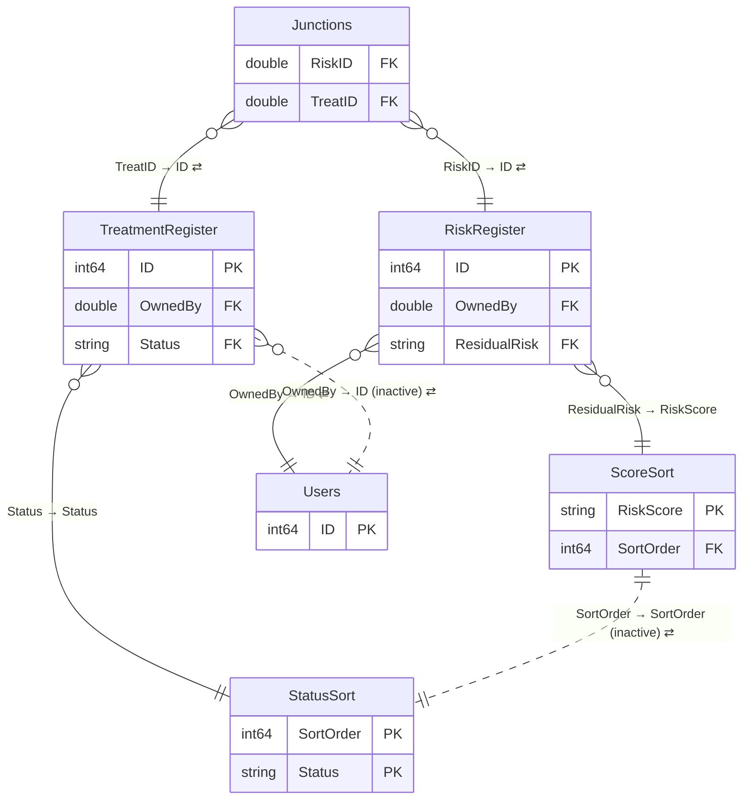

# Programme Risk

*Generated by `scripts/build_docs.py` from `pbix/Programme Risk.pbix`, the Master File sheet "Programme Risk" and the Power Automate Flow Master Register. Regenerate it rather than editing by hand.*

| | |
|---|---|
| Used by | Gemma Natoli, Liz Brown, Principal Advisor |
| Scheduled refresh | Once a week |
| Dashboard owner |  |
| SMEs | Liz Brown |
| Report | PBIR, 6 pages (2 hidden) |
| Power BI IDs | dataset `a65eeb60-514d-4a43-ac68-d4d6bc272bc6` · report `7c4fecf5-4433-4478-99ab-dca27de24caf` |

**Model:** 7 tables · 48 columns · 8 measures · 7 relationships. 8 hidden auto date/time tables (`LocalDateTable_*`) are left out.

- [Relationship diagram](#relationship-diagram)
- [Tables](#tables)
- [Table details](#table-details)
- [Measures](#measures)
- [Report pages](#report-pages)

## Relationship diagram



`}o--||` many-to-one · `||--||` one-to-one · dotted line = inactive · ⇄ = filters in both directions. Only key columns are shown.

Not related to any other table: `DateTable`.

| From | To | Cardinality | Cross-filter | Active |
|---|---|---|---|---|
| Junctions[RiskID] | RiskRegister[ID] | M:1 | Both | yes |
| Junctions[TreatID] | TreatmentRegister[ID] | M:1 | Both | yes |
| RiskRegister[OwnedBy] | Users[ID] | M:1 | Both | yes |
| TreatmentRegister[OwnedBy] | Users[ID] | M:1 | Both | no |
| RiskRegister[ResidualRisk] | ScoreSort[RiskScore] | M:1 | Single | yes |
| TreatmentRegister[Status] | StatusSort[Status] | M:1 | Single | yes |
| ScoreSort[SortOrder] | StatusSort[SortOrder] | 1:1 | Both | no |

## Tables

| Table | Source | Columns | In report | In Master File | Flows |
|---|---|---|---|---|---|
| [Junctions](#junctions) | SharePoint list: `Junctions` on `COLLABEnterprisePlanning` | 2 | yes | yes |  |
| [RiskRegister](#riskregister) | SharePoint list: `RiskRegister` on `COLLABEnterprisePlanning` | 22 | yes | yes |  |
| [TreatmentRegister](#treatmentregister) | SharePoint list: `TreatmentRegister` on `COLLABEnterprisePlanning` | 7 | yes | yes |  |
| [Users](#users) | SharePoint list: `Users` on `COLLABEnterprisePlanning` | 4 | yes | yes |  |
| [ScoreSort](#scoresort) | Manual table (Enter Data) | 2 | yes | yes |  |
| [StatusSort](#statussort) | Manual table (Enter Data) | 2 | yes | yes |  |
| [DateTable](#datetable) | DAX calculated table | 9 | no | yes |  |

## Table details

### Junctions

**Source:** SharePoint list: `Junctions` on `COLLABEnterprisePlanning` (list id `d516d85e-011b-49d7-ac9b-bd9f5bcb4688`)

**Master File:** Location: Enterprise Planning - Junctions - All Items · Team: Enterprise Planning · Maintained by: Enterprise Planning · Contact: Liz Brown · Flow: Yes · App: Programme Risk Register · Notes: Currently, the Enterprise Planning team manually updates the SharePoint list, as the existing Power App and associated flows are not functioning reliably. As part of the future-state solution, the app and flows will need to be reviewed and streamlined to enable a more automated process and minimise the need for manual updates to the list.

| Column | Type | Kind | Hidden | Referenced by |
|---|---|---|---|---|
| RiskID | Double | Data |  | report, relationship |
| TreatID | Double | Data |  | report, relationship, DAX |

<details><summary>Power Query (M), redacted</summary>

```m
let
    Source = SharePoint.Tables("https://worksafenz.sharepoint.com/sites/COLLABEnterprisePlanning", [Implementation="2.0", ViewMode="All"]),
    #"d516d85e-011b-49d7-ac9b-bd9f5bcb4688" = Source{[Id="d516d85e-011b-49d7-ac9b-bd9f5bcb4688"]}[Items],
    #"Removed Other Columns" = Table.SelectColumns(#"d516d85e-011b-49d7-ac9b-bd9f5bcb4688",{"RiskID", "TreatID"})
in
    #"Removed Other Columns"
```

</details>

### RiskRegister

**Source:** SharePoint list: `RiskRegister` on `COLLABEnterprisePlanning` (list id `2ccf25d1-972a-4a32-9f3f-ce5b9eff5d15`)

**Master File:** Location: Enterprise Planning - RiskRegister - All Items · Team: Enterprise Planning · Maintained by: Enterprise Planning · Contact: Liz Brown · Flow: Yes · App: Programme Risk Register · Notes: Currently, the Enterprise Planning team manually updates the SharePoint list, as the existing Power App and associated flows are not functioning reliably. As part of the future-state solution, the app and flows will need to be reviewed and streamlined to enable a more automated process and minimise the need for manual updates to the list.

| Column | Type | Kind | Hidden | Referenced by |
|---|---|---|---|---|
| Event | String | Data |  | report |
| Consequence | String | Data |  | report |
| ResidualLikelihood | String | Data |  | report |
| ResidualImpact | String | Data |  | report |
| ResidualRisk | String | Data |  | report, relationship |
| TargetLikelihood | String | Data |  | report |
| TargetImpact | String | Data |  | report |
| TargetRisk | String | Data |  | report |
| Programme | String | Data |  | report |
| Response | String | Data |  | report, DAX |
| TreatShareNotes | String | Data |  | report |
| Issue | Boolean | Data |  | report |
| Retired | Boolean | Data |  | report |
| Category | String | Data |  | report |
| ID | Int64 | Data |  | report, relationship, DAX |
| Modified | DateTime | Data |  | — |
| Created | DateTime | Data |  | DAX |
| RetiredDate | DateTime | Data |  | DAX |
| OwnedBy | Double | Data |  | relationship |
| Treated | String | Calculated |  | report, DAX |
| Draft | Boolean | Data |  | report, DAX |
| Status | String | Data |  | report, DAX |

<details><summary>Calculated columns (DAX)</summary>

**Treated**

```dax
VAR Response = 'RiskRegister'[Response]
VAR ActiveTreatmentCount =
    CALCULATE(
        DISTINCTCOUNT( TreatmentRegister[ID] ),
        KEEPFILTERS( TREATAS( VALUES( Junctions[TreatID] ), TreatmentRegister[ID] ) ),
        NOT ( TreatmentRegister[Status] IN { "Completed", "Cancelled" } )
    )
RETURN
SWITCH(
    TRUE(),
    Response <> "Treat", "N/A",
    ActiveTreatmentCount > 0, "Yes",
    "No"
)
```

</details>

<details><summary>Power Query (M), redacted</summary>

```m
let
    Source = SharePoint.Tables("https://worksafenz.sharepoint.com/sites/COLLABEnterprisePlanning", [Implementation="2.0", ViewMode="All"]),
    #"2ccf25d1-972a-4a32-9f3f-ce5b9eff5d15" = Source{[Id="2ccf25d1-972a-4a32-9f3f-ce5b9eff5d15"]}[Items],
    #"Removed Other Columns" = Table.SelectColumns(#"2ccf25d1-972a-4a32-9f3f-ce5b9eff5d15",{"Event", "Consequence", "ResidualLikelihood", "ResidualImpact", "ResidualRisk", "TargetLikelihood", "TargetImpact", "TargetRisk", "OwnedBy", "Programme", "Response", "TreatShareNotes", "Issue", "Retired", "Category", "RetiredDate", "ID", "Modified", "Created","Draft","Status"})
in
    #"Removed Other Columns"
```

</details>

### TreatmentRegister

**Source:** SharePoint list: `TreatmentRegister` on `COLLABEnterprisePlanning` (list id `3a000d89-0850-417a-aac6-6670c537cac0`)

**Master File:** Location: Enterprise Planning - TreatmentRegister - All Items · Team: Enterprise Planning · Maintained by: Enterprise Planning · Contact: Liz Brown · Flow: Yes · App: Programme Risk Register · Notes: Currently, the Enterprise Planning team manually updates the SharePoint list, as the existing Power App and associated flows are not functioning reliably. As part of the future-state solution, the app and flows will need to be reviewed and streamlined to enable a more automated process and minimise the need for manual updates to the list.

| Column | Type | Kind | Hidden | Referenced by |
|---|---|---|---|---|
| Description | String | Data |  | report |
| DueDate | DateTime | Data |  | report, DAX |
| Status | String | Data |  | report, relationship, DAX |
| OwnedBy | Double | Data |  | relationship |
| ID | Int64 | Data |  | report, relationship, DAX |
| Modified | DateTime | Data |  | — |
| Created | DateTime | Data |  | DAX |

<details><summary>Power Query (M), redacted</summary>

```m
let
    Source = SharePoint.Tables("https://worksafenz.sharepoint.com/sites/COLLABEnterprisePlanning", [Implementation="2.0", ViewMode="All"]),
    #"3a000d89-0850-417a-aac6-6670c537cac0" = Source{[Id="3a000d89-0850-417a-aac6-6670c537cac0"]}[Items],
    #"Removed Other Columns" = Table.SelectColumns(#"3a000d89-0850-417a-aac6-6670c537cac0",{"Description", "DueDate", "Status", "OwnedBy", "ID", "Modified", "Created"})
in
    #"Removed Other Columns"
```

</details>

### Users

**Source:** SharePoint list: `Users` on `COLLABEnterprisePlanning` (list id `375dd0cc-f2de-48f8-8863-81b41a759523`)

**Master File:** Location: Enterprise Planning - Users - All Items · Team: Enterprise Planning · Maintained by: Liz Brown - Manual update · Contact: Liz Brown

| Column | Type | Kind | Hidden | Referenced by |
|---|---|---|---|---|
| FullName | String | Data |  | report |
| Email | String | Data |  | — |
| Programme | String | Data |  | — |
| ID | Int64 | Data |  | relationship, DAX |

<details><summary>Power Query (M), redacted</summary>

```m
let
    Source = SharePoint.Tables("https://worksafenz.sharepoint.com/sites/COLLABEnterprisePlanning", [Implementation="2.0", ViewMode="All"]),
    #"375dd0cc-f2de-48f8-8863-81b41a759523" = Source{[Id="375dd0cc-f2de-48f8-8863-81b41a759523"]}[Items],
    #"Removed Other Columns" = Table.SelectColumns(#"375dd0cc-f2de-48f8-8863-81b41a759523",{"FullName", "Email", "Programme", "ID"})
in
    #"Removed Other Columns"
```

</details>

### ScoreSort

**Source:** Manual table (Enter Data)

**Master File:** Location: Manual Table · Team: n/a · Maintained by: n/a · Contact: n/a

| Column | Type | Kind | Hidden | Referenced by |
|---|---|---|---|---|
| RiskScore | String | Data |  | report, relationship |
| SortOrder | Int64 | Data |  | relationship |

<details><summary>Power Query (M), redacted</summary>

```m
let
    Source = Table.FromRows(Json.Document(Binary.Decompress(Binary.FromText("<embedded data redacted>", BinaryEncoding.Base64), Compression.Deflate)), let _t = ((type nullable text) meta [Serialized.Text = true]) in type table [RiskScore = _t, SortOrder = _t]),
    #"Changed Type" = Table.TransformColumnTypes(Source,{{"RiskScore", type text}, {"SortOrder", Int64.Type}})
in
    #"Changed Type"
```

</details>

### StatusSort

**Source:** Manual table (Enter Data)

**Master File:** Location: Manual Table · Team: BI Team · Maintained by: BI Team · Contact: BI Team

| Column | Type | Kind | Hidden | Referenced by |
|---|---|---|---|---|
| Status | String | Data |  | report, relationship, DAX |
| SortOrder | Int64 | Data |  | relationship |

<details><summary>Power Query (M), redacted</summary>

```m
let
    Source = Table.FromRows(Json.Document(Binary.Decompress(Binary.FromText("<embedded data redacted>", BinaryEncoding.Base64), Compression.Deflate)), let _t = ((type nullable text) meta [Serialized.Text = true]) in type table [Status = _t, SortOrder = _t]),
    #"Changed Type" = Table.TransformColumnTypes(Source,{{"Status", type text}, {"SortOrder", Int64.Type}})
in
    #"Changed Type"
```

</details>

### DateTable

**Source:** DAX calculated table

**Master File:** Location: Date (Calendar) table · Team: n/a · Maintained by: n/a · Contact: n/a · Flow: n/a · App: n/a

| Column | Type | Kind | Hidden | Referenced by |
|---|---|---|---|---|
| Date | DateTime | CalculatedTableColumn |  | DAX |
| Year | Int64 | CalculatedTableColumn |  | — |
| Month Number | Int64 | CalculatedTableColumn |  | — |
| Month Name | String | CalculatedTableColumn |  | — |
| Day | Int64 | CalculatedTableColumn |  | — |
| Year-Month | String | CalculatedTableColumn |  | — |
| MonthStart | DateTime | CalculatedTableColumn |  | — |
| Weekday | String | CalculatedTableColumn |  | — |
| IsWeekend | Boolean | CalculatedTableColumn |  | — |

<details><summary>Table expression (DAX)</summary>

```dax
ADDCOLUMNS(
    CALENDAR(DATE(2020, 1, 1), DATE(2030, 12, 31)),
    "Year", YEAR([Date]),
    "Month Number", MONTH([Date]),
    "Month Name", FORMAT([Date], "MMMM"),
    "Day", DAY([Date]),    "Year-Month",    FORMAT ( [Date], "yyyy-MM" ),   -- text bucket
    "MonthStart",    DATE ( YEAR ( [Date] ), MONTH ( [Date] ), 1 ),
    "Weekday", FORMAT([Date], "dddd"),
    "IsWeekend", IF(WEEKDAY([Date], 2) > 5, TRUE(), FALSE())
)
```

</details>

## Measures

| Measure | Home table | In report | Display folder | Description |
|---|---|---|---|---|
| Created30Days | RiskRegister | yes |  |  |
| DraftCount | RiskRegister | no |  |  |
| HasOverdueTreatments | RiskRegister | yes |  |  |
| IsTreated | RiskRegister | yes |  |  |
| OverdueTreatmentCount | RiskRegister | yes |  |  |
| PendingCount | RiskRegister | no |  |  |
| Retired30Days | RiskRegister | yes |  |  |
| UntreatedCount | RiskRegister | yes |  |  |

<details><summary>Measure expressions (DAX)</summary>

**RiskRegister[Created30Days]**

```dax
If(COUNTROWS(FILTER('RiskRegister',RiskRegister[Created]>TODAY()-30))>0,COUNTROWS(FILTER('RiskRegister',RiskRegister[Created]>TODAY()-30)),0)
```

**RiskRegister[DraftCount]**

```dax
If(COUNTROWS(FILTER('RiskRegister',RiskRegister[Draft]=TRUE))>0,COUNTROWS(FILTER('RiskRegister',RiskRegister[Draft]=TRUE)),0)
```

**RiskRegister[HasOverdueTreatments]**

```dax
IF(
[OverdueTreatmentCount] > 0,"Yes","No")
```

**RiskRegister[IsTreated]**

```dax
VAR Response = SELECTEDVALUE('RiskRegister'[Response])
VAR JunctionCount = COUNTROWS(Junctions)
RETURN
IF ( Response = "Treat", IF ( JunctionCount > 0, "Yes", "No" ), "N/A" )
```

**RiskRegister[OverdueTreatmentCount]**

```dax
If(CALCULATE(
    COUNTROWS( TreatmentRegister ),
    KEEPFILTERS( TREATAS( VALUES( Junctions[TreatID] ), TreatmentRegister[ID] ) ),
    NOT ISBLANK( TreatmentRegister[DueDate] ),
    TreatmentRegister[DueDate] < TODAY()
)>0,CALCULATE(
    COUNTROWS( TreatmentRegister ),
    KEEPFILTERS( TREATAS( VALUES( Junctions[TreatID] ), TreatmentRegister[ID] ) ),
    NOT ISBLANK( TreatmentRegister[DueDate] ),
    TreatmentRegister[DueDate] < TODAY()),0)
```

**RiskRegister[PendingCount]**

```dax
If(COUNTROWS(FILTER('RiskRegister',RiskRegister[Status]="Pending"))>0,COUNTROWS(FILTER('RiskRegister',RiskRegister[Status]="Pending")),0)
```

**RiskRegister[Retired30Days]**

```dax
If(COUNTROWS(FILTER('RiskRegister',RiskRegister[RetiredDate]>TODAY()-30))>0,COUNTROWS(FILTER('RiskRegister',RiskRegister[RetiredDate]>TODAY()-30)),0)
```

**RiskRegister[UntreatedCount]**

```dax
If(COUNTROWS(Filter('RiskRegister',RiskRegister[Treated]="No"))>0,COUNTROWS(Filter('RiskRegister',RiskRegister[Treated]="No")),0)
```

</details>

## Report pages

| Page | Hidden | Visuals |
|---|---|---|
| TreatDrillthrough | yes | 4 |
| Operations Issues |  | 31 |
| Risks |  | 31 |
| Issues |  | 31 |
| RiskDrillthrough | yes | 4 |
| Operations Risks |  | 31 |
