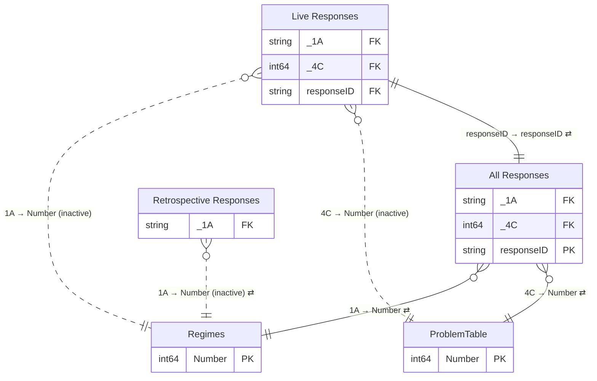

# Survey Dash

*Generated by `scripts/build_docs.py` from `pbix/Survey Dash.pbix`, the Master File sheet "Survey Dash" and the Power Automate Flow Master Register. Regenerate it rather than editing by hand.*

| | |
|---|---|
| Used by | Authorisationa dna Advisory team  - Kate Morrison |
| Scheduled refresh | Daily |
| Dashboard owner | Chris Thornborough, James Dodwell |
| SMEs | Adventure Activities - Kay Davies; Asbestos, Diving Authorisations - James Dodwell; HS Controls, CSL - Jon Heard |
| Report | PBIR, 9 pages (8 hidden) |
| Power BI IDs | dataset `42717c08-9605-4079-8155-84b47d10d05c` · report `9e13c1a6-ead0-4608-8f06-c0ee5c4d3503` |

**Model:** 5 tables · 73 columns · 0 measures · 6 relationships. 4 hidden auto date/time tables (`LocalDateTable_*`) are left out.

- [Relationship diagram](#relationship-diagram)
- [Tables](#tables)
- [Table details](#table-details)
- [Measures](#measures)
- [Report pages](#report-pages)

## Relationship diagram



`}o--||` many-to-one · `||--||` one-to-one · dotted line = inactive · ⇄ = filters in both directions. Only key columns are shown.

| From | To | Cardinality | Cross-filter | Active |
|---|---|---|---|---|
| Live Responses[1A] | Regimes[Number] | M:1 | Single | no |
| Live Responses[4C] | ProblemTable[Number] | M:1 | Single | no |
| Live Responses[responseID] | All Responses[responseID] | 1:1 | Both | yes |
| All Responses[1A] | Regimes[Number] | M:1 | Both | yes |
| Retrospective Responses[1A] | Regimes[Number] | M:1 | Both | no |
| All Responses[4C] | ProblemTable[Number] | M:1 | Both | yes |

## Tables

| Table | Source | Columns | In report | In Master File | Flows |
|---|---|---|---|---|---|
| [Live Responses](#live-responses) | Web API: `https://api.ubiquity.co.nz/surveys/sZXYBBJxa0GLSgjdYIPv9g/responses` | 23 | no | yes |  |
| [Regimes](#regimes) | Manual table (Enter Data) | 4 | yes | yes |  |
| [ProblemTable](#problemtable) | Manual table (Enter Data) | 2 | yes | yes |  |
| [Retrospective Responses](#retrospective-responses) | Web API: `https://api.ubiquity.co.nz/surveys/QAAY9WwGI0CmEAjdYuCWbQ/responses` | 22 | no | yes |  |
| [All Responses](#all-responses) | Append of other queries | 22 | yes | yes |  |

## Table details

### Live Responses

**Source:** Web API: `https://api.ubiquity.co.nz/surveys/sZXYBBJxa0GLSgjdYIPv9g/responses`

**Master File:** Location: https://api.ubiquity.co.nz/surveys/sZXYBBJxa0GLSgjdYIPv9g/responses?<query redacted> · Team: Website · Maintained by: n/a · Contact: Chris Thornborough,<br>Mark Johnson · Flow: n/a · App: n/a

| Column | Type | Kind | Hidden | Referenced by |
|---|---|---|---|---|
| responseID | String | Data |  | relationship |
| 1A | String | Data |  | relationship |
| 2A | Int64 | Data |  | — |
| 2B | String | Data |  | — |
| 2C | Int64 | Data |  | — |
| 2D | String | Data |  | — |
| 3A | Int64 | Data |  | — |
| 3B | String | Data |  | — |
| 3C | Int64 | Data |  | — |
| 3D | String | Data |  | — |
| 4A | String | Data |  | — |
| 4B | String | Data |  | — |
| 4C | Int64 | Data |  | relationship |
| 4D | String | Data |  | — |
| 5B | String | Data |  | — |
| 5C | String | Data |  | — |
| 5D | String | Data |  | — |
| 6A | Int64 | Data |  | — |
| 6B | String | Data |  | — |
| 6C | Int64 | Data |  | — |
| 6D | String | Data |  | — |
| Outcome | String | Calculated |  | — |
| ResponseDate | DateTime | Data |  | — |

<details><summary>Calculated columns (DAX)</summary>

**Outcome**

```dax
if('Live Responses'[5A]=5,"Approved","Declined")
```

</details>

<details><summary>Power Query (M), redacted</summary>

```m
let
    Source = Json.Document(Web.Contents("https://api.ubiquity.co.nz/surveys/sZXYBBJxa0GLSgjdYIPv9g/responses?<query redacted>")),
    #"Converted to Table" = Source[responses],
    #"Converted to Table1" = Table.FromList(#"Converted to Table", Splitter.SplitByNothing(), null, null, ExtraValues.Error),
    #"Expanded Column1" = Table.ExpandRecordColumn(#"Converted to Table1", "Column1", {"responseID", "data", "meta", "answers"}, {"Column1.responseID", "Column1.data", "Column1.meta", "Column1.answers"}),
    #"Expanded Column1.data" = Table.ExpandListColumn(#"Expanded Column1", "Column1.data"),
    #"Expanded Column1.data1" = Table.ExpandRecordColumn(#"Expanded Column1.data", "Column1.data", {"fieldID", "name", "value", "type"}, {"Column1.data.fieldID", "Column1.data.name", "Column1.data.value", "Column1.data.type"}),
    #"Expanded Column1.meta" = Table.ExpandListColumn(#"Expanded Column1.data1", "Column1.meta"),
    #"Expanded Column1.meta1" = Table.ExpandRecordColumn(#"Expanded Column1.meta", "Column1.meta", {"fieldID", "name", "value", "type"}, {"Column1.meta.fieldID", "Column1.meta.name", "Column1.meta.value", "Column1.meta.type"}),
    #"Expanded Column1.answers" = Table.ExpandListColumn(#"Expanded Column1.meta1", "Column1.answers"),
    #"Expanded Column1.answers1" = Table.ExpandRecordColumn(#"Expanded Column1.answers", "Column1.answers", {"fieldID", "value", "type", "questionType", "questionNumber", "text"}, {"Column1.answers.fieldID", "Column1.answers.value", "Column1.answers.type", "Column1.answers.questionType", "Column1.answers.questionNumber", "Column1.answers.text"}),
    #"Grouped Rows" = Table.Group(
    #"Expanded Column1.answers1",
    {"Column1.responseID", "Column1.answers.questionNumber"},
    {
        {
            "Count",
            each _,
            type table [
                Column1.responseID = text,
                Column1.data.fieldID = text,
                Column1.data.name = text,
                Column1.data.value = any,
                Column1.data.type = text,
                Column1.meta.fieldID = text,
                Column1.meta.name = text,
                Column1.meta.value = nullable text,
                Column1.meta.type = text,
                Column1.answers.fieldID = text,
                Column1.answers.value = nullable text,
                Column1.answers.type = text,
                Column1.answers.questionType = text,
                Column1.answers.questionNumber = text,
                Column1.answers.text = text
            ]
        },
        {
            "ResponseDate",
            each                let
                    dateRows = Table.SelectRows(_, each [Column1.meta.name] = "Date"),
                    dateVal = List.First(List.RemoveNulls(dateRows[Column1.meta.value]))
                in
                    dateVal,
            type datetime
        }
    }
),
    #"Aggregated Count" = Table.AggregateTableColumn(#"Grouped Rows", "Count", {{"Column1.answers.value", List.Max, "Max of Column1.answers.value"}}),
    #"Renamed Columns" = Table.RenameColumns(#"Aggregated Count",{{"Column1.responseID", "responseID"}, {"Column1.answers.questionNumber", "questionNumber"}, {"Max of Column1.answers.value", "answerValue"}}),
    #"Pivoted Column" = Table.Pivot(#"Renamed Columns", List.Distinct(#"Renamed Columns"[questionNumber]), "questionNumber", "answerValue"),
    #"Changed Type" = Table.TransformColumnTypes(#"Pivoted Column",{{"ResponseDate", type datetime}}),
    #"Sorted Rows" = Table.Sort(#"Changed Type",{{"ResponseDate", Order.Descending}}),
    #"Removed Columns" = Table.RemoveColumns(#"Sorted Rows",{"5A"})
in
    #"Removed Columns"
```

</details>

### Regimes

**Source:** Manual table (Enter Data)

**Master File:** Location: Manual Table · Notes: Only if there is any change in the regime

| Column | Type | Kind | Hidden | Referenced by |
|---|---|---|---|---|
| Number | Int64 | Data |  | relationship |
| Regime | String | Data |  | — |
| Abbr | String | Data |  | report |
| Index | Double | Data |  | — |

<details><summary>Power Query (M), redacted</summary>

```m
let
    Source = Table.FromRows(Json.Document(Binary.Decompress(Binary.FromText("<embedded data redacted>", BinaryEncoding.Base64), Compression.Deflate)), let _t = ((type nullable text) meta [Serialized.Text = true]) in type table [Number = _t, Regime = _t, Abbr = _t]),
    #"Changed Type" = Table.TransformColumnTypes(Source,{{"Number", Int64.Type}, {"Regime", type text}, {"Abbr", type text}}),
    #"Added Index" = Table.AddIndexColumn(#"Changed Type", "Index", 0, 1, Int64.Type),
    #"Replaced Value" = Table.ReplaceValue(#"Added Index",3,5,Replacer.ReplaceValue,{"Index"}),
    #"Replaced Value1" = Table.ReplaceValue(#"Replaced Value",4,3,Replacer.ReplaceValue,{"Index"}),
    #"Replaced Value2" = Table.ReplaceValue(#"Replaced Value1",5,4,Replacer.ReplaceValue,{"Index"})
in
    #"Replaced Value2"
```

</details>

### ProblemTable

**Source:** Manual table (Enter Data)

**Master File:** Location: Manual Table · Notes: Only if there is any change in the regime

| Column | Type | Kind | Hidden | Referenced by |
|---|---|---|---|---|
| Response | String | Data |  | report |
| Number | Int64 | Data |  | relationship |

<details><summary>Power Query (M), redacted</summary>

```m
let
    Source = Table.FromRows(Json.Document(Binary.Decompress(Binary.FromText("<embedded data redacted>", BinaryEncoding.Base64), Compression.Deflate)), let _t = ((type nullable text) meta [Serialized.Text = true]) in type table [Response = _t, Number = _t]),
    #"Changed Type" = Table.TransformColumnTypes(Source,{{"Response", type text}, {"Number", Int64.Type}})
in
    #"Changed Type"
```

</details>

### Retrospective Responses

**Source:** Web API: `https://api.ubiquity.co.nz/surveys/QAAY9WwGI0CmEAjdYuCWbQ/responses`

**Master File:** Location: https://api.ubiquity.co.nz/surveys/QAAY9WwGI0CmEAjdYuCWbQ/responses?<query redacted> · Team: Website · Maintained by: n/a · Contact: Chris Thornborough,<br>Mark Johnson · Flow: n/a · App: n/a · Notes: If the live survey changes then data wont match up.

| Column | Type | Kind | Hidden | Referenced by |
|---|---|---|---|---|
| responseID | String | Data |  | — |
| ResponseDate | DateTime | Data |  | — |
| 1A | String | Data |  | relationship |
| 2A | String | Data |  | — |
| 2B | String | Data |  | — |
| 2C | String | Data |  | — |
| 2D | String | Data |  | — |
| 3A | String | Data |  | — |
| 3B | String | Data |  | — |
| 3C | String | Data |  | — |
| 3D | String | Data |  | — |
| 4A | String | Data |  | — |
| 4B | String | Data |  | — |
| 4C | String | Data |  | — |
| 4D | String | Data |  | — |
| 5B | String | Data |  | — |
| 5C | String | Data |  | — |
| 5D | String | Data |  | — |
| 6A | String | Data |  | — |
| 6B | String | Data |  | — |
| 6C | String | Data |  | — |
| 6D | String | Data |  | — |

<details><summary>Power Query (M), redacted</summary>

```m
let
    Source = Json.Document(Web.Contents("https://api.ubiquity.co.nz/surveys/QAAY9WwGI0CmEAjdYuCWbQ/responses?<query redacted>")),
    #"Converted to Table" = Source[responses],
    #"Converted to Table1" = Table.FromList(#"Converted to Table", Splitter.SplitByNothing(), null, null, ExtraValues.Error),
    #"Expanded Column1" = Table.ExpandRecordColumn(#"Converted to Table1", "Column1", {"responseID", "data", "meta", "answers"}, {"Column1.responseID", "Column1.data", "Column1.meta", "Column1.answers"}),
    #"Expanded Column1.data" = Table.ExpandListColumn(#"Expanded Column1", "Column1.data"),
    #"Expanded Column1.data1" = Table.ExpandRecordColumn(#"Expanded Column1.data", "Column1.data", {"fieldID", "name", "value", "type"}, {"Column1.data.fieldID", "Column1.data.name", "Column1.data.value", "Column1.data.type"}),
    Custom1 = Table.ExpandListColumn(#"Expanded Column1.data1", "Column1.meta"),
    Custom2 = Table.ExpandRecordColumn(#"Custom1", "Column1.meta", {"fieldID", "name", "value", "type"}, {"Column1.meta.fieldID", "Column1.meta.name", "Column1.meta.value", "Column1.meta.type"}),
    Custom3 = Table.ExpandListColumn(#"Custom2", "Column1.answers"),
    Custom4 = Table.ExpandRecordColumn(#"Custom3", "Column1.answers", {"fieldID", "value", "type", "questionType", "questionNumber", "text"}, {"Column1.answers.fieldID", "Column1.answers.value", "Column1.answers.type", "Column1.answers.questionType", "Column1.answers.questionNumber", "Column1.answers.text"}),
    GroupedRows = Table.Group(
    #"Custom4",
    {"Column1.responseID", "Column1.answers.questionNumber"},
    {
        {
            "Count",
            each _,
            type table [
                Column1.responseID = text,
                Column1.data.fieldID = text,
                Column1.data.name = text,
                Column1.data.value = any,
                Column1.data.type = text,
                Column1.meta.fieldID = text,
                Column1.meta.name = text,
                Column1.meta.value = nullable text,
                Column1.meta.type = text,
                Column1.answers.fieldID = text,
                Column1.answers.value = nullable text,
                Column1.answers.type = text,
                Column1.answers.questionType = text,
                Column1.answers.questionNumber = text,
                Column1.answers.text = text
            ]
        },
        {
            "ResponseDate",
            each                let
                    dateRows = Table.SelectRows(_, each [Column1.meta.name] = "Date"),
                    dateVal = List.First(List.RemoveNulls(dateRows[Column1.meta.value]))
                in
                    dateVal,
            type datetime
        }
    }
),
    #"Aggregated Count" = Table.AggregateTableColumn(GroupedRows, "Count", {{"Column1.answers.value", List.Max, "Max of Column1.answers.value"}}),
    #"Renamed Columns" = Table.RenameColumns(#"Aggregated Count",{{"Column1.responseID", "responseID"}, {"Column1.answers.questionNumber", "questionNumber"}, {"Max of Column1.answers.value", "answerValue"}}),
    PivotedColumn = Table.Pivot(#"Renamed Columns", List.Distinct(#"Renamed Columns"[questionNumber]), "questionNumber", "answerValue"),
    #"Changed Type" = Table.TransformColumnTypes(PivotedColumn,{{"ResponseDate", type datetime}}),
    #"Removed Columns" = Table.RemoveColumns(#"Changed Type",{"5A"})
in
    #"Removed Columns"
```

</details>

### All Responses

**Source:** Append of other queries

**Reads from:** `Live Responses`, `Retrospective Responses`

**Master File:** Location: Append Query -  Retrospective Responses,Live Responses · Team: n/a · Maintained by: n/a · Contact: n/a · Flow: n/a · App: n/a

| Column | Type | Kind | Hidden | Referenced by |
|---|---|---|---|---|
| responseID | String | Data |  | relationship |
| ResponseDate | DateTime | Data |  | report |
| 1A | String | Data |  | report, relationship |
| 2A | Int64 | Data |  | report |
| 2B | String | Data |  | — |
| 2C | Int64 | Data |  | report |
| 2D | String | Data |  | — |
| 3A | Int64 | Data |  | report |
| 3B | String | Data |  | — |
| 3C | Int64 | Data |  | report |
| 3D | String | Data |  | — |
| 4A | Int64 | Data |  | report |
| 4B | String | Data |  | — |
| 4C | Int64 | Data |  | report, relationship |
| 4D | String | Data |  | — |
| 5B | String | Data |  | — |
| 5C | String | Data |  | — |
| 5D | String | Data |  | — |
| 6A | Int64 | Data |  | report |
| 6B | String | Data |  | — |
| 6C | Int64 | Data |  | report |
| 6D | String | Data |  | — |

<details><summary>Power Query (M), redacted</summary>

```m
let
    Source = Table.Combine({#"Retrospective Responses", #"Live Responses"})
in
    Source
```

</details>

## Measures

No measures.

## Report pages

| Page | Hidden | Visuals |
|---|---|---|
| Main |  | 70 |
| 2A | yes | 1 |
| 2C | yes | 1 |
| 3A | yes | 1 |
| 3C | yes | 1 |
| 4A | yes | 1 |
| 4C | yes | 1 |
| 6A | yes | 1 |
| 6C | yes | 1 |
